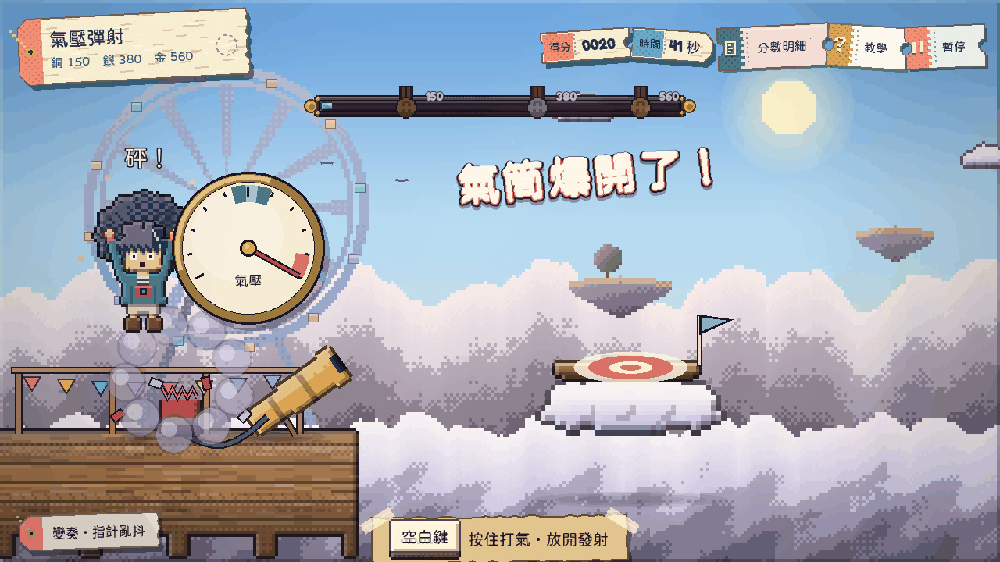

# [SG-117] 實作氣壓彈射

> 狀態：完成

## 內文

### 需求

按住替彈射筒打氣，氣壓錶指針落在綠區時放開，把雲包彈到對面的平台上。佔用雲端遊樂場的 game-099 位置，攤位在摩天輪廣場，取代原本偏向規劃與多按鈕的設計。

### 來源

2026-11-28 雲端遊樂場（MAIN-65）完成，十二個攤位都還是準備中。使用者要求小遊戲單純好玩、玩法多變、不要枯燥的射擊；依 design/00-principles/simple-fun-minigames.md 改寫為單一動詞的街機式小遊戲（Bomberman Land 3 方向）。

### 驗收條件

- [x] 平台距離每次不同，後段綠區變窄且指針會抖。
- [x] 打太飽時氣筒爆開，主角頂著一頭爆炸頭飄起來。
- [x] 整款只用方向鍵與一到兩顆按鍵，畫面上沒有操作按鈕面板；進場五秒內開始操作，沒有強制教學頁。
- [x] 一回合不超過 60 秒，回合內速度或變化明顯升級；至少兩種隨機出現的變奏。
- [x] 結算只顯示一個分數、銅銀金獎牌與一句評語；銅牌取得普通拍貼，未用輔助的金牌取得小惡魔拍貼。
- [x] 玩法物件達到街機小遊戲的畫面下限：沒有大面積純色、有材質與受光、描邊、接地陰影，色調與雲端遊樂場背景一致。
- [x] 鍵盤與手把都能完成；開啟減少動態後仍可遊玩；沒有按鍵就不得分。
- [x] 通過稽核十問，結果寫在設計目錄的該款說明；雲端遊樂場原有互動與其他小遊戲不受影響。

### 測試流程

1. 從摩天輪廣場的攤位進場，不看說明直接玩一回合。
2. 故意失敗一次，再玩到銅牌與金牌。
3. 開啟減少動態與手把各玩一回合，確認拍貼入冊與重開後保留。

---

# 跟其他票的關係

- Blocks：無
- Blocked by：無
- Related：MAIN-65、SG-66、ART-57

---

# Commit-1

## 內文

雲端遊樂場的 game-099 是偏向規劃與多按鈕的舊案，摩天輪廣場上那幾座攤位一直是準備中。
現在摩天輪廣場上、摩天輪左前方那座攤位頂上架著一支斜指天空、口裡塞著雲包的黃銅彈射筒，開放「氣壓彈射」。畫面左邊是掛著三角旗的木頭發射台，主角站在紅色氣筒旁，氣筒用管子接到黃銅彈射筒；上方一個大大的黃銅氣壓錶。對面雲上浮著一座木頭平台，台面畫著紅白靶心、插著小旗。按住空白鍵（或 E、手把 A 鍵）主角就上下壓氣筒，錶上指針往上爬；錶上的綠色弧就是對面平台那一段，指針進到綠區時錶上跳出「放開！」，這時放手就把綁著粉紅緞帶的雲包彈過去，落在平台上得分，正中靶心喊「正中！」並揚起塵土，連中越多每發越多分。太早放雲包掉進雲裡「噗」，太晚放飛過頭。指針過了紅區氣筒就爆開，上半截碎片飛散、冒出一團煙，主角頂著一頭蓬鬆的爆炸頭飄到半空，「砰！」。完全不按的回合一定是零分。
一回合 45 秒，平台每發換一個位置，綠區越來越窄、打氣越來越快，後段指針會抖。每回合隨機一種變奏：氣壓彈射、指針亂抖（一開始就抖）、快充氣筒（打氣快、綠區寬一點）。倒數時主角自己打一次氣、把雲包彈上平台示範。第一次爆開不算失誤。
在原生畫面以實際按鍵事件走過倒數示範、打氣進綠區、雲包飛行與落台、爆開、後段與結算，並確認攤位在摩天輪廣場、走到互動點會出現「E 玩氣壓彈射」。逐張看過後：雲包飛行時錶上的「放開！」還在，改成只在打氣中顯示；爆炸頭原本是一團平塗的深色圓，改成有一圈圈捲髮與受光的像素頭髮並讓臉露在前面；爆開時氣筒原本看起來完好，改成留下鋸齒裂口的下半截、碎片飛散與一團有亮面的煙；主角原本離氣筒一段距離，移到緊貼氣筒。規則測試以模擬輸入在三種變奏都在綠區正中放手的玩法拿到金牌（618 至 704 分），放得偏、偶爾太早放的玩家拿到銅牌 353 分，完全不按 0 分；輔助金牌不發小惡魔拍貼。手把以 A 鍵對應同一組按鍵驗證，沒有接實體手把；減少動態以畫面的靜止分支檢查（氣筒把手不上下、雲包直接到落點、爆炸頭不晃）。難度與「看一眼就懂」依畫面與模擬輸入判斷，尚未由真人試玩。

### 測試結果

| 項目 | 結果 |
|---|---|
| 氣壓彈射規則 | 通過：打氣與發射、綠區命中與靶心、太近太遠、連中、爆開與第一次免失誤、每發新平台、綠區變窄與指針抖動、三種變奏、金牌與銅牌整回合、不按零分 |
| 局部回歸 | 遊戲目錄、雲端遊樂場世界、區域往返、教學頁、街機共用流程與場景規範測試通過（以既有匯入快取直接執行） |
| 設計與資料驗證 | 5 個範圍通過 |
| 原生畫面 | 遊玩與結算過程無 ERROR；攤位在摩天輪廣場，互動點可走到 |

### 截圖

