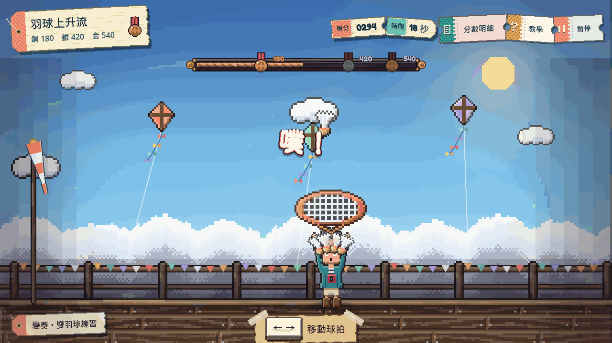

# [SG-121] 實作羽球上升流

> 狀態：完成

## 內文

### 需求

左右移動球拍接住被上升氣流亂吹的羽球，接到會自動挑高，連續不落地越久越高分。佔用雲端遊樂場的 game-103 位置，攤位在風箏露台，取代原本偏向規劃與多按鈕的設計。

### 來源

2026-11-28 雲端遊樂場（MAIN-65）完成，十二個攤位都還是準備中。使用者要求小遊戲單純好玩、玩法多變、不要枯燥的射擊；依 design/00-principles/simple-fun-minigames.md 改寫為單一動詞的街機式小遊戲（Bomberman Land 3 方向）。

### 驗收條件

- [x] 氣流忽強忽弱，後段同時有兩顆羽球。
- [x] 漏接時羽球插在主角頭上，像一頂歪掉的羽毛帽。
- [x] 整款只用方向鍵與一到兩顆按鍵，畫面上沒有操作按鈕面板；進場五秒內開始操作，沒有強制教學頁。
- [x] 一回合不超過 60 秒，回合內速度或變化明顯升級；至少兩種隨機出現的變奏。
- [x] 結算只顯示一個分數、銅銀金獎牌與一句評語；銅牌取得普通拍貼，未用輔助的金牌取得小惡魔拍貼。
- [x] 玩法物件達到街機小遊戲的畫面下限：沒有大面積純色、有材質與受光、描邊、接地陰影，色調與雲端遊樂場背景一致。
- [x] 鍵盤與手把都能完成；開啟減少動態後仍可遊玩；沒有按鍵就不得分。
- [x] 通過稽核十問，結果寫在設計目錄的該款說明；雲端遊樂場原有互動與其他小遊戲不受影響。

### 測試流程

1. 從風箏露台的攤位進場，不看說明直接玩一回合。
2. 故意失敗一次，再玩到銅牌與金牌。
3. 開啟減少動態與手把各玩一回合，確認拍貼入冊與重開後保留。

---

# 跟其他票的關係

- Blocks：無
- Blocked by：無
- Related：MAIN-65、SG-66、ART-57

---

# Commit-1

## 內文

雲端遊樂場的十二個攤位都還是準備中；第七格原本要移拍、挑高或扣回、讓羽球穿過三道風門，偏多操作與規劃。
現在風箏露台中間多了一座屋頂立著一顆大羽球、靠著一支球拍，櫃台上擺著小球拍和羽球的攤位，開放雲端遊樂場第一站「羽球上升流」。主角站在木頭露台上、兩手把球拍舉在頭上，背後是一片雲海和三隻拖著蝴蝶結尾巴的風箏；羽球順著上升氣流飄下來，地板上的影子越靠近越深。左右跑到羽球底下，羽球落到球拍上就會自己被挑高；拍子正中間接到會閃一下、喊「好球！」並多拿分，連續不落地的球數寫在右上角，越長每一球越多分。左邊的風向袋平常垂著，陣風來之前會先轉向鼓起來、旁邊寫出「側風 →」「上升氣流 ↑」或「下沉氣流 ↓」，吹的時候天上有一道道風的線條：上升氣流讓羽球停在空中、側風把它吹走、下沉氣流讓它一下掉下來。漏接的羽球會咻地跳到主角頭上插進頭髮，主角嚇一跳，越漏越多根，排成一頂歪掉的羽毛帽；每回合第一次漏接不算失誤。羽球越落越快、陣風越來越頻繁，中段加入下沉氣流，後段同時有兩顆羽球。每回合隨機一種變奏：午後微風、陣風亂吹、雙羽球練習；倒數時主角會自己跑去接一顆示範。放著不動的話球拍仍會把剛好掉在上面的羽球彈回去，但不會得分。
這是雲端遊樂場的第一款街機遊戲，一併接上雲端遊樂場的遊戲目錄、收藏本、圖解教學與小遊戲光點。共用的雲端背景還沒有完成，這款先用自己畫的午後天空與雲海，共用背景完成後再換過去。
以原生畫面用模擬按鍵玩過一段，逐張看過開場示範、兩顆羽球被側風吹動、風向袋預告、漏接插在頭上的羽毛帽與減少動態下的同一畫面。規則測試以模擬方向鍵玩出三種變奏的金牌、常常接在拍子邊緣又放掉一些球的銅牌、左右亂跑的回合（不得牌）、放著不玩的回合（0 分）與輔助金牌（不發小惡魔），並驗證 AD 與手把十字鍵都能跑。尚未在雲端遊樂場走到攤位實際進場一次；手把與減少動態為程式與擷取畫面確認，尚未由真人以手把實際玩完一回合；難度與「看一眼就懂」是依畫面與模擬輸入判斷，尚未由真人試玩。

### 測試結果

| 項目 | 結果 |
|---|---|
| 羽球上升流規則 | 通過：示範、左右跑與欄杆、挑高、拍子正中間加分、連續球數加分、拍外的球繼續掉、漏接插在頭上與羽毛帽、第二次漏接算失誤、沒人操作不得分、三種陣風與風向袋預告、陣風越來越頻繁、第二顆羽球、羽球越落越快、三種變奏、輔助、手把、金牌與銅牌整回合 |
| 局部回歸 | 遊戲目錄（含雲端遊樂場第一款的編號與資料檢查）、街機共用流程（含每款放著不玩 0 分）、雲端遊樂場世界（含攤位站位與空站位標牌）、區域往返（含雲端收藏本）、教學目錄與教學圖片、場景規範通過 |
| 設計與資料驗證 | 全部範圍通過；街機教學文字檢查通過 |

### 截圖

