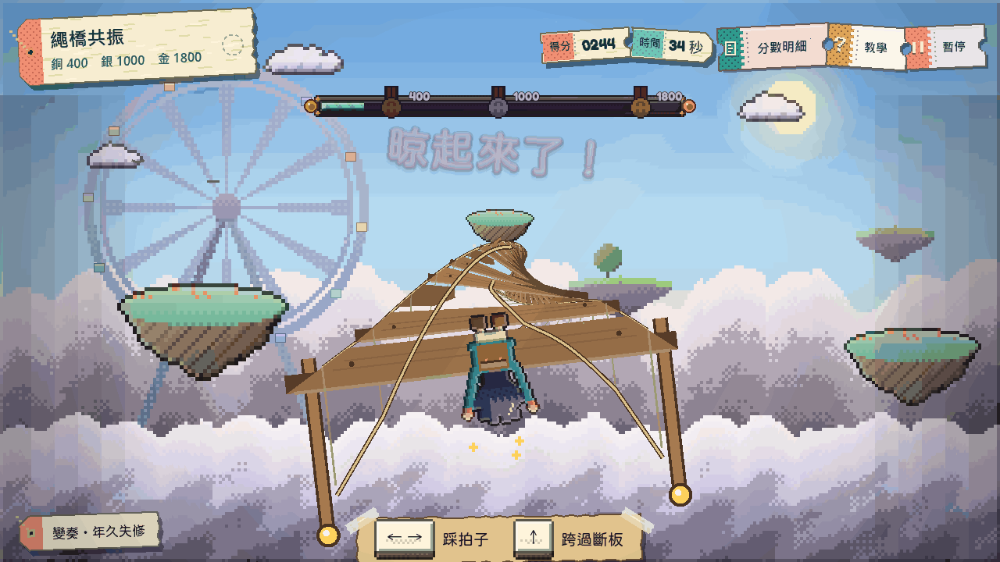

# [SG-122] 實作繩橋共振

> 狀態：完成

## 內文

### 需求

跟著吊橋擺動的節拍交替按左右鍵踩步過橋，踩在拍上橋就穩，踩錯橋越晃越大。佔用雲端遊樂場的 game-104 位置，攤位在浮島群，取代原本偏向規劃與多按鈕的設計。

### 來源

2026-11-28 雲端遊樂場（MAIN-65）完成，十二個攤位都還是準備中。使用者要求小遊戲單純好玩、玩法多變、不要枯燥的射擊；依 design/00-principles/simple-fun-minigames.md 改寫為單一動詞的街機式小遊戲（Bomberman Land 3 方向）。

### 驗收條件

- [x] 每段橋的擺動節拍不同，後段有斷掉一塊的橋板要跨大步。
- [x] 晃太大時橋翻過來，主角倒掛在繩上像一件晾著的衣服。
- [x] 整款只用方向鍵與一到兩顆按鍵，畫面上沒有操作按鈕面板；進場五秒內開始操作，沒有強制教學頁。
- [x] 一回合不超過 60 秒，回合內速度或變化明顯升級；至少兩種隨機出現的變奏。
- [x] 結算只顯示一個分數、銅銀金獎牌與一句評語；銅牌取得普通拍貼，未用輔助的金牌取得小惡魔拍貼。
- [x] 玩法物件達到街機小遊戲的畫面下限：沒有大面積純色、有材質與受光、描邊、接地陰影，色調與雲端遊樂場背景一致。
- [x] 鍵盤與手把都能完成；開啟減少動態後仍可遊玩；沒有按鍵就不得分。
- [x] 通過稽核十問，結果寫在設計目錄的該款說明；雲端遊樂場原有互動與其他小遊戲不受影響。

### 測試流程

1. 從浮島群的攤位進場，不看說明直接玩一回合。
2. 故意失敗一次，再玩到銅牌與金牌。
3. 開啟減少動態與手把各玩一回合，確認拍貼入冊與重開後保留。

---

# 跟其他票的關係

- Blocks：無
- Blocked by：無
- Related：MAIN-65、SG-66、ART-57

---

# Commit-1

## 內文

雲端遊樂場第八格原本偏預測與規劃，浮島群也還沒有這一站。
現在浮島群第三座浮島上多了一座屋頂擺著小吊橋、兩根柱子掛著燈籠，櫃台上放著一捲繩子和一塊備用橋板的攤位，開放雲端遊樂場第二站「繩橋共振」。畫面從主角背後看出去，一座木板吊橋掛在兩條扶手繩上，越過雲海通往遠處的浮島，兩旁有浮島飄著。整座橋繞著扶手繩左右晃，晃到底就是拍子：下一塊橋板上該踩的那一邊腳印會亮起來、外面一圈越收越小，收攏時按那一邊的方向鍵就輕輕一跳往前走一塊，冒出「穩！」，橋也穩一點；連踩越多每步越多分，過了一段柱子還有加分。踩錯腳或在兩拍之間亂踩，橋會晃得更大，主角伸出手臂平衡、扶手繩變紅嘎吱叫；再晃下去整座橋翻過去，主角倒掛在橋板底下像一件晾著的衣服，頭邊冒星星，過一會兒橋才翻回來；每回合第一次翻橋不算失誤。每一段橋晃的快慢都不同、越後面越快，中段以後出現斷掉的橋板，主角頭上會寫「↑ 跨！」，要在拍子上按 ↑ 跨過去，踩成左右會一腳踩空。每回合隨機一種變奏：晴天吊橋、強風吊橋（晃得更大）、年久失修（一開始就有斷板）；倒數時主角會自己踩著拍子走兩步示範。放著不按的話主角就站在原地，也不會得分。
雲端遊樂場的共用背景（SG-115）已經完成，這款和羽球上升流一起換成共用背景，羽球上升流的教學圖也一起更新。
以原生畫面用模擬按鍵玩過一段，逐張看過開場示範、踩步時亮起的腳印與收攏的圈、斷板前的「↑ 跨！」、晃得很大時的平衡、翻橋倒掛與減少動態下的同一畫面。規則測試以模擬方向鍵玩出三種變奏的金牌、常常踩早一點又漏掉一些拍子的銅牌、亂按方向鍵的回合（不得牌）、放著不玩的回合（0 分）與輔助金牌（不發小惡魔），並驗證手把十字鍵也能踩步。尚未在雲端遊樂場走到攤位實際進場一次；手把與減少動態為程式與擷取畫面確認，尚未由真人以手把實際玩完一回合；難度與「看一眼就懂」是依畫面與模擬輸入判斷，尚未由真人試玩。

### 測試結果

| 項目 | 結果 |
|---|---|
| 繩橋共振規則 | 通過：示範、左右交替的拍子、剛好與稍早踩步、連踩加分、漏拍斷連踩、踩錯腳與拍間亂踩讓橋晃大、踩回拍子穩下來、翻橋倒掛、倒掛時不能走、第二次翻橋算失誤、過一段加分、每段快慢不同且越來越快、斷板跨大步與踩空、三種變奏、輔助、手把、金牌與銅牌整回合 |
| 局部回歸 | 遊戲目錄、街機共用流程（含每款放著不玩 0 分）、羽球上升流（換用同一張暫代天空後）、雲端遊樂場世界（含攤位站位）、教學目錄（含雲梯換層的教學排回目錄順序）與教學圖片、場景規範、區域往返（含雲端收藏本列出三款）通過 |
| 設計與資料驗證 | 全部範圍通過；街機教學文字檢查通過 |

### 截圖

