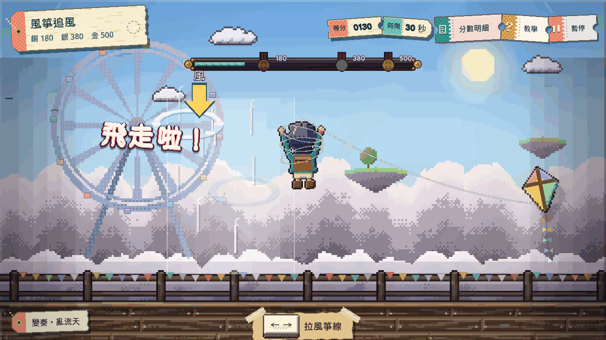

# [SG-123] 實作風箏追風

> 狀態：完成

## 內文

### 需求

風向箭頭不斷變換，左右拉線讓風箏一直迎著風往上飛，穿過空中的雲圈。佔用雲端遊樂場的 game-105 位置，攤位在風箏露台，取代原本偏向規劃與多按鈕的設計。

### 來源

2026-11-28 雲端遊樂場（MAIN-65）完成，十二個攤位都還是準備中。使用者要求小遊戲單純好玩、玩法多變、不要枯燥的射擊；依 design/00-principles/simple-fun-minigames.md 改寫為單一動詞的街機式小遊戲（Bomberman Land 3 方向）。

### 驗收條件

- [x] 風向變換越來越快，偶爾有一陣亂流讓箭頭先騙一下再轉。
- [x] 風箏失速時線把主角纏起來，主角被風箏拖上天又掉回露台。
- [x] 整款只用方向鍵與一到兩顆按鍵，畫面上沒有操作按鈕面板；進場五秒內開始操作，沒有強制教學頁。
- [x] 一回合不超過 60 秒，回合內速度或變化明顯升級；至少兩種隨機出現的變奏。
- [x] 結算只顯示一個分數、銅銀金獎牌與一句評語；銅牌取得普通拍貼，未用輔助的金牌取得小惡魔拍貼。
- [x] 玩法物件達到街機小遊戲的畫面下限：沒有大面積純色、有材質與受光、描邊、接地陰影，色調與雲端遊樂場背景一致。
- [x] 鍵盤與手把都能完成；開啟減少動態後仍可遊玩；沒有按鍵就不得分。
- [x] 通過稽核十問，結果寫在設計目錄的該款說明；雲端遊樂場原有互動與其他小遊戲不受影響。

### 測試流程

1. 從風箏露台的攤位進場，不看說明直接玩一回合。
2. 故意失敗一次，再玩到銅牌與金牌。
3. 開啟減少動態與手把各玩一回合，確認拍貼入冊與重開後保留。

---

# 跟其他票的關係

- Blocks：無
- Blocked by：無
- Related：MAIN-65、SG-66、ART-57

---

# Commit-1

## 內文

雲端遊樂場第九格原本是要在織機上排風向、再試風的「風向織布」，偏創意規劃與多步驟，風箏露台也還沒有這一站。
現在風箏露台多了一座屋頂插著一支大菱形風箏、櫃台上擺著線軸和小風向標的攤位，開放雲端遊樂場第四款「風箏追風」。主角背對著我們站在露台欄杆邊放一支四色大風箏，背後是雲端遊樂場的共用天空和摩天輪。天上有一道往上吹的白色風，上面有一個大箭頭；按住 ← → 拉線，把風箏拉進那一道風裡它就會往上爬，離開風會一直晃、往下掉，快到底時寫著「快掉了！」。雲圈從天上飄下來，讓風箏穿過就得分，連穿越多每圈越多分；有些雲圈飄在風的旁邊，要不要冒險離開風去穿由你決定。箭頭先轉、風隔一下才跟過去，看到箭頭就先拉過去最穩；風轉得越來越快，中段以後偶爾有亂流，箭頭變成珊瑚色、寫著「亂流！」、抖著先指錯邊再轉到真正的方向。風箏掉到底時線會把主角纏起來，風箏被下一陣風拉走，把主角拖上天再掉回露台揚起一陣灰；每回合第一次被拖走不算失誤。每回合隨機一種變奏：午後風、亂流天（一開始就有亂流）、雲圈大會（雲圈更多）；倒數時風會轉一次、風箏自己跟過去示範。放著不動的話風箏遲早會掉下來，也不會得分。
以原生畫面用模擬按鍵玩過一段，逐張看過開場示範、風箏在風裡穿雲圈、亂流箭頭、主角被拖上天與減少動態下的同一畫面。規則測試以模擬方向鍵玩出三種變奏的金牌、只跟著箭頭走也不追雲圈的銅牌、左右亂拉的回合（不得牌）、放著不玩的回合（0 分）與輔助金牌（不發小惡魔），並驗證手把十字鍵也能拉線。尚未在雲端遊樂場走到攤位實際進場一次；手把與減少動態為程式與擷取畫面確認，尚未由真人以手把實際玩完一回合；難度與「看一眼就懂」是依畫面與模擬輸入判斷，尚未由真人試玩。

### 測試結果

| 項目 | 結果 |
|---|---|
| 風箏追風規則 | 通過：示範、拉線、在風裡往上爬、離開風往下掉、箭頭先轉風後到、亂流先指錯邊、風越轉越快、亂流只在中段以後出現、穿雲圈與連穿加分、漏掉雲圈斷連穿、沒人操作不得分、掉到底被拖走、被拖走時拉不動、第二次被拖走算失誤、三種變奏、輔助、手把、金牌與銅牌整回合 |
| 局部回歸 | 遊戲目錄、街機共用流程（含每款放著不玩 0 分）、雲端遊樂場世界（含攤位站位）、區域往返（含雲端收藏本列出四款）、教學目錄與教學圖片、場景規範通過 |
| 設計與資料驗證 | 全部範圍通過；街機教學文字檢查通過 |

### 截圖

