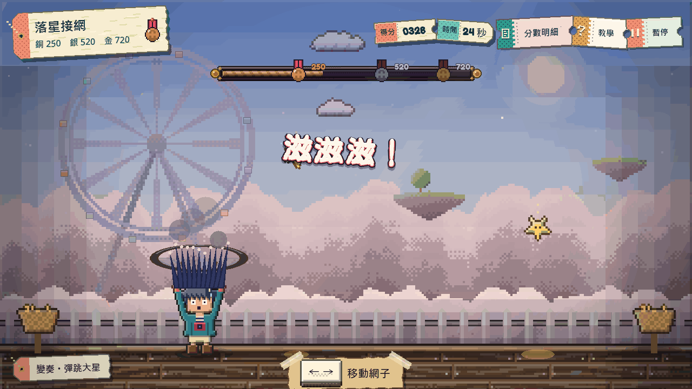

# [SG-124] 實作落星接網

> 狀態：完成

## 內文

### 需求

左右移動網子接住從天上掉下來的星星，把它們彈進旁邊的籃子，躲開夾在裡面的雷雲球。佔用雲端遊樂場的 game-106 位置，攤位在雲上拍照點，取代原本偏向規劃與多按鈕的設計。

### 來源

2026-11-28 雲端遊樂場（MAIN-65）完成，十二個攤位都還是準備中。使用者要求小遊戲單純好玩、玩法多變、不要枯燥的射擊；依 design/00-principles/simple-fun-minigames.md 改寫為單一動詞的街機式小遊戲（Bomberman Land 3 方向）。

### 驗收條件

- [x] 星星越掉越快，後段同時從兩側落下並出現會彈跳的大星。
- [x] 接到雷雲球時主角頭髮全部豎起冒煙。
- [x] 整款只用方向鍵與一到兩顆按鍵，畫面上沒有操作按鈕面板；進場五秒內開始操作，沒有強制教學頁。
- [x] 一回合不超過 60 秒，回合內速度或變化明顯升級；至少兩種隨機出現的變奏。
- [x] 結算只顯示一個分數、銅銀金獎牌與一句評語；銅牌取得普通拍貼，未用輔助的金牌取得小惡魔拍貼。
- [x] 玩法物件達到街機小遊戲的畫面下限：沒有大面積純色、有材質與受光、描邊、接地陰影，色調與雲端遊樂場背景一致。
- [x] 鍵盤與手把都能完成；開啟減少動態後仍可遊玩；沒有按鍵就不得分。
- [x] 通過稽核十問，結果寫在設計目錄的該款說明；雲端遊樂場原有互動與其他小遊戲不受影響。

### 測試流程

1. 從雲上拍照點的攤位進場，不看說明直接玩一回合。
2. 故意失敗一次，再玩到銅牌與金牌。
3. 開啟減少動態與手把各玩一回合，確認拍貼入冊與重開後保留。

---

# 跟其他票的關係

- Blocks：無
- Blocked by：無
- Related：MAIN-65、SG-66、ART-57

---

# Commit-1

## 內文

雲端遊樂場第十格原本是偏多人協調的 3D 彈網舞台，雲上拍照點也還沒有這一站。
現在雲上拍照點多了一座屋頂架著一支大網子、網裡卡著一顆金星，櫃台上擺著一籃小星星的攤位，開放雲端遊樂場第五款「落星接網」。拍照點換成黃昏，天空泛著紫色和橘色、已經有小星星在閃；主角站在白色欄杆前的甲板上，兩手把一支大木圈網子舉在頭上，甲板兩端各有一個藤編籃子。星星一邊轉一邊從天上掉下來，甲板上有越來越亮的光點標出落點；左右跑到底下用網子接住，星星就劃一道弧飛進旁邊的籃子，連接越多每顆越多分。混在裡面的雷雲球是深色、會冒閃電還有一張生氣的臉，接到時主角頭髮全部豎起來冒煙、身邊冒閃電、網子燒黑一下不能動，還要扣分；每回合第一次被電不算失誤。星星越掉越快，中段以後出現大星，接到會往旁邊彈、喊「再接一次！」，追過去再接一次才進籃、有大獎；後段同時從兩側各掉一顆。每回合隨機一種變奏：流星雨、雷雨夜（雷雲球更多）、彈跳大星（一開始就有大星）；倒數時主角會自己跑去接一顆星星示範。放著不動的話網子剛好接到的星星也不算分。
以原生畫面用模擬按鍵玩過一段，逐張看過開場示範、同時好幾顆星星和雷雲球在掉、接到的星星飛進籃子、被電到頭髮豎起與減少動態下的同一畫面。規則測試以模擬方向鍵玩出三種變奏的金牌、放掉不少星星的銅牌、左右亂跑的回合（不得牌）、放著不玩的回合（0 分）與輔助金牌（不發小惡魔），並驗證手把十字鍵也能跑。尚未在雲端遊樂場走到攤位實際進場一次；手把與減少動態為程式與擷取畫面確認，尚未由真人以手把實際玩完一回合；難度與「看一眼就懂」是依畫面與模擬輸入判斷，尚未由真人試玩。

### 測試結果

| 項目 | 結果 |
|---|---|
| 落星接網規則 | 通過：示範、左右跑、接星進籃、連接加分、漏接斷連接、沒人操作不得分、雷雲球電人扣分、被電時不能動也接不到、放過雷雲球沒有損失、第二次被電算失誤、大星彈起再接、星星越掉越快、後段兩側同時掉、大星只在中段以後出現、三種變奏、輔助、手把、金牌與銅牌整回合 |
| 局部回歸 | 遊戲目錄、街機共用流程（含每款放著不玩 0 分）、雲端遊樂場世界（含攤位站位）、區域往返（含雲端收藏本列出五款）、教學目錄與教學圖片、場景規範通過 |
| 設計與資料驗證 | 全部範圍通過；街機教學文字檢查通過 |

### 截圖

