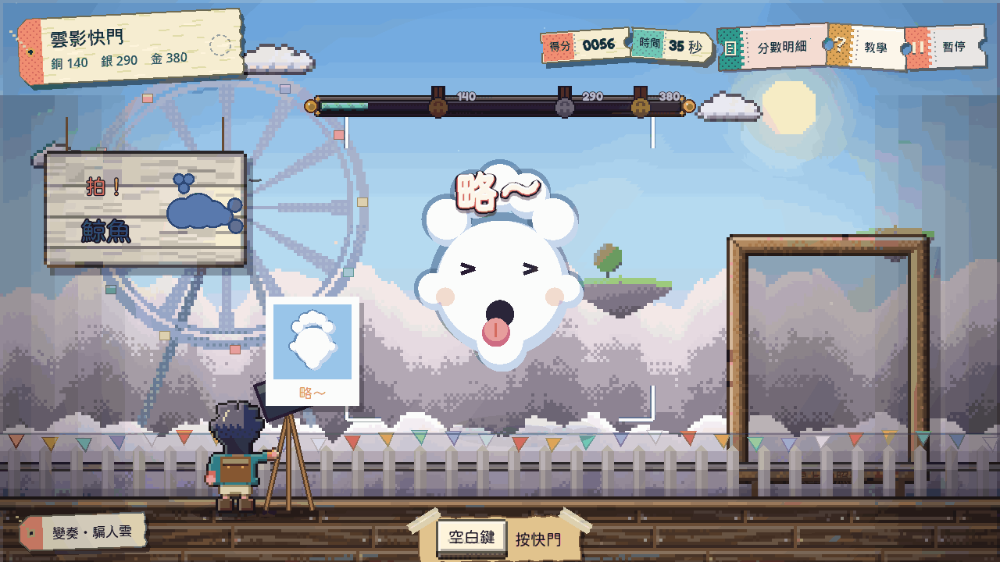

# [SG-125] 實作雲影快門

> 狀態：完成

## 內文

### 需求

天上的雲一直變形，旁白喊出一種形狀（兔子、鯨魚、茶壺），在雲剛好像那個形狀的瞬間按下快門。佔用雲端遊樂場的 game-107 位置，攤位在雲上拍照點，取代原本偏向規劃與多按鈕的設計。

### 來源

2026-11-28 雲端遊樂場（MAIN-65）完成，十二個攤位都還是準備中。使用者要求小遊戲單純好玩、玩法多變、不要枯燥的射擊；依 design/00-principles/simple-fun-minigames.md 改寫為單一動詞的街機式小遊戲（Bomberman Land 3 方向）。

### 驗收條件

- [x] 變形越來越快，偶爾有一朵很像但其實不對的雲先出現。
- [x] 拍錯時拍到一朵長得像主角的雲，對著主角吐舌頭。
- [x] 整款只用方向鍵與一到兩顆按鍵，畫面上沒有操作按鈕面板；進場五秒內開始操作，沒有強制教學頁。
- [x] 一回合不超過 60 秒，回合內速度或變化明顯升級；至少兩種隨機出現的變奏。
- [x] 結算只顯示一個分數、銅銀金獎牌與一句評語；銅牌取得普通拍貼，未用輔助的金牌取得小惡魔拍貼。
- [x] 玩法物件達到街機小遊戲的畫面下限：沒有大面積純色、有材質與受光、描邊、接地陰影，色調與雲端遊樂場背景一致。
- [x] 鍵盤與手把都能完成；開啟減少動態後仍可遊玩；沒有按鍵就不得分。
- [x] 通過稽核十問，結果寫在設計目錄的該款說明；雲端遊樂場原有互動與其他小遊戲不受影響。

### 測試流程

1. 從雲上拍照點的攤位進場，不看說明直接玩一回合。
2. 故意失敗一次，再玩到銅牌與金牌。
3. 開啟減少動態與手把各玩一回合，確認拍貼入冊與重開後保留。

---

# 跟其他票的關係

- Blocks：無
- Blocked by：無
- Related：MAIN-65、SG-66、ART-57

---

# Commit-1

## 內文

雲端遊樂場第十一格原本是要在雲影平台上帶路的「雲影導遊」，偏預測規劃，雲上拍照點也還沒有這一站。
現在雲上拍照點多了一座屋頂架著相機、對著一朵兔子形狀的雲，櫃台上擺著一疊照片的攤位，開放雲端遊樂場第七款「雲影快門」。主角背對著我們站在三腳架上的相機旁，前景是白色欄杆、隨風搖擺的彩旗和拍照點的大木框，後面是雲端遊樂場的共用天空。取景框裡有一朵有描邊、有陰影的大雲，一塊塊慢慢融成下一個形狀；左邊掛著告示牌，寫著「拍！」和要拍的形狀（兔子、鯨魚、茶壺），旁邊畫著那個形狀的剪影。雲變成告示牌上的形狀時框角會變金色，這時按快門就閃一下、洗出一張照片，完全變好再拍分數最高，稍早一點也算，連拍越多加越多。雲變形越來越快、停留越來越短，越後面越常先出現很像但不對的雲（像兔子的貓、像鯨魚的魚、像茶壺的馬克杯）。拍錯的話，雲會變成主角的頭，瞇著眼吐舌頭「略～」，洗出來的照片也是那張鬼臉；每回合第一次拍錯不算失誤。要拍的形狀過去了沒拍，連拍會斷掉、換下一個形狀。每回合隨機一種變奏：慢慢變、雲跑得快、騙人雲；倒數時雲會自己變成兔子、相機自己拍一張示範。放著不按的話不會得分。
以原生畫面用模擬按鍵玩過一段，逐張看過開場示範、雲變成茶壺時的金色框角與告示牌、拍下後洗出的照片、拍錯時的鬼臉雲與減少動態下的同一畫面。規則測試以模擬按鍵玩出三種變奏的金牌、常常太早按又漏掉一些的銅牌、一直亂按的回合（不得牌）、放著不玩的回合（0 分）與輔助金牌（不發小惡魔），並驗證 ↓ 與手把 A 鈕也能按快門。尚未在雲端遊樂場走到攤位實際進場一次；手把與減少動態為程式與擷取畫面確認，尚未由真人以手把實際玩完一回合；難度與「看一眼就懂」是依畫面與模擬輸入判斷，尚未由真人試玩。

### 測試結果

| 項目 | 結果 |
|---|---|
| 雲影快門規則 | 通過：示範、雲融成下一個形狀、喊出要拍的形狀、完全變好與稍早拍下、連拍加分、快門冷卻、拍錯變鬼臉、鬼臉時不能拍、第二次拍錯算失誤、沒拍到的形狀斷連拍、很像的雲先出現且越後面越常見、雲越變越快、三種變奏、輔助、手把、金牌與銅牌整回合 |
| 局部回歸 | 遊戲目錄、街機共用流程（含每款放著不玩 0 分）、雲端遊樂場世界（含攤位站位）、區域往返（含雲端收藏本）、教學目錄與教學圖片、場景規範通過 |
| 設計與資料驗證 | 全部範圍通過；街機教學文字檢查通過 |

### 截圖

