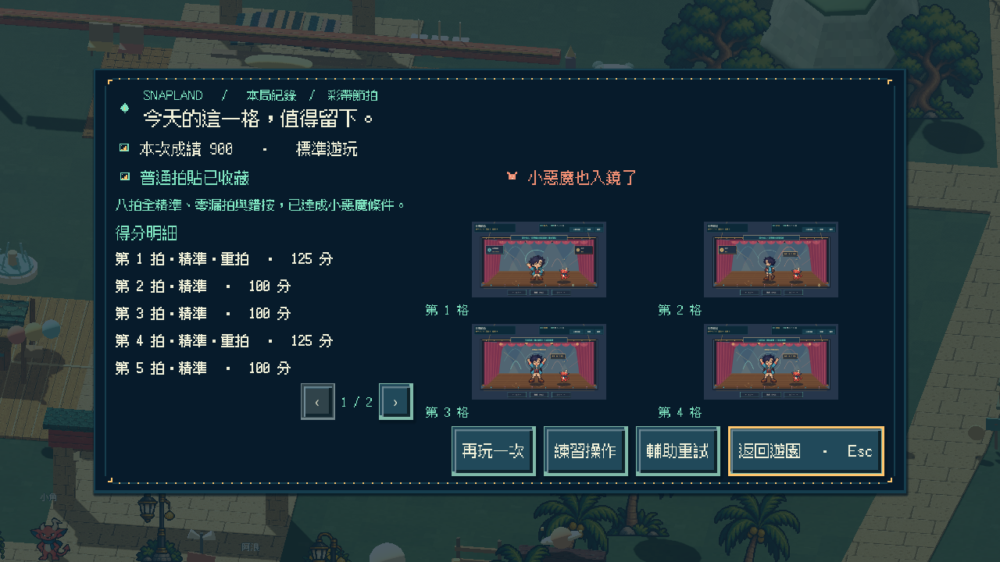
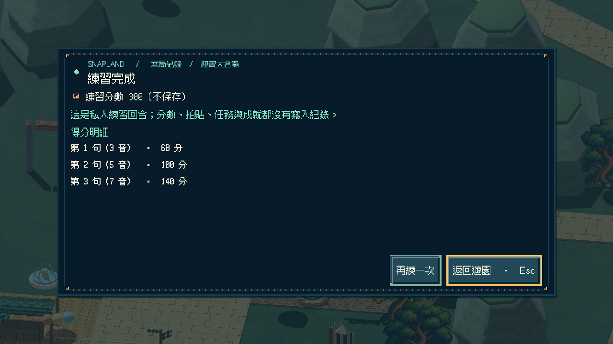

# [SG-14] 完善十二款遊戲動作回饋

> 狀態：完成

## 內文

### 需求
操作、命中、失誤、節拍、倒數與完成都有符合場景的動作與回饋，讓玩家能讀懂遊戲反應。

### 來源
2026-10-11（Asia/Taipei）使用者要求繼續完善島嶼與小遊戲，改善簡陋美術；研究業界實例而不照抄，建立自己的風格並持續完成本批。

### 驗收條件
- [x] 十二款遊戲皆有命中或選擇及成功與失誤的清楚回饋
- [x] 重試、離開、輔助、成就與普通及惡魔拍貼規則保持正確
- [x] 降低動態可用，十二款可由實際輸入通關且局部測試通過

### 測試流程
1. 查看票內研究來源、參考圖與實際觀察。
2. 啟動隔離存檔的原生遊戲，操作本票相關場景，核對驗收條件與截圖。
3. 切換日夜或降低動態、重開相關畫面，確認動線、文字、互動與獎勵正常。

---

# 跟其他票的關係

- Blocks：無
- Blocked by：無
- Related：ART-3、ART-4、ART-5、ART-6、SG-14

---

# 研究與參考

[本批設計與實際查閱觀察](../../design/runtime/visual-polish.md)。學習分層材質、日夜光影、清楚操作主體與一致的物料語言，重新設計 Snapland 的海港意象；參考圖不當遊戲素材。

---

# Commit-1

問題：玩家需要在命中、失誤、倒數和完成時看懂遊戲反應，並清楚保留重試、離開與輔助規則。

改動：十二款小遊戲補上符合各自場景的回饋與結果呈現，並維持遊戲規則、輔助及成就流程。

驗收：小遊戲局部測試與十二款原生自動輸入／結果路線檢查通過；截圖僅表示自動化路線與結果畫面，不宣稱玩家試玩成功。

| 畫面證據 | 說明 |
| --- | --- |
| [遊戲 01](../Snapland-art/images/ART-5-game-01.png) · [成功結果 01](../Snapland-art/images/ART-5-result-01.png) | 原生靜態畫面 |
| [遊戲 05](../Snapland-art/images/ART-5-game-05.png) · [成功結果 05](../Snapland-art/images/ART-5-result-05.png) | 原生靜態畫面 |
| [遊戲 09](../Snapland-art/images/ART-5-game-09.png) · [成功結果 09](../Snapland-art/images/ART-5-result-09.png) | 原生靜態畫面 |
| [解鎖成就畫面](images/SG-14-achievements-unlocked.png) | 原生自動化結果靜態畫面 |

程式交付：[Commit c6b1883](https://github.com/deadline314/Snapland/commit/c6b1883213994a7ad5b3d1f0b92f92638f4d4bdc)（分支 `feature/island-first-park`；固定基準 `92e885390967bff3abbde3cf52716076124b1383`）。

### 最新輸出驗證
Windows輸出於Intel Arc B580原生GPU完成圖集、NPC、場景動畫與遮擋資源冒煙檢查，12款場景所需素材均載入，無ERROR；此檢查不代表真人試玩、完整換裝動作、每姿勢或試聽驗收。

### 程式與證據提交
分支：feature/island-first-park。更新至最新main後的本票提交：[c5195a0](https://github.com/deadline314/Snapland/commit/c5195a099d8f29063ef6246ed9cd559c0c576c22)。

# Commit — 2026-10-24 固定步長與慢放驗收

固定模擬的驗收曾誤用即時模式等待期限，彩帶的四分之一速度又以原速影格數計算上限，三拍預備尚未結束就被判成卡住。實際查證 Godot 已移除腳本可讀清單內的引擎參數後，改用明確的驗收模式；慢放依遊戲時間換算影格數，仍保留有限上限。沒有調整玩家的節奏、計分、命中窗口或收藏資格。

彩帶完整 Main 正式鍵盤 900 分、錯誤輸入與確認重試，以及真正 0.25 倍速的輔助／降低動態指標私人練習均通過；私人回合不改正式進度。大合奏完整 Main 的鍵盤 300 分普通／小惡魔收藏、暫停／重試及輔助降低動態指標練習也通過，練習不改正式收藏。此段交付可重現的驗收流程與這兩款的實際紀錄，不把早期程序中的單一通過訊息當成整段成功。

| 項目 | 實際結果 |
|---|---|
| 彩帶正式＋慢放私人 | 223.41 秒，exit 0、0 ERROR；正式 1×，私人實際 0.25×，結算擷取恢復 1× |
| 大合奏正式＋私人 | 246.89 秒，exit 0、0 ERROR；三句合奏及私人回合自然完成 |
| 模式辨識 | 原始探針讀不到已解析的引擎參數；明確使用者參數可讀且模式正確 |
| 原始失敗 | 原分數偏差、固定模式期限與慢放影格期限的失敗均保留，沒有改門檻掩蓋 |

[官方文件查證與共通流程](../../design/runtime/native-review-clocks.md) · [範圍、來源及雜湊](images/SG-14-clock-20261024-verification.json) · [來源前後、原始失敗與完整擷取](images/SG-14-clock-20261024-sources-and-captures.zip)。25 張彩帶與 4 張合奏擷取已透過總覽查看；不是觀看完整影片、真人試玩、試聽或硬體效能結論。

# Commit — 2026-10-24 完成十二款現行回饋核對

逐一核對十二款現行場景、操作、成功與失誤，以及各款既有完整驗收紀錄。原生鍵鼠路線均由真實輸入和正常模型規則完成，沒有指定結果或分數；最後選用的十二款程序全部 exit 0、0 ERROR。重試、暫停、普通／小惡魔資格、輔助與降低動態、私人練習不寫入進度，以及失敗保護各依對應路線與共通檢查核對。

初次未固定步長的得分偏差，以及彩帶／合奏的驗收等待錯誤均保留。固定步長與真正 0.25 倍速回歸通過；84 個共通案例也在不改判定下全部通過（本地 96.10 秒，使用既有倍率 2、上限 180 秒；原 90 秒超時未隱藏）。本票依原三條驗收結案，沒有把自動化輸入稱為真人試玩或音效試聽。

[逐款結果、提交與成品來源一致性](images/SG-14-final-20261024-verification.json) · [全十二款原生結果與擷取](../Snapland-art/images/ART-5-final-20261024-game-captures.zip) · [完整實際範圍及原始失敗](../Snapland-art/images/ART-5-final-20261024-verification.json) · [固定步長與慢放回歸](images/SG-14-clock-20261024-verification.json)。最新 Linux 成品的玩家來源與已合入的 ART-5 逐檔雜湊一致；十二入口初始繪製與資源正常，不當作十二款成品完整通關。
