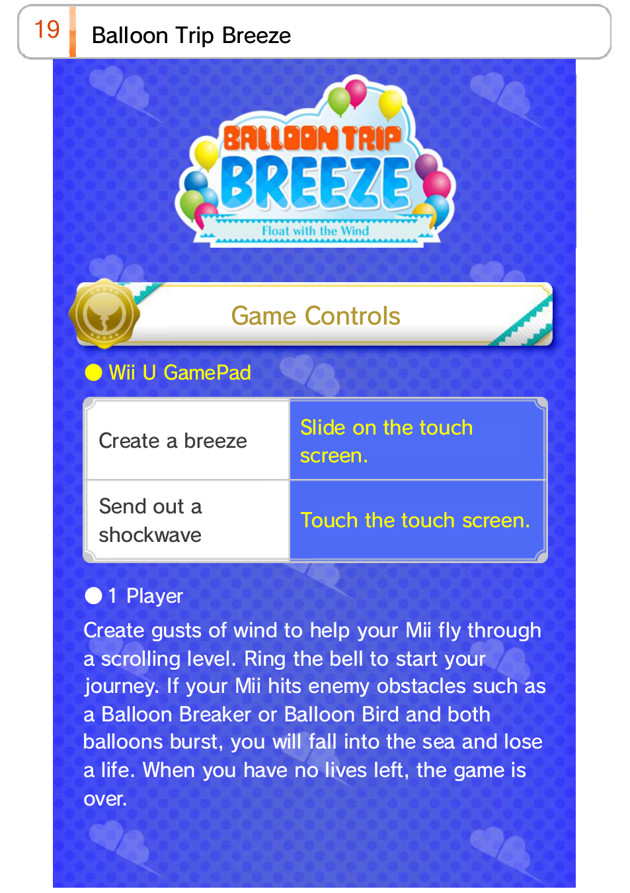
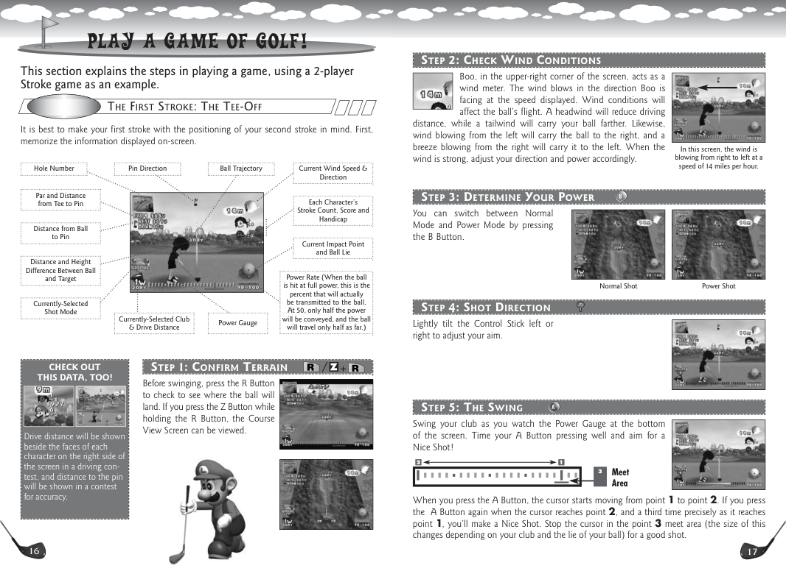

# [SG-15] 重做氣球快遞操控與風場

> 狀態：進行中

## 內文

### 需求
氣球快遞提供看得見、可預判的海風與陣風，讓玩家有明確操控、避險與投遞目標。以逐步引導和可讀回饋改善無聊、操控弱與不知如何完成的體驗。

### 來源
2026-10-11 使用者追加：建築遮擋時需要圓形穿透顯示主角；氣球快遞過於簡略、海風不可見、操控與引導弱。參考資料至少超過五個來源，跨不同方向比較並形成自己的設計。

### 驗收條件
- [x] 查閱至少六個來源，涵蓋不同遊戲做法、操控、環境訊號、引導及玩家體驗；記錄採用理由。
- [x] 風向、風力與陣風預告在畫面可辨識，視覺訊號與實際受力一致。
- [x] 鍵盤與滑鼠各有直接且可理解的控制，玩家能主動減速、穩定投遞或避開障礙。
- [x] 首次與重玩都有清楚目標、按鍵說明及逐步短引導，不在讀引導時消耗遊玩時間。
- [x] 投遞過程有多段目標、清楚成功失敗回饋與可快速重試，普通及惡魔成就資格正確。
- [x] 輔助與降低動態下可完成，且十一款其他遊戲的回歸檢查沒有退化。
- [ ] 匯出／打包檢查通過。

### 測試流程
1. 第一次從園區開始遊玩，按引導完成移動、減速與投遞。
2. 用鍵盤與滑鼠分別操作，觀察風場、陣風預告、避險與多段目標。
3. 普通、輔助、降低動態及重試後核對結算、收藏與成就，跑受影響局部測試。

---

# 跟其他票的關係
- Blocks：無
- Blocked by：無
- Related：SG-2、SG-14、ART-5

---

# 開始與研究

固定基準：a1fc7abaa91a5d9fdf6e2c7ca084f0dba0205985。來源比較與採用原因見 design/runtime/occlusion.md 與 design/runtime/balloon-delivery.md，未看影片不算已看。

## 研究圖例

此頁實際區分製造微風與衝擊波；只參考操作對應明確的做法，不沿用角色或版面。

此頁實際標示風向、風速與飛行受影響的關係；採用風向與數值並存的可讀提示。來源網址、其他四個方向及採用理由見研究文件。

---

# Commit-1

問題：氣球快遞原本風場與操控提示不足，初次操作不易理解移動、煞停和投遞。

改動：補上逐步引導、鍵盤與滑鼠控制、風向風速及陣風預告、分段投遞回饋和可重試結果。

驗收：原生自動輸入以滑鼠無失誤達成惡魔結果，並以 WASD 輔助及降低動態條件完成惡魔結果（450 分、零失誤）；十一款其他遊戲回歸檢查亦通過。匯出／打包尚未驗收，票仍進行中。

| 畫面證據 | 說明 |
| --- | --- |
| [第一次引導](images/SG-15-intro.png) · [移動步驟](images/SG-15-intro-move.png) · [煞車步驟](images/SG-15-intro-brake.png) | 原生靜態畫面 |
| [風場](images/SG-15-wind.png) · [投遞中](images/SG-15-dock-2.png) | 原生靜態畫面 |
| [普通結果](images/SG-15-result-ordinary.png) · [惡魔結果](images/SG-15-result-devil.png) · [輔助降低動態結果](images/SG-15-result-assist-devil.png) | 原生自動輸入結果靜態畫面 |
| [氣球快遞動態預覽影片](images/SG-15-delivery-motion.mp4) | 自動化審查錄影，不等同玩家試玩 |

程式交付：[Commit c8202d6](https://github.com/deadline314/Snapland/commit/c8202d69779497456ee55ae1ca051d21f7952dec)（分支 `feature/island-first-park`；固定基準 `a1fc7abaa91a5d9fdf6e2c7ca084f0dba0205985`）。

### 最新輸出驗證
Windows輸出於Intel Arc B580原生GPU完成圖集、NPC、場景動畫與遮擋資源冒煙檢查，12款場景所需素材均載入，無ERROR；此檢查不代表真人試玩、完整換裝動作、每姿勢或試聽驗收。

### 程式與證據提交
分支：feature/island-first-park。更新至最新main後的本票提交：[9b45af9](https://github.com/deadline314/Snapland/commit/9b45af90c0a2fcc9880bd93735b03d2a3edf30fd)。
