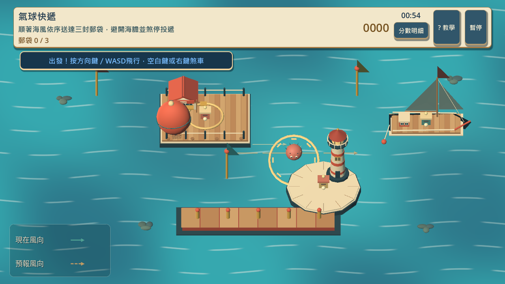
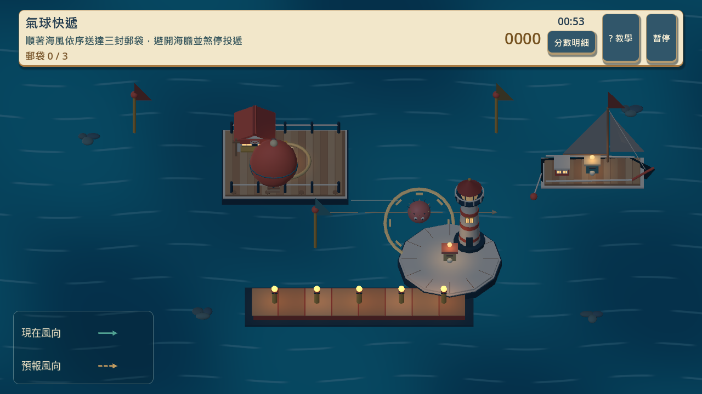
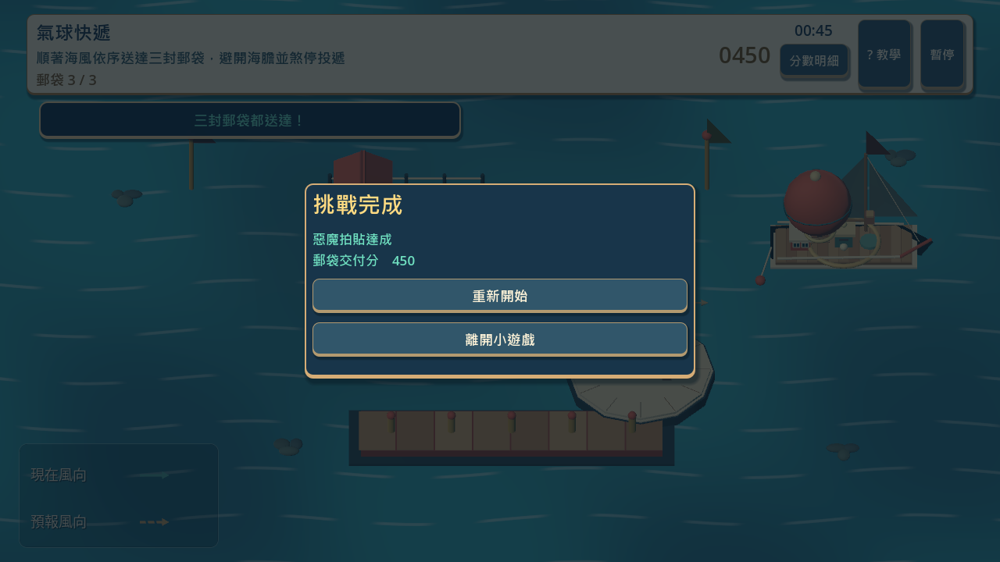

# [SG-16] 精修氣球快遞玩法與計分

> 狀態：進行中

## 內文

### 需求
將氣球快遞提升為可對外展示的完整小遊戲。風向、預告與實際受力一致，移動、減速、避險和投遞形成可掌握的技巧。操作手感、目標、分數和演出一起設計，學習內容放在有截圖的完整教學，遊玩時保留必要資訊。

2026-10-12 使用者追加：同一園區維持共同主題，每款小遊戲須依玩法選擇自己的 2D、2.5D、HD-2D 或 3D 表現。不能沿用同一場地、構圖與動畫再換規則；鏡頭、空間、操作節奏和成功演出須帶來可辨認的新體驗。

### 來源
2026-10-12（Asia/Taipei）使用者要求全面重新審閱 UI 和小遊戲，提升目標、計分及操作手感；先廣泛 survey，減少遊戲當下提示，提供含截圖的完整教學。使用者授權自行決定設計，強調循序完善、細節有主次且不雜亂，以可面向大眾的品質驗收。

### 驗收條件
- [ ] 依玩法採用獨立鏡頭、場地、視覺節奏與成功演出；與首區其他遊戲並列比較能辨認不同體驗，海港主題仍一致。
- [x] 比較至少六個跨不同方向的玩法、操控與玩家體驗來源，保存實際閱讀、圖例及選擇理由。
- [ ] 風向、預告與實際受力一致，移動、減速、避險和投遞形成可掌握的技巧。
- [ ] 普通、精準表現、失誤及輔助的成績規則明確；結算能說明成果與個別成就資格。
- [ ] 首次學習、練習、正式遊玩、重試和離開形成完整流程，不在教學閱讀時消耗回合時間。
- [ ] 正常及輔助、鍵盤及滑鼠、降低動態下以實際输入遊玩驗收；保留正常速度影片、截圖和受影響測試。

開始基準：`92e68e4`。

### 測試流程
1. 查看本票研究紀錄與圖例，核對採用的原則和原生前後比較。
2. 使用隔離存檔實際操作本票完整流程，核對各項驗收條件。
3. 核對重試、返回、重開與相關設定，保存原生截圖、影片和受影響測試摘要。

---

# 跟其他票的關係

- Blocks：無
- Blocked by：無
- Related：SG-2、SG-14、ART-21、MAIN-10、SG-15

---

# Commit-1

## 問題

氣球快遞原本與其他遊戲共用平面場地，海風難以從畫面判斷，投遞點也缺少自己的形象。

## 改動

將航道改成立體海港，三站分別是郵局、燈塔與帆船。即時風向、預告風向、風旗、海膽範圍、投遞亮圈與煞車回饋對應實際操作；白天與夜晚各有燈光。換上三張實際遊戲截圖與正確航線說明，並補正常速度及四分之一速度影片。共用小遊戲票券面板加上紙層、黃銅邊框與按鈕深度，屬 ART-21 的最小相依變更。

## 驗收

主 Session 在獨立提交候選上重跑局部檢查，並用原生鍵盤推動、煞車及滑鼠航行依序完成三站：450 分、零失誤，結果顯示惡魔拍貼達成。實際看過白天、夜晚、投遞、正常播放與慢放畫面；影片按 60 FPS 擷取，慢放是遊戲四分之一速度，沒有補造動畫幀。待本機原生驗收：輔助模式、降低動態、重試與完整教學返回流程。票維持進行中。

### 測試結果

- 迎賓小遊戲 52 項、投遞規則 8 項、海港呈現 68 項通過；圖解教學與主場景整合各自通過，沒有引擎錯誤。
- 原生正常／慢放都完成三站、450 分、零失誤。遊戲時間分別 9.650／9.629 秒，錄製時間對應正常／四分之一速度。
- 正常影片保留 577 幀，慢放保留 2309 幀；只去掉退出場景後的三個空白幀。
- 參考：[玩法與操控調查](../../design/runtime/first-park-gameplay-quality.md)、[不同鏡頭與媒材](../../design/runtime/minigame-diversity-survey.md)、[六個不同團隊的實際圖例](../../design/runtime/minigame-visual-diversity-review.md)。靜態圖例不是參考遊戲試玩證明。

### 截圖與影片

[正常速度影片](images/SG-16-normal-play.mp4) · [四分之一速度影片](images/SG-16-slow-play.mp4)

### 提交

分支：`feature/island-first-park`；[遠端提交 f29e126](https://github.com/deadline314/Snapland/commit/f29e1261cdb7a70a065337442f3ac8a77b9300a4)。
