# [SG-17] 精修風箏穿環玩法與計分

> 狀態：完成

本次接線與原生驗收固定基準：`aae0a1b`；分支：`feature/island-first-park`。

## 內文

### 需求
將風箏穿環提升為可對外展示的完整小遊戲。風環路線與障礙清楚，風箏的加速、轉向和穿環判定可預期，避免只移動靜態圖片。操作手感、目標、分數和演出一起設計，學習內容放在有截圖的完整教學，遊玩時保留必要資訊。

2026-10-12 使用者追加：同一園區維持共同主題，每款小遊戲須依玩法選擇自己的 2D、2.5D、HD-2D 或 3D 表現。不能沿用同一場地、構圖與動畫再換規則；鏡頭、空間、操作節奏和成功演出須帶來可辨認的新體驗。

### 來源
2026-10-12（Asia/Taipei）使用者要求全面重新審閱 UI 和小遊戲，提升目標、計分及操作手感；先廣泛 survey，減少遊戲當下提示，提供含截圖的完整教學。使用者授權自行決定設計，強調循序完善、細節有主次且不雜亂，以可面向大眾的品質驗收。

### 驗收條件
- [x] 依玩法採用獨立鏡頭、場地、視覺節奏與成功演出；與首區其他遊戲並列比較能辨認不同體驗，海港主題仍一致。
- [x] 比較至少六個跨不同方向的玩法、操控與玩家體驗來源，保存實際閱讀、圖例及選擇理由。
- [x] 風環路線與障礙清楚，風箏的加速、轉向和穿環判定可預期，避免只移動靜態圖片。
- [x] 普通、精準表現、失誤及輔助的成績規則明確；結算能說明成果與個別成就資格。
- [x] 首次學習、練習、正式遊玩、重試和離開形成完整流程，不在教學閱讀時消耗回合時間。
- [x] 正常及輔助、鍵盤及滑鼠、降低動態下以實際输入遊玩驗收；保留正常速度影片、截圖和受影響測試。

### 測試流程
1. 查看本票研究紀錄與圖例，核對採用的原則和原生前後比較。
2. 使用隔離存檔實際操作本票完整流程，核對各項驗收條件。
3. 核對重試、返回、重開與相關設定，保存原生截圖、影片和受影響測試摘要。

---

# 跟其他票的關係

- Blocks：無
- Blocked by：無
- Related：SG-3、SG-14、ART-21、MAIN-10

---

## Commit — 側面飛行接線與原生五環驗收

**問題**
風箏缺乏獨立飛行體驗，滑鼠事件曾被全畫面的介面攔住；教學截圖也未反映新玩法。

**改動**
改為海崖側面航線，迎風角、衝刺與收線形成取捨，畫面直接呈現同一套陣風與張力。教學改用實際航線、陣風及完成畫面。研究紀錄：[風箏玩法](../../design/runtime/kite-flight-design.md)，跨遊戲圖例見 ART-21。

**驗收**
主 Session 局部檢查：模型 29、畫面 83、Session 53 項通過，教學面板測試通過。原生正常速度 43.4 秒、四分之一速度 169.3 秒，鍵盤輔助練習和滑鼠正式回合各五次中心穿環、500 分；衝刺與收線均有生效，正式回合取得惡魔資格。實際觀看飛行及五環結算，修正影片最後畫面後保存。這是原生輸入驗收，不是完整園區真人試玩。

[正常速度](images/SG-17-normal-play.mp4) · [慢放](images/SG-17-slow-play.mp4)

尚待本機原生驗收：Main 首次教學、暫停／重試／離開與收藏持久化完整流程，以及最终美術和跨遊戲體驗比較；因此維持進行中。分支：`feature/island-first-park`。遠端 commit：[71c6146](https://github.com/deadline314/Snapland/commit/71c6146)。

## Commit — 海崖航線與可見風力修訂

**問題**
初版風跡像長橫線，海岸色帶與拱洞被儀表遮住，成功提示也會蓋住風箏；場地缺少可辨認的側向旅程。

**改動**
加入錯開的遠近海崖、燈塔、港屋、帆船及有厚度的風環，以克制的剪紙輪廓呈現海港航線。短風跡、旗尾隨當下真實風力變化，預報另列；成功提示移到風箏之外。降低動態保留玩法訊號，四個時段有可辨認的色調。

**驗收**
主 Session 局部檢查：畫面 100、模型 29、回合整合 81 項通過。正常速度 65.48 秒、四分之一速度 254.08 秒，均以真實事件完成鍵盤輔助練習、滑鼠正式回合及降低動態鍵盤輔助練習三條路線；各五次中心穿環、500 分、零失誤和救援，衝刺與收線均實際生效，正式回合取得惡魔資格。成功提示在實際擷取幀中未與風箏包圍盒重疊，三條路線都擷取自然強風。

主 Session 播放正常與慢放影片至結尾，並查看兩組各 23 張原生截圖及共 12 頁審閱拼圖。四時段與靜態降低動態圖僅是畫面預覽，不冒充 Main 時段切換或完整遊玩；目前模型只有向上的陣風，本段未宣稱原生風向反轉。這是回合輸入與本輪畫面修訂驗收，不是完整園區真人試玩或最終公開品質。

[正常影片](images/SG-17-coast-normal-play.mp4) · [四分之一速度影片](images/SG-17-coast-quarter-play.mp4)

研究：[七項風箏來源與採用理由](../../design/runtime/kite-flight-design.md)、[九款不同體驗的官方資料](../../design/runtime/minigame-diversity-survey.md)、[六張實際看過的比較圖與選擇理由](../../design/runtime/minigame-visual-diversity-review.md)。圖例保存在 ART-21 的票券 images；本輪延續該組審閱，沒有把未觀看的來源影片寫成已驗證。

尚待本機原生驗收：Main 首次教學、重試／離開／收藏完整流程，以及最終美術與十二款並列體驗比較；票況維持進行中。這輪固定基準：`50103433d4e08c19665c56b958325dadc8dd3ec9`，文件基準 `cf719411aca2be6d15bc9a1b6a468e338095e1fb`；分支：`feature/island-first-park`。

夜間與傍晚的事件文字另補深色襯底與淺色字，主 Session 查看 24 張原生畫面預覽和六頁拼圖，確認五種文字在飛行及結果狀態均清楚；其中 20 張為合成事件的畫面測試，不是完成回合。新版本凌晨／中午預覽逐像素比較與先前影片版本相同（RGB 差異 0 像素），上述正常／慢放影片仍對應未變動的白天畫面。新增擷取場景首輪解析失敗，修正明確型別後重新執行為 0 錯誤；不將失敗輪列為通過。

[24 張預覽索引與白天像素比較](images/SG-17-caption-preview-evidence.json) · [重新擷取紀錄](images/SG-17-caption-native.log)

遠端 commit：[3b0f094](https://github.com/deadline314/Snapland/commit/3b0f094b01fb0027c46f2ea0908174006b33b26e)。同步工作目錄後另跑畫面 100、模型 29、整合 82 項，均零錯誤；既有其他工作內容保留。

## Commit — Main 正常與慢放流程驗收

**問題**
小遊戲原生輸入與計分已有驗收，但尚未確認第一次教學、正式結算、收藏及私人練習能否在 Main 中接續完成。

**改動**
補上隔離存檔下的完整 Main 流程紀錄，涵蓋第一次教學、正式回合、普通與小惡魔收藏、成就、重載存檔，以及輔助／降低動態的私人練習、重試與離開。

**驗收**
正常速度影片 1,760 幀、29.333333 秒；四分之一速度影片 6,757 幀、112.616667 秒，均為 1280×720、60 fps，執行紀錄沒有 ERROR 或 SCRIPT ERROR。兩次都以實際鍵盤輸入完成五次中心穿環、500 分及普通／小惡魔資格；Main 顯示普通與小惡魔收藏冊各自的已收藏卡片、game-002 成就，隔離存檔重載後進度一致。私人練習保留輔助與降低動態設定，重試及離開後收藏進度不變。Root 已將兩段影片播放至結尾；正常速度查看 0.17 秒及結尾，慢放查看 0.17 秒、61.66 秒、108.75 秒及結尾，並查看兩組共 28 張原生畫面及 8 張聯絡頁。

這項流程從測試中直接將角色放在設施旁，再以實際 E 鍵開啟遊戲，不代表步行動線驗收。首次教學截圖仍是舊版畫面，需更新後才能作為最新教學美術證據。小惡魔收藏狀態與卡片文字已確認；畫面實際顯示缺圖，已先開 [MAIN-13](../Snapland-main/[MAIN-13]補齊小惡魔拍貼實際縮圖.md) 修復，不宣稱縮圖成功顯示。

新版教學圖可重新取景：第一步參考正常速度的實際飛行畫面，第二步參考陣風畫面，第三步參考自然結算畫面；這三張遊戲截圖僅供挑選構圖，不代表已更新教學素材。

三輪未通過紀錄也保留：第一輪錯把分頁收藏冊當成普通與小惡魔卡片會同時顯示；第二輪錯把原生點擊返回後的兩幀自然經過時間判成重試失敗；第三輪中止路徑出現資源清理訊息。修正後兩次完整執行皆為零錯誤；以上不視為遊戲規則缺陷。

[正常速度影片](images/SG-17-mainflow-normal.mp4) · [四分之一速度影片](images/SG-17-mainflow-quarter.mp4)

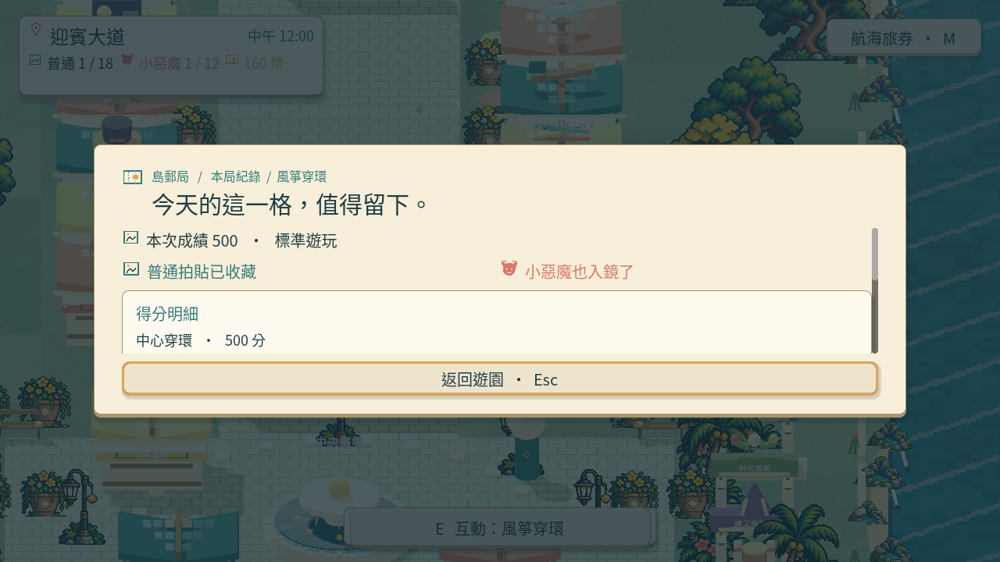
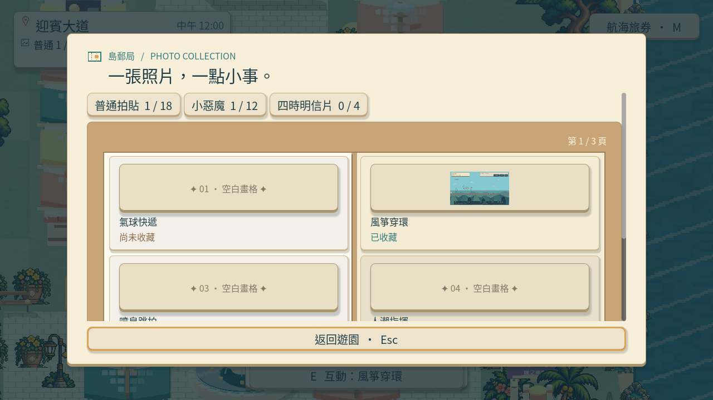 · 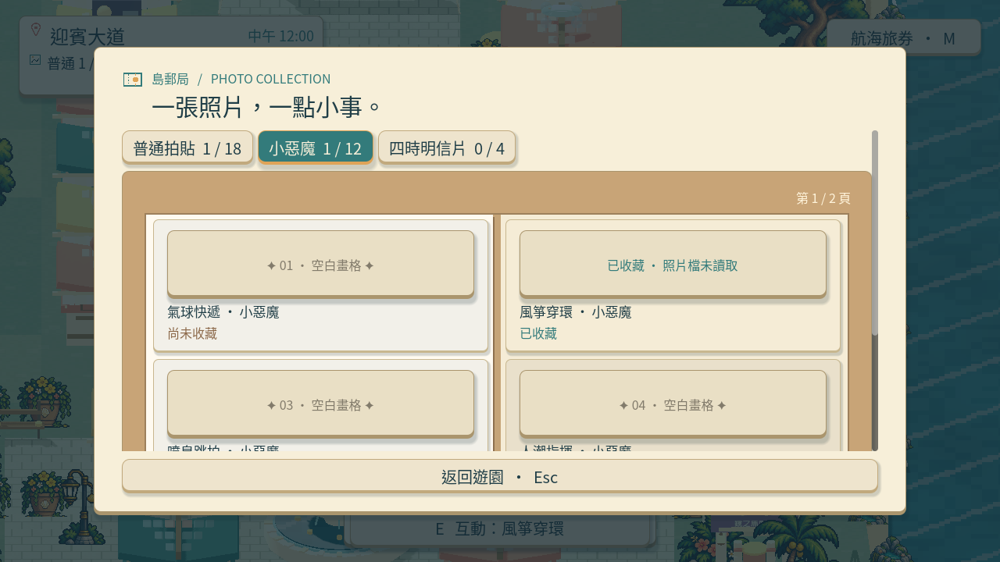
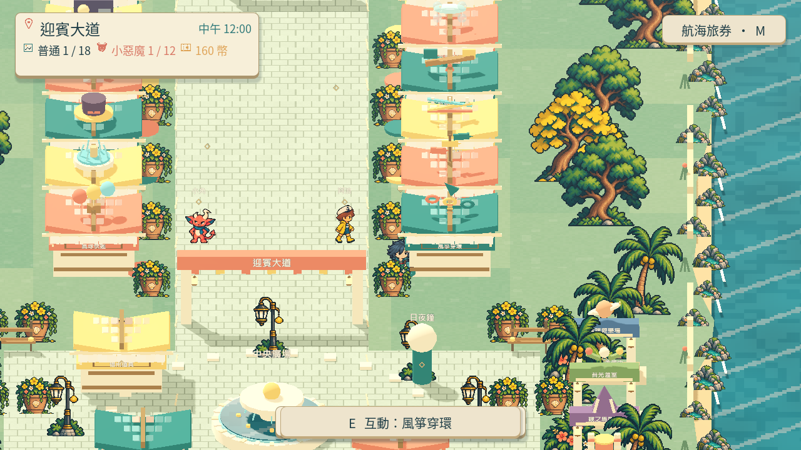

本次驗收涵蓋 Main 流程與收藏持久化，票況維持進行中。影片格式、逐圖雜湊、聯絡頁對照及執行紀錄見 [證據索引](images/SG-17-mainflow-evidence-manifest.json)。

分支：`feature/island-first-park`；固定流程驗收基準：`186b3a90fb904ae37ba98ff09a258b802d956022`。

# Commit-4

## 問題

舊教學圖仍是先前的場地，第三步替代文字也使用玩家不需要理解的流程術語。

## 改動

三頁改用正式回合的海崖航線、上升陣風與五環中心穿越 500 分結算畫面。第三步直接說明普通拍貼入冊和小惡魔也入鏡。

## 驗收

三張教材圖直接複製實際原生回合截圖，沒有裁切或重繪。隔離存檔下以真實互動開啟首次教學，逐頁操作並查看三頁顯示；原生執行零錯誤、零資源洩漏。教學面板／目錄與學習紀錄局部檢查通過，刻意的缺圖及損毀資料案例按預期顯示診斷。本輪驗收涵蓋教學圖片和版面，票況維持進行中。

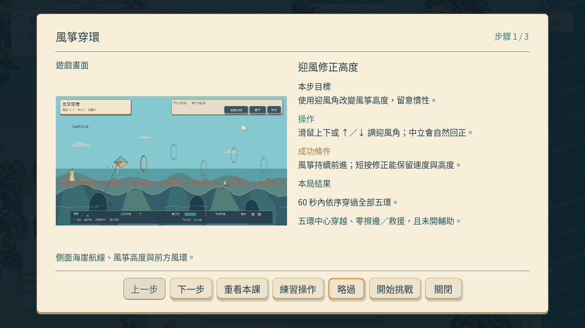
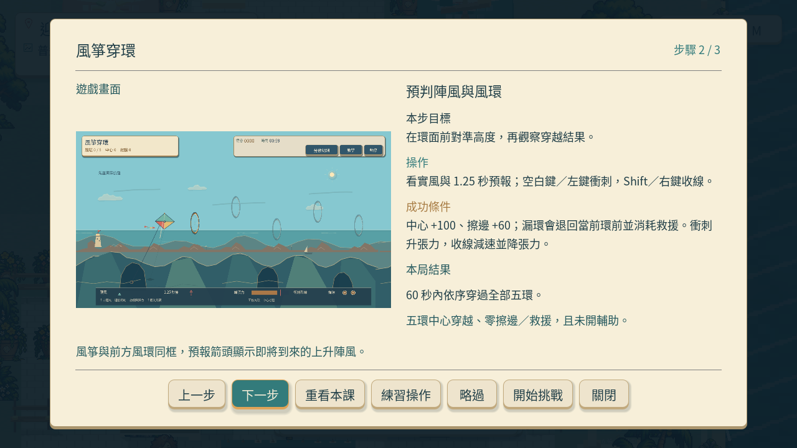
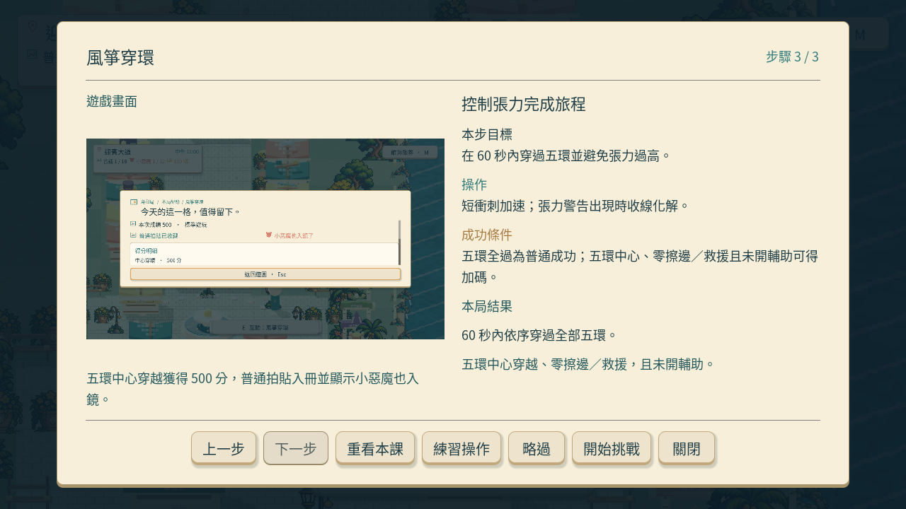

[原生執行紀錄](images/SG-17-kite-current-tutorial-native.log) · [本輪證據索引](images/SG-17-current-tutorial-evidence.json)。

分支：`feature/island-first-park`；[本轮教學交付提交](https://github.com/deadline314/Snapland/commit/3db468c04044759177374661ffb01ade3f83c3b4)。先前完整流程：[63e2d06](https://github.com/deadline314/Snapland/commit/63e2d06df43382be860cafafdf2d40eff308692e)。

# Commit — 2026-10-22 完成風箏結算與全流程驗收

固定起點 `f6b48d0`；分支 `codex/finish-runtime-batch-20261020`。本段完成此前Main、資格說明、現行教學與並列體驗的驗收範圍。

### 問題與改動

漏環、斷線沒有逐次顯示零分；結算也未直接說清本次為何取得普通或小惡魔資格。現在逐環顯示中心／擦邊得分，逐次列出漏環／斷線，結算直接說明本次中心、救援與輔助資格。翻到較短的最後一頁時，照片及視窗保持穩定，不再縮動。五環、原飛行／風力、中心／擦邊門檻、60秒和兩次救援維持原規則。

三頁教學換成現行真實飛行、陣風及自然完成500分的原生截圖，逐檔原樣複製。重新比較六個不同團隊的一手飛行、探索與畫面實例，並列首區十二款現行教材所用的實際遊玩來源圖，確認風箏的側向海崖旅程與其他玩法不同；沒有將其他十一款的歷史來源圖當成本輪新試玩。

### 驗收結果

| 項目 | 實際結果 |
|---|---|
| 精準與私人練習流程 | 真實首次教學、鍵盤五中心500分、普通／小惡魔／本機成就、收藏兩分頁；輔助／降低動態私人練習、確認重試及離開後進度一致。108.87秒、exit0、0ERROR |
| 失敗／普通／正式輔助 | 三次實際漏環0分、完整非空存檔不變；真實結果重試歸零；滑鼠一次擦邊加四中心460分，普通資格；夜間／降低動態正式輔助五中心500分仍只有普通，重玩不重複給金幣／成就／衣物獎勵。76.36秒、exit0、0ERROR |
| 真正新程序重開 | 另一個引擎程序讀取剛取得的隔離進度，實際開普通／小惡魔收藏分頁並載入兩張實拍縮圖；完整存檔及全部6個照片檔逐位元相同。10.41秒、exit0、0ERROR |
| 結果分頁 | 實際點開全部成績頁；普通結果兩頁的四個照片位置／尺寸逐值相同，文字及本次資格可見 |
| 新版教材 | 三張與原生來源PNG逐位元相同；乾淨匯入13.11秒，更新後另跑新存檔教學、略過／重看／暫停／私人練習生命週期37.85秒，均0ERROR |
| 受影響局部套件 | 模型0.26、畫面0.36、回合76.05、Main23.47、介面外殼48.69、小遊戲介面6.58秒，六組皆0ERROR，原90秒上限不變 |
| 翻頁回歸反例 | 同一組較長明細、資格說明及六列部分末頁，舊布局48.52秒exit1／20個照片矩形穩定性錯誤；現行布局47.18秒exit0／0ERROR，原90秒上限及既有閱讀檢查保留 |
| 實際Linux輸出 | 乾淨來源匯入25.44秒／輸出5.33秒；真正輸出檔自身Main及十二款初始繪圖／資源檢查24.74秒，均exit0、0ERROR。此項不是輸出檔完整風箏輸入流程 |
| 前置完整CI | f6b48d0的143項Python、93個Godot執行及5設計範圍實際成功；與本輪局部結果分開記錄 |

已逐頁查看包含42張最終原生擷取的聯絡圖、實際結算／教材原圖及兩頁十二款比較圖；兩段最終無聲影片完整解碼。失敗／普通／正式輔助影片為實際引擎時鐘、外部15FPS擷取，1,143幀76.20秒；精準／收藏／私人練習採原60FPS模擬步進契約，外部15FPS牆鐘擷取1,631幀108.733333秒，不能當作即時模擬或硬體FPS。既有四分之一速度證據保留為歷史驗收，本輪沒有新增慢放或試聽。教材更新在精準影片之後，另以新版教學程序驗證，不把影片內舊教材冒稱新圖。

輸出檔219,543,272 bytes，SHA256 `72e85aa0f7faa51263131e91cbd78c20996f2ba9010d28b84389ca420580349a`；來源逐檔指紋與本輪實際程式／三張教材一致，不含測試、製作工具或拒收衣物。輸出來源含本輪工作目錄改動，沒有聲稱是未修改的f6b48d0產物。前兩輪原生雖通過各自流程，仍因資格未顯示及翻頁縮動而未作最終介面接受；原紀錄保留。

本票完成範圍是風箏玩法與上述局部／原生驗收，不等同ART-20／21全套介面美術、十二款本輪重玩、真人試玩、Windows或音樂試聽驗收。

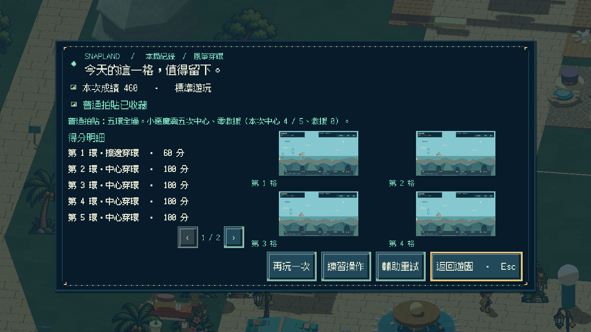
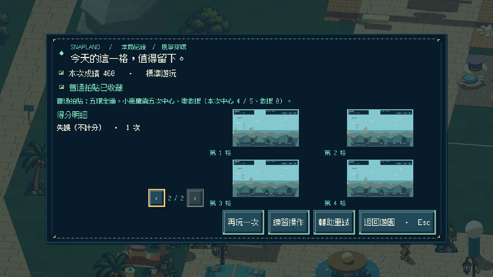
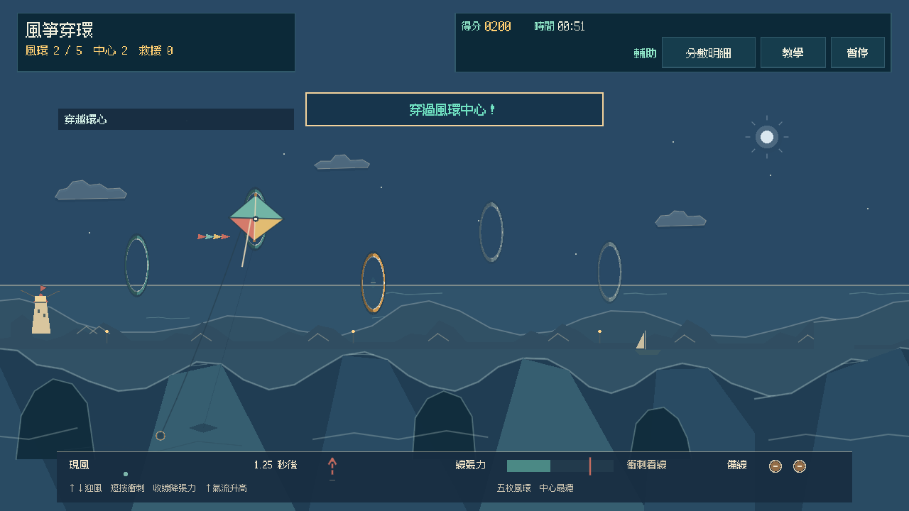
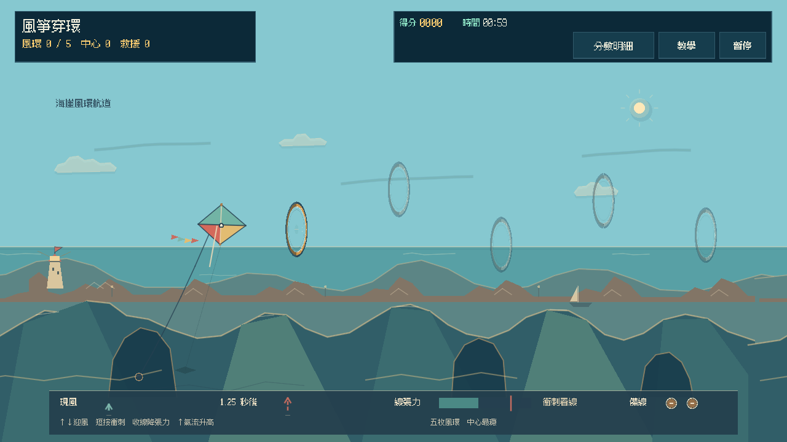

[精準／收藏／私人練習影片](images/SG-17-final-20261022-controls-v3.mp4) · [失敗／普通／夜間輔助影片](images/SG-17-final-20261022-outcomes-v4.mp4) · [新版教材實際顯示](images/SG-17-final-20261022-lesson-final-review-1.jpg) · [六方研究、參考原圖與採用理由](../../design/runtime/kite-flight-design.md) · [驗證與完整範圍](images/SG-17-final-20261022-verification.json) · [原始來源、前後教材與歷史診斷](images/SG-17-final-20261022-sources-and-diagnostics.zip) · [逐檔指紋](images/SG-17-final-20261022-manifest.json)。

補充回歸證據：第一組短標籤且沒有資格說明的合成結果未重現跳動，只作不具決定性的診斷；改用實際可出現的長明細、資格文字與部分末頁後，同一檢查能拒絕舊布局並接受現行布局。這是介面回歸，不冒充自然遊玩。見[前後結果](images/SG-17-final-20261022-ui-regression.json)。
