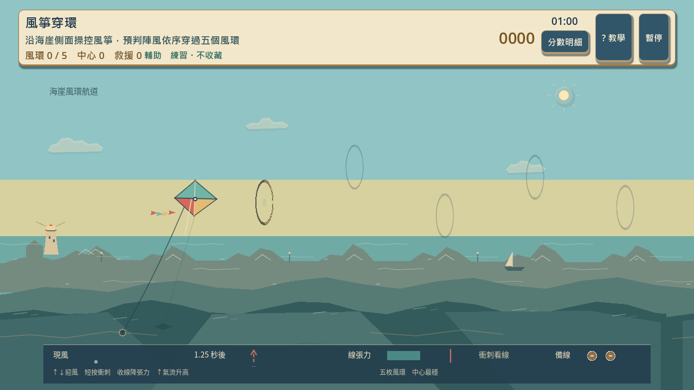
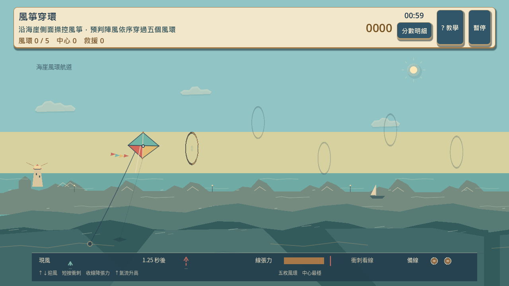
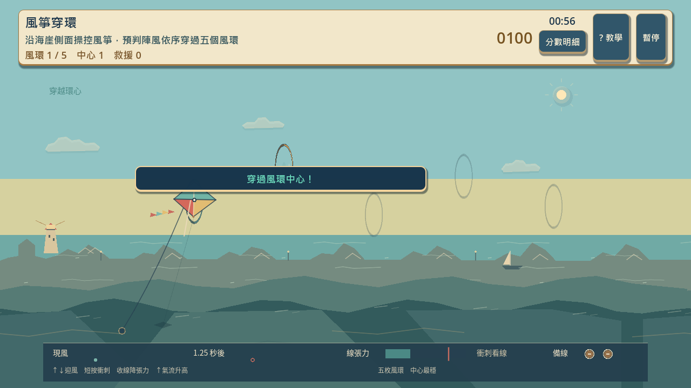
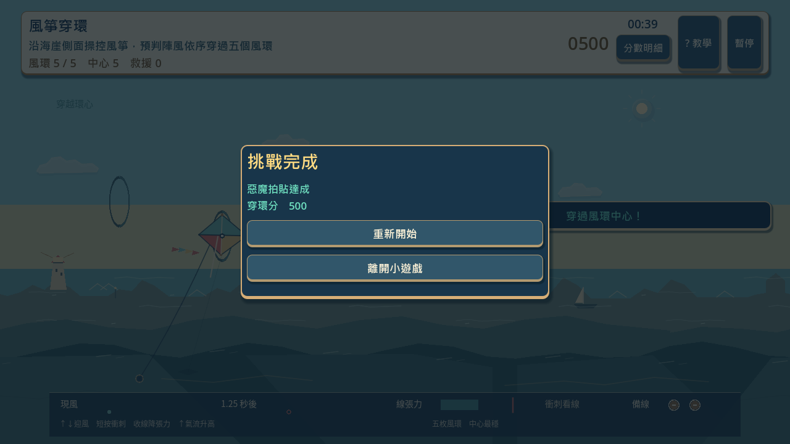
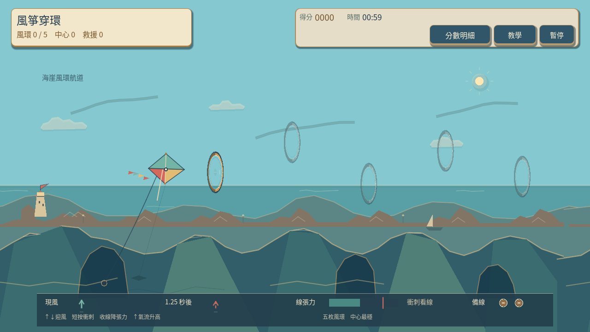
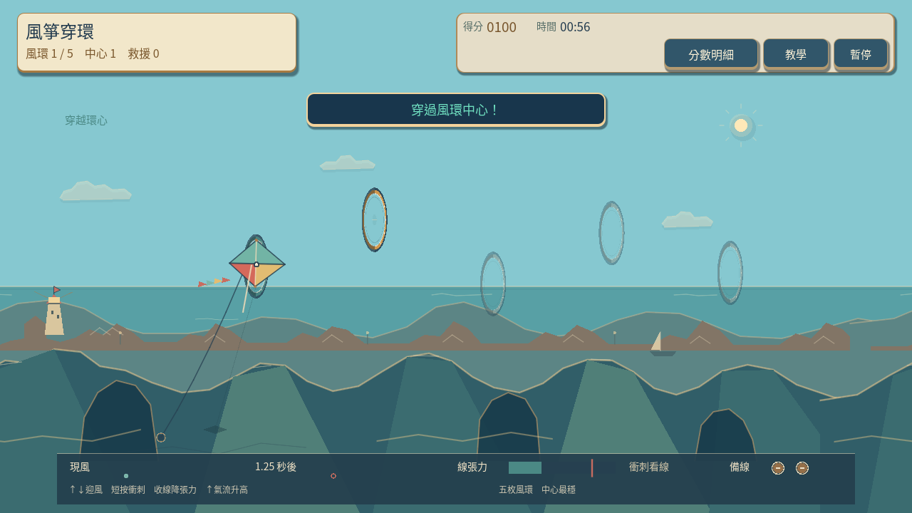
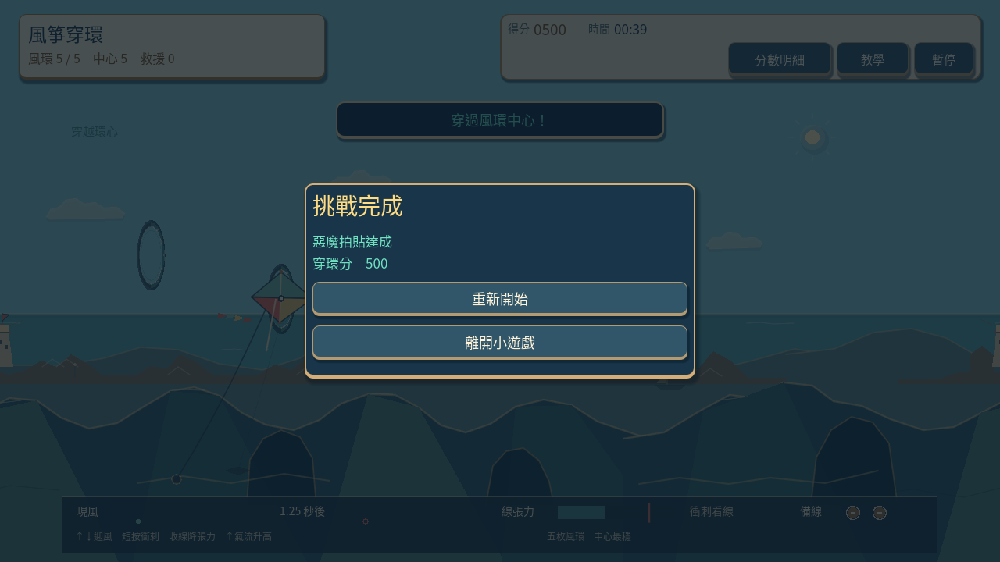
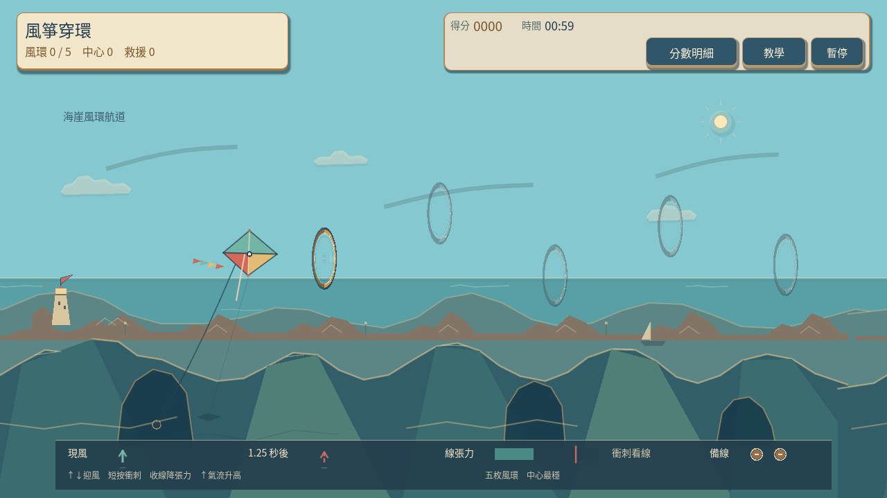
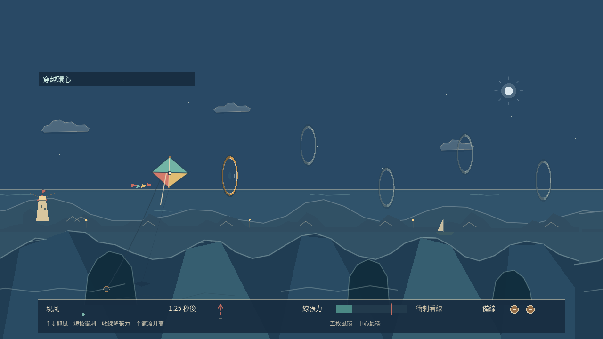

# [SG-17] 精修風箏穿環玩法與計分

> 狀態：進行中

本次接線與原生驗收固定基準：`aae0a1b`；分支：`feature/island-first-park`。

## 內文

### 需求
將風箏穿環提升為可對外展示的完整小遊戲。風環路線與障礙清楚，風箏的加速、轉向和穿環判定可預期，避免只移動靜態圖片。操作手感、目標、分數和演出一起設計，學習內容放在有截圖的完整教學，遊玩時保留必要資訊。

2026-10-12 使用者追加：同一園區維持共同主題，每款小遊戲須依玩法選擇自己的 2D、2.5D、HD-2D 或 3D 表現。不能沿用同一場地、構圖與動畫再換規則；鏡頭、空間、操作節奏和成功演出須帶來可辨認的新體驗。

### 來源
2026-10-12（Asia/Taipei）使用者要求全面重新審閱 UI 和小遊戲，提升目標、計分及操作手感；先廣泛 survey，減少遊戲當下提示，提供含截圖的完整教學。使用者授權自行決定設計，強調循序完善、細節有主次且不雜亂，以可面向大眾的品質驗收。

### 驗收條件
- [ ] 依玩法採用獨立鏡頭、場地、視覺節奏與成功演出；與首區其他遊戲並列比較能辨認不同體驗，海港主題仍一致。
- [x] 比較至少六個跨不同方向的玩法、操控與玩家體驗來源，保存實際閱讀、圖例及選擇理由。
- [ ] 風環路線與障礙清楚，風箏的加速、轉向和穿環判定可預期，避免只移動靜態圖片。
- [ ] 普通、精準表現、失誤及輔助的成績規則明確；結算能說明成果與個別成就資格。
- [ ] 首次學習、練習、正式遊玩、重試和離開形成完整流程，不在教學閱讀時消耗回合時間。
- [x] 正常及輔助、鍵盤及滑鼠、降低動態下以實際输入遊玩驗收；保留正常速度影片、截圖和受影響測試。

### 測試流程
1. 查看本票研究紀錄與圖例，核對採用的原則和原生前後比較。
2. 使用隔離存檔實際操作本票完整流程，核對各項驗收條件。
3. 核對重試、返回、重開與相關設定，保存原生截圖、影片和受影響測試摘要。

---

# 跟其他票的關係

- Blocks：無
- Blocked by：無
- Related：SG-3、SG-14、ART-21、MAIN-10

---

## Commit — 側面飛行接線與原生五環驗收

**問題**
風箏缺乏獨立飛行體驗，滑鼠事件曾被全畫面的介面攔住；教學截圖也未反映新玩法。

**改動**
改為海崖側面航線，迎風角、衝刺與收線形成取捨，畫面直接呈現同一套陣風與張力。教學改用實際航線、陣風及完成畫面。研究紀錄：[風箏玩法](../../design/runtime/kite-flight-design.md)，跨遊戲圖例見 ART-21。

**驗收**
主 Session 局部檢查：模型 29、畫面 83、Session 53 項通過，教學面板測試通過。原生正常速度 43.4 秒、四分之一速度 169.3 秒，鍵盤輔助練習和滑鼠正式回合各五次中心穿環、500 分；衝刺與收線均有生效，正式回合取得惡魔資格。實際觀看飛行及五環結算，修正影片最後畫面後保存。這是原生輸入驗收，不是完整園區真人試玩。

[正常速度](images/SG-17-normal-play.mp4) · [慢放](images/SG-17-slow-play.mp4)

尚待本機原生驗收：Main 首次教學、暫停／重試／離開與收藏持久化完整流程，以及最终美術和跨遊戲體驗比較；因此維持進行中。分支：`feature/island-first-park`。遠端 commit：[71c6146](https://github.com/deadline314/Snapland/commit/71c6146)。

## Commit — 海崖航線與可見風力修訂

**問題**
初版風跡像長橫線，海岸色帶與拱洞被儀表遮住，成功提示也會蓋住風箏；場地缺少可辨認的側向旅程。

**改動**
加入錯開的遠近海崖、燈塔、港屋、帆船及有厚度的風環，以克制的剪紙輪廓呈現海港航線。短風跡、旗尾隨當下真實風力變化，預報另列；成功提示移到風箏之外。降低動態保留玩法訊號，四個時段有可辨認的色調。

**驗收**
主 Session 局部檢查：畫面 100、模型 29、回合整合 81 項通過。正常速度 65.48 秒、四分之一速度 254.08 秒，均以真實事件完成鍵盤輔助練習、滑鼠正式回合及降低動態鍵盤輔助練習三條路線；各五次中心穿環、500 分、零失誤和救援，衝刺與收線均實際生效，正式回合取得惡魔資格。成功提示在實際擷取幀中未與風箏包圍盒重疊，三條路線都擷取自然強風。

主 Session 播放正常與慢放影片至結尾，並查看兩組各 23 張原生截圖及共 12 頁審閱拼圖。四時段與靜態降低動態圖僅是畫面預覽，不冒充 Main 時段切換或完整遊玩；目前模型只有向上的陣風，本段未宣稱原生風向反轉。這是回合輸入與本輪畫面修訂驗收，不是完整園區真人試玩或最終公開品質。

[正常影片](images/SG-17-coast-normal-play.mp4) · [四分之一速度影片](images/SG-17-coast-quarter-play.mp4)

研究：[七項風箏來源與採用理由](../../design/runtime/kite-flight-design.md)、[九款不同體驗的官方資料](../../design/runtime/minigame-diversity-survey.md)、[六張實際看過的比較圖與選擇理由](../../design/runtime/minigame-visual-diversity-review.md)。圖例保存在 ART-21 的票券 images；本輪延續該組審閱，沒有把未觀看的來源影片寫成已驗證。

尚待本機原生驗收：Main 首次教學、重試／離開／收藏完整流程，以及最終美術與十二款並列體驗比較；票況維持進行中。這輪固定基準：`50103433d4e08c19665c56b958325dadc8dd3ec9`，文件基準 `cf719411aca2be6d15bc9a1b6a468e338095e1fb`；分支：`feature/island-first-park`。

夜間與傍晚的事件文字另補深色襯底與淺色字，主 Session 查看 24 張原生畫面預覽和六頁拼圖，確認五種文字在飛行及結果狀態均清楚；其中 20 張為合成事件的畫面測試，不是完成回合。新版本凌晨／中午預覽逐像素比較與先前影片版本相同（RGB 差異 0 像素），上述正常／慢放影片仍對應未變動的白天畫面。新增擷取場景首輪解析失敗，修正明確型別後重新執行為 0 錯誤；不將失敗輪列為通過。

[24 張預覽索引與白天像素比較](images/SG-17-caption-preview-evidence.json) · [重新擷取紀錄](images/SG-17-caption-native.log)
