# [SG-18] 精修噴泉跳拍玩法與計分

> 狀態：完成

開始基準：`783c7ea6aa6c31fd95147da2139096ab280a85ef`；分支：`feature/island-first-park`。

## 內文

### 需求
將噴泉跳拍提升為可對外展示的完整小遊戲。起跳預告、起跳動作與落地拍點一致，提供可理解的判定精度及循序挑戰。操作手感、目標、分數和演出一起設計，學習內容放在有截圖的完整教學，遊玩時保留必要資訊。

2026-10-12 使用者追加：同一園區維持共同主題，每款小遊戲須依玩法選擇自己的 2D、2.5D、HD-2D 或 3D 表現。不能沿用同一場地、構圖與動畫再換規則；鏡頭、空間、操作節奏和成功演出須帶來可辨認的新體驗。

### 來源
2026-10-12（Asia/Taipei）使用者要求全面重新審閱 UI 和小遊戲，提升目標、計分及操作手感；先廣泛 survey，減少遊戲當下提示，提供含截圖的完整教學。使用者授權自行決定設計，強調循序完善、細節有主次且不雜亂，以可面向大眾的品質驗收。

### 驗收條件
- [x] 依玩法採用獨立鏡頭、場地、視覺節奏與成功演出；與首區其他遊戲並列比較能辨認不同體驗，海港主題仍一致。
- [x] 比較至少六個跨不同方向的玩法、操控與玩家體驗來源，保存實際閱讀、圖例及選擇理由。
- [x] 起跳預告、起跳動作與落地拍點一致，提供可理解的判定精度及循序挑戰。
- [x] 普通、精準表現、失誤及輔助的成績規則明確；結算能說明成果與個別成就資格。
- [x] 首次學習、練習、正式遊玩、重試和離開形成完整流程，不在教學閱讀時消耗回合時間。
- [x] 正常及輔助、鍵盤及滑鼠、降低動態下以實際输入遊玩驗收；保留正常速度影片、截圖和受影響測試。

### 測試流程
1. 查看本票研究紀錄與圖例，核對採用的原則和原生前後比較。
2. 使用隔離存檔實際操作本票完整流程，核對各項驗收條件。
3. 核對重試、返回、重開與相關設定，保存原生截圖、影片和受影響測試摘要。

---

# 跟其他票的關係

- Blocks：無
- Blocked by：無
- Related：SG-4、SG-14、ART-21、MAIN-10

---

# Commit-1

## 內文

問題：噴泉起跳原先缺少可核對的提前／延遲判定，最後一跳可能還沒落地就結算，也缺少實際收藏證據。

改動：三個水柱拍點有同一套預告與判定，每跳分別列出精度、時間偏差和分數；八張起跳姿勢播放完並站穩後才結算。空白鍵與滑鼠採相同規則，輔助放寬判定但仍由玩家起跳。

驗收：主 Session 使用隔離存檔，以真實按鍵與點擊完成準確、完美、漏拍及輔助／降低動態路線；兩跳成功一跳漏拍為 500 分，另一個正式回合三跳完美為 900 分。已實際查看普通拍貼、惡魔拍貼與本遊戲成就的相冊畫面，並播放正常及四分之一速度影片核對跳躍和落地。這是現有畫面的判定與動畫驗證，尚不等於獨立場地或角色完整動畫套件完成。

### 測試結果

| 項目 | 結果 |
|---|---|
| 噴泉局部判定與落地 | 39 項通過，無 ERROR |
| 真實鍵盤／滑鼠、漏拍 | 500 分，三跳逐項記錄符合輸入 |
| 輔助與降低動態 | 仍需實際起跳，預告可辨 |
| 三跳完美與收藏 | 900 分；兩種拍貼及成就已見於相冊 |
| 正常及四分之一速度 | 均通過，執行紀錄無 ERROR |

待本機原生驗收：噴泉獨立鏡頭和美術、完整首次教學／私人練習／重試流程，以及更細緻的角色動作。票維持進行中。

### 來源與畫面

[七個來源、判定取捨及實際驗證範圍](../../design/runtime/fountain-quality.md) · [六個實際看過的跨方向官方圖例](../../design/runtime/minigame-visual-diversity-review.md)

[正常速度原生影片](images/SG-18-normal-play.mp4) · [四分之一速度原生影片](images/SG-18-slow-play.mp4)

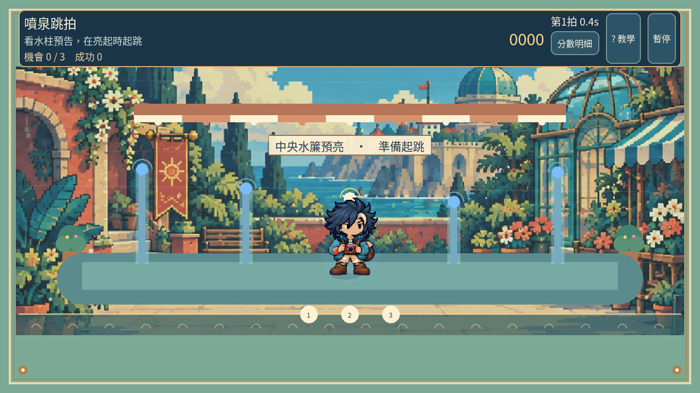
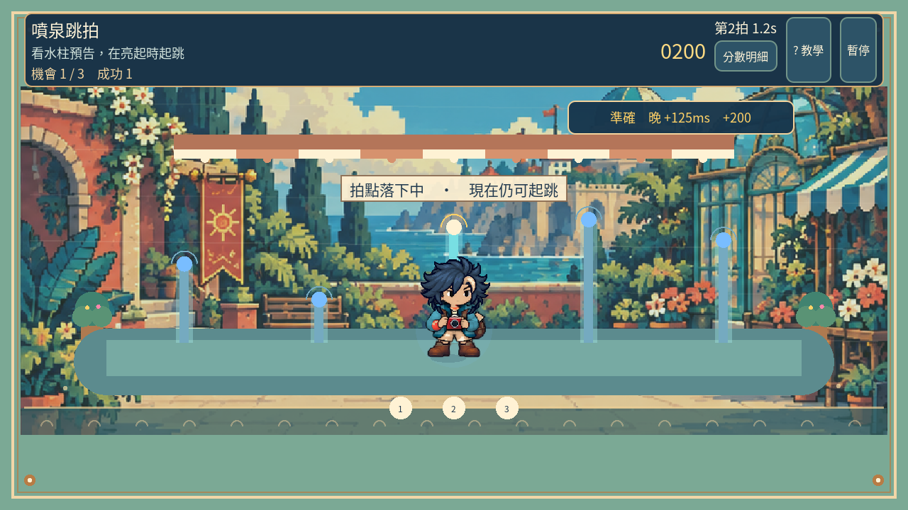
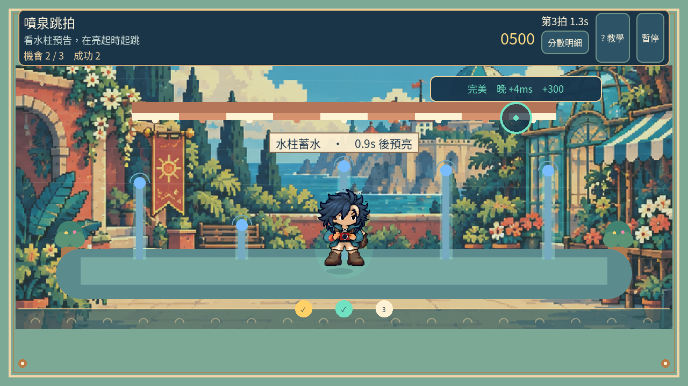
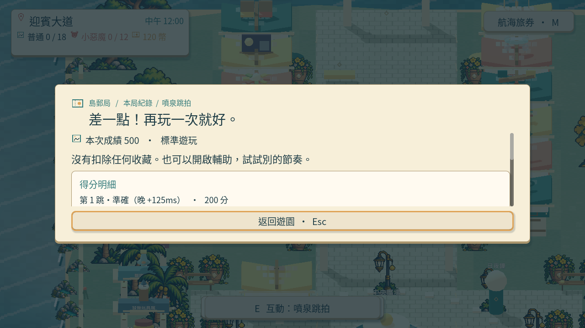
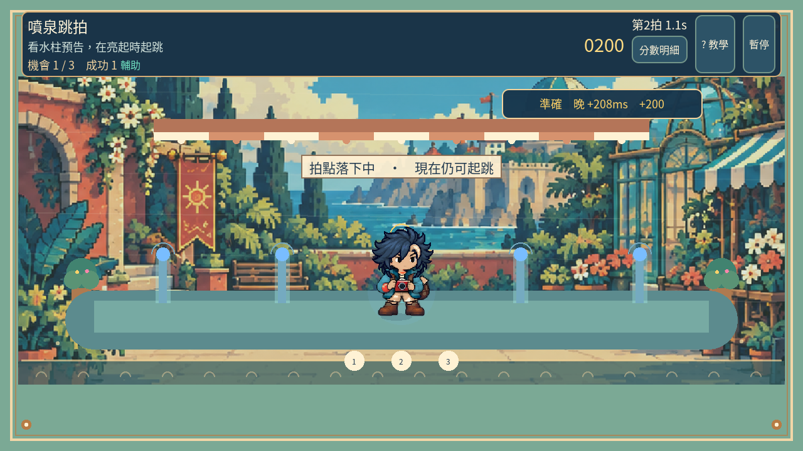
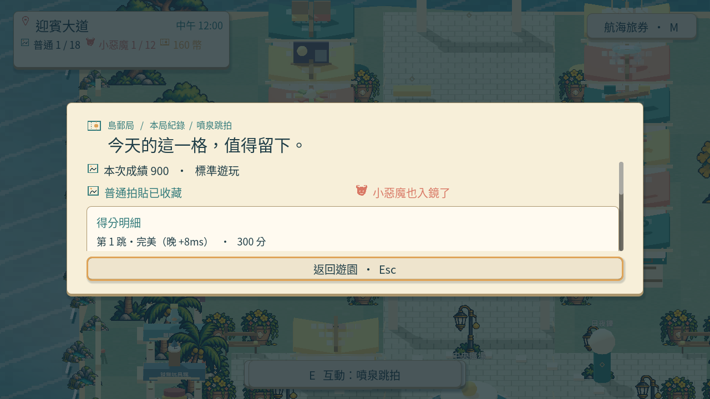
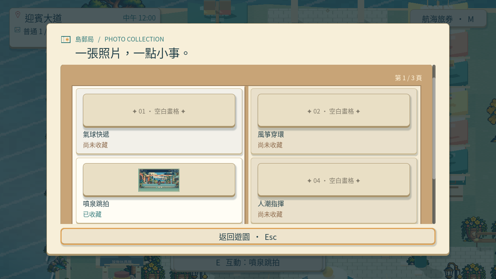
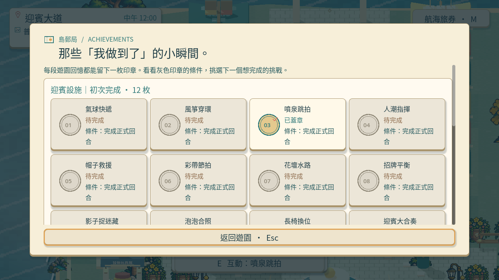

分支：`feature/island-first-park`。遠端提交：[32df4b3](https://github.com/deadline314/Snapland/commit/32df4b301c3c5afca1e0ac6eab272e537469ce64)。

# Commit-2

## 內文

問題：噴泉跳拍雖已有可核對的判定，仍沿用平面海港場地，與其他小遊戲的空間體驗差異不足。

改動：改成近距離斜視的 3D 噴泉庭院，旅人站在池前踏台，中央水柱的升降直接呈現下一拍；白天與夜晚有各自水面、庭院陰影和燈光。教學圖片同步改成實際庭院、懸空姿勢及正式結算。

驗收：主 Session 實際查看正常與四分之一速度影片，檢查角色頭部、手腳、池緣和舞台邊界，看到白天與夜晚的不同照明。以真實按鍵完成兩跳成功一跳漏拍的 500 分、輔助／降低動態夜晚的一次一般命中 100 分，以及三跳完美的正式 900 分；暫停、恢復與確認重試後歸零皆符合操作。這是獨立場地與已操作路線的交付紀錄，未將完整角色動畫套件或最終美術列為完成。

### 測試結果

| 項目 | 結果 |
|---|---|
| 判定、3D 畫面與共用遊戲流程 | 主 Session 重跑 43／62／53 項，全部通過 |
| 正常速度原生錄影 | 894 幀、14.90 秒，預期 PASS，無 ERROR |
| 四分之一速度原生錄影 | 3359 幀、55.98 秒，預期 PASS，無 ERROR |
| 白天／夜晚與完整角色 | 已看過實際畫面及慢放中的正式回合 |

待本機原生驗收：完整首次教學／離開再進入、此 3D 場景的滑鼠與換裝組合、更細緻的角色動作和最終環境美術。票維持進行中，其餘驗收條件未勾選。

### 來源與畫面

[七個跨方向來源、3D 呈現取捨及實際驗收範圍](../../design/runtime/fountain-jump-view.md) · [六個親自看過的官方圖例](../../design/runtime/minigame-visual-diversity-review.md)

[正常速度 3D 原生影片](images/SG-18-3d-normal.mp4) · [四分之一速度 3D 原生影片](images/SG-18-3d-slow.mp4)

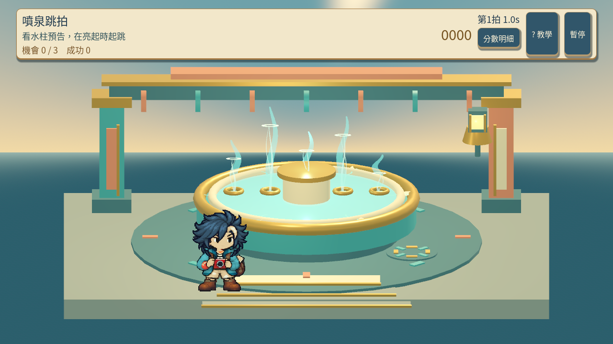
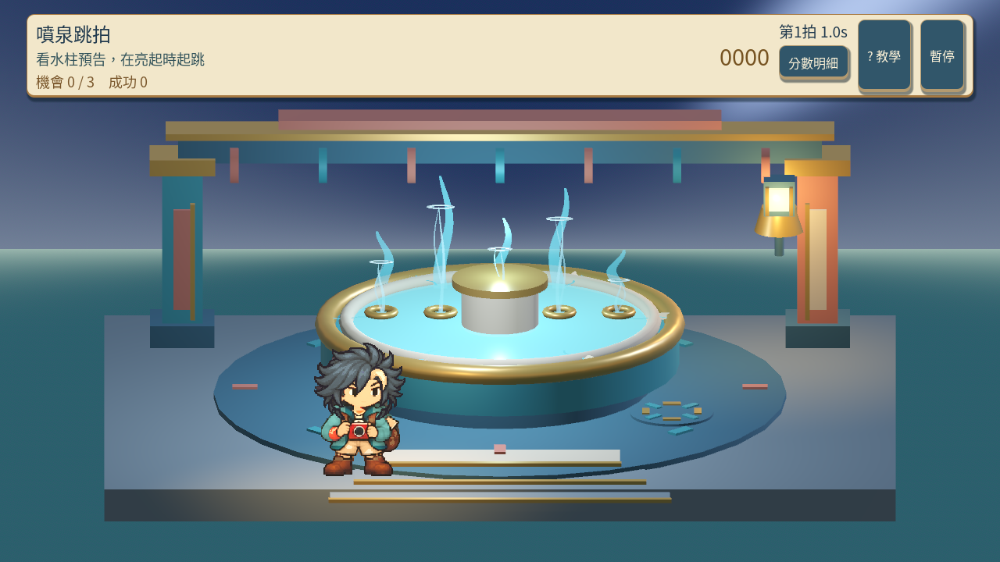
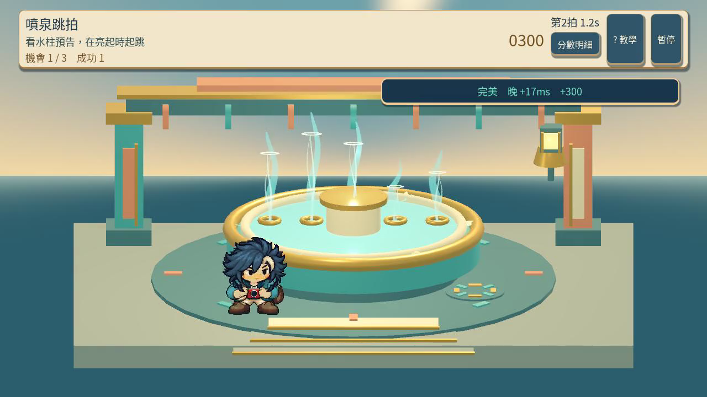

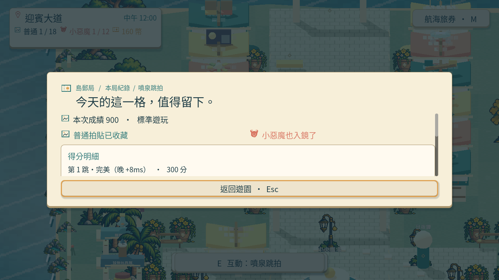

開始基準：`eed390e2063b4d3b7c38a7530fef7bb00a52efed`；分支：`feature/island-first-park`。遠端提交：[6954b68](https://github.com/deadline314/Snapland/commit/6954b68bc70d68647c3bc7fc9231923f48ff7524)。

# Commit — 2026-10-23 三段數拍、循序挑戰與資格說明

## 問題

三跳等距、整局約 4.5 秒，唯一預告是被中央底座擋住大半的水柱高度，看不出「還有幾拍才跳」，三跳之間也沒有難度變化。輔助回合三跳完美時結算仍顯示「小惡魔也入鏡了」，與首區其他精修遊戲「未開輔助」才得小惡魔的規則矛盾；結算沒有說明這次差在哪裡。遊戲說明頁也寫著「輔助遊玩收藏資格相同」。

## 改動

一局改為三段：慢拍（每拍 0.60 秒）、快拍（0.45 秒）、休止拍（第三拍不響）。每段先數三拍——側邊水柱依序湧起、前景拍燈從左到右亮一格並響一聲——第四拍中央水柱升到最高就是起跳拍；休止拍的拍燈改亮藍色、沒有聲音，要靠心中節拍。起跳燈與水池前緣三顆寶石顯示每跳評價，落地時腳邊出現同色水花。降低動態時水柱與跳躍不位移，拍燈與顏色照樣提示；聲音不是唯一線索。

判定窗與分數不變（完美 ±70ms 300、準確 ±160ms 200、踩中 ±220ms 100；輔助 ±110／240／340ms）。普通拍貼仍是三跳全中；小惡魔改為未開輔助且三跳完美。結算逐跳列出段落、評價和毫秒差，並說明本次資格，例如「本次 2 / 3，錯過 1」「本次完美 2 / 3」或「輔助回合不取得小惡魔拍貼」。遊戲說明頁改為「仍可收藏普通拍貼；小惡魔是否要求未開輔助，以上方條件為準」。三頁教學換成現行實際畫面並重寫說明；移除已不會繪製、卻仍每局替它準備角色姿勢的舊平面噴泉。

## 驗收

以隔離存檔從園區站點進入，固定 60 FPS 遊戲時鐘、真實按鍵與點擊：

| 路線 | 實際結果 |
|---|---|
| 輔助＋降低動態、夜晚、鍵盤 | 三跳完美 900 分，只收藏普通拍貼；結算寫明輔助不取得小惡魔 |
| 標準、正午、鍵盤 | 數拍中提早按只提示、不耗機會；暫停凍結時鐘、恢復、確認重試歸零；三跳完美 900 分，取得小惡魔拍貼與本遊戲成就 |
| 標準、黃昏、只用滑鼠（從結算「再玩一次」） | 準確、快拍錯過、踩中共 300 分，未達普通；結算寫「本次 2 / 3，錯過 1」，進度不變 |
| 私人練習（滑鼠） | 結算為練習、不保存；收藏、成就、金幣、衣物與待同步項目不變，返回遊園 |
| 首次教學（遊戲 3、4） | 新存檔首次進入顯示三頁實際畫面教學，鍵盤與滑鼠翻頁、開始後記為已學；遊戲中開教學時回合與模型時鐘不動，重看、私人練習與返回皆正常 |

輸入落點實測與目標相差不到半格（例：目標 +90ms 實得 +83ms、滑鼠 +120ms 得 +117ms）。

### 測試結果

| 項目 | 結果 |
|---|---|
| 原生完整路線 | exit 0、0 ERROR；3103.71 秒（固定 60 FPS，共用 4 核機器） |
| 原生正常速度影片 | 699 格／11.65 秒，exit 0、0 ERROR；含進站、提早按、暫停與重試、三段正式回合 |
| 原生首次教學流程（遊戲 3、4） | 兩款 PASS，exit 0、0 ERROR |
| 噴泉判定／3D 庭院／首區小遊戲／教學頁與面板／小遊戲介面 | 局部套件全部通過（新增數拍音、休止、資格說明、長影格不連發等檢查） |
| Python 全套／設計驗證 | 147 項通過；5 範圍通過 |

已實際查看全部截圖、兩段影片的抽格總覽，以及首區十二款現行遊戲畫面並列圖：噴泉是近距離斜視的立體庭院與角色起跳，與氣球的俯看港灣、風箏的側向海崖、人潮的俯視路口等並列可辨。原生驗收由腳本以真實輸入操作，不是真人試玩；數拍聲走既有音符聲道，沒有實際試聽。機器負載很高，教學流程檢查以 `--watchdog-scale=10` 放寬牆鐘看門狗（預設不變）；先前在 60 秒與並行負載下逾時的紀錄保留在本機，不改任何遊戲時限或判定。

### 截圖與影片

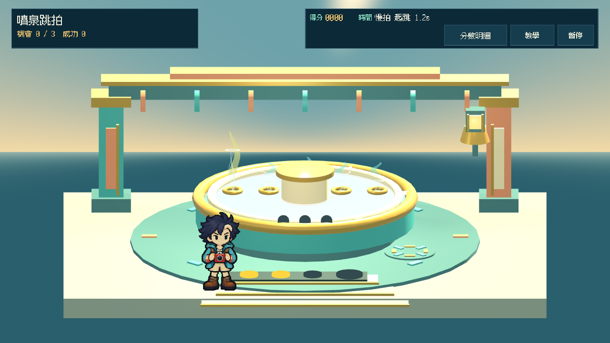
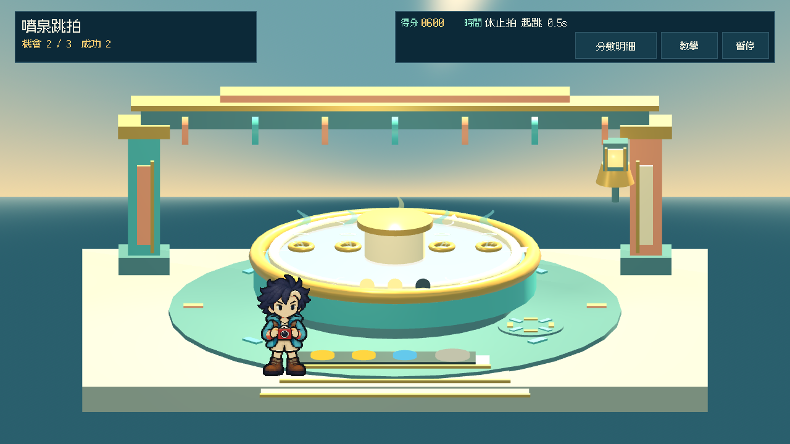
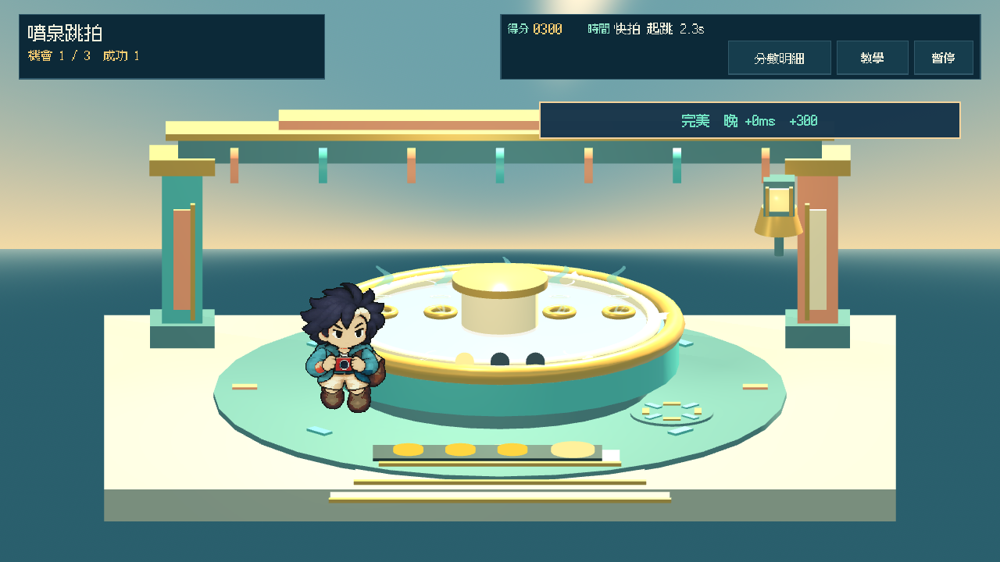
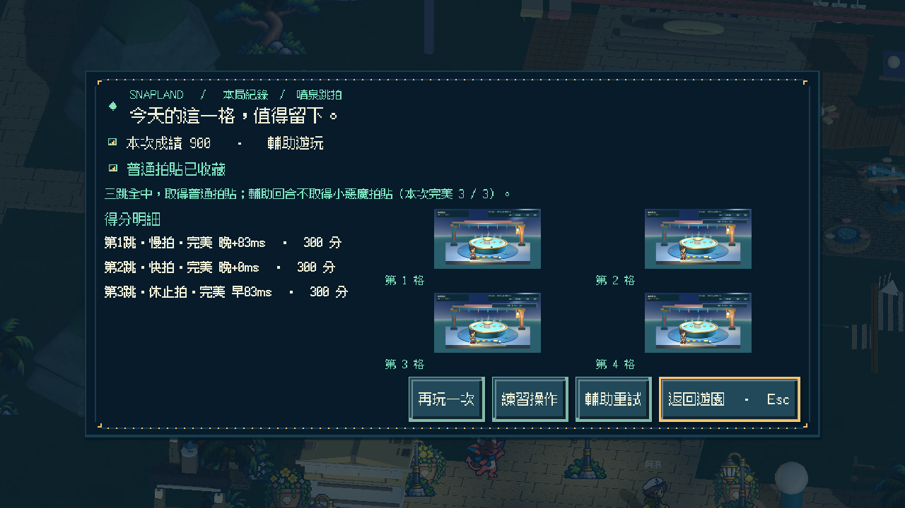
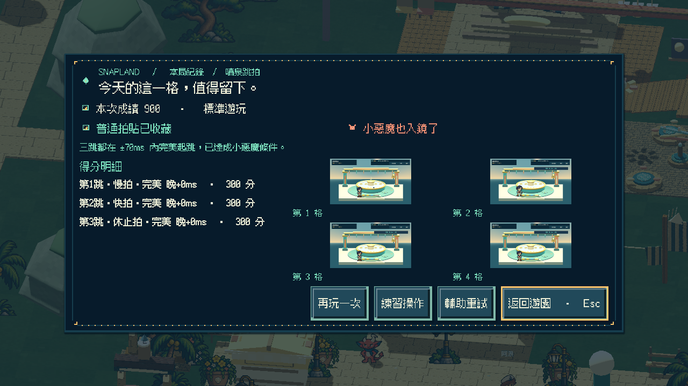
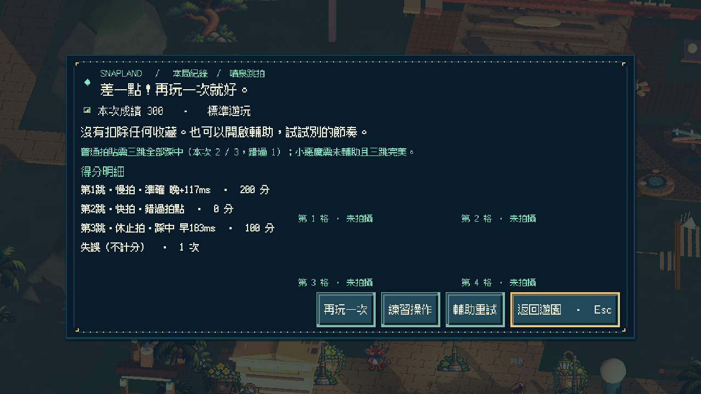
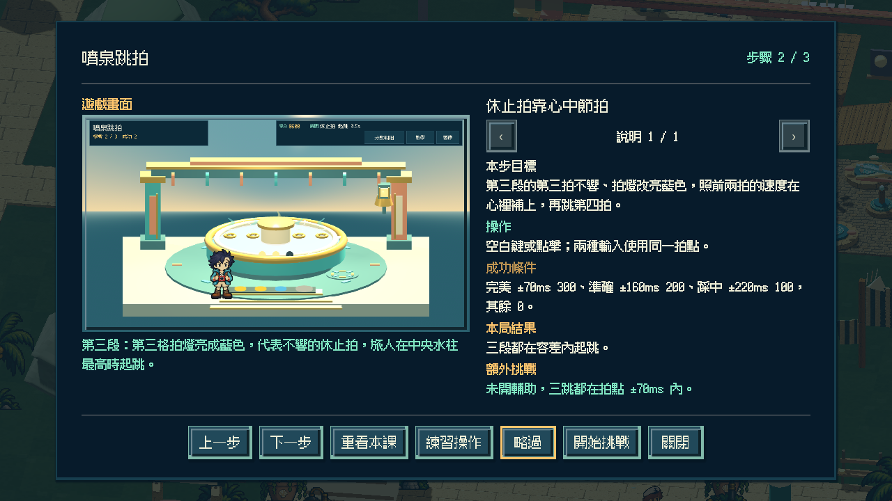
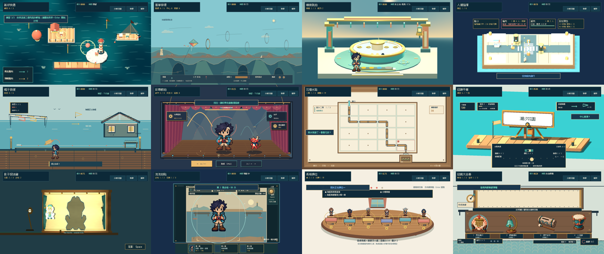

[正常速度影片](images/SG-18-final-20261023-sg18.mp4) · [影片抽格總覽](images/SG-18-final-20261023-sheet.png) · [快拍數拍](images/SG-18-final-20261023-noon-quick-count.png) · [提早按提示](images/SG-18-final-20261023-early-press-feedback.png) · [夜晚降低動態數拍](images/SG-18-final-20261023-assist-reduced-night-count.png) · [黃昏滑鼠起跳](images/SG-18-final-20261023-dusk-mouse-airborne.png) · [私人練習](images/SG-18-final-20261023-practice-result.png) · [設計與本輪閱讀](../../design/runtime/fountain-phrases.md)

開始基準：`2e95cc6`；分支：`work/sg-18-19`。

