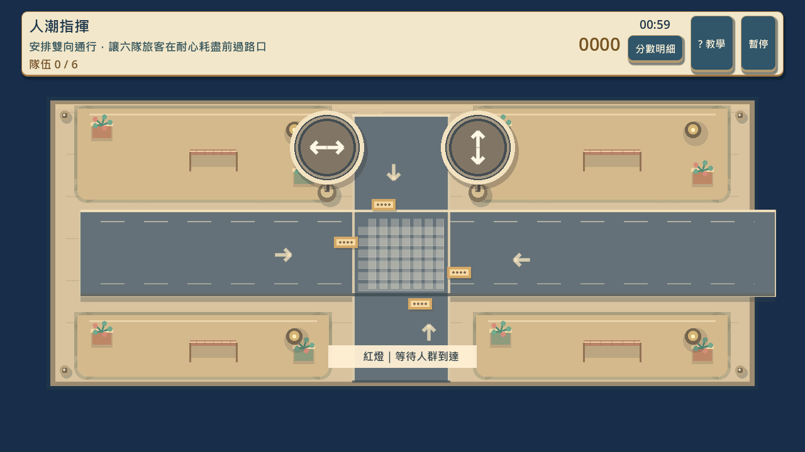
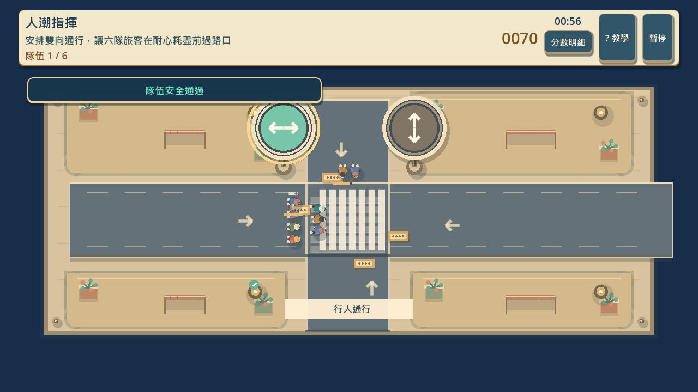
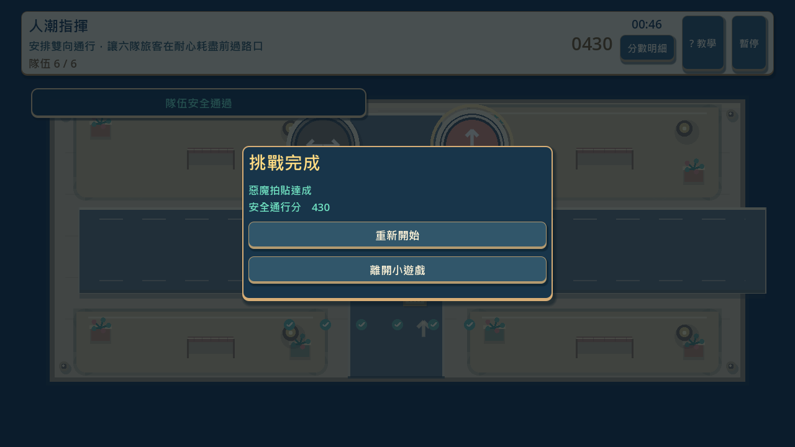
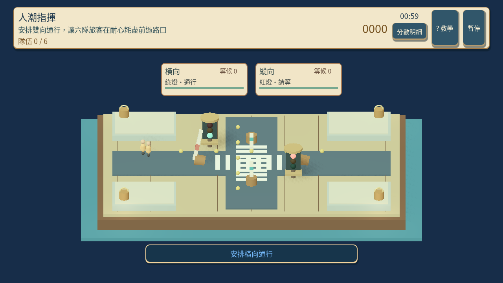
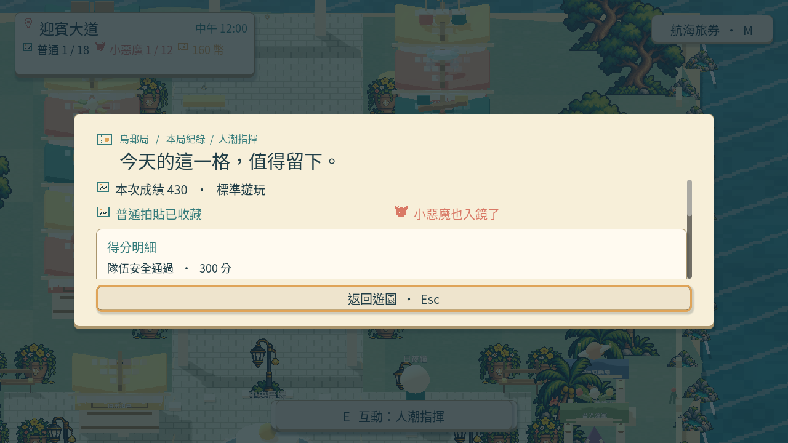
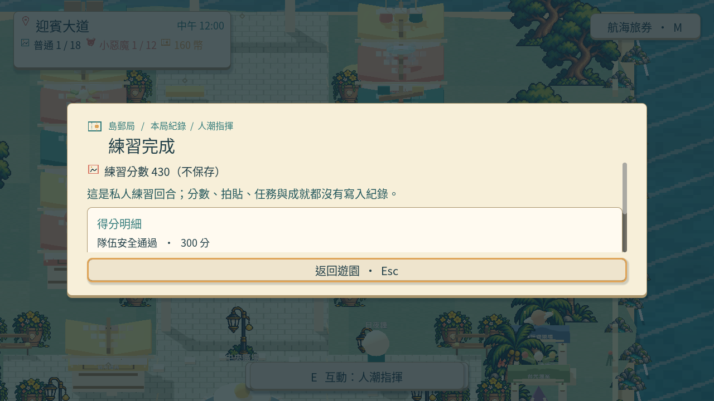

# [SG-19] 精修人潮指揮玩法與計分

> 狀態：進行中

## 內文

### 需求
將人潮指揮提升為可對外展示的完整小遊戲。隊伍需求、路口風險和號誌效果可辨，讓玩家能計畫通行順序，而非只交替按鍵。操作手感、目標、分數和演出一起設計，學習內容放在有截圖的完整教學，遊玩時保留必要資訊。

2026-10-12 使用者追加：同一園區維持共同主題，每款小遊戲須依玩法選擇自己的 2D、2.5D、HD-2D 或 3D 表現。不能沿用同一場地、構圖與動畫再換規則；鏡頭、空間、操作節奏和成功演出須帶來可辨認的新體驗。

### 來源
2026-10-12（Asia/Taipei）使用者要求全面重新審閱 UI 和小遊戲，提升目標、計分及操作手感；先廣泛 survey，減少遊戲當下提示，提供含截圖的完整教學。使用者授權自行決定設計，強調循序完善、細節有主次且不雜亂，以可面向大眾的品質驗收。

### 驗收條件
- [ ] 依玩法採用獨立鏡頭、場地、視覺節奏與成功演出；與首區其他遊戲並列比較能辨認不同體驗，海港主題仍一致。
- [x] 比較至少六個跨不同方向的玩法、操控與玩家體驗來源，保存實際閱讀、圖例及選擇理由。
- [ ] 隊伍需求、路口風險和號誌效果可辨，讓玩家能計畫通行順序，而非只交替按鍵。
- [ ] 普通、精準表現、失誤及輔助的成績規則明確；結算能說明成果與個別成就資格。
- [ ] 首次學習、練習、正式遊玩、重試和離開形成完整流程，不在教學閱讀時消耗回合時間。
- [ ] 正常及輔助、鍵盤及滑鼠、降低動態下以實際输入遊玩驗收；保留正常速度影片、截圖和受影響測試。

開始基準：`92e68e4`。

### 測試流程
1. 查看本票研究紀錄與圖例，核對採用的原則和原生前後比較。
2. 使用隔離存檔實際操作本票完整流程，核對各項驗收條件。
3. 核對重試、返回、重開與相關設定，保存原生截圖、影片和受影響測試摘要。

---

# 跟其他票的關係

- Blocks：無
- Blocked by：無
- Related：SG-5、SG-14、ART-21、MAIN-10

---

# Commit-2

## 內文

問題：原本人潮遊戲依固定拍點換燈，隊伍幾乎不會同時等待，玩家缺少安排次序的理由，畫面也與其他小遊戲共用場地。

改動：改成俯視海港路口，兩側各自排隊，紅燈停在線後；已開始過路的人必須完整走完，清場和全紅後才換向。六隊以重疊時程抵達，救援隊有擔架與較短耐心，不能跳過同向隊伍；玩家須比較兩側等待期限。安全通過給基礎分，等候效率與救援另計，全部六隊達普通資格，至少 430 分達惡魔資格。教學更換成此版實際路口截圖。

驗收：主 Session 在隔離存檔用實際滑鼠選縱向、Q 選橫向，接著依等待期限安排通行；正常與四分之一速度均完成六隊、430 分，捕捉兩側同時排隊、救援進場與結果。原生畫面查看確認人物、擔架和訊號對應；影片播放檢視通行片段。局部規則驗證也確認：選全局最早抵達反而會讓救援逾期；較慢但全隊安全仍可獲普通資格，效率不足不給惡魔。這是原生輸入與模型驗證，不當作真人完整試玩或十二款全部完成。

### 測試結果

| 項目 | 結果 |
|---|---|
| 通行、重疊等待、救援與成績 | 56 項通過 |
| 俯視路口顯示與邊界 | 64 項通過 |
| 首區小遊戲局部回歸 | 52 項通過 |
| 教學與主場景整合 | 通過，無 ERROR |
| 原生正常／四分之一速度 | 六隊安全、430 分；無 ERROR |

待本機原生驗收：鍵盤獨立、滑鼠獨立、輔助及降低動態、失誤結算、完整教學／練習／重試／返回流程。票維持進行中，不以混合輸入通關勾選全部條件。

### 研究、影片與截圖

[通行設計與八個實讀來源](../../design/runtime/crowd-gameplay-design.md)、[跨玩法的官方遊戲比較](../../design/runtime/first-park-gameplay-quality.md)、[不同鏡頭與媒材](../../design/runtime/minigame-diversity-survey.md)、[六款官方畫面圖例](../../design/runtime/minigame-visual-diversity-review.md)。交通來源提供訊號、清空及優先次序原則，遊戲的短秒數不是現實道路規格。

[正常速度原生影片](images/SG-19-normal-play.mp4) · [四分之一速度原生影片](images/SG-19-slow-play.mp4)

分支：`feature/island-first-park`。遠端提交：[d6a8ace](https://github.com/deadline314/Snapland/commit/d6a8ace38401df5854081d03c7f20647bf9bdbf4)。

# Commit-3

## 內文

問題：平面路口雖然能通關，空間演出與其他小遊戲缺少差異。早期立體版本太小，後續操作訊息又壓住號誌標題，不能清楚安排通行。

改動：路口改成可操作的立體港口模型，閘門與號誌按照通行階段開合，旅客沿所選方向過路，其餘隊伍在線後等待。兩張狀態卡分開顯示等候與耐心；訊息放在路口下方，避免遮住決策資訊。滑鼠點選與 Q／E 共用同一通行規則；教學換成這版實際畫面。

驗收：主 Session 重跑局部檢查，以真實鍵鼠完成六隊正式通行、暫停恢復及確認重試，再完成輔助／降低動態的私人練習。正常及四分之一速度影片均實際查看，看到路口、閘門與隊伍變化，訊息不再遮住號誌卡；私人練習後完整保存狀態保持一致，返回遊園會釋放本局。隊伍目前是六組立體棋子，並非六位已有整套動畫的 NPC；最終人物美術另行完善。

### 測試結果

| 項目 | 結果 |
|---|---|
| 通行、清場、救援與成績 | 主 Session 重跑 56 項通過 |
| 立體路口、動態、指標輸入與邊界 | 主 Session 重跑 30 項通過 |
| 共用回合及訊息位置 | 主 Session 重跑 73 項通過 |
| 當前截圖教學 | 主 Session 重跑教學面板通過 |
| 正常速度原生流程 | 1886 幀，31.433 秒，正式／私人均完成，無 ERROR |
| 四分之一速度原生流程 | 7355 幀，122.583 秒，正式／私人均完成，無 ERROR |

正式示例六隊安全通行、430 分，取得普通及小惡魔拍貼；私人練習不新增拍貼、成就、任務、衣物、貨幣或平台待同步項。待本機原生驗收：獨立純鍵盤與純滑鼠回合、失誤結算、完整首次教學及最終美術品質；票維持進行中，不因立體場景與混合輸入通關勾選完整條件。

### 來源與畫面

[立體號誌設計與跨方向比較](../../design/runtime/crowd-semaphore-design.md) · [實際流程及觀察範圍](../../design/runtime/crowd-semaphore-native-review.md)

[正常速度原生影片](images/SG-19-spatial-normal-v5.mp4) · [四分之一速度原生影片](images/SG-19-spatial-slow-v5.mp4)

開始基準：`f3a276f34886ea3e3b790f5fc38194c364513d2d`；分支：`feature/island-first-park`；遠端提交：[立體號誌與操作驗收](https://github.com/deadline314/Snapland/commit/17cf634fd6a654a6a4c63572ab0e2e041429e2c9)。
