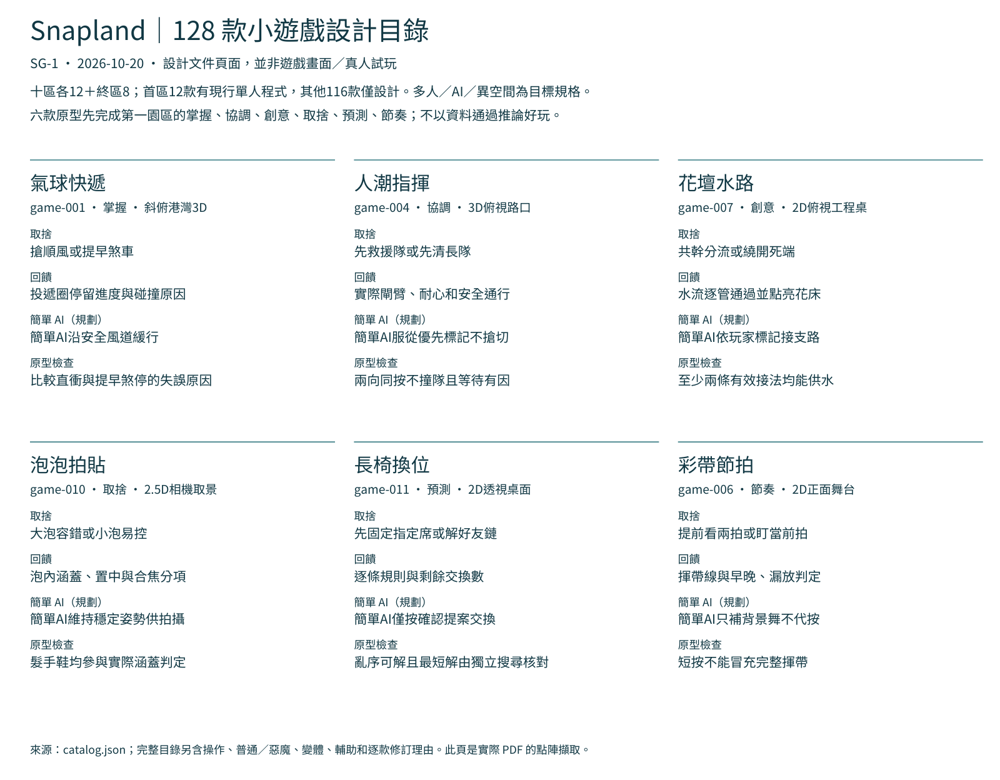

# [SG-1] 重設小遊戲樂趣目錄

> 狀態：完成

## 內文

### 需求
以已研究的樂趣核心重設 128 款基本小遊戲，逐款提供可評估的操作、取捨、回饋、單人與多人玩法，以及延伸核心機制的小惡魔條件與異空間。

### 來源
使用者於 2026-10-06 的 Snapland 對話要求依業界案例整理的樂趣核心重整設計並按票交付；設計基線見 design/06-roadmap/open-questions.md。

### 驗收條件
- [x] 十區各十二款與終區八款完整列出，編號唯一且變體沒有計入基本款數。
- [x] 每款可查樂趣核心、操作目標、取捨、回饋、重玩變化與原型檢查。
- [x] 每款有單人、多人、簡單 AI、輔助及小惡魔取得方式。
- [x] 前版候選保留、重設或替換的理由與六款原型次序清楚可查。
- [x] 有可重現的目錄驗證結果與文件截圖。

### 測試流程
1. 閱讀交付規格並逐項對照驗收條件。
2. 執行受影響範圍的設計驗證，確認有效資料通過、錯誤資料能被拒絕。
3. 比對文件與截圖，預期全部條件可追溯且沒有虛報實際遊戲試玩。

---

# 跟其他票的關係
- Blocks：無
- Blocked by：無
- Related：無

---

# Commit-1 — 2026-10-20 完整候選規格

固定開始 SHA：`5560c2380fa089a6ef9cfe1fb4d63fba80006e73`；分支：`codex/finish-runtime-batch-20261020`。

原本只有128款的數量基線，沒有可逐款檢查的目錄，設計CI因此缺檔失敗。現在十區各十二款及終區八款完整列出，每款有操作、目標、取捨、回饋、重玩變化、單人／多人／簡單AI、輔助、小惡魔、異空間與原型問題；逐款修訂理由及六款優先順序可查。

保留首區十二款現行單人規則，重設其餘116個未交付逐款規格的候選；沒有捏造舊款名稱或舊試玩結論。異空間不計基本款，終區技巧不新增惡魔拍貼。首區有些現行惡魔規則排除輔助，已忠實標明；沒有把未實作的內容同等取得說成已驗收。

### 研究與採用流程

[七個官方／開發者來源、逐款修訂與不採用理由](../../design/02-minigames/revision-notes.md)。實際讀文字、查看Panic官方靜態原圖；未看影片或遊玩參考作品。先比較動詞、資訊、失敗原因與第二用途；共用物件需能放下／固定，讓單人按順序交接。六個不同樂趣中心先在首區驗證，不能用128數字推論內容豐富或好玩。

### 驗收

| 項目 | 結果 |
|---|---|
| 目錄 | 128唯一編號、十區各12及終區8，六種樂趣覆蓋 |
| 設計五範圍 | 全部通過；沒有略過原檢查 |
| Python完整可用回歸 | 101／101通過，含缺AI、修訂理由、重複原型、未知原型、首區規則漂移等反例 |
| 文件畫面 | 實際PDF頁面點陣擷取並檢視；初版錯字型候選拒收 |
| 遊戲／真人試玩 | 本票未執行，不由文件或資料測試推論 |

[完整可讀目錄](../../design/02-minigames/catalog.md) · [六款原型順序](../../design/02-minigames/prototype-order.md) · [驗證範圍與雜湊](images/SG-1-verification.json) · [Python記錄](images/SG-1-python-full.log)。本票結案只代表設計需求交付，沒有把其他實作票結案。

### Commit

[47f9601](https://github.com/deadline314/Snapland/commit/47f960151f1bf339ef81a4da73e8965c4f443346)：本票內容已正常快轉推送，隨後fetch確認HEAD、本機main與origin/main一致。
