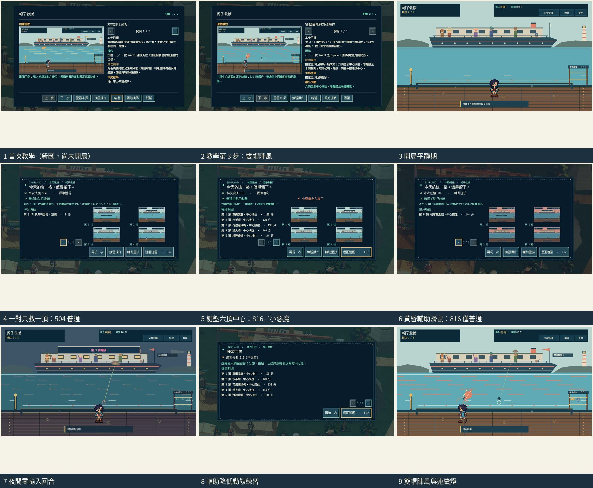

# [SG-20] 精修帽子救援玩法與計分

> 狀態：完成

## 內文

### 需求
將帽子救援提升為可對外展示的完整小遊戲。落帽、風勢與角色接帽動作互相對應，讓走位、救援取捨和連續成功有可見成果。操作手感、目標、分數和演出一起設計，學習內容放在有截圖的完整教學，遊玩時保留必要資訊。

2026-10-12 使用者追加：同一園區維持共同主題，每款小遊戲須依玩法選擇自己的 2D、2.5D、HD-2D 或 3D 表現。不能沿用同一場地、構圖與動畫再換規則；鏡頭、空間、操作節奏和成功演出須帶來可辨認的新體驗。

### 來源
2026-10-12（Asia/Taipei）使用者要求全面重新審閱 UI 和小遊戲，提升目標、計分及操作手感；先廣泛 survey，減少遊戲當下提示，提供含截圖的完整教學。使用者授權自行決定設計，強調循序完善、細節有主次且不雜亂，以可面向大眾的品質驗收。

### 驗收條件
- [x] 依玩法採用獨立鏡頭、場地、視覺節奏與成功演出；與首區其他遊戲並列比較能辨認不同體驗，海港主題仍一致。
- [x] 比較至少六個跨不同方向的玩法、操控與玩家體驗來源，保存實際閱讀、圖例及選擇理由。
- [x] 落帽、風勢與角色接帽動作互相對應，讓走位、救援取捨和連續成功有可見成果。
- [x] 普通、精準表現、失誤及輔助的成績規則明確；結算能說明成果與個別成就資格。
- [x] 首次學習、練習、正式遊玩、重試和離開形成完整流程，不在教學閱讀時消耗回合時間。
- [x] 正常及輔助、鍵盤及滑鼠、降低動態下以實際输入遊玩驗收；保留正常速度影片、截圖和受影響測試。

### 測試流程
1. 查看本票研究紀錄與圖例，核對採用的原則和原生前後比較。
2. 使用隔離存檔實際操作本票完整流程，核對各項驗收條件。
3. 核對重試、返回、重開與相關設定，保存原生截圖、影片和受影響測試摘要。

---

# 跟其他票的關係

- Blocks：無
- Blocked by：無
- Related：SG-6、SG-14、ART-21、MAIN-10

---

# Commit-1｜v12 操作與回合驗收

## 問題

走位、短暫伸手與帽子真正經過手線的時刻，共同決定能否接住。實際慢放也發現，方向鍵按住時滑鼠微移會改變當前控制方式，讓走位方向不穩。

## 改動

滑鼠微移不會打斷持續按住的方向鍵；放開方向鍵後仍可用滑鼠走位，左鍵仍能直接走位並伸手。分數仍由實際接帽位置及操作時機決定。

## 驗收

使用隔離存檔從 Main 啟動。正常與四分之一速度都完成正式回合，六頂中心接住、零漏接、816 分，普通及小惡魔成果通過；暫停／恢復、重試、輔助私人練習也通過。私人練習六頂中心接住、816 分，不取得小惡魔成果，所比較的收藏與玩家進度沒有改變。Park 私人離開、第一次教學理解、五十套服裝及三位完整動畫 NPC 未在此輪驗證。

## 記錄

[v12 原生記錄與後續步態補驗](../../design/runtime/hat-rescue-native-v12-evidence.md)

# Commit-2｜v13 全步態與原生驗收

## 問題

旅人走路時會重複少數幾個姿勢，而且原地等候也會繼續踏步，因此移動看起來不夠自然。

## 改動

走路姿勢隨角色實際移動前進；停下時腳步停住，掉頭時延續步伐，重試才重新起步。教學截圖更新為實際正常速度畫面，並保留接帽動作及分數規則。

## 驗收

使用隔離存檔由 Main 開始遊戲。正常速度與四分之一速度都自然完成：正式鍵盤回合六頂中心接住、零漏接、816 分，普通與小惡魔成果通過；暫停／繼續、重試及確認歸零都通過。接著以輔助和降低動態進行私人滑鼠練習，也六頂中心接住、816 分，但沒有小惡魔成果，所比較的收藏和玩家進度維持原樣。

兩段實際遊玩都看得到十二個伸手姿勢，以及向左、向右各八個完整走路姿勢。畫面與遊戲流程檢查 55 項通過；模型檢查 28 項、共用操作檢查 80 項通過。Root 已播放兩段完整影片，並檢視接帽／走路片段、十二個接帽姿勢、左右各八個走路姿勢及全尺寸畫面；基本角色全身與提示位置通過。尚未驗證第一次教學理解、Park 私人離開路徑、五十套服裝剪影或三位完整動畫 NPC；這張票維持進行中。

| 項目 | 實際結果 |
|---|---|
| 正常速度 | 1,943 幀／32.3833 秒；六頂中心接住、零漏接、816 分 |
| 四分之一速度 | 7,598 幀／126.6333 秒；六頂中心接住、零漏接、816 分 |
| 接帽與走路姿勢 | 兩段實際流程都看到 12 個伸手姿勢，以及左右各 8 個走路姿勢 |
| 輔助私人練習 | 六頂中心接住、816 分；不新增收藏，小惡魔成果不成立 |
| Root 完整影片檢視 | 正常與四分之一速度均播放完成；基本角色畫面通過 |

## 設計與媒體

[玩法設計與來源比較](../../design/runtime/hat-rescue-design.md) · [動作來源與取捨](../../design/runtime/hat-catch-generation-review.md) · [v13 原生證據](../../design/runtime/hat-rescue-native-v13-evidence.md)

[正常速度完整影片](images/SG-20-hat-v13-normal.mp4) · [四分之一速度完整影片](images/SG-20-hat-v13-quarter.mp4) · [正常接帽片段](images/SG-20-hat-v13-normal-catch-focus.mp4) · [慢速接帽片段](images/SG-20-hat-v13-quarter-catch-focus.mp4) · [正常走路片段](images/SG-20-hat-v13-normal-walk-focus.mp4) · [慢速走路片段](images/SG-20-hat-v13-quarter-walk-focus.mp4)

分支：`feature/island-first-park`；本票起始基準：`88cb340740f9b490e956bcb5dc89c31f2eb7f0b8`。

[本次远端交付提交](https://github.com/deadline314/Snapland/commit/f2919ac7000cd811ec51d51a213a369a45fa3e0a)。

# 2026-10-20：接帽原畫、換髮及移動呈現

舊接帽v4和現在正式待機的髮型、臉向、頭身不同，已改成完整人物v5十二格。固定來源格與單一0.81倍率，保留共同畫布與足錨點；雙眼、髮／衣料與手掌前後關係逐姿勢核對。真實bob／curly切換不挖額頭、不讓手掌被頭髮蓋住。第一份匯出曾因半透明邊緣RGB改變使owner失配，已以新圖保留原像素處理重驗；沒有放寬hash。

正常30FPS／真正四分之一時間20FPS，完整Main實際輸入均exit0、0ERROR：獨立站定十二格演練與取消不改進度、正式六頂鍵盤中心救援、暫停／重試、普通／惡魔收藏，以及六頂滑鼠輔助／降低動態練習不發獎。移動時切回完整走路，不再把站定接帽沿地滑動；另記錄模型接帽提示仍有效時實際顯示走路格，左右八格全數觀察。模型控制、物理、窗口、計分與收藏規則不變。

四種外觀48張角色圖、兩速各12張post-draw姿勢均查看；站定片段所有22／50電影格已解碼查看，並非連續看完所有影片。101項Python、接帽規則／視圖與髮型來源／生命周期通過；原生三髮型×八方向×四帽96組像素、另200格待機／行走休止、保護區、恢復與1px反例通過。獨立PCK無散落PNG，十二新來源、36款髮型姿勢、原16方向動態依賴及移動優先均通過。

[七方已讀研究與製作／拒收流程](../../design/runtime/catch-character-consistency.md) · [全部實際範圍、版本與雜湊](../Snapland-art/images/ART-17-catch-v5-20261020-verification.json) · [正常短片](../Snapland-art/images/ART-17-catch-v5-20261020-normal.mp4) · [真正四分之一時間](../Snapland-art/images/ART-17-catch-v5-20261020-quarter.mp4)。雲端llvmpipe；2D完整1280×720，製作檢視暫隱3D世界，不當完整光影、Windows EXE、真人試玩或試聽。

本批是兩張相關票的同一組素材／呈現整合，整票仍進行中。ART-17尚缺票票／小角正式左右步行及四人完整演出；SG-20整體布景、更多完整操作情境與玩法品質仍依原條件。NPC整張走路候選曾連續畫成同一條腿前伸，已拒收；兩色分腿關鍵姿勢只作製作診斷，未加入正式遊戲。

# Commit — 2026-10-23 成對陣風、救援取捨與完整流程

## 問題

六頂帽子一頂接一頂落下、從不同時在空中，只有「追上落點再按」一種解法，沒有救援取捨；帽子憑空出現，畫面散落「沿接帽線移動、下一頂、帽影落點」等說明字。結算規則仍寫「每接住一頂 +100」，與實際中心 120／擦帽 70／連續加分不符，也沒說明本次資格。開始就落帽，沒有準備時間。實機另發現：用滑鼠點過 HUD 的教學或繼續後，焦點留在按鈕上，方向鍵與空白鍵失效。

## 改動

海風改為全場同一陣風，同時推動空中所有帽子；寬簷帽被吹得比便帽遠。第 3、4 頂與第 5、6 頂由同一陣風一起吹走，兩頂同時在空中時落點環標 1、2 號：可以先穩接一頂（仍可達普通），或規劃走位連救（小惡魔需要）；漏接會中斷連續中心加分。背景改成渡輪甲板，帽子從實際旅客頭上被吹走、由遠而近變大，下一位失帽旅客有圓圈提示；桅旗移到船頭避開回饋列；失物帽架逐頂掛回並有六盞連續中心燈。開局有 1.5 秒平靜期。結算逐頂列出帽名、等級與分數，規則與資格說明由實際分值產生並說明本次差多少。恢復遊戲時鍵盤焦點交回遊戲畫面（所有小遊戲共用）。教學三張圖換成新版實際畫面。

## 驗收

以隔離存檔、固定 30 FPS 引擎時鐘在雲端 llvmpipe 上用實際按鍵與滑鼠事件操作 Main：首次教學三頁在開局前顯示、不消耗回合時間；回合中開教學時鐘凍結、關閉後需玩家按繼續；鍵盤「每對只救一頂」得 504 分普通拍貼、結算寫明「本次中心 4 / 6、漏接 2」且不存小惡魔；黃昏輔助＋降低動態的正式滑鼠回合六頂全接 816 分仍僅普通並說明原因，不重複發金幣或成就；夜間零輸入 0 分失敗，完整存檔逐位元不變。原有檢查在新圖表上也通過：暫停／繼續、確認重試歸零、鍵盤六頂中心 816 分取得普通與小惡魔、輔助降低動態滑鼠練習不改收藏、左右各 8 個走路姿勢與 12 格站定伸手，以及經暫停選單離開。腳本輸入不是真人試玩，沒有試聽。

| 項目 | 結果 |
|---|---|
| 模型（成對陣風、共同風、取捨、平靜期） | 39 項通過 |
| 畫面（編號落點、帆位、縮放、帽架） | 70 項通過 |
| 共用小遊戲（含焦點交回、逐頂明細與資格） | 84 案通過 |
| 原生結果流程 | exit 0、0 ERROR，46.4 秒影片 |
| 原生原有操作流程 | exit 0、0 ERROR，30.8 秒影片 |
| 教學／教學圖預檢 | 通過；新教學圖重新匯入後於面板實際顯示 |
| Python／設計驗證 | 147 項；5 範圍通過 |

與首區其他十一款並列：本款是唯一的側面海岸棧道接物玩法（目錄表現欄與既有各款畫面比對），成功演出為帽架逐頂掛回與連續燈。

[六方研究與取捨](../../design/runtime/hat-rescue-design.md) · [來源頁面截圖](images/SG-20-research-20261023-sources.jpg) · [結果流程影片](images/SG-20-final-20261023-outcomes.mp4) · [原有操作流程影片](images/SG-20-final-20261023-controls.mp4)

影片中的教學頁仍是舊圖：該次執行使用了更換前的匯入快取；重新匯入後另行擷取，面板已顯示新圖（上圖 1、2）。分支：`work/sg-20-21-27`。
