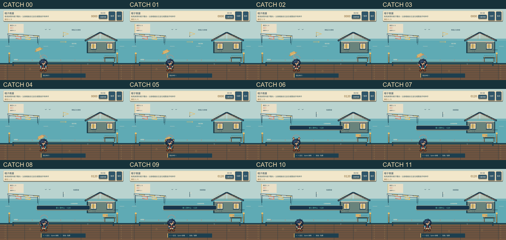
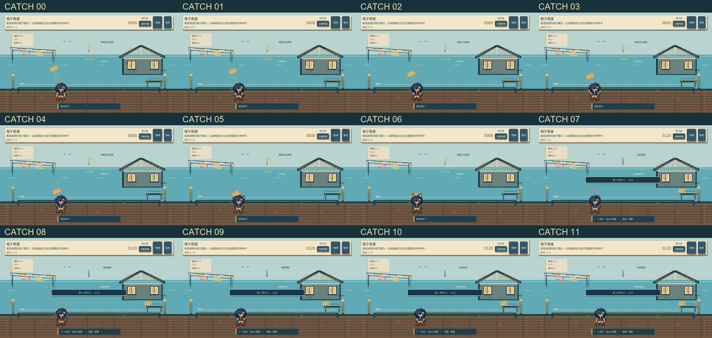
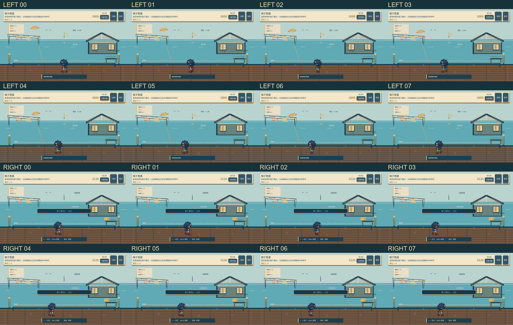
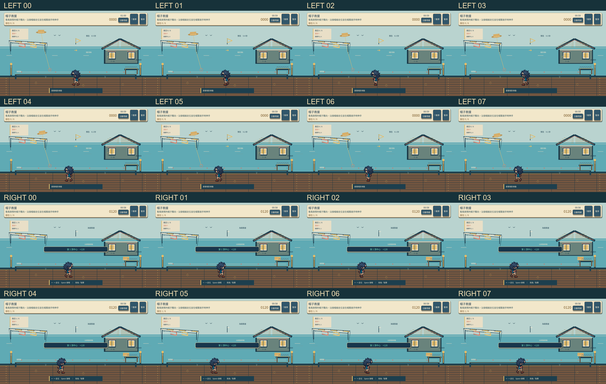
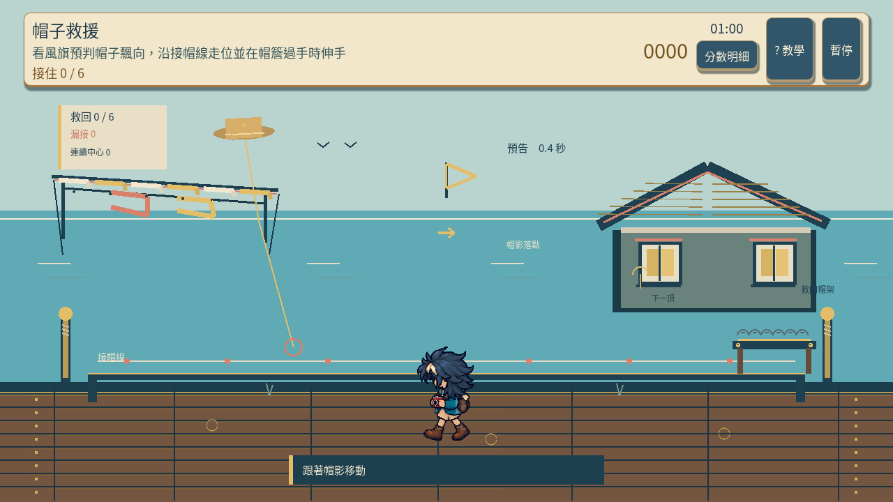
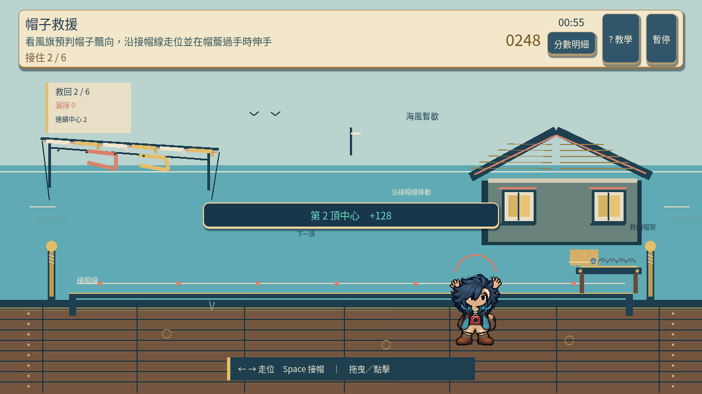
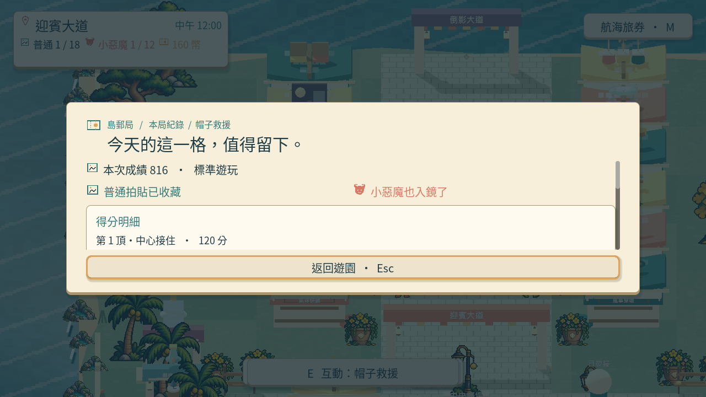

# [SG-20] 精修帽子救援玩法與計分

> 狀態：進行中（v13 正常與四分之一速度流程及基本角色畫面驗收完成；其餘範圍仍待驗收）

## 內文

### 需求
將帽子救援提升為可對外展示的完整小遊戲。落帽、風勢與角色接帽動作互相對應，讓走位、救援取捨和連續成功有可見成果。操作手感、目標、分數和演出一起設計，學習內容放在有截圖的完整教學，遊玩時保留必要資訊。

2026-10-12 使用者追加：同一園區維持共同主題，每款小遊戲須依玩法選擇自己的 2D、2.5D、HD-2D 或 3D 表現。不能沿用同一場地、構圖與動畫再換規則；鏡頭、空間、操作節奏和成功演出須帶來可辨認的新體驗。

### 來源
2026-10-12（Asia/Taipei）使用者要求全面重新審閱 UI 和小遊戲，提升目標、計分及操作手感；先廣泛 survey，減少遊戲當下提示，提供含截圖的完整教學。使用者授權自行決定設計，強調循序完善、細節有主次且不雜亂，以可面向大眾的品質驗收。

### 驗收條件
- [ ] 依玩法採用獨立鏡頭、場地、視覺節奏與成功演出；與首區其他遊戲並列比較能辨認不同體驗，海港主題仍一致。
- [ ] 比較至少六個跨不同方向的玩法、操控與玩家體驗來源，保存實際閱讀、圖例及選擇理由。
- [ ] 落帽、風勢與角色接帽動作互相對應，讓走位、救援取捨和連續成功有可見成果。
- [ ] 普通、精準表現、失誤及輔助的成績規則明確；結算能說明成果與個別成就資格。
- [ ] 首次學習、練習、正式遊玩、重試和離開形成完整流程，不在教學閱讀時消耗回合時間。
- [ ] 正常及輔助、鍵盤及滑鼠、降低動態下以實際输入遊玩驗收；保留正常速度影片、截圖和受影響測試。

### 測試流程
1. 查看本票研究紀錄與圖例，核對採用的原則和原生前後比較。
2. 使用隔離存檔實際操作本票完整流程，核對各項驗收條件。
3. 核對重試、返回、重開與相關設定，保存原生截圖、影片和受影響測試摘要。

---

# 跟其他票的關係

- Blocks：無
- Blocked by：無
- Related：SG-6、SG-14、ART-21、MAIN-10

---

# Commit-1｜v12 操作與回合驗收

## 問題

走位、短暫伸手與帽子真正經過手線的時刻，共同決定能否接住。實際慢放也發現，方向鍵按住時滑鼠微移會改變當前控制方式，讓走位方向不穩。

## 改動

滑鼠微移不會打斷持續按住的方向鍵；放開方向鍵後仍可用滑鼠走位，左鍵仍能直接走位並伸手。分數仍由實際接帽位置及操作時機決定。

## 驗收

使用隔離存檔從 Main 啟動。正常與四分之一速度都完成正式回合，六頂中心接住、零漏接、816 分，普通及小惡魔成果通過；暫停／恢復、重試、輔助私人練習也通過。私人練習六頂中心接住、816 分，不取得小惡魔成果，所比較的收藏與玩家進度沒有改變。Park 私人離開、第一次教學理解、五十套服裝及三位完整動畫 NPC 未在此輪驗證。

## 記錄

[v12 原生記錄與後續步態補驗](../../design/runtime/hat-rescue-native-v12-evidence.md)

# Commit-2｜v13 全步態與原生驗收

## 問題

旅人走路時會重複少數幾個姿勢，而且原地等候也會繼續踏步，因此移動看起來不夠自然。

## 改動

走路姿勢隨角色實際移動前進；停下時腳步停住，掉頭時延續步伐，重試才重新起步。教學截圖更新為實際正常速度畫面，並保留接帽動作及分數規則。

## 驗收

使用隔離存檔由 Main 開始遊戲。正常速度與四分之一速度都自然完成：正式鍵盤回合六頂中心接住、零漏接、816 分，普通與小惡魔成果通過；暫停／繼續、重試及確認歸零都通過。接著以輔助和降低動態進行私人滑鼠練習，也六頂中心接住、816 分，但沒有小惡魔成果，所比較的收藏和玩家進度維持原樣。

兩段實際遊玩都看得到十二個伸手姿勢，以及向左、向右各八個完整走路姿勢。畫面與遊戲流程檢查 55 項通過；模型檢查 28 項、共用操作檢查 80 項通過。Root 已播放兩段完整影片，並檢視接帽／走路片段、十二個接帽姿勢、左右各八個走路姿勢及全尺寸畫面；基本角色全身與提示位置通過。尚未驗證第一次教學理解、Park 私人離開路徑、五十套服裝剪影或三位完整動畫 NPC；這張票維持進行中。

| 項目 | 實際結果 |
|---|---|
| 正常速度 | 1,943 幀／32.3833 秒；六頂中心接住、零漏接、816 分 |
| 四分之一速度 | 7,598 幀／126.6333 秒；六頂中心接住、零漏接、816 分 |
| 接帽與走路姿勢 | 兩段實際流程都看到 12 個伸手姿勢，以及左右各 8 個走路姿勢 |
| 輔助私人練習 | 六頂中心接住、816 分；不新增收藏，小惡魔成果不成立 |
| Root 完整影片檢視 | 正常與四分之一速度均播放完成；基本角色畫面通過 |

## 設計與媒體

[玩法設計與來源比較](../../design/runtime/hat-rescue-design.md) · [動作來源與取捨](../../design/runtime/hat-catch-generation-review.md) · [v13 原生證據](../../design/runtime/hat-rescue-native-v13-evidence.md)

[正常速度完整影片](images/SG-20-hat-v13-normal.mp4) · [四分之一速度完整影片](images/SG-20-hat-v13-quarter.mp4) · [正常接帽片段](images/SG-20-hat-v13-normal-catch-focus.mp4) · [慢速接帽片段](images/SG-20-hat-v13-quarter-catch-focus.mp4) · [正常走路片段](images/SG-20-hat-v13-normal-walk-focus.mp4) · [慢速走路片段](images/SG-20-hat-v13-quarter-walk-focus.mp4)

分支：`feature/island-first-park`；本票起始基準：`88cb340740f9b490e956bcb5dc89c31f2eb7f0b8`。
