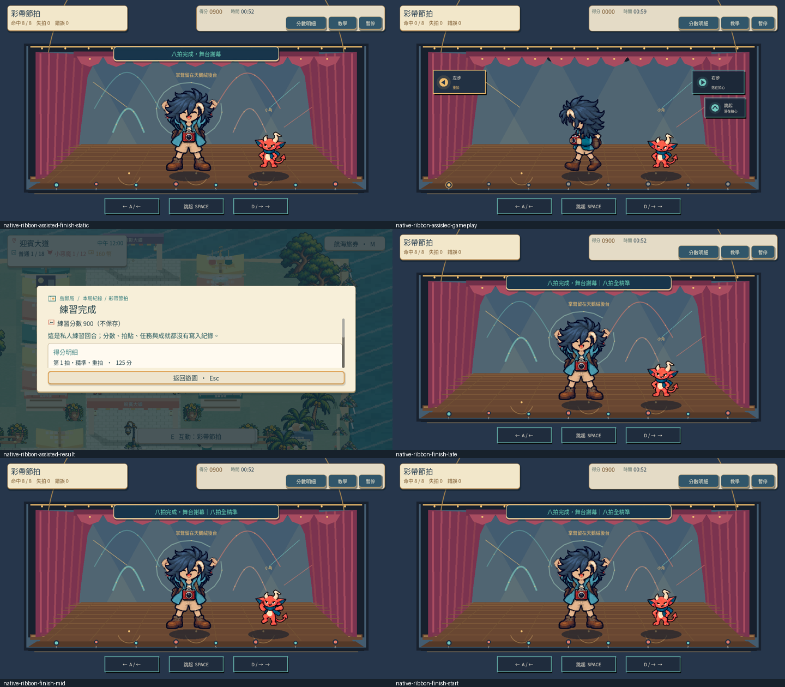
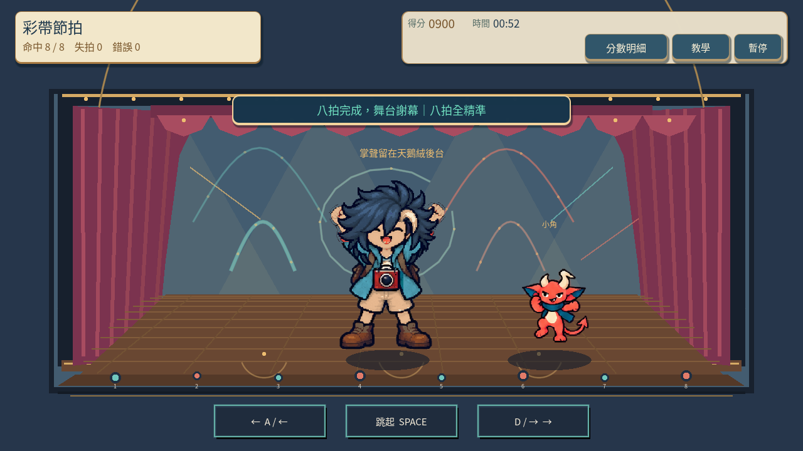
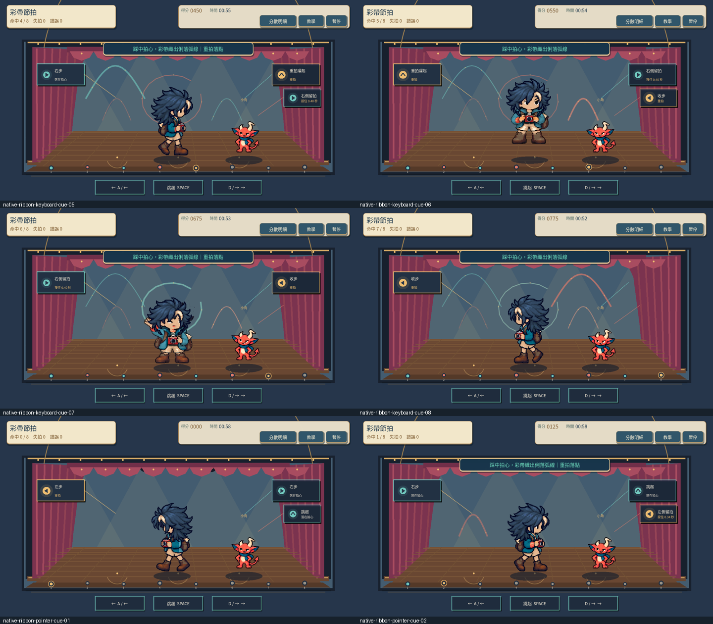
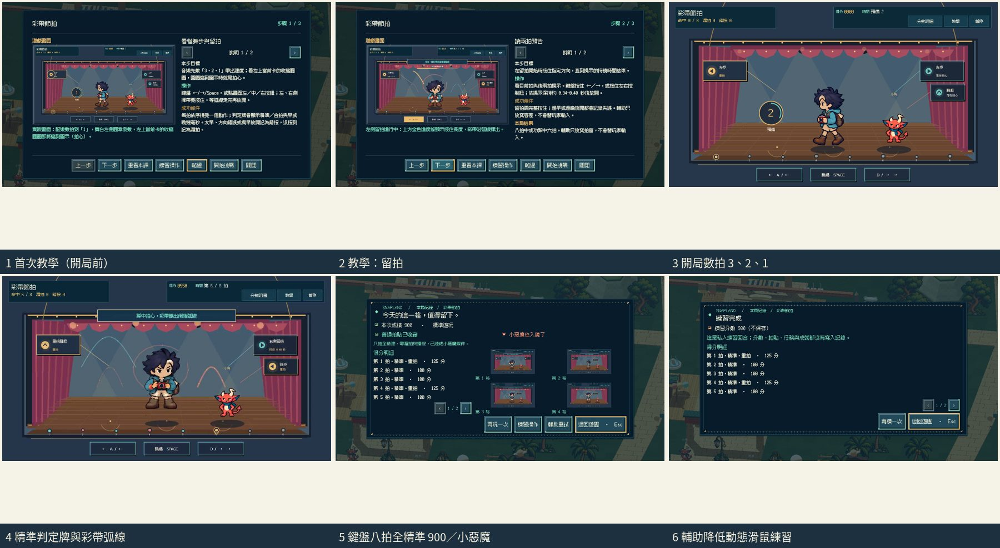

# [SG-21] 精修彩帶節拍玩法與計分

> 狀態：完成

開始基準：`2d165f2`；分支：`feature/island-first-park`。

## 內文

### 需求
將彩帶節拍提升為可對外展示的完整小遊戲。節拍提示、音樂與輸入判定同步，區分精準、合格和失誤；練習不損失正式回合時間。操作手感、目標、分數和演出一起設計，學習內容放在有截圖的完整教學，遊玩時保留必要資訊。

2026-10-12 使用者追加：同一園區維持共同主題，每款小遊戲須依玩法選擇自己的 2D、2.5D、HD-2D 或 3D 表現。不能沿用同一場地、構圖與動畫再換規則；鏡頭、空間、操作節奏和成功演出須帶來可辨認的新體驗。

### 來源
2026-10-12（Asia/Taipei）使用者要求全面重新審閱 UI 和小遊戲，提升目標、計分及操作手感；先廣泛 survey，減少遊戲當下提示，提供含截圖的完整教學。使用者授權自行決定設計，強調循序完善、細節有主次且不雜亂，以可面向大眾的品質驗收。

### 驗收條件
- [x] 依玩法採用獨立鏡頭、場地、視覺節奏與成功演出；與首區其他遊戲並列比較能辨認不同體驗，海港主題仍一致。
- [x] 比較至少六個跨不同方向的玩法、操控與玩家體驗來源，保存實際閱讀、圖例及選擇理由。
- [x] 節拍提示、音樂與輸入判定同步，區分精準、合格和失誤；練習不損失正式回合時間。
- [x] 普通、精準表現、失誤及輔助的成績規則明確；結算能說明成果與個別成就資格。
- [x] 首次學習、練習、正式遊玩、重試和離開形成完整流程，不在教學閱讀時消耗回合時間。
- [x] 正常及輔助、鍵盤及滑鼠、降低動態下以實際输入遊玩驗收；保留正常速度影片、截圖和受影響測試。

### 測試流程
1. 查看本票研究紀錄與圖例，核對採用的原則和原生前後比較。
2. 使用隔離存檔實際操作本票完整流程，核對各項驗收條件。
3. 核對重試、返回、重開與相關設定，保存原生截圖、影片和受影響測試摘要。

---

# 跟其他票的關係

- Blocks：無
- Blocked by：無
- Related：SG-7、SG-14、ART-21、MAIN-10

---

# Commit-1

## 內文

問題：彩帶節拍原本缺少自己的動作節奏、持續輸入與清楚的分數；早期提示也會擋住角色的臉。

改動：海港歌舞廳採正面舞台，八拍交替踏步、跳躍與兩次留按，提前顯示兩拍，成功時留下不同的彩帶弧線。每拍區分精準與合拍，四個重拍另給獎勵；八拍全精準、零錯誤且未開輔助可得 900 分與小惡魔資格。提示移到角色上方，三張教學換成實際操作與結算畫面。

驗收：主 Session 重跑局部檢查並播放正常動作短段與正式／私人慢放，看過踏步、跳躍、留按後弧線及完整手腳，提示不遮住臉。原生鍵盤與滑鼠各完成八拍和兩次留按，正式收藏與私人不改進度的結果正確；暫停、恢復、確認重試歸零均有實際輸入紀錄。

### 測試結果

| 項目 | 結果 |
|---|---|
| 節拍與留按規則 | 主 Session 重跑 42 項通過 |
| 畫面、操作與全身邊界 | 主 Session 重跑 28 項通過 |
| 共用小遊戲與教學 | 53 項及教學面板檢查通過 |
| 正式正常／私人慢放影片 | 完整 2439 幀、40.65 秒，正式 900 分，無 ERROR |
| 正式與私人慢放影片 | 完整 4171 幀、69.52 秒，正式 900 分，無 ERROR |

影片速度：第一部正式動作 1 倍、私人動作 0.25 倍；第二部兩段動作均 0.25 倍；兩部結果截圖等待均回到 1 倍。影片長度不是正式回合時間。

待本機原生驗收：完整首次教學、離開再進入、音樂試聽與同步手感、專屬舞蹈動畫及最終介面／美術。票維持進行中，驗收條件保留未勾選。

### 來源與畫面

[六方向官方來源、已查看圖例與設計取捨](../../design/runtime/ribbon-rhythm-design.md) · [原生驗收與速度說明](../../design/runtime/ribbon-rhythm-native-review.md)

[正式正常／私人慢放影片](images/SG-21-formal-normal-private-quarter-v4.mp4) · [正式與私人慢放影片](images/SG-21-formal-quarter-private-quarter-v4.mp4)

開始基準：`0bb34a939c825f93e3baab274f9c236e83fdaa9c`；分支：`feature/island-first-park`；遠端提交：[彩帶操作與驗收紀錄](https://github.com/deadline314/Snapland/commit/2e6b3aeb523943bfc8e97ca7d7ce6c7f239551b5)。

# Commit-2

## 問題

彩帶舞的同伴曾像是主角的換色複本，場地缺少自己的演出特徵；最後一拍成功又會立即進結算，玩家看不到收尾舞蹈。

## 改動

舞台加入帷幕、木台口、透視地板與八拍踏燈，小角以自己的完整角色待機和伴舞出場。成功後先保留收尾演出，再結算；暫停會凍結演出並於恢復後接續，重試或離開會取消舊演出。降低動態使用短暫靜態完成姿勢。十方官方來源、六張已實際查看的圖例及選擇理由保存在[研究紀錄](../../design/runtime/ribbon-rhythm-design.md)。

## 驗收

主 Session 重跑五組局部測試並完成兩輪原生操作：正式鍵盤八拍與兩次留按自然取得900分、八次精準及普通／惡魔收藏；降低動態私人回合由滑鼠親自完成八拍，同得900分且不改收藏和其他進度。錯按、暫停、確認重試歸零與收尾中暫停／恢復皆有真實操作記錄。看過兩輪共五十張截圖，收尾開始、中段、後段的主角與小角均完整可見。正常與四分之一影片均已實際播放至結尾，確認正式及私人結果。

### 測試結果

| 項目 | 結果 |
|---|---|
| 節拍模型 | Root 42 項通過 |
| 舞台、角色、輸入與邊界 | Root 138 項通過 |
| 實際遊戲角色初始化 | Root 3 項通過 |
| 收尾、暫停、恢復、重試及離開 | Root 61 項通過 |
| 既有小遊戲整合 | Root 81 項通過 |
| 正常速度原生流程 | 2577 幀／60FPS，42.95 秒，exit0、無錯誤 |
| 四分之一速度原生流程 | 4543 幀／60FPS，75.716667 秒，exit0、無錯誤 |

影片包含菜單、重試及結果；長度不代表正式回合時限。主角目前仍使用已存在的踏步、跳躍與招呼姿勢，尚不能視為完整專屬編舞或最終美術驗收；音樂試聽與完整首次教學也保持原有未勾選條件，票維持進行中。

### 截圖與影片

[正常速度影片](images/SG-21-performance-normal-play.mp4) · [四分之一速度影片](images/SG-21-performance-quarter-play.mp4)。兩輪共50張原圖與10張總覽以 `SG-21-performance-` 開頭保存。

分支：`feature/island-first-park`。本輪程式與原生證據：[2fc465a](https://github.com/deadline314/Snapland/commit/2fc465ace44ba015947ecc604ae0173a283cde2c)。

# Commit — 2026-10-23 跟拍配樂、數拍前奏與判定呈現

## 問題

節拍只靠每拍一個提示音疊在與拍速無關的共用遊戲曲上；第一拍前只有約一拍準備，感受不到速度。提示卡只說做什麼、不說何時；漏拍同時算成錯誤（HUD「失拍 4 錯誤 4」），約 9 秒的回合卻顯示 60 秒倒數，結算也不說明本次資格。

## 改動

彩帶回合有自己的原創伴奏：三下木魚數拍，八個動作拍各落在鼓與馬林巴音上，強拍加拍手，留拍有與按住長度相同的上揚彩帶聲，最後收在謝幕內的琶音與和弦；播放時共用遊戲曲淡出。規則時鐘跟隨伴奏的實際播放時間（音訊時鐘不可用時改用畫面時間），提示、音樂與判定同一時間基準。舞台顯示 3、2、1 數拍，當前提示卡與腳燈有兩拍前開始收縮、縮到圖示即拍心的圓圈；判定牌顯示精準／合拍與早或晚幾毫秒，或失拍。HUD 分開漏拍與錯按，時間欄改為「預備 n／第 n / 8 拍」；規則文字由實際判定時窗與分值產生，結算列出每拍分數、漏拍與錯按次數及本次資格。練習是獨立的不收藏回合，同樣有數拍，不影響正式回合。教學前兩張圖換成新版實際畫面。

## 驗收

以隔離存檔、固定 30 FPS 引擎時鐘在雲端 llvmpipe 上用實際按鍵與滑鼠操作 Main：首次教學三頁在開局前顯示、不消耗回合時間，開始後數拍、經暫停離開回到園區且進度不變；正式鍵盤錯動作重試、八拍兩次留拍全精準 900 分取得普通與小惡魔，結算說明資格；輔助＋降低動態以滑鼠按畫面按鈕完成八拍的不收藏練習，進度不變；收尾演出中暫停／恢復正常。伴奏的每個數拍與動作音起音都落在規則拍點上（音訊資料檢查）。普通與失敗的資格文字由單元測試核對，原生只實看了小惡魔與練習結果。腳本輸入不是真人試玩，也沒有實際試聽伴奏。

| 項目 | 結果 |
|---|---|
| 節拍模型（含伴奏拍點與起音對齊、規則與資格文字） | 53 項通過 |
| 舞台畫面（收縮圈、數拍、判定牌不遮舞者） | 146 項通過 |
| 收尾／暫停／重試／離開；啟動 | 61、3 項通過 |
| 共用小遊戲 | 84 案通過 |
| 共用音樂淡出 | 音訊執行期與動態檢查通過 |
| 原生正式＋練習 | exit 0、0 ERROR，60.7 秒影片 |
| 原生首次教學與離開 | exit 0、0 ERROR |
| Python／設計驗證 | 147 項；5 範圍通過 |

[六方研究與取捨](../../design/runtime/ribbon-rhythm-design.md) · [來源頁面截圖](images/SG-21-research-20261023-sources.jpg) · [原生影片](images/SG-21-final-20261023-native.mp4)

原生影片為無聲畫面（錄製時去除音軌）。「切換式留拍」等按住替代方案未加入，列在研究紀錄。分支：`work/sg-20-21-27`。
