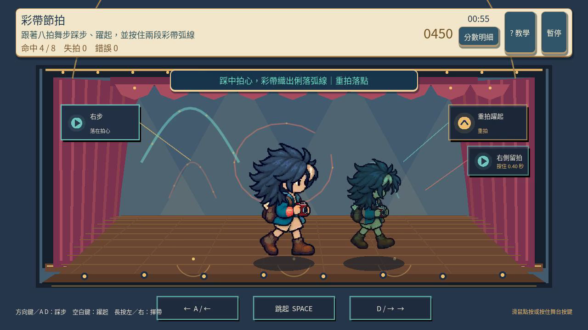
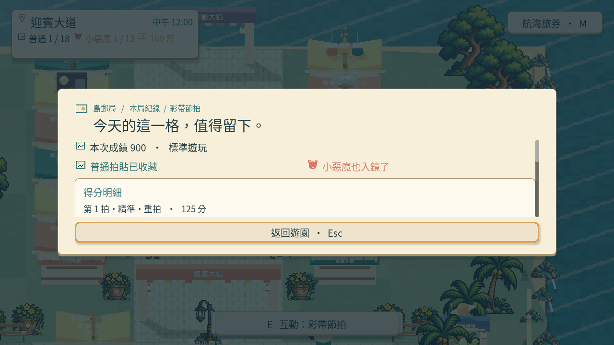
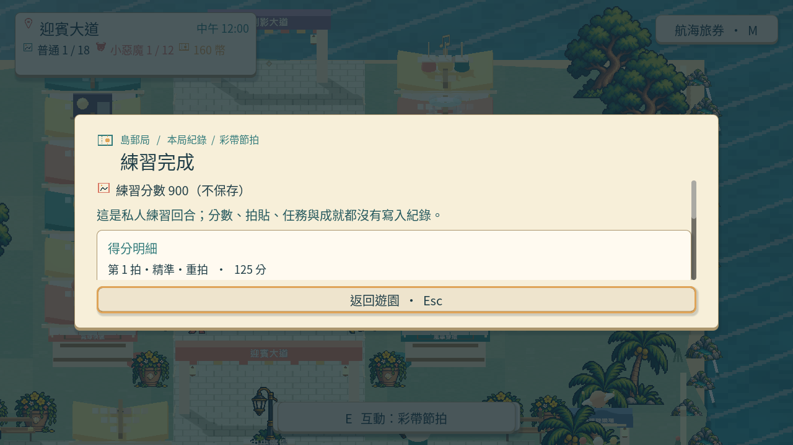
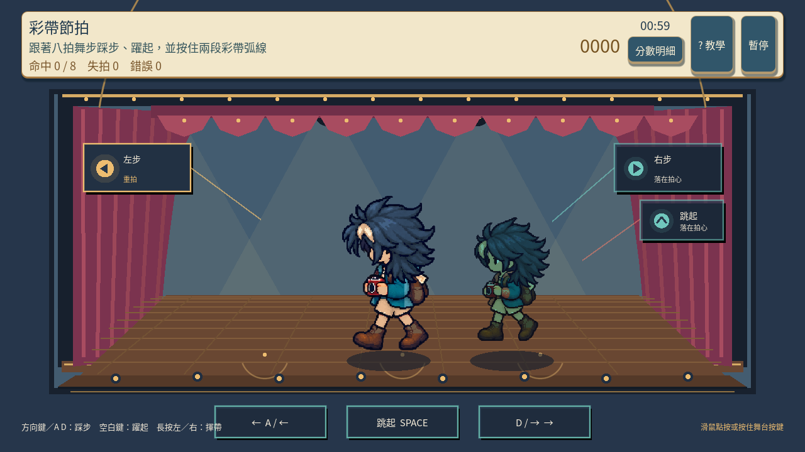

# [SG-21] 精修彩帶節拍玩法與計分

> 狀態：進行中

開始基準：`2d165f2`；分支：`feature/island-first-park`。

## 內文

### 需求
將彩帶節拍提升為可對外展示的完整小遊戲。節拍提示、音樂與輸入判定同步，區分精準、合格和失誤；練習不損失正式回合時間。操作手感、目標、分數和演出一起設計，學習內容放在有截圖的完整教學，遊玩時保留必要資訊。

2026-10-12 使用者追加：同一園區維持共同主題，每款小遊戲須依玩法選擇自己的 2D、2.5D、HD-2D 或 3D 表現。不能沿用同一場地、構圖與動畫再換規則；鏡頭、空間、操作節奏和成功演出須帶來可辨認的新體驗。

### 來源
2026-10-12（Asia/Taipei）使用者要求全面重新審閱 UI 和小遊戲，提升目標、計分及操作手感；先廣泛 survey，減少遊戲當下提示，提供含截圖的完整教學。使用者授權自行決定設計，強調循序完善、細節有主次且不雜亂，以可面向大眾的品質驗收。

### 驗收條件
- [ ] 依玩法採用獨立鏡頭、場地、視覺節奏與成功演出；與首區其他遊戲並列比較能辨認不同體驗，海港主題仍一致。
- [ ] 比較至少六個跨不同方向的玩法、操控與玩家體驗來源，保存實際閱讀、圖例及選擇理由。
- [ ] 節拍提示、音樂與輸入判定同步，區分精準、合格和失誤；練習不損失正式回合時間。
- [ ] 普通、精準表現、失誤及輔助的成績規則明確；結算能說明成果與個別成就資格。
- [ ] 首次學習、練習、正式遊玩、重試和離開形成完整流程，不在教學閱讀時消耗回合時間。
- [ ] 正常及輔助、鍵盤及滑鼠、降低動態下以實際输入遊玩驗收；保留正常速度影片、截圖和受影響測試。

### 測試流程
1. 查看本票研究紀錄與圖例，核對採用的原則和原生前後比較。
2. 使用隔離存檔實際操作本票完整流程，核對各項驗收條件。
3. 核對重試、返回、重開與相關設定，保存原生截圖、影片和受影響測試摘要。

---

# 跟其他票的關係

- Blocks：無
- Blocked by：無
- Related：SG-7、SG-14、ART-21、MAIN-10

---

# Commit-1

## 內文

問題：彩帶節拍原本缺少自己的動作節奏、持續輸入與清楚的分數；早期提示也會擋住角色的臉。

改動：海港歌舞廳採正面舞台，八拍交替踏步、跳躍與兩次留按，提前顯示兩拍，成功時留下不同的彩帶弧線。每拍區分精準與合拍，四個重拍另給獎勵；八拍全精準、零錯誤且未開輔助可得 900 分與小惡魔資格。提示移到角色上方，三張教學換成實際操作與結算畫面。

驗收：主 Session 重跑局部檢查並播放正常動作短段與正式／私人慢放，看過踏步、跳躍、留按後弧線及完整手腳，提示不遮住臉。原生鍵盤與滑鼠各完成八拍和兩次留按，正式收藏與私人不改進度的結果正確；暫停、恢復、確認重試歸零均有實際輸入紀錄。

### 測試結果

| 項目 | 結果 |
|---|---|
| 節拍與留按規則 | 主 Session 重跑 42 項通過 |
| 畫面、操作與全身邊界 | 主 Session 重跑 28 項通過 |
| 共用小遊戲與教學 | 53 項及教學面板檢查通過 |
| 正式正常／私人慢放影片 | 完整 2439 幀、40.65 秒，正式 900 分，無 ERROR |
| 正式與私人慢放影片 | 完整 4171 幀、69.52 秒，正式 900 分，無 ERROR |

影片速度：第一部正式動作 1 倍、私人動作 0.25 倍；第二部兩段動作均 0.25 倍；兩部結果截圖等待均回到 1 倍。影片長度不是正式回合時間。

待本機原生驗收：完整首次教學、離開再進入、音樂試聽與同步手感、專屬舞蹈動畫及最終介面／美術。票維持進行中，驗收條件保留未勾選。

### 來源與畫面

[六方向官方來源、已查看圖例與設計取捨](../../design/runtime/ribbon-rhythm-design.md) · [原生驗收與速度說明](../../design/runtime/ribbon-rhythm-native-review.md)

[正式正常／私人慢放影片](images/SG-21-formal-normal-private-quarter-v4.mp4) · [正式與私人慢放影片](images/SG-21-formal-quarter-private-quarter-v4.mp4)

開始基準：`0bb34a939c825f93e3baab274f9c236e83fdaa9c`；分支：`feature/island-first-park`；遠端提交：本次推送後補入。
