# [SG-22] 精修花壇水路玩法與計分

> 狀態：完成

## 內文

### 需求
將花壇水路提升為可對外展示的完整小遊戲。水管連接、轉動、水流與花朵反應一致，提供可看懂的解題目標和有意義的步數成績。操作手感、目標、分數和演出一起設計，學習內容放在有截圖的完整教學，遊玩時保留必要資訊。

2026-10-12 使用者追加：同一園區維持共同主題，每款小遊戲須依玩法選擇自己的 2D、2.5D、HD-2D 或 3D 表現。不能沿用同一場地、構圖與動畫再換規則；鏡頭、空間、操作節奏和成功演出須帶來可辨認的新體驗。

### 來源
2026-10-12（Asia/Taipei）使用者要求全面重新審閱 UI 和小遊戲，提升目標、計分及操作手感；先廣泛 survey，減少遊戲當下提示，提供含截圖的完整教學。使用者授權自行決定設計，強調循序完善、細節有主次且不雜亂，以可面向大眾的品質驗收。

### 驗收條件
- [x] 依玩法採用獨立鏡頭、場地、視覺節奏與成功演出；與首區其他遊戲並列比較能辨認不同體驗，海港主題仍一致。
- [x] 比較至少六個跨不同方向的玩法、操控與玩家體驗來源，保存實際閱讀、圖例及選擇理由。
- [x] 水管連接、轉動、水流與花朵反應一致，提供可看懂的解題目標和有意義的步數成績。
- [x] 普通、精準表現、失誤及輔助的成績規則明確；結算能說明成果與個別成就資格。
- [x] 首次學習、練習、正式遊玩、重試和離開形成完整流程，不在教學閱讀時消耗回合時間。
- [x] 正常及輔助、鍵盤及滑鼠、降低動態下以實際输入遊玩驗收；保留正常速度影片、截圖和受影響測試。

開始基準：`92e68e4`。

### 測試流程
1. 查看本票研究紀錄與圖例，核對採用的原則和原生前後比較。
2. 使用隔離存檔實際操作本票完整流程，核對各項驗收條件。
3. 核對重試、返回、重開與相關設定，保存原生截圖、影片和受影響測試摘要。

---

# 跟其他票的關係

- Blocks：無
- Blocked by：無
- Related：SG-8、SG-14、ART-21、MAIN-10

---

# Commit-2

## 內文

問題：花壇水路原先只有一張短路線，接通便結束，與其他遊戲共用場景，步數與花床供水缺少完整過程。

改動：改成港灣園丁的木質配水工作台，依序完成三張工單，包含雙向分流與五座花床。水真正沿接通管路前進，到達才開花；每單步數一起計入成果。北側花床移出標頭遮擋範圍，教學換成此版原生截圖。共用介面的立體邊框沿用 ART-21，未改其他遊戲的玩法。

驗收：主 Session 在隔離存檔以滑鼠實際轉動 19 次、完成三單，普通速度與四分之一速度均得到 2620 分及惡魔資格；查看工單二、第三單供水及結算畫面，花葉與盆框完整，北口管路不被標頭擋住。原生影片已播放檢視轉動及水流片段。此紀錄不等同真人完整試玩或首區十二款完成。

### 測試結果

| 項目 | 結果 |
|---|---|
| 配水規則 | 97 項通過，損壞輸入明確警告後回安全工單 |
| 工作台顯示及邊界 | 101 項通過 |
| 首區小遊戲局部回歸 | 52 項通過 |
| 教學與主場景整合 | 通過，無 ERROR |
| 原生正常／四分之一速度 | 三单、19 次實際旋轉、2620 分；無 ERROR |

待本機原生驗收：鍵盤獨立操作、輔助模式、降低動態、失誤成績、完整教學／練習／重試與返回流程。票維持進行中，不以本次滑鼠通關勾選全部条件。

### 研究與影片

[配水玩法七個來源與採用理由](../../design/runtime/pipe-gameplay-design.md)、[首區多方向玩法比較](../../design/runtime/first-park-gameplay-quality.md)、[多媒材構圖比較](../../design/runtime/minigame-diversity-survey.md)。六個實際看過的官方畫面圖例與選用理由另見 [ART-21 視覺比較](../../design/runtime/minigame-visual-diversity-review.md)。

[正常速度原生影片](images/SG-22-normal-play.mp4) · [四分之一速度原生影片](images/SG-22-slow-play.mp4)

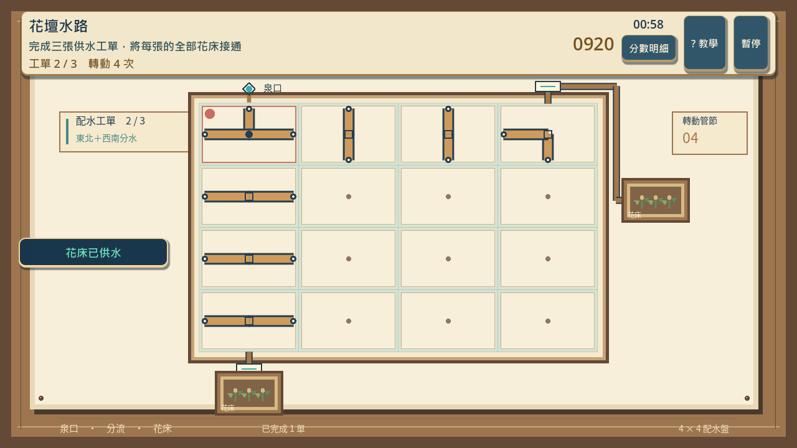
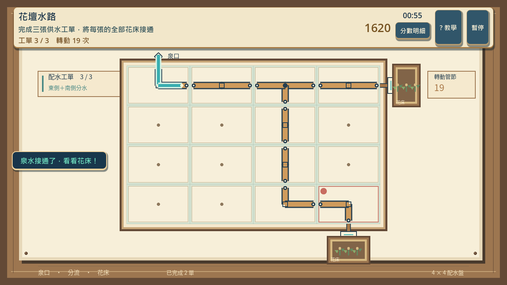
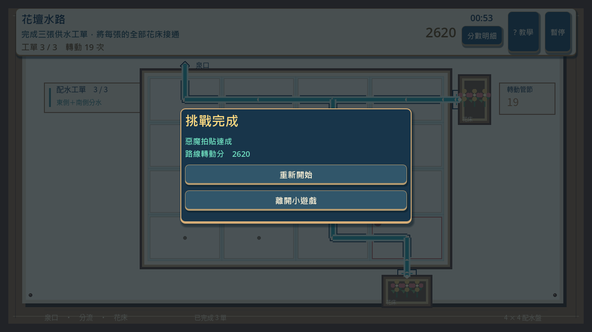

分支：`feature/island-first-park`。遠端提交：[8817b70](https://github.com/deadline314/Snapland/commit/8817b701e41b7910dda412b2115d9eb1dd672494)。

# Commit-3

## 內文

問題：之前只驗證滑鼠正式解題，未確認键盤選管、暂停重試、輔助及私人練習會不會改動收藏。

改動：補齊鍵盤與滑鼠的原生操作驗收；先暫停同一回合再恢復，確認重試當下清空時間、分數與工單，接著完成正式挑戰和降低動態的私人練習。

驗收：主 Session 使用隔離存檔，正常及四分之一速度均以實際方向鍵／空白鍵完成三單，再以滑鼠完成輔助練習；兩條路線均為 19 次轉動、2620 分。練習前後分數、拍貼、任務、成就紀錄一致；結果明示不保存。已檢視正常及慢放的轉動、分流與開花畫面，未以此代替真人手感評價。

### 測試結果

| 項目 | 結果 |
|---|---|
| 原生鍵盤／滑鼠獨立路線 | 三單各 4／7／8 次，共 2620 分 |
| 暫停、恢復、確認重試 | 暫停不走時，重試當下數值歸零 |
| 輔助、降低動態、私人練習 | 操作仍有效；收藏與成就沒有寫入 |
| 正常／四分之一速度錄影 | 均通過，執行紀錄無 ERROR |

待本機原生驗收：完整首次教學與失败成績流程，以及與其他遊戲並列的最終畫面品質。票維持進行中。

[正常速度完整操作](images/SG-22-controls-normal.mp4) · [四分之一速度完整操作](images/SG-22-controls-slow.mp4)

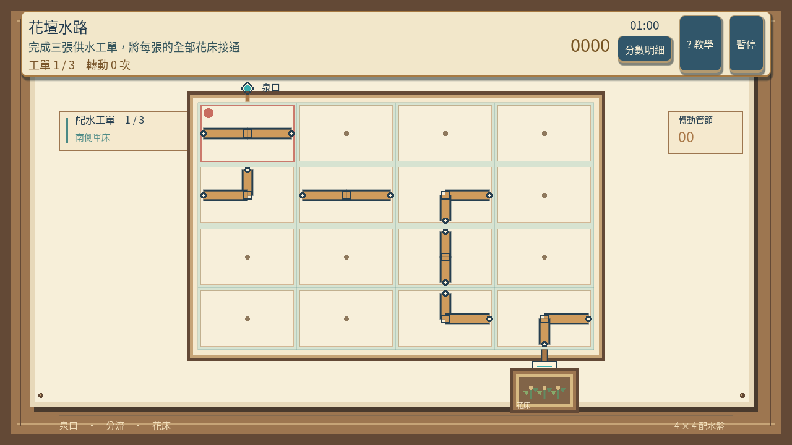
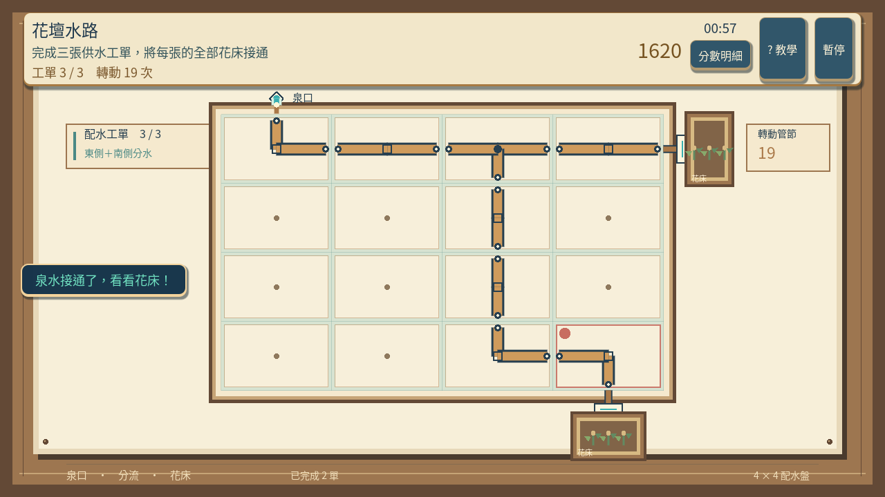
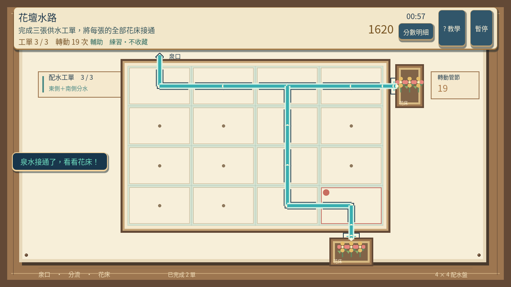
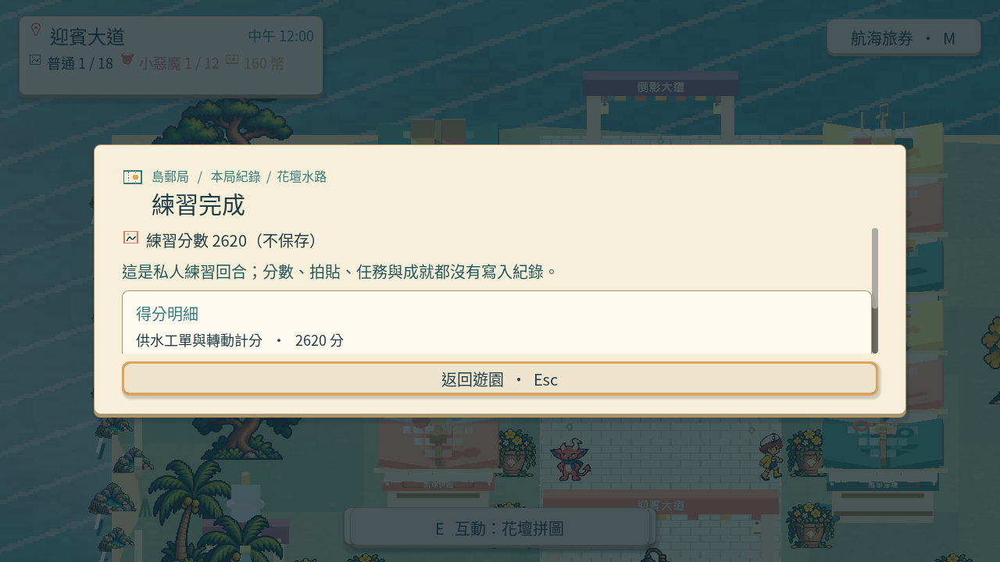

分支：`feature/island-first-park`。遠端提交：[2e5697e](https://github.com/deadline314/Snapland/commit/2e5697ebe21b08fc5628363d13c30503c6d32e50)。

# Commit-4：完成結果分級與結算閱讀

## 內文

補齊真正部分逾時、失敗後重試及一般完成的驗收；同時修正結算把操作步數顯示為「0 分」的問題。現在顯示總轉動次數，並逐張列出目標次數、實際次數與供水狀態，解釋一般與精準資格差異。一般視窗一次顯示五項明細，小視窗與大字仍可分頁完整閱讀。計分公式、六十秒規則及收藏門檻沒有放寬。

原生練習驗收也走過目前的精簡邀請與「玩法與選項」，確認按鈕能真正點到；輸出跟隨絕對隔離存檔，逐張編號且拒絕覆寫。程序／來源與真實結果各有雜湊，當前首次教學則由 MAIN-10 的 game-007 完整鍵鼠、暫停與練習流程接續驗收。

### 測試結果

| 項目 | 結果 |
|---|---|
| 正式精準完成 | 真實鍵盤三工單 4／7／8，共 19 次，2620 分；普通與精準收藏均經正常結算 |
| 一般完成 | 真實輸入 8／7／8，共 23 次，2540 分；只取得普通收藏，畫面不顯示精準獎勵 |
| 自然逾時 | 第一工單完成、第二工單錯轉一次，等待原六十秒倒數；5 次轉動、900 分、失敗，完整非空存檔位元相同且無收藏 |
| 失敗後重試 | 真正點結算的再玩一次，在按鈕事件核對時間、分數、工單、轉數及完成數全部歸零，再完成一般路線 |
| 輔助／降低動態 | 真實滑鼠完成三單 19 次、2620 分的私人練習；收藏與成就不變，結果明示不保存 |
| 原生程序 | 兩個新程序及隔離存檔；54.47 秒與 183.71 秒，皆 exit 0／0 ERROR；原本 360 秒程序限制保留 |
| 局部回歸 | 97 個配水模型、105 個工作台、71 個 HUD 檢查、81 個首區案例通過；主流程、小遊戲 UI 與 800／1280／1920 的結果頁實際文字／翻頁／返回均通過 |
| 圖像與影片 | 21 張新原生圖、兩張已檢視總覽、四份真實結算；兩片 1280×720／20 FPS，14.7 秒／294 格與 67.55 秒／1351 格，完整解碼通過 |

正常／四分之一速度的原有完整操作證據保留；這次影片已完整解碼、靜格與總覽已實看，沒有稱為連續播放審閱、真人試玩或試聽。當前十二款的[靜態並列比較](images/SG-22-final-20261020-twelve-scene-comparison.png)使用 MAIN-10 來源圖，不是本輪再通關十二款：本作配水採俯視工作台、分支供水與開花，與其他移動、節拍、投影、換位玩法可辨。對應研究及採用理由仍見本票七方來源與六份既有官方圖例。

最初兩個程序雖通過玩法，畫面仍出現「步數 0 分」；新版本又抓到只顯示兩列、將工單目標藏在翻頁後的問題。這些記錄依原版本保存，不列為最終畫面通過；修正後重新以實際操作完成兩個程序。本輪編譯檢查曾抓到診斷副本的縮排問題，原失敗與修正後紀錄也保留。

[全部結果、來源與雜湊](images/SG-22-final-20261020-verification.json) · [失敗與一般結果實際明細](images/SG-22-final-20261020-pipe-accepted-outcomes-outcomes.json) · [標準與練習影片](images/SG-22-final-20261020-pipe-accepted-controls.mp4) · [自然逾時及重試影片](images/SG-22-final-20261020-pipe-accepted-outcomes.mp4)

### 畫面

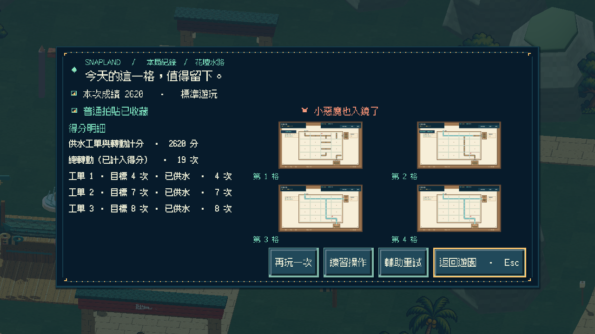
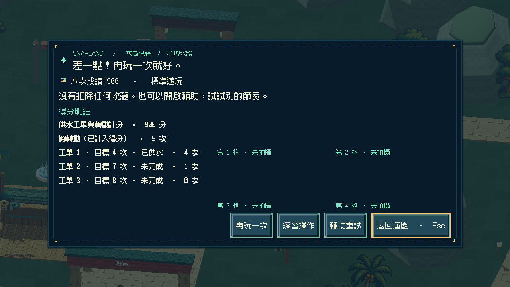
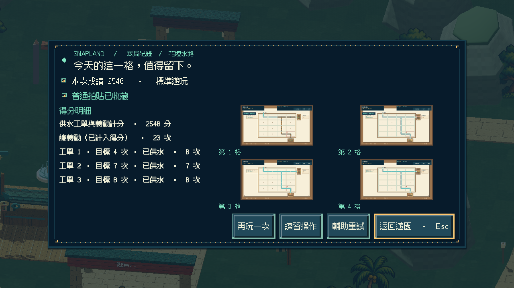
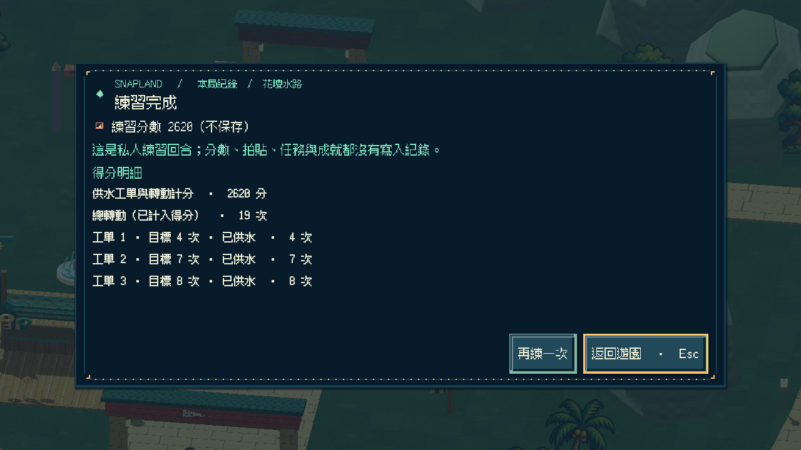
