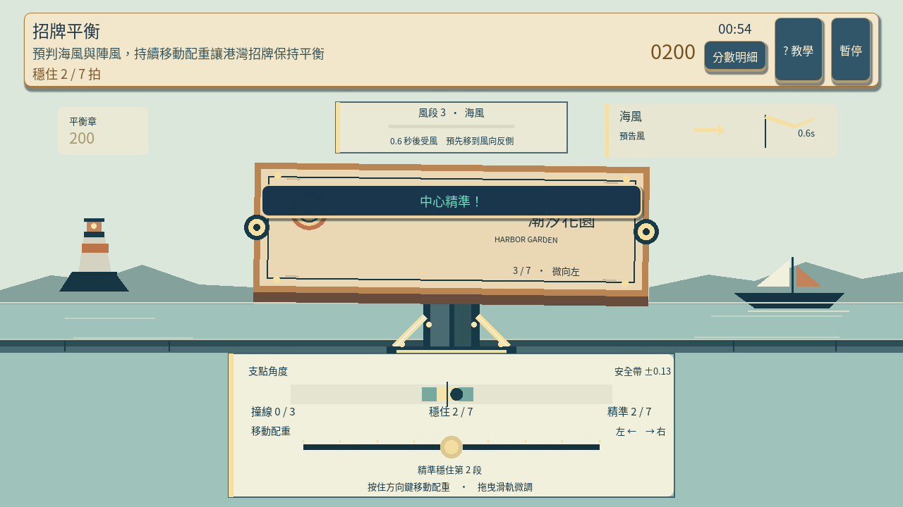
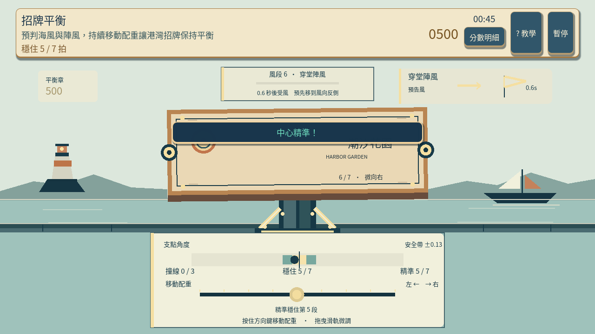
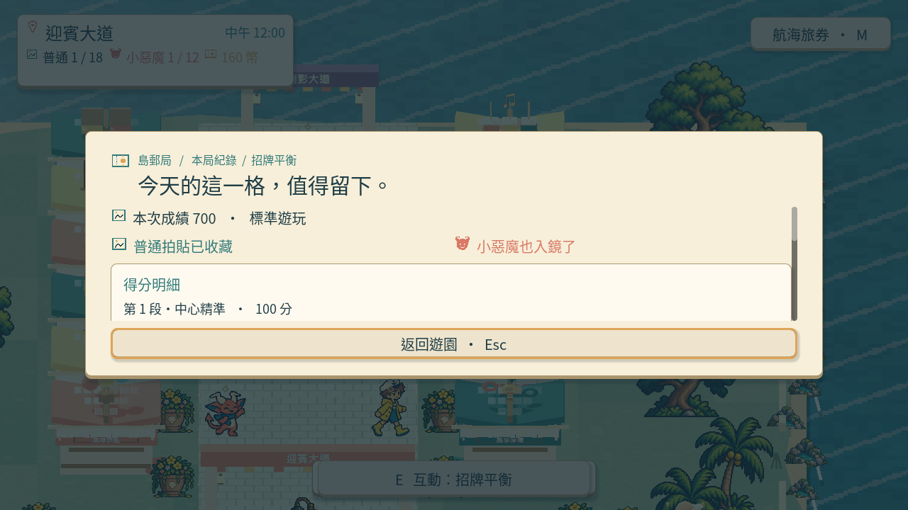
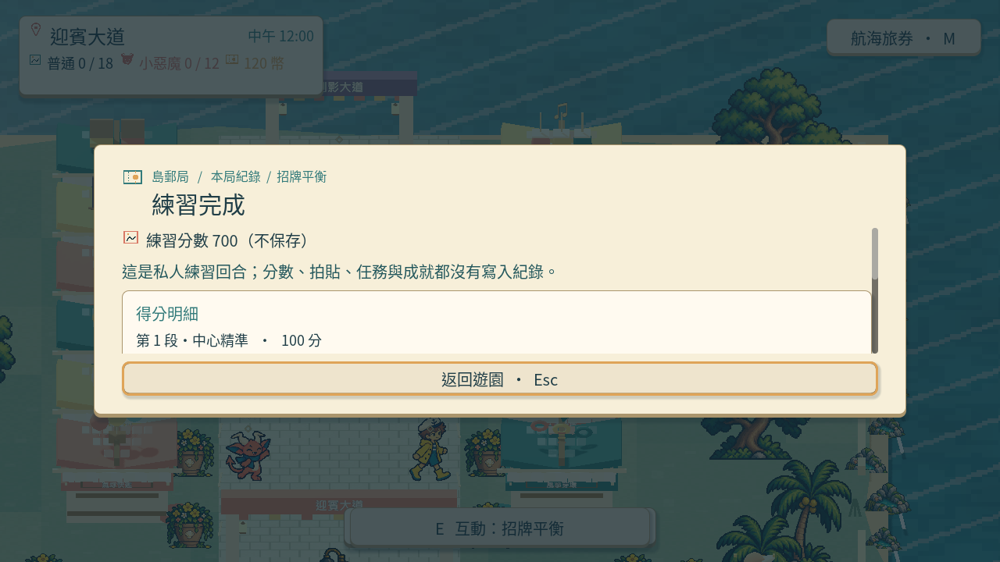

# [SG-23] 精修招牌平衡玩法與計分

> 狀態：進行中

本次接線與原生驗收固定基準：`aae0a1b`；分支：`feature/island-first-park`。

## 內文

### 需求
將招牌平衡提升為可對外展示的完整小遊戲。招牌受力與重心、陣風和修正操作一致，讓玩家能主動穩定並理解失衡原因。操作手感、目標、分數和演出一起設計，學習內容放在有截圖的完整教學，遊玩時保留必要資訊。

2026-10-12 使用者追加：同一園區維持共同主題，每款小遊戲須依玩法選擇自己的 2D、2.5D、HD-2D 或 3D 表現。不能沿用同一場地、構圖與動畫再換規則；鏡頭、空間、操作節奏和成功演出須帶來可辨認的新體驗。

### 來源
2026-10-12（Asia/Taipei）使用者要求全面重新審閱 UI 和小遊戲，提升目標、計分及操作手感；先廣泛 survey，減少遊戲當下提示，提供含截圖的完整教學。使用者授權自行決定設計，強調循序完善、細節有主次且不雜亂，以可面向大眾的品質驗收。

### 驗收條件
- [ ] 依玩法採用獨立鏡頭、場地、視覺節奏與成功演出；與首區其他遊戲並列比較能辨認不同體驗，海港主題仍一致。
- [ ] 比較至少六個跨不同方向的玩法、操控與玩家體驗來源，保存實際閱讀、圖例及選擇理由。
- [ ] 招牌受力與重心、陣風和修正操作一致，讓玩家能主動穩定並理解失衡原因。
- [ ] 普通、精準表現、失誤及輔助的成績規則明確；結算能說明成果與個別成就資格。
- [ ] 首次學習、練習、正式遊玩、重試和離開形成完整流程，不在教學閱讀時消耗回合時間。
- [ ] 正常及輔助、鍵盤及滑鼠、降低動態下以實際输入遊玩驗收；保留正常速度影片、截圖和受影響測試。

### 測試流程
1. 查看本票研究紀錄與圖例，核對採用的原則和原生前後比較。
2. 使用隔離存檔實際操作本票完整流程，核對各項驗收條件。
3. 核對重試、返回、重開與相關設定，保存原生截圖、影片和受影響測試摘要。

---

# 跟其他票的關係

- Blocks：無
- Blocked by：無
- Related：SG-9、SG-14、ART-21、MAIN-10

---

## Commit — 獨立配重玩法與七段成績

**問題**
招牌只有簡化操作，受力、海風和得分缺乏可讀的連結，原先結算也會漏掉第七段成績。

**改動**
加入側面海港機械台、連續配重滑軌、風向預告、招牌支點角度與安全帶。七段各自依實際穩定成果計分，結算保留各段名稱與分數；教學改用新玩法的原生截圖。參考與選擇理由見[研究紀錄](../../design/runtime/sign-balance-design.md)，跨遊戲圖例見 ART-21。

**驗收**
主 Session 局部模型 48、畫面 27、Session 53 項及教學面板檢查通過。保留錯向操作失敗、暫停、立即重試歸零、七段各 100 分合計 700，以及結束後不得重复發獎的檢查。

原生正常速度 41.43 秒、四分之一速度 162.25 秒：實際觀看配重調整、風段切換、牌面角度和結算；鍵盤正式遊玩七段精準、零撞線、700 分取得普通及小惡魔拍貼。滑鼠拖曳、輔助與降低動態的練習為 700 分，拍貼及收藏計數不變；實際暫停、恢復與確認重試通過。結算資料包含七筆各 100 分，截圖可看到第一段明細；其餘列須捲動查看，完整結算版面仍屬 UI 待改善範圍。

[正常速度](images/SG-23-normal-play.mp4) · [慢放](images/SG-23-slow-play.mp4)

尚待本機原生驗收：首次教學、錯向失敗、離開與收藏完整流程；最終美術及完整結算版面仍待改善，因此維持進行中。分支：`feature/island-first-park`。遠端 commit：[dd64e24](https://github.com/deadline314/Snapland/commit/dd64e24)。

