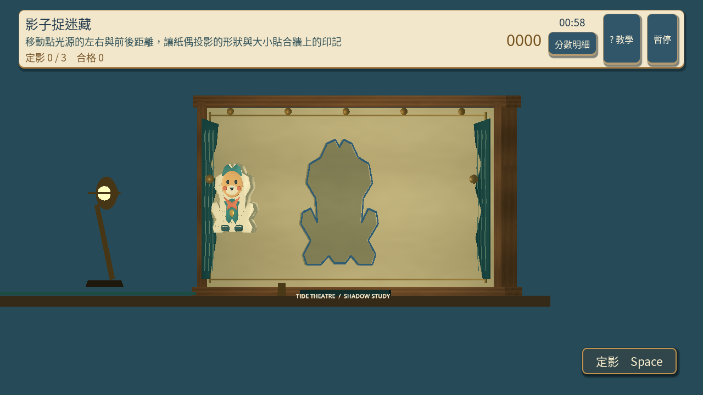
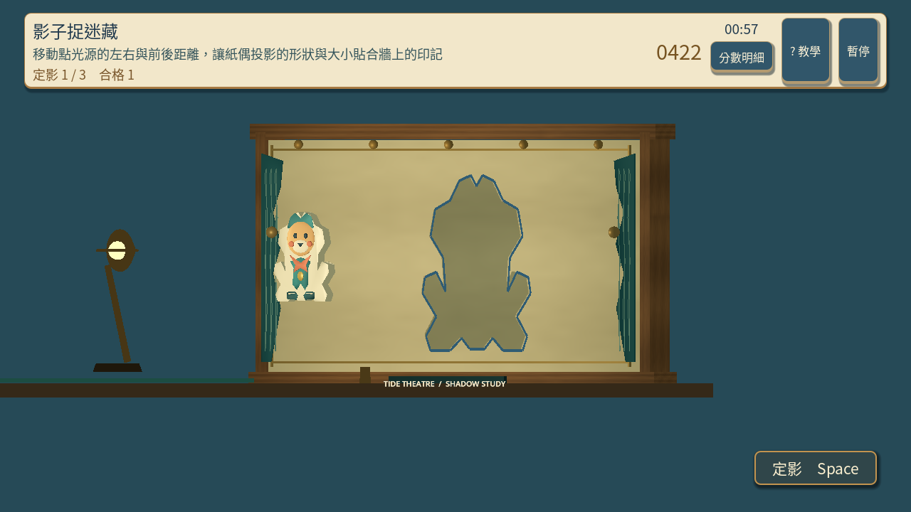
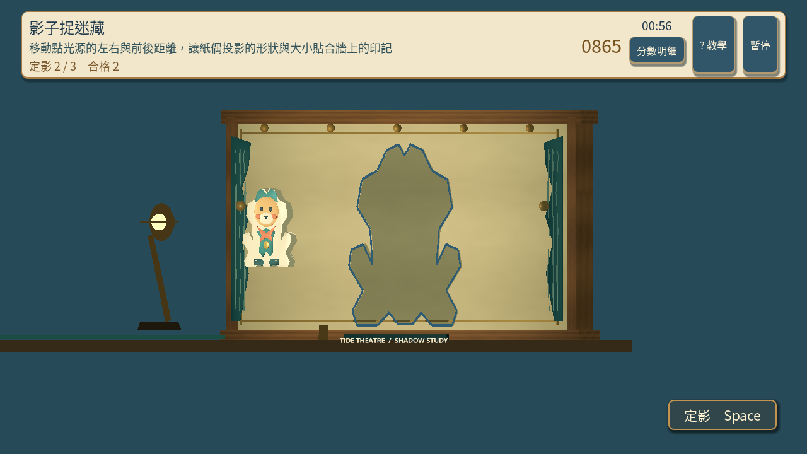
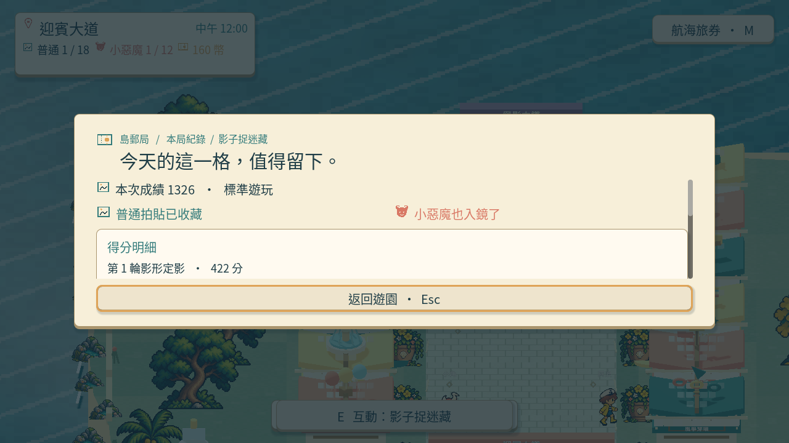
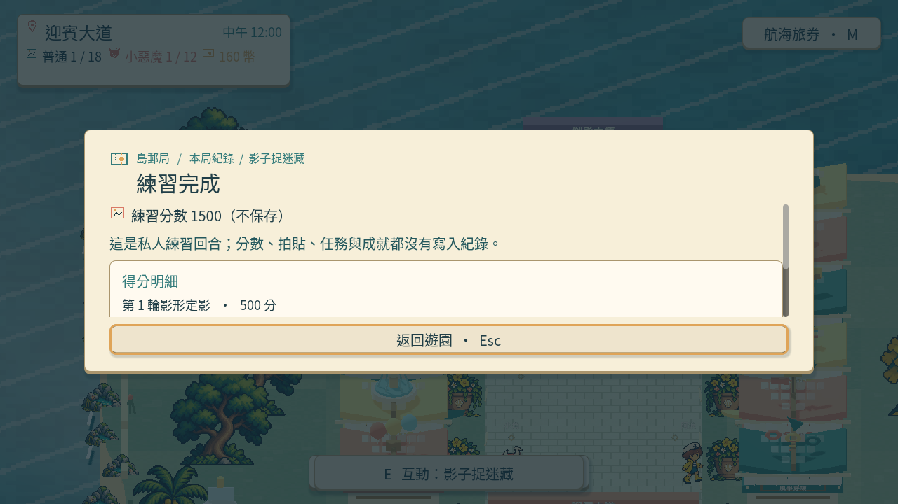
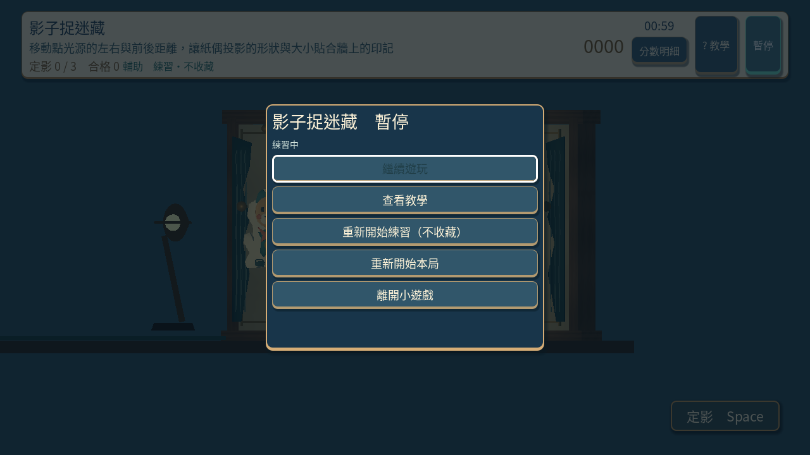
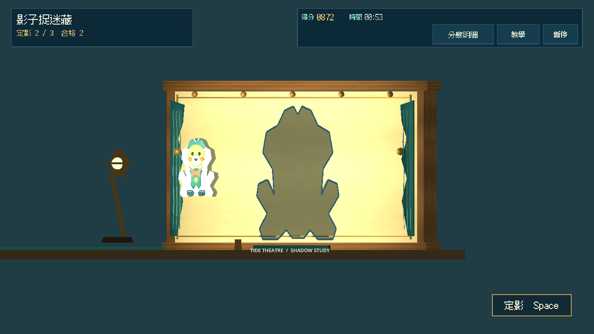
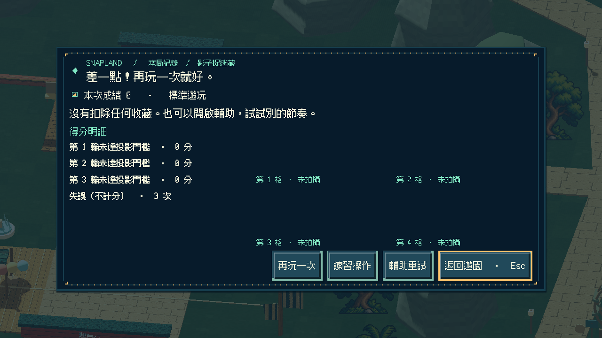
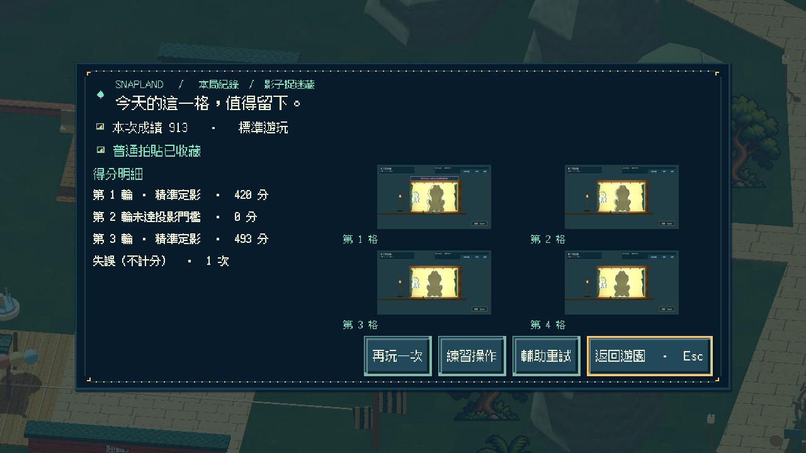
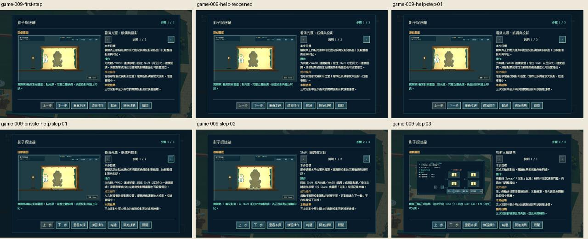

# [SG-24] 精修影子捉迷藏玩法與計分

> 狀態：完成

開始基準：`aae0a1b`；分支：`feature/island-first-park`。

## 內文

### 需求
將影子捉迷藏提升為可對外展示的完整小遊戲。燈光、影子和目標轮廓有一致幾何關係，對準與維持時長可辨，避免只移動貼圖。操作手感、目標、分數和演出一起設計，學習內容放在有截圖的完整教學，遊玩時保留必要資訊。

2026-10-12 使用者追加：同一園區維持共同主題，每款小遊戲須依玩法選擇自己的 2D、2.5D、HD-2D 或 3D 表現。不能沿用同一場地、構圖與動畫再換規則；鏡頭、空間、操作節奏和成功演出須帶來可辨認的新體驗。

### 來源
2026-10-12（Asia/Taipei）使用者要求全面重新審閱 UI 和小遊戲，提升目標、計分及操作手感；先廣泛 survey，減少遊戲當下提示，提供含截圖的完整教學。使用者授權自行決定設計，強調循序完善、細節有主次且不雜亂，以可面向大眾的品質驗收。

### 驗收條件
- [x] 依玩法採用獨立鏡頭、場地、視覺節奏與成功演出；與首區其他遊戲並列比較能辨認不同體驗，海港主題仍一致。
- [x] 比較至少六個跨不同方向的玩法、操控與玩家體驗來源，保存實際閱讀、圖例及選擇理由。
- [x] 燈光、影子和目標轮廓有一致幾何關係，對準與維持時長可辨，避免只移動貼圖。
- [x] 普通、精準表現、失誤及輔助的成績規則明確；結算能說明成果與個別成就資格。
- [x] 首次學習、練習、正式遊玩、重試和離開形成完整流程，不在教學閱讀時消耗回合時間。
- [x] 正常及輔助、鍵盤及滑鼠、降低動態下以實際输入遊玩驗收；保留正常速度影片、截圖和受影響測試。

### 測試流程
1. 查看本票研究紀錄與圖例，核對採用的原則和原生前後比較。
2. 使用隔離存檔實際操作本票完整流程，核對各項驗收條件。
3. 核對重試、返回、重開與相關設定，保存原生截圖、影片和受影響測試摘要。

---

# 跟其他票的關係

- Blocks：無
- Blocked by：無
- Related：SG-10、SG-14、ART-21、MAIN-10

---

# Commit-1

## 內文

問題：影子遊戲原本只移動平面圖，早期立體版本則沒有可見投影；後續畫面還出現整片黑斜紋、過曝與燈座遮臉，不能清楚比較影形。

改動：玩家移動真正的燈光，讓紙偶在紙幕上投影，左右與前後位置一起改變影形的位置和大小。固定斜視鏡頭分開燈座、紙偶與影子；只有紙偶參與投影，裝飾不再干擾紙幕。方向鍵／WASD 可移燈，Shift 可細調，滑鼠也可拖動；Space 或定影按鈕記錄三輪結果。

驗收：主 Session 重跑規則與畫面檢查，實際播放正常與慢放影片，看到影子由偏離到貼近印記，完整紙偶、燈座和目標都可分辨。三輪正式用鍵盤移燈及定影，輔助／降低動態私人練習用滑鼠移燈和快門，私人進度沒有改變；暫停、恢復、確認重試歸零均有實際輸入紀錄。被拒收的無影子與斜紋版本不當作驗收證據。

### 測試結果

| 項目 | 結果 |
|---|---|
| 真實投影、形狀誤差與三輪計分 | 主 Session 重跑 32 項通過 |
| 光影配置、鏡頭、操作與完整邊界 | 主 Session 重跑 50 項通過 |
| 共用小遊戲及教學 | 57 項及教學面板檢查通過 |
| 正常速度原生影片 | 438 幀、7.30 秒，三輪正式及私人完成，無 ERROR |
| 四分之一速度原生影片 | 1368 幀、22.80 秒，三輪正式及私人完成，無 ERROR |

三輪以實際形狀誤差計分，影片內分數逐輪累積；慢放正式示例為 1326 分，三輪精準且未輔助，取得普通與小惡魔拍貼。

以上為前次局部交付範圍；本輪完整流程與現行光影構圖見 Commit-2。

### 來源與畫面

[跨方向一手來源、圖例與光影取捨](../../design/runtime/shadow-theatre-design.md) · [原生流程與真實觀察範圍](../../design/runtime/shadow-theatre-native-review.md)

[正常速度原生影片](images/SG-24-normal-v6.mp4) · [四分之一速度原生影片](images/SG-24-slow-v6.mp4)

開始基準：`d49348a6da937dc3db5bd810984a5ff9ebaa9e4b`；分支：`feature/island-first-park`；遠端提交：[真實投影與驗收紀錄](https://github.com/deadline314/Snapland/commit/356699b43e2d3076997d03618996e43528c2d05a)。

# Commit-2

## 內文

結果原先只標示「影形定影」，無法從每輪文字區分精準和一般合格。現在逐輪列出精準、合格或未達投影門檻，並說明每輪合格最高 500 分、輪廓越吻合越高；普通至少兩輪合格，小惡魔要求三輪精準、零失誤且未輔助。燈座、紙偶與實際投影保留同一幾何，未以移動貼圖代替，也未改評分或門檻。

正式鍵盤真移燈／Shift 細調／Space 定影，三輪 420／452／493，共 1365 分並獲普通與小惡魔。另以夜間輔助／降低動態滑鼠私人練習移燈、點實際定影按鈕完成 1500 分；收藏、成就、任務、貨幣及待同步資料保持不變。暫停凍結位置與時計、確認重試清零，均由原生事件核對。

新增路線三次真實錯誤快門得到 0 分失敗，完整非空存檔位元組不變。從失敗結果點「再玩一次」時，時鐘、輪號、分數、合格與失誤同步歸零；再以第一與第三輪精準、第二輪故意偏離完成 913 分，只得普通拍貼，結果清楚保留兩次精準和一次失誤。

全新未讀教學存檔另完成三步圖文及文字分頁、開始／重看、暫停／繼續、確認離開、再進入與私人練習；閱讀不耗回合時間。逐張查看本輪 29 張原生畫面與結果大圖，並重看首區十二款實景並列：本款是近距離紙戲台、實際燈光投影與空間對準，和長椅座序、俯視水路、側面風箏等構圖及操作節奏可辨，保留海港紙木／黃銅物料。參考作品只用於比較，未當素材。

### 測試結果

| 項目 | 結果 |
|---|---|
| 正式三輪鍵盤、暫停／確認重試、夜間輔助降低動態滑鼠私人練習 | 新程序 58.36 秒，exit 0／0 ERROR |
| 真實三失誤、完整檔安全、結果重試、普通完成 | 新程序 34.50 秒，exit 0／0 ERROR |
| 新玩家三步教學、重看、離開再進、私人練習 | 新程序 41.25 秒，原每款 60 秒上限內，exit 0／0 ERROR |
| 投影模型／真光源場景與操作範圍 | 32／50 項通過，0.24／0.53 秒 |
| 首區共用玩法／Main 整合 | 通過，74.05／23.45 秒 |
| UI 外殼／小遊戲 UI | 通過，48.51／6.87 秒，含 800×450、1280×720、1920×1080 的實際布局／文字／導覽檢查 |
| 最後補充最高分文案後的首區共用玩法 | 77.6 秒通過；兩張零誤差各 500 分與公開說明一致 |
| 正常時間影片 | 1280×720、20 FPS，308／142 格，15.40／7.10 秒；兩份完整解碼通過 |

首份控制採收在第三輪因 20 FPS 持鍵步長振盪而失敗，58.50 秒、exit 1／1 ERROR，完整日誌與來源保留並拒收。修正腳本提早使用原有 Shift 細調，再用全新目錄及存檔重跑；原本移動與總監督時間、正式判定均未放寬。未把失敗路線或舊結果當成通過。

最後的「最高 500 分」說明在原生採收後補充，另跑實際評分測試；採收時的結果字樣、分數與玩法相同，版本界線隨證據保留。影片本輪完整解碼並查看逐張擷取，未聲稱連續觀看或 Dummy 音訊試聽。全套 CI 由本票提交另行執行，本地六種檢查不擴稱完整 92 項。

### 來源與畫面

[六團隊重新研究與取捨](images/SG-24-final-20261021-research.md) · [官方原圖與雜湊](images/SG-24-final-20261021-reference-provenance.json) · [逐檔證據](images/SG-24-final-20261021-manifest.json) · [原生操作來源](images/SG-24-final-20261021-review-sources.zip) · [最後來源一致性](images/SG-24-final-20261021-final-source-sha256.json)

[正式／夜間私人正常時間影片](images/SG-24-final-20261021-shadow-controls-v2-play.mp4) · [失敗／普通完成影片](images/SG-24-final-20261021-shadow-outcomes-v2-play.mp4) · [首次流程日誌](images/SG-24-final-20261021-shadow-lesson-result.log) · [六項回歸](images/SG-24-final-20261021-checks-final-results.json) · [最終得分說明回歸](images/SG-24-final-20261021-checks-rule-final-results.json) · [拒收的首次控制日誌](images/SG-24-final-20261021-rejected-shadow-controls-result.log)

交付提交：以本票 Commit-2 對應的 `SG-24 完成影戲失敗與普通驗收並區分逐輪定影成績` 提交為準。

# Commit-3

## 內文

補齊證據發布完成後的五範圍規格檢查：園區、玩法、故事、物品、連結皆通過。較早草稿先連到尚未建立的研究附件而未通過連結檢查；附件建立後已重驗，不把前置部分輸出當作完整通過。前置錯誤原因及原始 stderr 未另存的界線均記錄。

[最終五範圍日誌](images/SG-24-final-20261021-design-final.log) · [前置檢查與最終結果紀錄](images/SG-24-final-20261021-verification-history.json)。這是規格與連結驗證，不是遊戲試玩。
