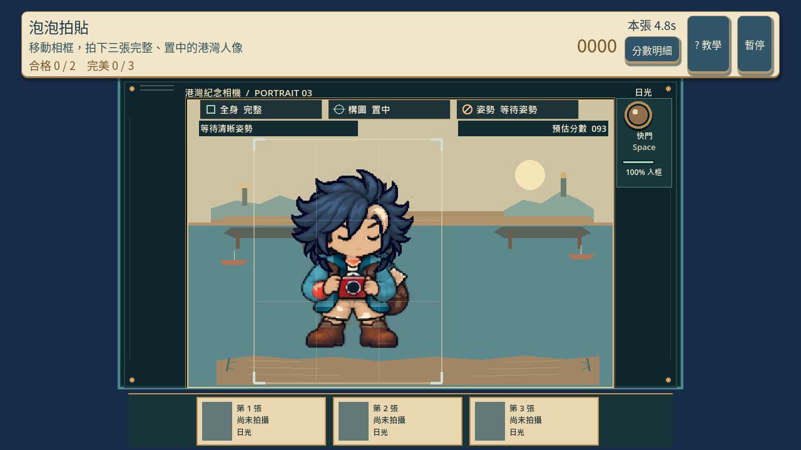
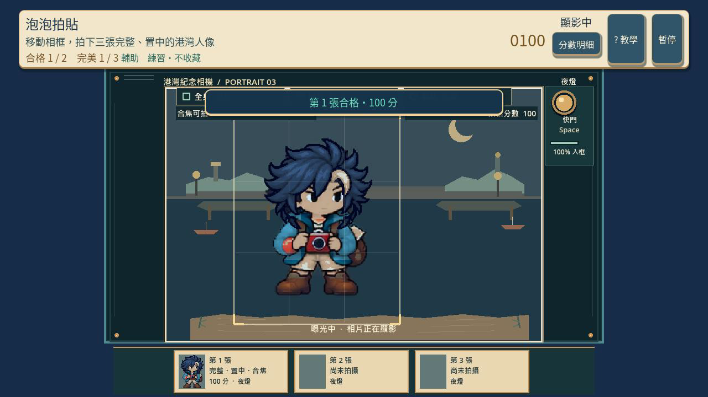
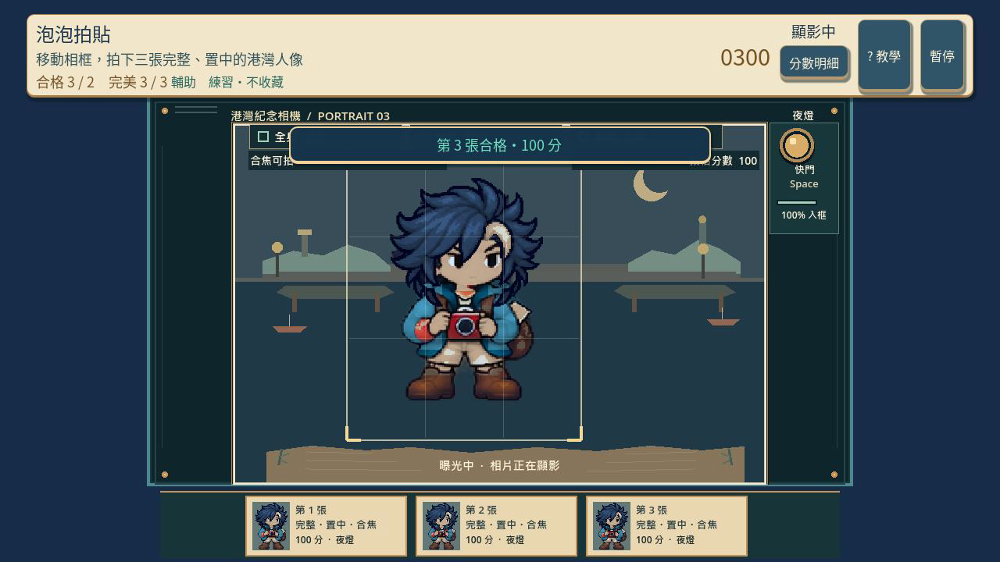
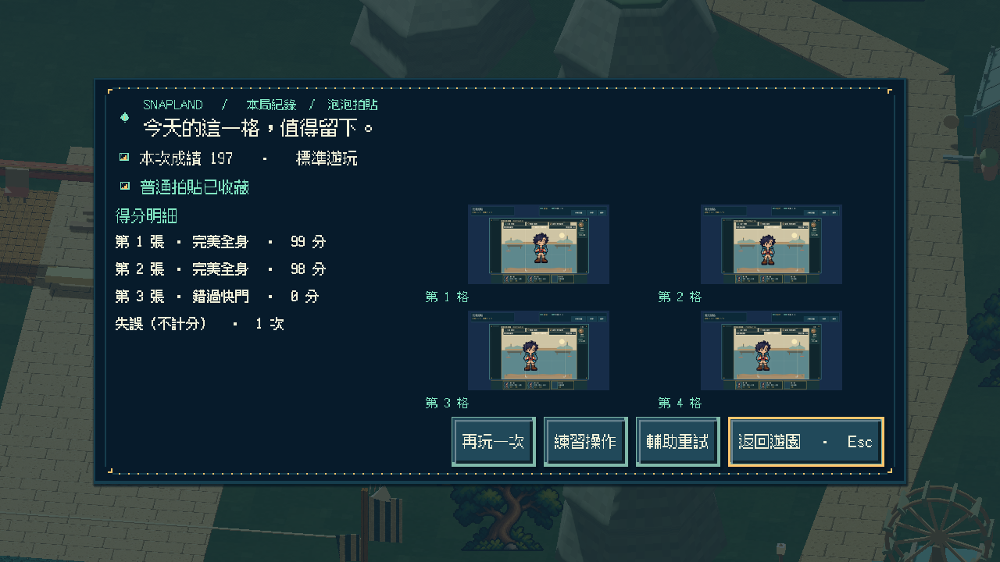

# [SG-25] 精修泡泡合照玩法與計分

> 狀態：完成

本次候選固定基準：`cf719411aca2be6d15bc9a1b6a468e338095e1fb`。泡泡包覆玩法已採納；此次修正明確要求全身完整入框、暫停安全與未就緒快門友善處理，不改既有照片分數公式。

## 內文

### 需求
將泡泡合照提升為可對外展示的完整小遊戲。保留每局三張照片、每張既有 0–100 構圖分、兩張合格的一般成功與三張完美的惡魔成功。新增每輪一次手動充氣／放飛泡泡：快門時人物全身須完整位於相框與有效泡泡內，該張才算合格；泡泡不另加分。即使只有少量頭頂或鞋底被裁、覆蓋率仍很高，也不能合格。相框為 360×440 設計像素；300×400 身形左右各有 30、上下各有 20 像素的真實容錯，鍵盤單次 14 像素微調下仍需看見可用合格窗口；第三輪水平追蹤為 0.45 rad/s。沒有泡泡或包覆失敗的照片仍顯示涵蓋、置中、時機原分，但不能計入合格張數。快門在合焦提示前不消耗本輪，並顯示短提示。助理由玩家親自充氣、放飛、移框與快門，只放寬泡泡尺寸／位置／時間容差，不放寬相框全身條件；暫停或失焦取消尚未發射的蓄力，已發射泡泡則保留並隨回合暫停。練習使用相同規則但不保存正式成績或收藏。

2026-10-12 使用者追加：同一園區維持共同主題，每款小遊戲須依玩法選擇自己的 2D、2.5D、HD-2D 或 3D 表現。不能沿用同一場地、構圖與動畫再換規則；鏡頭、空間、操作節奏和成功演出須帶來可辨認的新體驗。

### 來源
2026-10-12（Asia/Taipei）使用者要求全面重新審閱 UI 和小遊戲，提升目標、計分及操作手感；先廣泛 survey，減少遊戲當下提示，提供含截圖的完整教學。使用者授權自行決定設計，強調循序完善、細節有主次且不雜亂，以可面向大眾的品質驗收。

### 驗收條件
- [x] 依玩法採用獨立鏡頭、場地、視覺節奏與成功演出；與首區其他遊戲並列比較能辨認不同體驗，海港主題仍一致。
- [x] 比較至少六個跨不同方向的玩法、操控與玩家體驗來源，保存實際閱讀、圖例及選擇理由。
- [x] 移框、短按或短充氣放飛泡泡、選快門時機形成可理解的操作；bubble 中心／尺寸／路徑由實際模型狀態決定，四角全身包覆與精確完整入框都是真正合格條件，助理亦不得放寬裁切。
- [x] 合焦提示前的快門不消耗照片、失誤或時間回合；暫停／失焦取消未發射的充氣，已發射泡泡保留且回合時鐘凍結。
- [x] 鍵盤與滑鼠均可手動完成充氣／放飛；assist 不代替玩家操作，reduced motion 保留泡泡路徑、尺寸與命中資訊。
- [x] 普通、精準表現、失誤及輔助的成績規則明確；結算能說明成果與個別成就資格。
- [x] 首次學習、練習、正式遊玩、重試和離開形成完整流程，不在教學閱讀時消耗回合時間。
- [x] 正常及輔助、鍵盤及滑鼠、降低動態下以實際输入遊玩驗收；保留正常速度影片、截圖和受影響測試。

### 測試流程
1. 查看本票研究紀錄與圖例，核對採用的原則和原生前後比較。
2. 使用隔離存檔實際操作本票完整流程，核對各項驗收條件。
3. 核對重試、返回、重開與相關設定，保存原生截圖、影片和受影響測試摘要。

---

# 跟其他票的關係

- Blocks：無
- Blocked by：無
- Related：SG-11、SG-14、ART-21、MAIN-10

---

## Commit — 獨立取景玩法與原生構圖驗收

**問題**
合照沿用其他遊戲的場地與簡化點擊，構圖品質和身體是否完整沒有清楚影響成績，快門標籤也曾被裁切。

**改動**
加入港灣紀念相機、可移動的全身相框、姿勢與合焦時機，以及保留拍攝當下姿勢和光線的三張拍貼。涵蓋、置中與時機共同決定每張成績；快門與分數置於獨立區域。教學截圖換成新玩法的實際畫面。參考與選擇理由見[研究紀錄](../../design/runtime/bubble-photo-design.md)，跨遊戲圖例見 ART-21。

**驗收**
主 Session 局部檢查：模型 34、畫面 74、Session 53 項通過，教學面板檢查通過；錯誤資源測試按預期顯示提示。補回連按快門不得重複曝光，以及兩張合格照片加一次逾時僅獲普通資格的檢查。

原生正常速度 26.42 秒、四分之一速度 100.87 秒：鍵盤正式回合分别 296、297 分，三張完整構圖取得普通與小惡魔拍貼；滑鼠輔助、降低動態的夜間練習各 300 分。實際觀看取景、顯影和結算，確認當前角色頭髮、手腳、鞋底完整；暫停、繼續、重試歸零及練習不寫入拍貼、任務、分數與成就記錄通過。這是原生輸入驗收，未宣稱完整園區真人試玩。

[正常速度](images/SG-25-normal-play.mp4) · [慢放](images/SG-25-slow-play.mp4)

## Commit-2 — 光學明信片候選與 v2 原生驗收

固定基準：88cb340740f9b490e956bcb5dc89c31f2eb7f0b8；分支：feature/island-first-park。

### 問題
日光背景會降低白色合焦與預估分數的辨識度。相片舞台也需要更明確地呈現取景深度，避免只像一般平面遊戲場景。吹泡泡互動、完整角色動畫與第一次教學流程尚未完成，不能標示為已驗收。

### 改動
本次候選以取景框實際位置帶動遠岸、中景碼頭與近岸三層 2D 紙雕背景，形成有界限的視差；人物、評分取景框與得分幾何不移動。合焦與預估分數改用不透明深色底板，日夜與降低動態模式均保留一致對比。這是 2.5D 向量光學明信片，不是 3D 相機。候選教學截圖與影片改用最終 v2 原生畫面。

### 驗收
Godot 4.7.2 局部檢查：模型 34 項、畫面 101 項、教學面板／目錄與資源匯入通過。面板測試唯一缺圖警告來自刻意無效的 game-001 測試夾具。v1 日光白字可讀性問題已由深色底板修正；最終 v2 正常速度 1,585 幀／26.4167 秒、四分之一速度 6,052 幀／100.8667 秒，均無 ERROR。鍵盤正式回合各 297 分；滑鼠輔助、降低動態私人練習各 300 分，兩種速度均完成三張全身相片及暫停、繼續、重試、練習流程；正式結算後實際返回遊園，私人練習則在原生夾具結束時退出，未驗證私人練習返回遊園。練習前後比對拍貼、普通／惡魔收藏數、成就、任務、金幣、已擁有服飾、服飾獎勵及待同步成就；不代表其他設定或外觀欄位均未改變。這些是候選原生夾具與畫面檢視結果，不是完整真人試玩。

[正常速度 v2](images/SG-25-normal-play-v2.mp4) · [四分之一速度 v2](images/SG-25-slow-play-v2.mp4)

練習截圖中的 300 分為私人預覽結果，不新增收藏。

仍待驗證：吹泡泡互動、完整角色動畫、首次教學、失敗、私人練習離開與相簿完整流程。這些條件未完成前，本票維持進行中。固定基準與分支見本段開頭；[遠端提交 80ca160](https://github.com/deadline314/Snapland/commit/80ca160)。

## Commit-3 — 蓄泡包覆與全身拍貼

### 問題
原本主要是移動相框與按快門，泡泡沒有影響拍照成敗，操作也缺少蓄力與釋放的取捨。教學需要對應實際的新操作與拍貼成果。

### 改動
玩家先按住蓄泡、放開發射，讓會隨風漂移的泡泡與相框完整包住人物，再等待姿勢合焦拍照。過早按快門不消耗本輪；暫停或失去視窗焦點會取消未發射的蓄泡，已發射泡泡在暫停時凍結。三張教學圖改用正式鍵盤流程的實際畫面，依序展示充氣、泡泡與相框完整包住人物並等待合焦、以及三張拍貼結算。玩家說明改以方向鍵、滑鼠、充氣、放飛和快門提示操作，不再列出畫面尺寸或像素間距。結果示例明確標示 99、98、98 分，合計 295；滑鼠輔助練習結果另標示為私人預覽，不混入正式收藏。

### 驗收
正常速度與四分之一速度的隔離原生流程均自然結束，分別為 1,590 幀／26.500 秒及 6,057 幀／100.950 秒；兩段影片皆由 Root 實際播放至結尾，並檢視全部 30 張截圖及 8 張比較圖。兩種速度的鍵盤正式回合均為 295 分、三張全身完整且取得普通與小惡魔資格；滑鼠輔助、降低動態的私人練習為 296 分。兩段最終執行記錄均無引擎錯誤。早期兩次未通過均為原生夾具問題：第一次把「照片清單是否為空」的布林判斷寫反，第二次在讀取前未先沖出按住 E 的緩衝輸入。修正保留正式操作斷言，兩種速度的最終流程均通過；不是遊戲執行錯誤。

Root 已由 Main 的首次教學流程實際開啟 game-010，按下兩次原生「下一步」並核對三張 1280×720 教學圖；原生檢查 35 幀、60 fps，正常結束且無 ERROR 或資源洩漏，並已檢視三張截圖。這只確認教學頁面與圖片顯示，不是遊戲操作影片或完整真人遊玩。本票仍進行中，其他未勾驗收、最終美術與整區比較仍待完成。 相關局部檢查：模型 71 項、畫面 111 項、小遊戲整合 81 例通過。

[正常速度影片](images/SG-25-envelope-v3-normal.mp4) · [四分之一速度影片](images/SG-25-envelope-v3-quarter.mp4) · [三張正式教學圖](../../assets/ui/tutorials/game-010-step-01.png) · [包覆與合焦教學圖](../../assets/ui/tutorials/game-010-step-02.png) · [三張結算教學圖](../../assets/ui/tutorials/game-010-step-03.png)

[首次教學第 1 頁](images/SG-25-envelope-v3-native-tutorial-step-01.png) · [第 2 頁](images/SG-25-envelope-v3-native-tutorial-step-02.png) · [第 3 頁](images/SG-25-envelope-v3-native-tutorial-step-03.png) · [原生教學檢查記錄](images/SG-25-envelope-v3-native-tutorial-current.log) · [模型 71 項](images/SG-25-envelope-v3-model-71.log) · [畫面 111 項](images/SG-25-envelope-v3-view-111.log) · [整合 81 例](images/SG-25-envelope-v3-minigames-81.log)

分支：`feature/island-first-park`；本輪原生候選固定基準：`cf719411aca2be6d15bc9a1b6a468e338095e1fb`；整合提交前基準：`fd3d473e8d9a7f20d574db2ea2db2223fdef6a8b`。

整合後局部檢查：模型 71 項、畫面 111 項、共用操作 82 例及教學面板／目錄通過；文件連結通過。[完整本輪證據索引](images/SG-25-envelope-v3-evidence.json)。[本輪玩法與教學交付提交](https://github.com/deadline314/Snapland/commit/64df46eb5c3acdda6e974a3b219f0c66ee64c165)。

## Commit-4 — 2026-10-21 完整失敗、普通與練習流程結案

結算現在逐張區分完美／合格全身、泡泡未包全身、相框裁切與錯過快門；未拍到的照片也明確列0分。構圖、包覆四角、計分、泡泡風路徑及成功門檻保持原規則，沒有用放寬全身判定來通關。

正式鍵盤三張完美全身295分，普通及小惡魔均收藏；滑鼠蓄泡／釋放／快門、輔助／降低動態的夜間私人練習296分，返回遊園後原有收藏、成就、任務、金幣及服飾紀錄仍相同。另從非空存檔自然等三次逾時，結果0分失敗且完整存檔位元組不變；實際重試當下照片／泡泡／時鐘／失誤歸零，再用鍵盤拍兩張全身99、98分並等第三張逾時，197分只得普通拍貼。已發射泡泡在實際暫停期間連同時鐘凍結；失焦通知取消未發射蓄泡。

正常操作91.44秒、失敗／普通98.49秒、首次教學完整生命週期50.35秒，均exit0／0ERROR。首次閱讀不開局、不消耗回合；完成／略過、局中暫停重看、私人練習與重進依現行入口驗證。六項正式局部測試全數通過，含模型、視圖、十二款整合、Main及兩組介面檢查；原90秒門檻不變。

兩段無聲20FPS影片30.75／35.45秒均完整解碼，27張遊戲／結算與6張教學圖已檢視，包含全身、曝光、逐張原因與不同日夜。這輪沒有重新宣稱四分之一速度、真人試玩、聽感或全作美術完成；之前慢放原證據另見Commit-3。本票既有獨立港灣相機與十二款比較範圍保持，ART-20／21仍依整體UI／十二款條件驗收。

[六團隊本輪閱讀與選擇](images/SG-25-final-20261021-research.md) · [官方Camera-Ready靜態原圖](images/SG-25-final-20261021-reference-camera-ready.webp) · [完整結果／來源／拒收記錄](images/SG-25-final-20261021-verification.json) · [正常正式及滑鼠練習](images/SG-25-final-20261021-controls-v2-play.mp4) · [真正失敗／普通及重試](images/SG-25-final-20261021-outcomes-v2-play.mp4)。第一輪曾因驗收腳本找舊輔助入口失敗，已保留；改從真正「玩法與選項」入口操作後通過。

