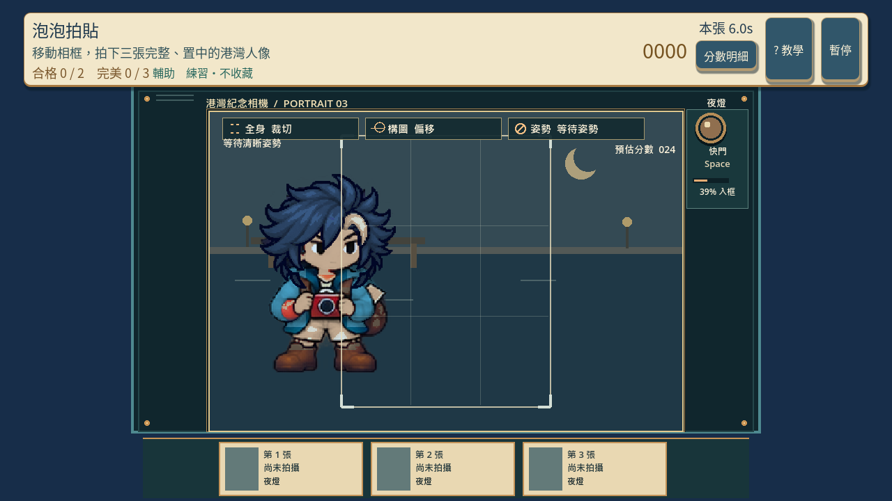
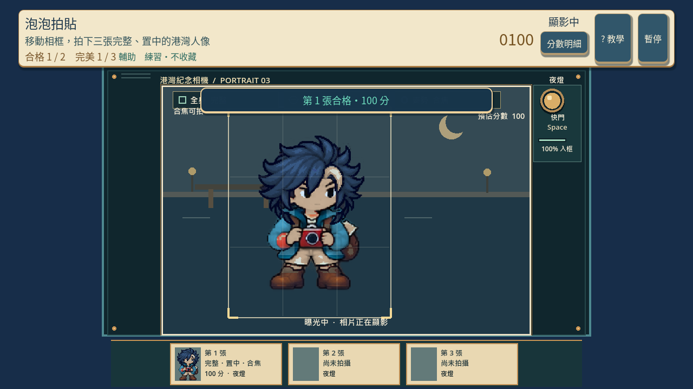
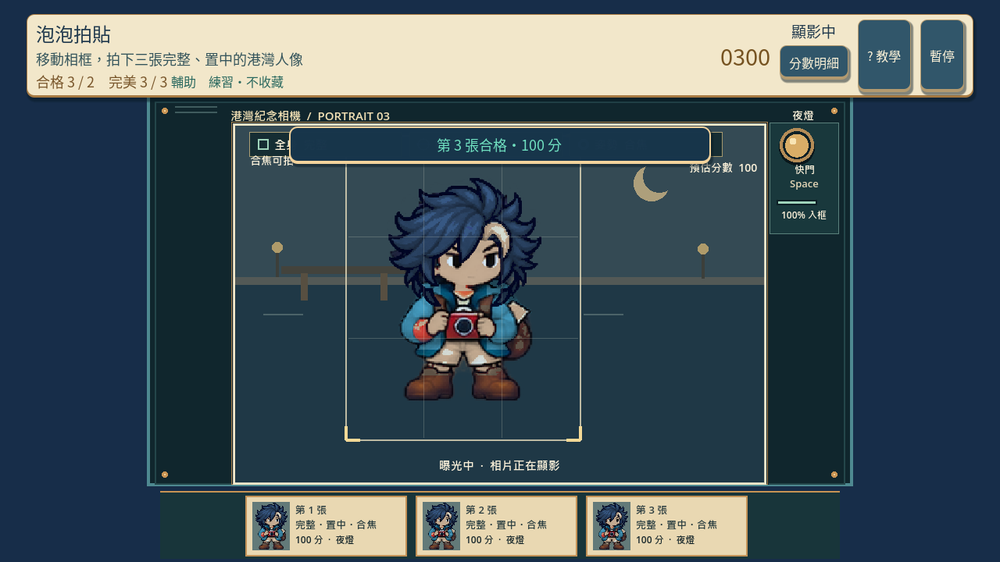
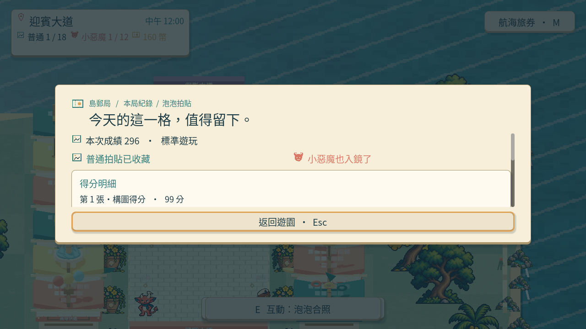
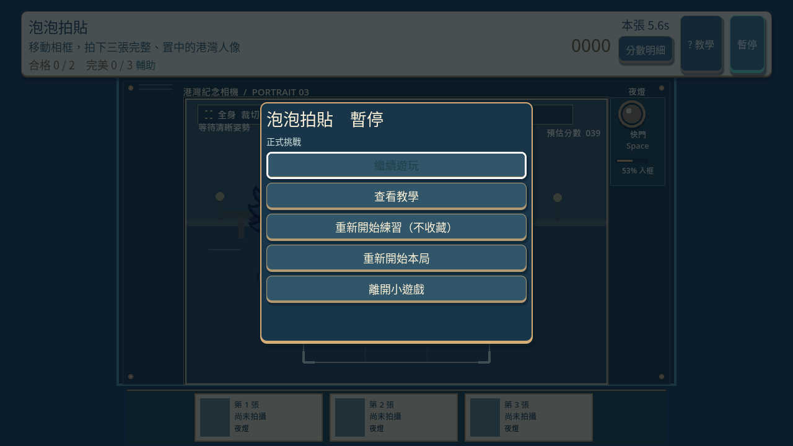
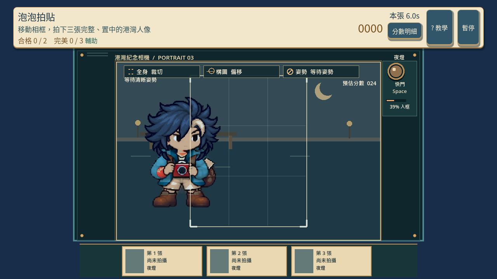
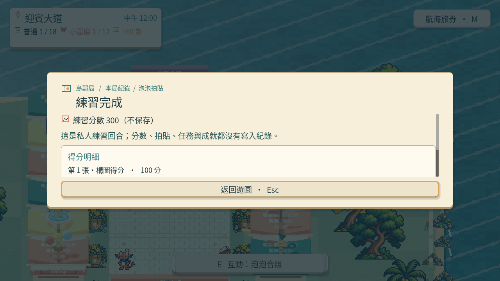

# [SG-25] 精修泡泡合照玩法與計分

> 狀態：進行中

本次接線與原生驗收固定基準：`aae0a1b`；分支：`feature/island-first-park`。

## 內文

### 需求
將泡泡合照提升為可對外展示的完整小遊戲。瞄準、吹泡泡與快門是可理解的連續操作，合照完整性與置中品質影響可見成績。操作手感、目標、分數和演出一起設計，學習內容放在有截圖的完整教學，遊玩時保留必要資訊。

2026-10-12 使用者追加：同一園區維持共同主題，每款小遊戲須依玩法選擇自己的 2D、2.5D、HD-2D 或 3D 表現。不能沿用同一場地、構圖與動畫再換規則；鏡頭、空間、操作節奏和成功演出須帶來可辨認的新體驗。

### 來源
2026-10-12（Asia/Taipei）使用者要求全面重新審閱 UI 和小遊戲，提升目標、計分及操作手感；先廣泛 survey，減少遊戲當下提示，提供含截圖的完整教學。使用者授權自行決定設計，強調循序完善、細節有主次且不雜亂，以可面向大眾的品質驗收。

### 驗收條件
- [ ] 依玩法採用獨立鏡頭、場地、視覺節奏與成功演出；與首區其他遊戲並列比較能辨認不同體驗，海港主題仍一致。
- [ ] 比較至少六個跨不同方向的玩法、操控與玩家體驗來源，保存實際閱讀、圖例及選擇理由。
- [ ] 瞄準、吹泡泡與快門是可理解的連續操作，合照完整性與置中品質影響可見成績。
- [ ] 普通、精準表現、失誤及輔助的成績規則明確；結算能說明成果與個別成就資格。
- [ ] 首次學習、練習、正式遊玩、重試和離開形成完整流程，不在教學閱讀時消耗回合時間。
- [ ] 正常及輔助、鍵盤及滑鼠、降低動態下以實際输入遊玩驗收；保留正常速度影片、截圖和受影響測試。

### 測試流程
1. 查看本票研究紀錄與圖例，核對採用的原則和原生前後比較。
2. 使用隔離存檔實際操作本票完整流程，核對各項驗收條件。
3. 核對重試、返回、重開與相關設定，保存原生截圖、影片和受影響測試摘要。

---

# 跟其他票的關係

- Blocks：無
- Blocked by：無
- Related：SG-11、SG-14、ART-21、MAIN-10

---

## Commit — 獨立取景玩法與原生構圖驗收

**問題**
合照沿用其他遊戲的場地與簡化點擊，構圖品質和身體是否完整沒有清楚影響成績，快門標籤也曾被裁切。

**改動**
加入港灣紀念相機、可移動的全身相框、姿勢與合焦時機，以及保留拍攝當下姿勢和光線的三張拍貼。涵蓋、置中與時機共同決定每張成績；快門與分數置於獨立區域。教學截圖換成新玩法的實際畫面。參考與選擇理由見[研究紀錄](../../design/runtime/bubble-photo-design.md)，跨遊戲圖例見 ART-21。

**驗收**
主 Session 局部檢查：模型 34、畫面 74、Session 53 項通過，教學面板檢查通過；錯誤資源測試按預期顯示提示。補回連按快門不得重複曝光，以及兩張合格照片加一次逾時僅獲普通資格的檢查。

原生正常速度 26.42 秒、四分之一速度 100.87 秒：鍵盤正式回合分别 296、297 分，三張完整構圖取得普通與小惡魔拍貼；滑鼠輔助、降低動態的夜間練習各 300 分。實際觀看取景、顯影和結算，確認當前角色頭髮、手腳、鞋底完整；暫停、繼續、重試歸零及練習不寫入拍貼、任務、分數與成就記錄通過。這是原生輸入驗收，未宣稱完整園區真人試玩。

[正常速度](images/SG-25-normal-play.mp4) · [慢放](images/SG-25-slow-play.mp4)

尚待本機原生驗收：首次教學、失敗、離開與相簿完整流程；吹泡泡操作及完整角色動畫仍未完成，因此維持進行中。分支：`feature/island-first-park`。遠端 commit：[4d11312](https://github.com/deadline314/Snapland/commit/4d11312)。

