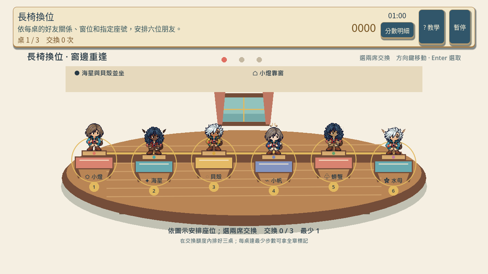
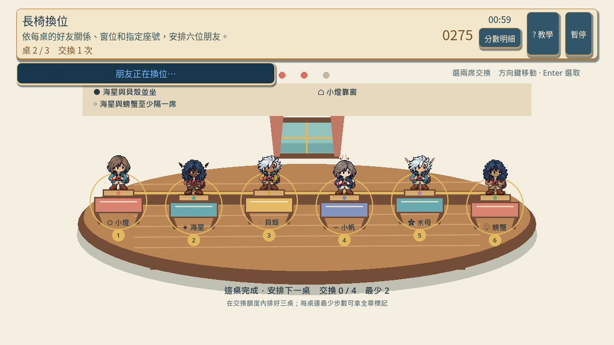
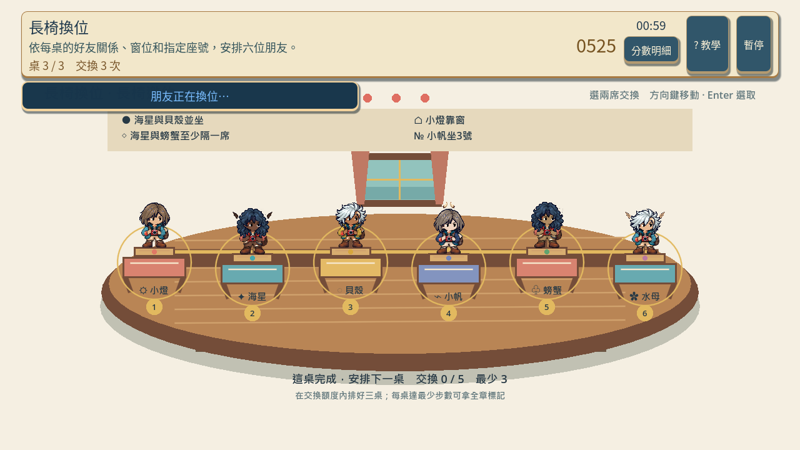
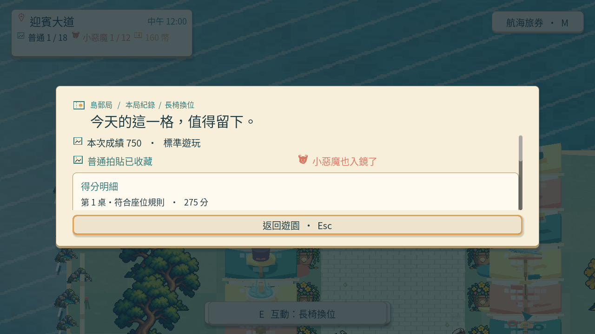
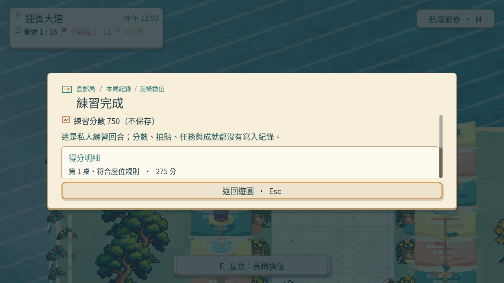
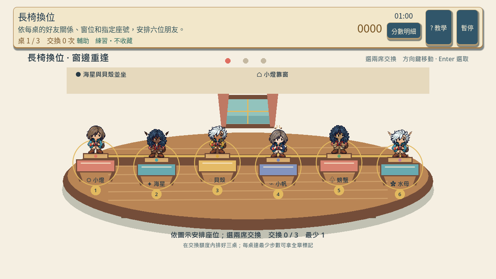
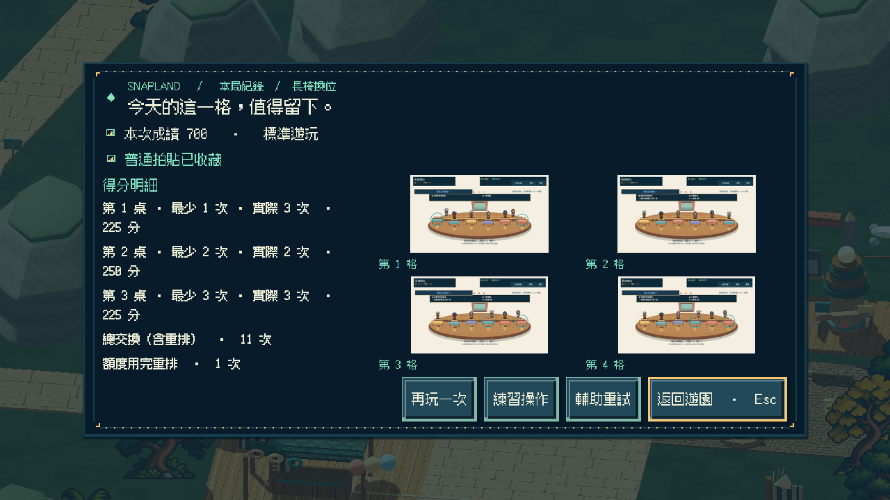
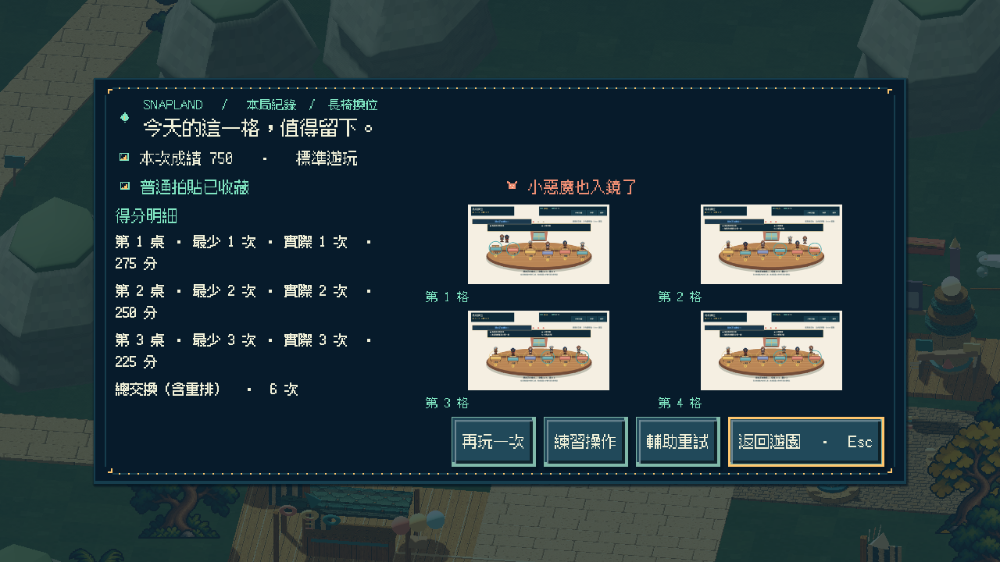
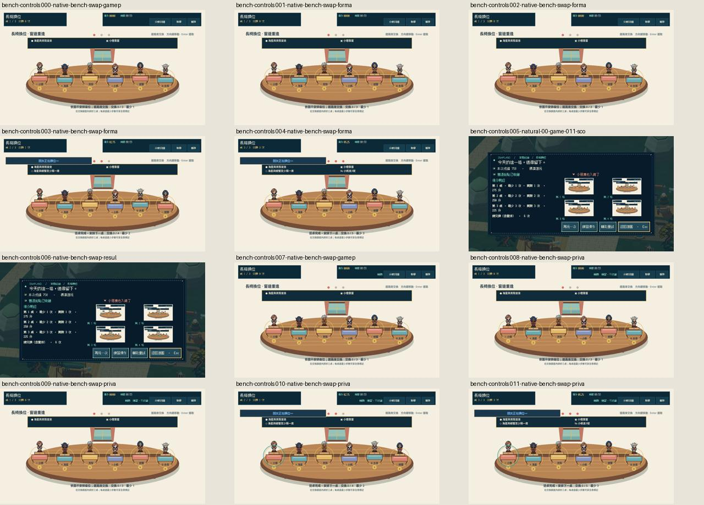

# [SG-26] 精修長椅換位玩法與計分

> 狀態：完成

開始基準：`aae0a1b`；分支：`feature/island-first-park`。

## 內文

### 需求
將長椅換位提升為可對外展示的完整小遊戲。好友關係和座位限制可辨，交換動作清楚且有策略，解題步數與完成條件一致。操作手感、目標、分數和演出一起設計，學習內容放在有截圖的完整教學，遊玩時保留必要資訊。

2026-10-12 使用者追加：同一園區維持共同主題，每款小遊戲須依玩法選擇自己的 2D、2.5D、HD-2D 或 3D 表現。不能沿用同一場地、構圖與動畫再換規則；鏡頭、空間、操作節奏和成功演出須帶來可辨認的新體驗。

### 來源
2026-10-12（Asia/Taipei）使用者要求全面重新審閱 UI 和小遊戲，提升目標、計分及操作手感；先廣泛 survey，減少遊戲當下提示，提供含截圖的完整教學。使用者授權自行決定設計，強調循序完善、細節有主次且不雜亂，以可面向大眾的品質驗收。

### 驗收條件
- [x] 依玩法採用獨立鏡頭、場地、視覺節奏與成功演出；與首區其他遊戲並列比較能辨認不同體驗，海港主題仍一致。
- [x] 比較至少六個跨不同方向的玩法、操控與玩家體驗來源，保存實際閱讀、圖例及選擇理由。
- [x] 好友關係和座位限制可辨，交換動作清楚且有策略，解題步數與完成條件一致。
- [x] 普通、精準表現、失誤及輔助的成績規則明確；結算能說明成果與個別成就資格。
- [x] 首次學習、練習、正式遊玩、重試和離開形成完整流程，不在教學閱讀時消耗回合時間。
- [x] 正常及輔助、鍵盤及滑鼠、降低動態下以實際输入遊玩驗收；保留正常速度影片、截圖和受影響測試。

### 測試流程
1. 查看本票研究紀錄與圖例，核對採用的原則和原生前後比較。
2. 使用隔離存檔實際操作本票完整流程，核對各項驗收條件。
3. 核對重試、返回、重開與相關設定，保存原生截圖、影片和受影響測試摘要。

---

# Commit-1

## 內文

問題：長椅換位缺少自己的空間與策略層次，人物交換的早期畫面也曾讓其他人物消失，移動者跑出畫面。

改動：六席人物立牌放在近距離港灣工作桌，三桌座序限制逐步增加，最少交換分別為 1、2、3 次。交換時四位留在座位，兩位沿弧線換位；每桌列出步數和分數，三桌最短解共 750 分。立牌沿用現有旅人的外觀變化，不將其當成六位已完成新動畫的 NPC。

驗收：主 Session 實際播放正常與四分之一速度影片，看過六個完整立牌、兩位移動與四位留座、完整手腳及正式 750 分結算；發現的消失及越界問題已修正後重錄。正式流程用真實鍵盤，輔助／降低動態私人練習用真實指標操作；暫停、恢復、確認重試歸零，以及私人練習未改變收藏、成就、任務、貨幣、衣櫃和待同步資料，均有原生紀錄。

### 測試結果

| 項目 | 結果 |
|---|---|
| 座序與評分規則 | 主 Session 重跑 49 項，通過 |
| 全身邊界與交換畫面 | 主 Session 重跑 80 項，通過 |
| 共用小遊戲流程及教學 | 53 項及教學檢查通過，匯入無腳本／解析錯誤 |
| 正常速度原生影片 | 470 幀、7.83 秒，正式與私人皆完成 750 分，無 ERROR |
| 四分之一速度原生影片 | 1665 幀、27.75 秒，正式與私人皆完成 750 分，無 ERROR |

以上為前次局部交付範圍；本輪完整流程與目前構圖的驗收見 Commit-2。

### 來源與畫面

[六個實際閱讀的官方來源與六張圖例、座序設計取捨](../../design/runtime/bench-swap-design.md)

[正常速度原生影片](images/SG-26-normal-v2.mp4) · [四分之一速度原生影片](images/SG-26-slow-v2.mp4)

開始基準：`f4babe8687d4fa79918eb64c05efb6e6a8e6720b`；分支：`feature/island-first-park`。遠端提交：[4dd6602](https://github.com/deadline314/Snapland/commit/4dd66027d7a1be31e9e18376a5c402592bd806b9)。

---

# 跟其他票的關係

- Blocks：無
- Blocked by：無
- Related：SG-12、SG-14、ART-21、MAIN-10

---

# Commit-2

## 內文

結算原先把會影響得分的交換次數寫成「不計分」，也無法直接比較每桌最少與實際交換。現在每桌同列兩者與真實得分，另外列含錯誤嘗試的總交換及額度用完的重排次數；三桌最短解仍是 750 分，三桌完成是普通目標，不加隱藏座序限制。

實際鍵盤最短 1／2／3 次完成 750 分並取得普通與小惡魔；滑鼠輔助／降低動態私人練習同樣完成三桌，完整收藏、任務、成就、貨幣、衣櫃及待同步資料不變。另一條路線先用三次錯誤交換自然觸發重排，再走 3／2／3 次完成，實際共 11 次交換、一次重排、700 分，只得普通。完成前完整非空存檔位元組不變；真正結果的「再玩一次」事件當下，時計、桌號、分數、交換與歷史同步歸零。

另外用全新未讀教學存檔操作三步圖文、文字分頁、前後步、開始、遊玩中重看、暫停與繼續、確認離開、再進入與私人練習教學；閱讀期間時計不動，離開再進不用強制重讀。這是獨立流程，未用通關測試的已讀 fixture 代替首次學習。逐張看過本輪 25 張原生截圖與結果大圖，也重看首區十二款實景比較：本款維持港灣木桌、單排六席完整立牌及兩人交換，其餘四人留座，和影戲、管線與樂器構圖可辨。六席是原旅人的外觀立牌，不擴稱六名新 NPC。既有全速及四分之一速交換觀察仍是前次證據。

### 測試結果

| 項目 | 結果 |
|---|---|
| 正式鍵盤、HUD 暫停／確認重試、輔助降低動態滑鼠練習 | 新程序 45.18 秒，exit 0／0 ERROR |
| 錯誤額度重排、700 分一般路線、結果重試、完整檔安全 | 新程序 27.53 秒，exit 0／0 ERROR |
| 新玩家三步教學／重看／離開再進／私人練習 | 新程序 48.90 秒，原每款 60 秒上限內，exit 0／0 ERROR |
| 座序模型／場地與完整人物範圍 | 49／80 項通過，0.36／3.76 秒 |
| 首區共用玩法／Main 整合／小遊戲 UI | 通過，77.66／23.17／6.87 秒，皆 exit 0／0 ERROR；UI 包含三尺寸 |
| 正常時間影片 | 1280×720、20 FPS，205／103 格，10.25／5.15 秒；完整解碼通過 |

影片本輪只作完整解碼及擷取圖檢視，未聲稱連續觀看；Dummy 音訊未試聽。既有角色 celebrate 缺正式來源的安全替代警告歸 ART-17；本票不代替角色整套動作驗收。完整 CI 依本票提交另由遠端執行，不把本地五項擴稱完整 92 項。

### 來源與畫面

[本輪六團隊研究與取捨](images/SG-26-final-20261021-research.md) · [官方圖來源與雜湊](images/SG-26-final-20261021-reference-provenance.json) · [逐檔證據清單](images/SG-26-final-20261021-manifest.json) · [原生來源及操作診斷](images/SG-26-final-20261021-review-sources.zip)

[正式／私人正常時間影片](images/SG-26-final-20261021-bench-controls-play.mp4) · [錯誤恢復／一般完成影片](images/SG-26-final-20261021-bench-outcomes-play.mp4) · [新玩家完整流程日誌](images/SG-26-final-20261021-bench-lesson-result.log) · [受影響檢查](images/SG-26-final-20261021-checks-results.json)

交付提交：以本票 Commit-2 對應的 `SG-26 完成長椅一般與精準驗收並釐清交換計分` 提交為準。
