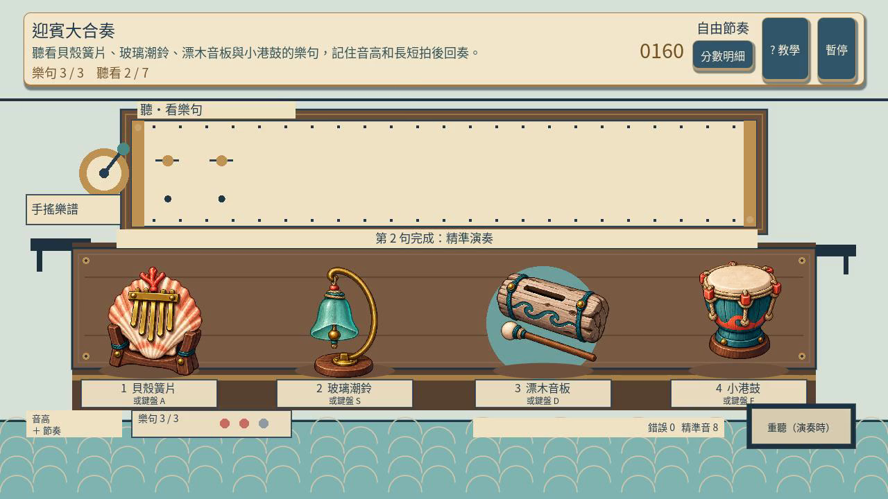
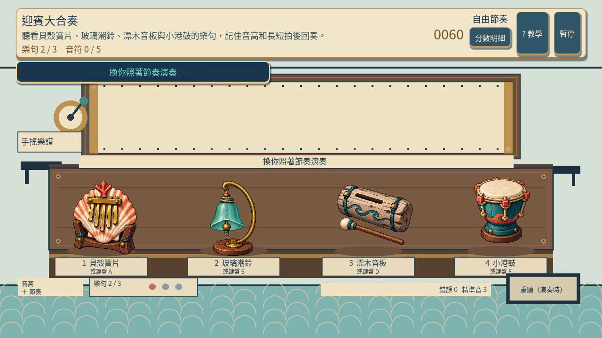
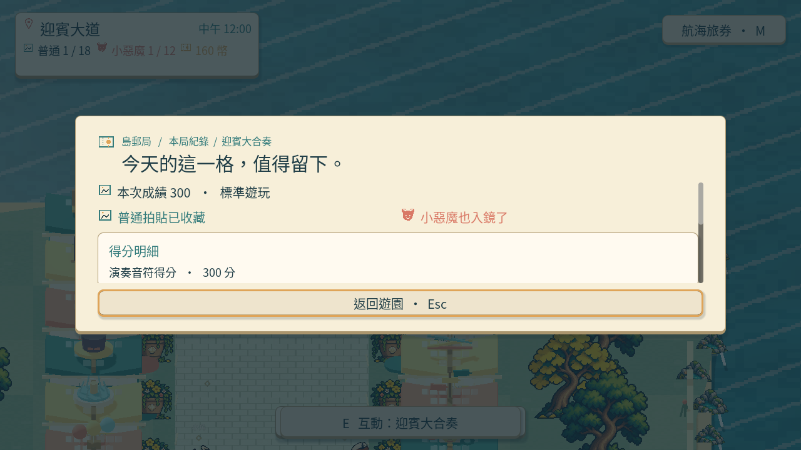
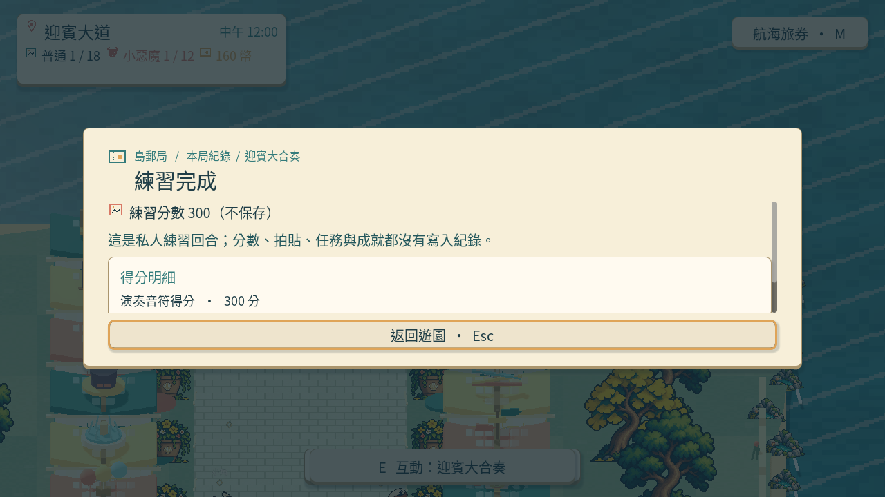
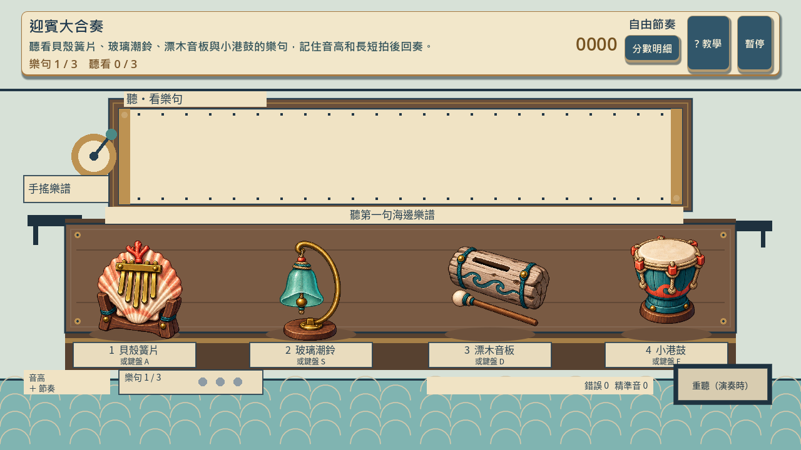

# [SG-27] 精修迎賓大合奏玩法與計分

> 狀態：進行中

開始基準：`aae0a1b`；分支：`feature/island-first-park`。

## 內文

### 需求
將迎賓大合奏提升為可對外展示的完整小遊戲。示範、記憶與演奏階段明確，音色、亮起及操作同步，完成樂句有完整音樂回饋。操作手感、目標、分數和演出一起設計，學習內容放在有截圖的完整教學，遊玩時保留必要資訊。

2026-10-12 使用者追加：同一園區維持共同主題，每款小遊戲須依玩法選擇自己的 2D、2.5D、HD-2D 或 3D 表現。不能沿用同一場地、構圖與動畫再換規則；鏡頭、空間、操作節奏和成功演出須帶來可辨認的新體驗。

### 來源
2026-10-12（Asia/Taipei）使用者要求全面重新審閱 UI 和小遊戲，提升目標、計分及操作手感；先廣泛 survey，減少遊戲當下提示，提供含截圖的完整教學。使用者授權自行決定設計，強調循序完善、細節有主次且不雜亂，以可面向大眾的品質驗收。

### 驗收條件
- [ ] 依玩法採用獨立鏡頭、場地、視覺節奏與成功演出；與首區其他遊戲並列比較能辨認不同體驗，海港主題仍一致。
- [ ] 比較至少六個跨不同方向的玩法、操控與玩家體驗來源，保存實際閱讀、圖例及選擇理由。
- [ ] 示範、記憶與演奏階段明確，音色、亮起及操作同步，完成樂句有完整音樂回饋。
- [ ] 普通、精準表現、失誤及輔助的成績規則明確；結算能說明成果與個別成就資格。
- [ ] 首次學習、練習、正式遊玩、重試和離開形成完整流程，不在教學閱讀時消耗回合時間。
- [x] 正常及輔助、鍵盤及滑鼠、降低動態下以實際输入遊玩驗收；保留正常速度影片、截圖和受影響測試。

### 測試流程
1. 查看本票研究紀錄與圖例，核對採用的原則和原生前後比較。
2. 使用隔離存檔實際操作本票完整流程，核對各項驗收條件。
3. 核對重試、返回、重開與相關設定，保存原生截圖、影片和受影響測試摘要。

---

# Commit-1

## 問題

原本只有重複亮起的色塊，畫面與其他小遊戲相近，玩家也難以感覺自己在演奏音樂。

## 改動

改為海港手搖樂譜工作台，四件樂器有不同材質與輪廓。三句固定旋律分別包含 3、5、7 個音，玩家先聽看音高與長短拍，再用按鍵或點擊回奏。錯音重播原句，節奏不完美仍可完成，每句開始前可額外重聽兩次。教學附實際樂譜、回奏與正式結果截圖。

## 驗收

以隔離存檔從園區站點進入，透過實際按鍵完成三句，正常速度及四分之一速度均得到 300 分、普通與小惡魔拍貼；暫停、恢復及確認重試正常。輔助、降低動態與滑鼠私人練習也完成三句，拍貼、成就、任務、待同步成就、換裝獎勵紀錄及金幣沒有因此改變。已實際查看正常及慢放影片中的演奏畫面與結果，四件樂器完整且不遮住控制牌；此紀錄不代表已完成真人試聽。

### 測試結果

| 項目 | 結果 |
|---|---|
| 合奏規則局部測試 | 35 項通過 |
| 合奏畫面局部測試 | 48 項通過 |
| 首區回合整合局部測試 | 53 案通過 |
| 教學面板與資料 | 通過 |
| 教學控制及截圖資源預檢 | 13 課、39 步通過；不等同原生教學導航驗收 |
| 原生正常速度 | 通過；47.47 秒影片 |
| 原生四分之一速度 | 通過；187.57 秒影片 |
| 執行紀錄 | 無腳本或解析錯誤 |

### 研究與素材

[研究紀錄與採用理由](../../design/runtime/melody-memory-design.md)涵蓋官方 Simon 規則、Nintendo Rhythm Heaven、Enhance Lumines、W3C 動態可及性與 Godot，並比較六款不同遊戲的實際靜態圖例。[生成素材與裁切檢查紀錄](../../design/runtime/melody-instruments-generation.md)保留素材來源及檢查範圍。

### 截圖與影片

[正常速度影片](images/SG-27-normal-play.mp4) · [四分之一速度影片](images/SG-27-slow-play.mp4)

分支：`feature/island-first-park`。本票維持「進行中」；首教完整導航、離開及重新進入、真人試聽與最終音樂演出尚待本機原生驗收，驗收條件維持未勾選。

交付 commit：[6661904](https://github.com/deadline314/Snapland/commit/6661904521c9308b36c26e6a9ae45ecd94852061)。

# Commit-2

## 問題

後續原生啟動紀錄發現遊戲雖回報結束碼 0，仍有三筆腳本錯誤。這也修正 Commit-1「執行紀錄無腳本或解析錯誤」的記載：前次只看結束碼，漏掉了錯誤訊息。

## 改動

移除啟動時造成錯誤的多餘步驟，讓樂器畫面依照遊戲啟動流程載入。音符輸入、重試與練習仍使用原有玩法。

## 驗收

局部樂器畫面檢查 54 項、原生顯示器 SceneTree 檢查 55 項、旋律模型檢查 35 項通過，三次記錄皆為零錯誤。原生檢查確認遊戲建立了實際樂器畫面、載入四件樂器並產生 1280×720 截圖；其階段推進與指標事件由檢查程式直接驅動，不代表以主選單、外接輸入或完整回合進行真人試玩，也未驗收實際音訊。票券其他驗收項目仍在進行。

# 跟其他票的關係

- Blocks：無
- Blocked by：無
- Related：SG-13、SG-14、ART-21、MAIN-10

---

