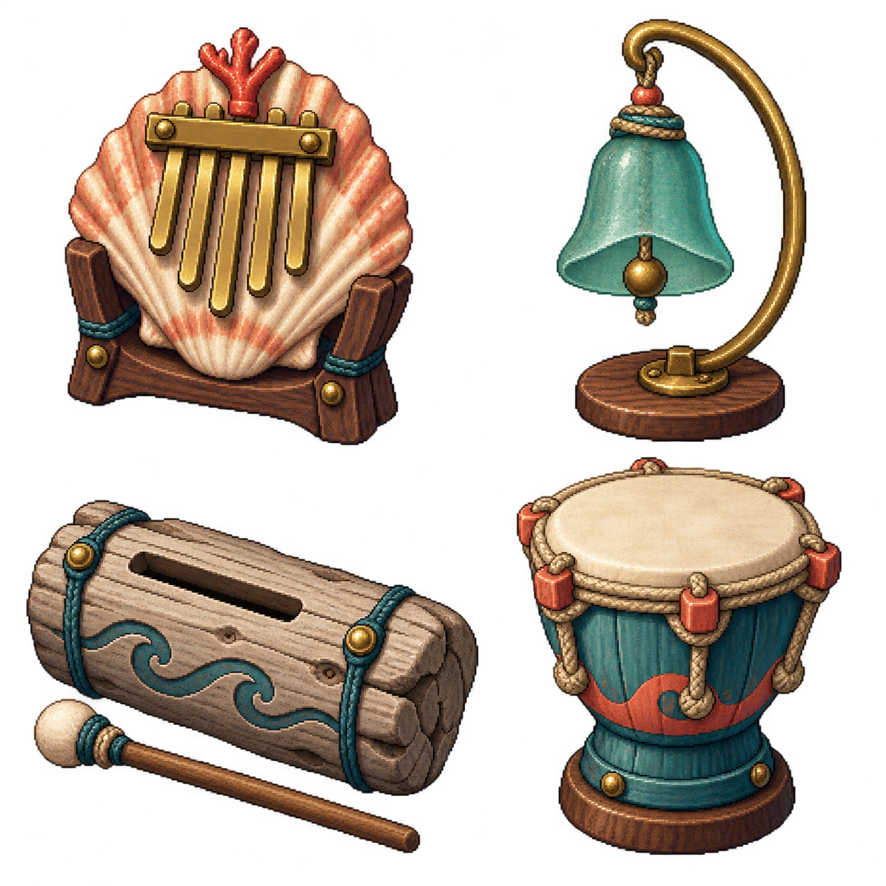
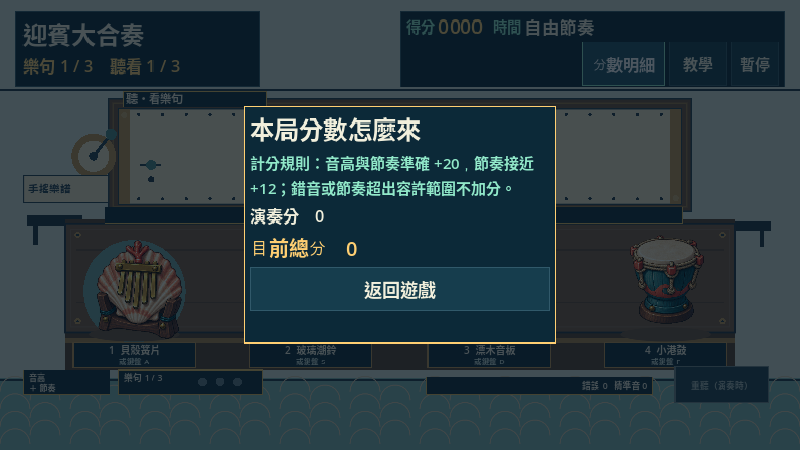
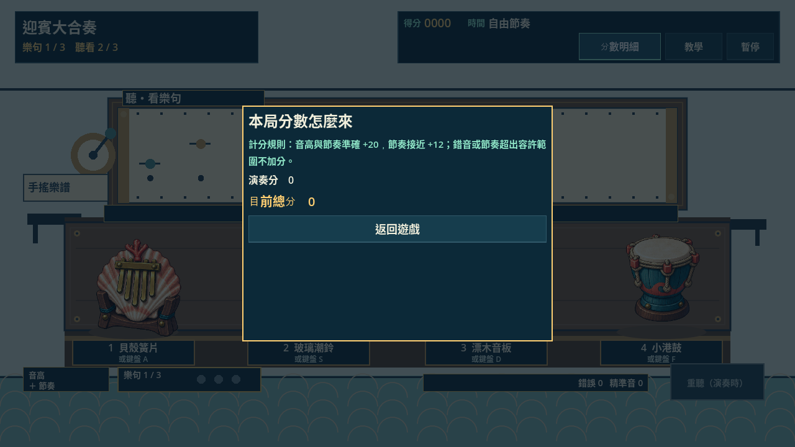
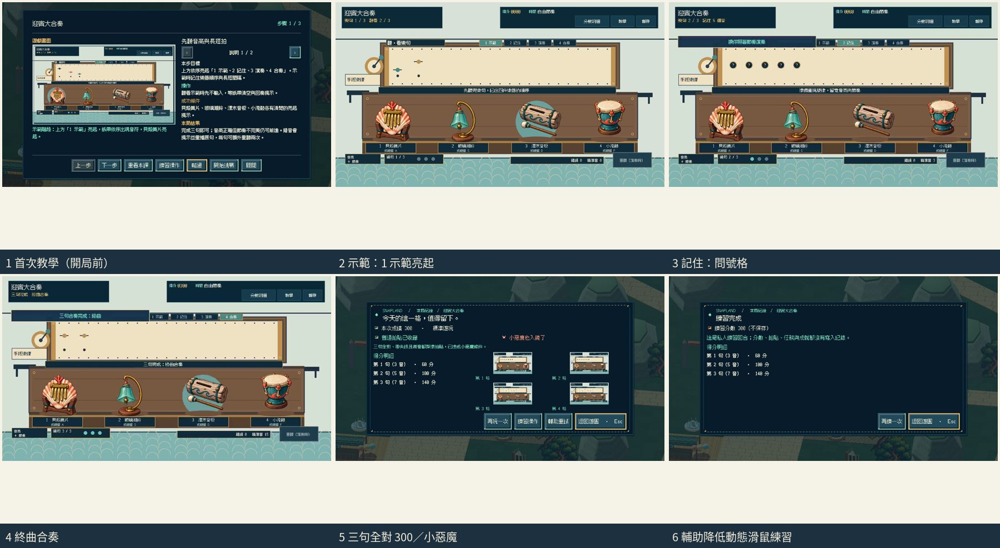

# [SG-27] 精修迎賓大合奏玩法與計分

> 狀態：完成

開始基準：`aae0a1b`；分支：`feature/island-first-park`。

## 內文

### 需求
將迎賓大合奏提升為可對外展示的完整小遊戲。示範、記憶與演奏階段明確，音色、亮起及操作同步，完成樂句有完整音樂回饋。操作手感、目標、分數和演出一起設計，學習內容放在有截圖的完整教學，遊玩時保留必要資訊。

2026-10-12 使用者追加：同一園區維持共同主題，每款小遊戲須依玩法選擇自己的 2D、2.5D、HD-2D 或 3D 表現。不能沿用同一場地、構圖與動畫再換規則；鏡頭、空間、操作節奏和成功演出須帶來可辨認的新體驗。

### 來源
2026-10-12（Asia/Taipei）使用者要求全面重新審閱 UI 和小遊戲，提升目標、計分及操作手感；先廣泛 survey，減少遊戲當下提示，提供含截圖的完整教學。使用者授權自行決定設計，強調循序完善、細節有主次且不雜亂，以可面向大眾的品質驗收。

### 驗收條件
- [x] 依玩法採用獨立鏡頭、場地、視覺節奏與成功演出；與首區其他遊戲並列比較能辨認不同體驗，海港主題仍一致。
- [x] 比較至少六個跨不同方向的玩法、操控與玩家體驗來源，保存實際閱讀、圖例及選擇理由。
- [x] 示範、記憶與演奏階段明確，音色、亮起及操作同步，完成樂句有完整音樂回饋。
- [x] 普通、精準表現、失誤及輔助的成績規則明確；結算能說明成果與個別成就資格。
- [x] 首次學習、練習、正式遊玩、重試和離開形成完整流程，不在教學閱讀時消耗回合時間。
- [x] 正常及輔助、鍵盤及滑鼠、降低動態下以實際输入遊玩驗收；保留正常速度影片、截圖和受影響測試。

### 測試流程
1. 查看本票研究紀錄與圖例，核對採用的原則和原生前後比較。
2. 使用隔離存檔實際操作本票完整流程，核對各項驗收條件。
3. 核對重試、返回、重開與相關設定，保存原生截圖、影片和受影響測試摘要。

---

# Commit-1

## 問題

原本只有重複亮起的色塊，畫面與其他小遊戲相近，玩家也難以感覺自己在演奏音樂。

## 改動

改為海港手搖樂譜工作台，四件樂器有不同材質與輪廓。三句固定旋律分別包含 3、5、7 個音，玩家先聽看音高與長短拍，再用按鍵或點擊回奏。錯音重播原句，節奏不完美仍可完成，每句開始前可額外重聽兩次。教學附實際樂譜、回奏與正式結果截圖。

## 驗收

以隔離存檔從園區站點進入，透過實際按鍵完成三句，正常速度及四分之一速度均得到 300 分、普通與小惡魔拍貼；暫停、恢復及確認重試正常。輔助、降低動態與滑鼠私人練習也完成三句，拍貼、成就、任務、待同步成就、換裝獎勵紀錄及金幣沒有因此改變。已實際查看正常及慢放影片中的演奏畫面與結果，四件樂器完整且不遮住控制牌；此紀錄不代表已完成真人試聽。

### 測試結果

| 項目 | 結果 |
|---|---|
| 合奏規則局部測試 | 35 項通過 |
| 合奏畫面局部測試 | 48 項通過 |
| 首區回合整合局部測試 | 53 案通過 |
| 教學面板與資料 | 通過 |
| 教學控制及截圖資源預檢 | 13 課、39 步通過；不等同原生教學導航驗收 |
| 原生正常速度 | 通過；47.47 秒影片 |
| 原生四分之一速度 | 通過；187.57 秒影片 |
| 執行紀錄 | 無腳本或解析錯誤 |

### 研究與素材

[研究紀錄與採用理由](../../design/runtime/melody-memory-design.md)涵蓋官方 Simon 規則、Nintendo Rhythm Heaven、Enhance Lumines、W3C 動態可及性與 Godot，並比較六款不同遊戲的實際靜態圖例。[生成素材與裁切檢查紀錄](../../design/runtime/melody-instruments-generation.md)保留素材來源及檢查範圍。

### 截圖與影片

[正常速度影片](images/SG-27-normal-play.mp4) · [四分之一速度影片](images/SG-27-slow-play.mp4)

分支：`feature/island-first-park`。本票維持「進行中」；首教完整導航、離開及重新進入、真人試聽與最終音樂演出尚待本機原生驗收，驗收條件維持未勾選。

交付 commit：[6661904](https://github.com/deadline314/Snapland/commit/6661904521c9308b36c26e6a9ae45ecd94852061)。

# Commit-2

## 問題

後續原生啟動紀錄發現遊戲雖回報結束碼 0，仍有三筆腳本錯誤。這也修正 Commit-1「執行紀錄無腳本或解析錯誤」的記載：前次只看結束碼，漏掉了錯誤訊息。

## 改動

移除啟動時造成錯誤的多餘步驟，讓樂器畫面依照遊戲啟動流程載入。音符輸入、重試與練習仍使用原有玩法。

## 驗收

局部樂器畫面檢查 54 項、原生顯示器 SceneTree 檢查 55 項、旋律模型檢查 35 項通過，三次記錄皆為零錯誤。原生檢查確認遊戲建立了實際樂器畫面、載入四件樂器並產生 1280×720 截圖；其階段推進與指標事件由檢查程式直接驅動，不代表以主選單、外接輸入或完整回合進行真人試玩，也未驗收實際音訊。票券其他驗收項目仍在進行。

# 跟其他票的關係

- Blocks：無
- Blocked by：無
- Related：SG-13、SG-14、ART-21、MAIN-10

---

### 提交

分支：`feature/island-first-park`；[遠端交付提交](https://github.com/deadline314/Snapland/commit/7719b26b4966265d1f5b7ddd14083ce4478bcfeb)。

## Commit — 補齊合奏素材退件圖例

**問題**
素材研究記錄引用的第一版退件圖沒有隨先前交付保存，乾淨下載後無法審閱該圖，連結檢查也會失敗。

**改動**
補存原始第一版圖例，供比較貝殼底座與槌子靠近分格邊界的退件原因；正式遊戲仍使用既有第二版。

**驗收**
主 Session 親自查看原圖並核對 SHA-256，保存內容沒有重繪。與 MAIN-12 入口修復候選一併檢查，連結驗證通過，必要目標缺失的反例仍被拒絕（兩項局部測試通過）；本段僅是文件與圖例驗收，沒有重新宣稱音訊或遊戲試玩通過。固定基準：`cf719411aca2be6d15bc9a1b6a468e338095e1fb`；分支：`feature/island-first-park`。整體票況維持進行中。

本次圖例交付提交：[c707bcd](https://github.com/deadline314/Snapland/commit/c707bcdca1c184e7852c288ad2bfc241cb3d953e)。

# Commit — 2026-10-20 修正與實際成績矛盾的說明

固定開始 SHA：`95c08c1`；分支：`codex/delivery-batch-20261020`。

正式普通及小惡魔拍照驗收時發現：實際精準音符給 20、接近給 12，分數明細卻仍寫每音 25 加樂句 100。現在說明由實際使用的兩項分值產生，不再顯示不存在的樂句加分，得分、容許時間與收藏資格均未改。

在既有旋律回歸中補入實際精準／接近輸入與公開分數明細的比對，39 項全部通過；畫面與 Session 生命週期 54 項通過。另以真正滑鼠事件開啟原生分數明細，800×600 與 1280×720 視窗都顯示正確規則（前者保留畫面比例，實際渲染為 800×450）、文字完整，兩張畫面已實際查看，0 個引擎 ERROR。採用既有玩法研究，這是說明一致性修正，不是新一輪音樂選材或試聽。

[39 項規則與明細對照](images/SG-27-rule-20261020-model.log) · [54 項畫面／生命週期](images/SG-27-rule-20261020-view.log) · [實際滑鼠與雙尺寸](images/SG-27-rule-20261020-native.log)。整組首區整合回歸曾在原有 90 秒時限中止，完整結果另由 MAIN-2 追蹤，不能將上述局部結果寫成全套通過。兩次原生檢視腳本的座標／事件傳遞失敗保留於隔離草稿，改用實際視窗到 viewport 的縮放後重跑通過。全票仍為進行中，完整音色與演出條件保持未勾。

# Commit — 2026-10-23 示範／記住／演奏／合奏與樂器音色

## 問題

四件樂器共用四個純正弦音，聽不出各自的材質；完成一句只有文字，沒有音樂回饋；記住階段紙帶清空，卻沒說要記幾個音；結算只有一列合計分數，也不說明本次資格。

## 改動

四件樂器保留原音高，改成遊戲自有的合成音色：貝殼簧片撥奏、玻璃潮鈴的鐘聲泛音、漂木音板的木質短音加槌擊、小港鼓的鼓皮下滑音；跟隨音效音量與暫停。紙帶上方以「1 示範／2 記住／3 演奏／4 合奏」標出目前階段，記住與演奏時顯示該句音數的問號格並逐格點亮。第一、二句完成後四件樂器帶和聲合奏回放剛完成的樂句，再示範下一句；第三句完成後播放終曲合奏與收尾和弦才進結算。結算每句一列分數，資格說明列出精準音數與失誤。教學三張圖換成新版實際畫面。

## 驗收

以隔離存檔、固定 30 FPS 引擎時鐘在雲端 llvmpipe 上用實際按鍵與滑鼠操作 Main：首次教學在開局前顯示、不消耗回合，開始後經暫停離開回到園區且進度不變；正式鍵盤三句全對得 300 分與普通、小惡魔，期間兩次合奏回放與終曲依序亮起樂器，結算列出三句分數與資格；暫停／恢復、確認重試正常；輔助＋降低動態以滑鼠完成的練習不改收藏。普通與未完成的資格文字由單元測試核對。腳本輸入不是真人試玩，也沒有實際試聽音色。

| 項目 | 結果 |
|---|---|
| 旋律模型（含合奏回放順序、音色快取、資格文字） | 45 項通過 |
| 樂器畫面 | 54 項通過 |
| 共用小遊戲 | 84 案通過 |
| 原生正式＋練習 | exit 0、0 ERROR，71.1 秒影片 |
| 原生首次教學與離開 | exit 0、0 ERROR |
| Python／設計驗證 | 147 項；5 範圍通過 |

[設計與來源](../../design/runtime/melody-memory-design.md) · [原生影片](images/SG-27-final-20261023-native.mp4)

原生影片為無聲畫面。分支：`work/sg-20-21-27`。
