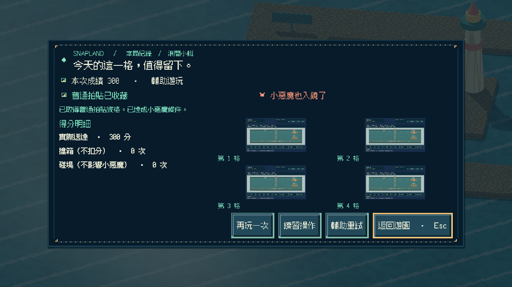
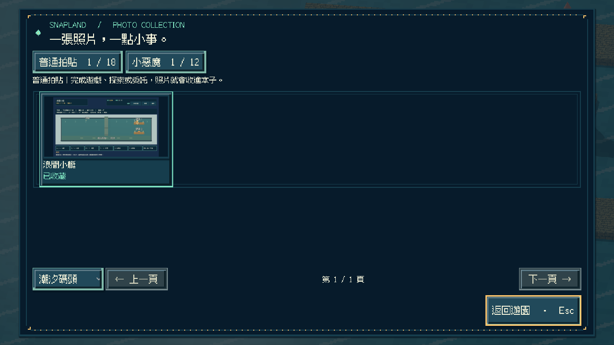
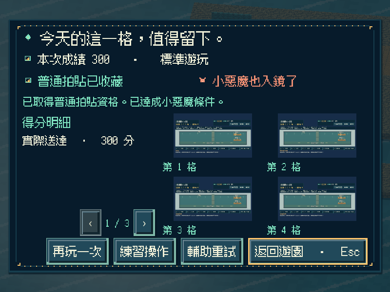
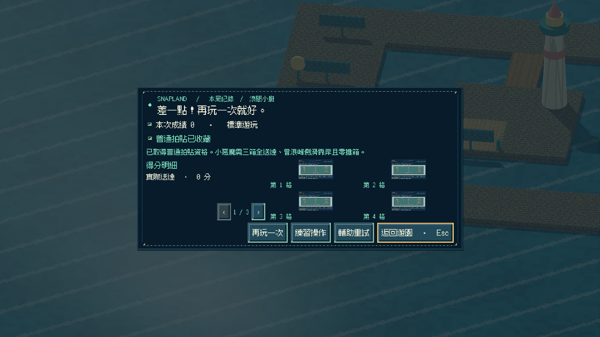
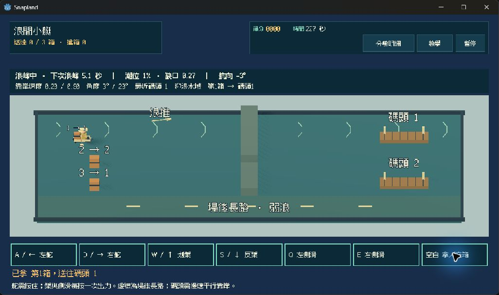
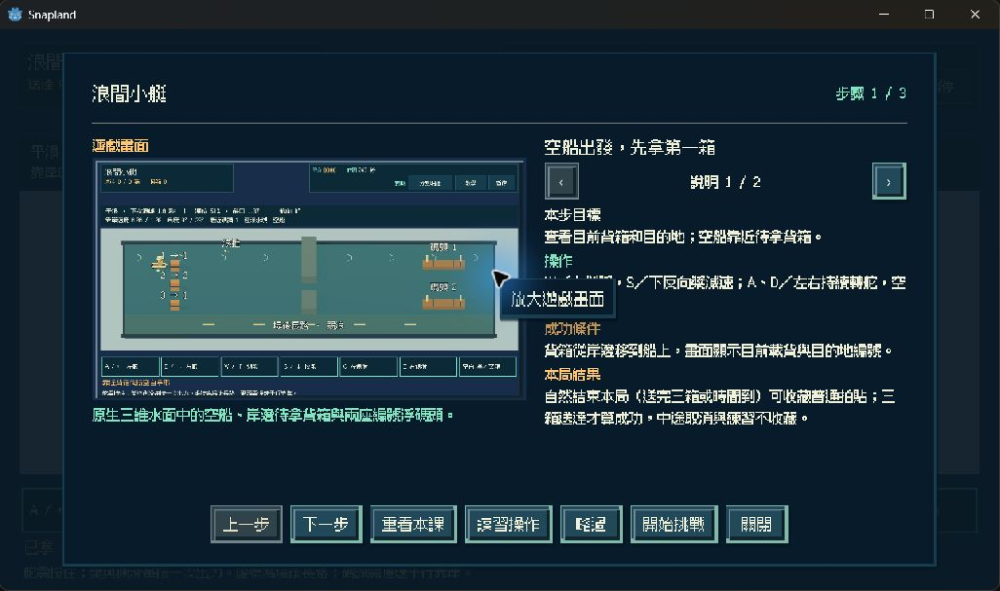

# [SG-28] 實作浪間小艇與碼頭收藏

> 狀態：完成

## 內文

### 需求
在潮汐碼頭實際划槳、轉舵與側滑，把三箱貨送到兩座浮碼頭；可逆浪抄近或繞防波堤，操作時機會真正影響航向與靠岸。

### 來源
2026-11-13 使用者要求持續完成整個遊戲並自主開票交付。既定第十三款「浪間小艇」目前只有設計，潮汐碼頭已可往返與探索。

### 驗收條件
- [x] 有獨立的三維低俯小艇玩法；划槳、轉舵、慣性、浪推與側滑實際影響運箱及靠岸，不以既有氣球玩法換名代替。
- [x] 同路線改變槳時機會改變靠岸角度；防波堤與近路有不同浪推，潮位改變可航缺口，三箱與兩座浮碼頭清楚可辨。
- [x] 單人可操作全部流程；首次教學、練習、輔助、暫停、失焦、重試與離開正常，靜音仍能看懂浪峰與靠岸條件。
- [x] 正常參與到結算可取得普通拍貼，成功或失敗仍如實記分；浪峰側滑靠岸且不撞箱可取得小惡魔拍貼，輔助不取消資格；練習與中途取消不發獎。
- [x] 新拍貼記在潮汐碼頭第一格，成就與教學辨認為第十三款；重播不重複加錢，縮圖與原圖重開仍有效，不誤解鎖全區完成。
- [x] 實際遊戲亭、地圖、收藏與成就可進入或查閱此款；迎賓十二款與舊存檔不受損，其他碼頭玩法仍如實顯示準備中。
- [x] 不同視窗、放大文字、降低動態、原生操作與隔離輸出包驗證附票；不能用直接設分、傳送小艇或設定完成旗標代替原生操作證據。

### 測試流程
1. 比較相同路線的兩種槳時機與靠岸角，操作兩種航路、潮位及三箱兩碼頭。
2. 正常與輔助完成回合，核對普通、小惡魔資格、真實成績、重試與取消；暫停及失焦後操作不黏住。
3. 取得當地第一格拍貼後重播並關閉重開，核對金幣、教學、成就、縮圖與原圖，以及原迎賓內容。
4. 在原生視窗與輸出包用實際指令操作，保存畫面、結果與局部／完整驗證紀錄。

---

# 跟其他票的關係
- Blocks：SG-29
- Blocked by：無
- Related：SG-1、MAIN-24、MAIN-25

---

# Commit-1

## 內文

潮汐碼頭現在能從實際遊戲亭與地圖進入「浪間小艇」。划槳、轉舵、慣性、浪推與側滑會改變運箱路線；三箱必須實際拿取並停靠兩座碼頭。可走潮位缺口或防波堤後方弱浪路線。

正常回合自然結束取得普通卡資格，三箱送達才算成功；浪峰側滑靠岸且不撞箱可取得小惡魔卡，輔助保留資格。練習與取消不發卡。碼頭第一格、全域第十三款成就、教學與原圖均能保存及重開；重播不重複取得40金幣。失敗保存清楚提示與重試，同一回合的照片重試不重複通知劇情成功。

正常、輔助與逾時的原生操作均保留真實結果；獨立資源包實際送完三箱並獲得兩張卡，另一程序重讀收藏及原圖。Windows 獨立成品以實際鍵鼠確認入口、拿箱、划槳、暫停、重開、教學與返回，另完成新遊戲／碼頭存檔啟動及原十二款圖資檢查。這些是程式化驗收，未當成真人樂趣或試聽紀錄。

### 測試結果

| 項目 | 結果 |
|---|---|
| 完整雲端 | [43294673452](https://github.com/deadline314/Snapland/actions/runs/43294673452)：198項Python、共用來源與四批遊戲全部成功 |
| 遊戲覆蓋 | 115項各恰好一次，另四次乾淨匯入；實際RUN/PASS聯集與順序相符，原106項保留 |
| 實際操作 | 標準／輔助三箱300分及小惡魔、失敗0分普通卡、練習／取消不發卡、近路與弱浪路線通過 |
| 節奏與狀態 | 不同划槳時機的實際靠岸角不同；30／60Hz、暫停／失焦、重試、舊玩法切換及保存失敗回復通過 |
| 原生尺寸 | 800×600、1280×720、1920×1080，包含1.25文字與降低動態；畫面及結果附下 |
| 獨立輸出 | 排除測試資料的乾淨輸出包，全回合與原圖重讀通過；Windows不靠旁掛資源包，實際入口／操作及三組啟動／圖資檢查通過 |
| 舊內容回歸 | 原十二款、舊卡、錢幣、劇情、圖片、地區、教學與存檔隔離檢查通過 |
| 執行記錄 | 最終打包全回合／重讀及碼頭Windows操作0 ERROR／0 WARNING；迎賓啟動／圖資保留15項既有材質回退警告，0 ERROR |
| 資料驗證 | 五個範圍全部通過，0錯誤 |

實作來源 `f6f9a8bf788e17ab02ab7c3e35b116019fb5aefb`；輸出來源 `123e769251903fa086f742f2a475668f6ab62422`，後續僅兩個測試準備／清理修正，1097個輸入完全相同。完整修正與審查紀錄、所有定稿決策及其代價、保存檔與實際照片見[驗證摘要](images/SG-28-verification-20261113.json)及[完整證據](images/SG-28-evidence-20261113.zip)。

### 截圖

