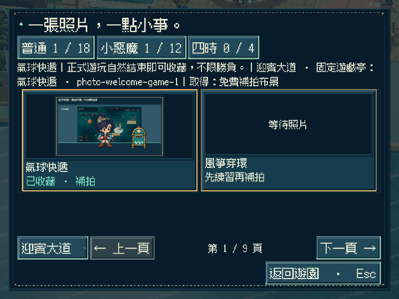
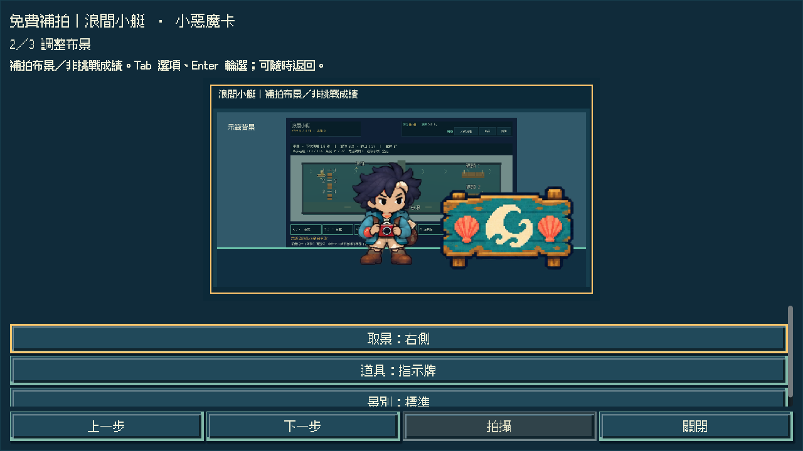
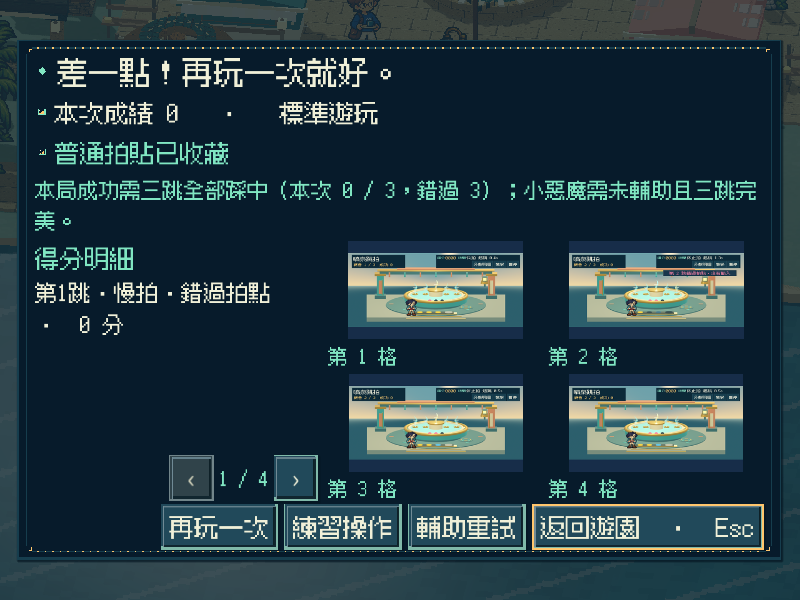
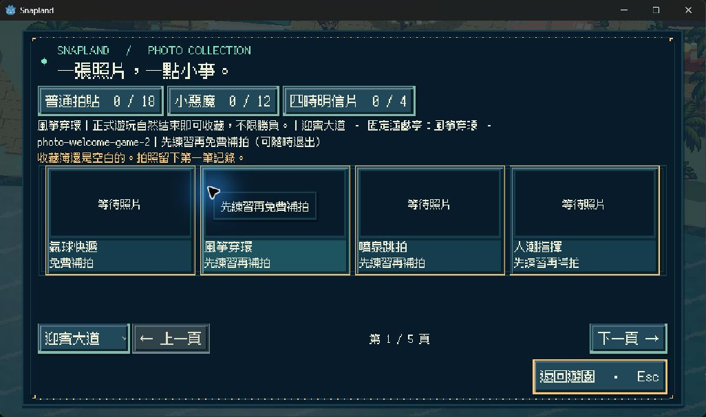
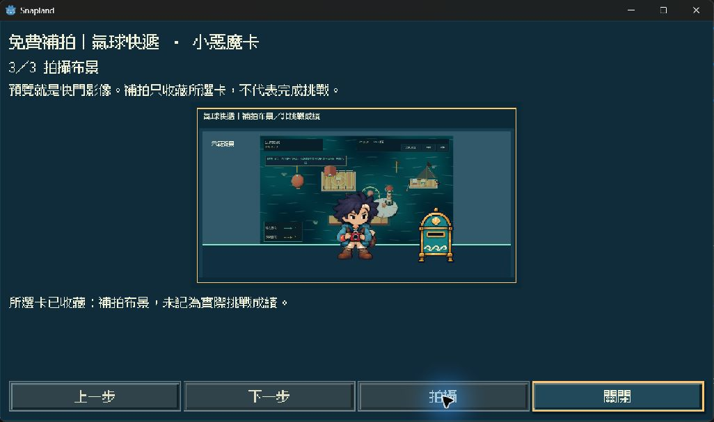
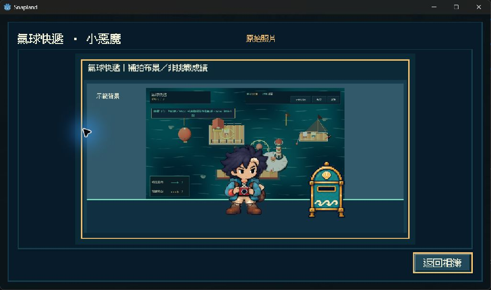

# [SG-29] 提供免費補拍與參與收藏

> 狀態：完成

## 內文

### 需求
所有已開放玩法參與至正常結算即可取得普通拍貼，成績及勝負保持真實；一次嘗試後可在遊戲亭或相簿免費補拍原普通／小惡魔卡，讓操作能力不成為收藏與後續園區的阻礙。

### 來源
2026-11-13 使用者要求持續完成整個遊戲並自行補票。既定「樂趣、收藏與認證分開」要求普通卡不綁勝負，且每張遊戲卡有觀察示範、調整布景、拍攝三步的固定免費補拍；迎賓現行取卡仍綁成功，新碼頭玩法交付後需統一補齊。

### 驗收條件
- [x] 所有已開放玩法正常參與至結算均能取得普通卡；失敗仍如實顯示失敗，練習與中途取消不自動發卡。
- [x] 實際嘗試一次後，遊戲亭與相簿有固定免費補拍入口；練習嘗試並立即退出也能接續補拍，未開放玩法不能借此取卡。
- [x] 普通與小惡魔補拍均有該玩法主題的觀察示範、調整布景、拍攝三步，沒有反應限時、勝負、金錢、裝備或人工智慧成功門檻；鍵盤與逐步選項可完成。
- [x] 補拍授予原卡且記錄取得方式，不偽造遊戲成功、排名、高分或實際挑戰認證；照片與取得說明清楚可查。
- [x] 重播不重複發錢，失敗保存不留下部分獎勵；嘗試與取卡在重開、取消、重試及重置後符合預期，舊卡與原圖不損毀。
- [x] 迎賓與碼頭的缺卡說明、入口、區域格數、普通／小惡魔卡及縮圖／原圖一致，原有教學、任務、成就與實際挑戰資格保持正確。
- [x] 原生小視窗、放大文字、降低動態、隔離輸出包與完整回歸結果附票；不把補拍當成實際高難成功或真人試玩。

### 測試流程
1. 正常失敗、完成、練習與取消各一回合，核對真實成績、普通卡及嘗試入口。
2. 從遊戲亭及缺卡頁完成三步補拍，核對原普通／小惡魔卡、取得方式、照片及金幣，重播再確認。
3. 模擬保存失敗及真正關閉重開，核對嘗試、收藏、原圖與舊存檔；未開放項目仍不能領卡。
4. 在不同原生視窗與獨立成品驗證鍵鼠、逐步選項、教學與原玩法回歸。

---

# 跟其他票的關係
- Blocks：無
- Blocked by：SG-28
- Related：SG-1、ST-1、MAIN-24

---

# Commit-1

## 內文

普通拍貼原先受勝負限制，缺卡也缺乏固定的免費補拍途徑。現在十三款已開放玩法正常結算即可收藏普通卡，勝負與實際成績仍如實顯示；練習及中途取消不自動發卡。

實際嘗試一次後，可從遊戲亭或相簿依序觀察示範、調整布景與按下快門，取得所選普通／小惡魔原卡。照片保留這次安排的布景，清楚標示補拍來源及真實挑戰狀態；不冒領實際高難成功，不覆蓋另一張舊卡與原圖，也不重複發錢。保存失敗可重試，小視窗可完整閱讀，視窗改變後仍保留所選卡及鍵盤操作。

### 測試結果

| 項目 | 結果 |
|---|---|
| 完整雲端 Python 與設計／素材來源 | 199 項 Python 及來源檢查通過 |
| 完整遊戲四批回歸 | 120 項獨立遊戲檢查及 4 次乾淨匯入通過；實際執行與成功順序、聯集均核對，原有 115 項完整保留 |
| 參與資格、保存、舊卡與原圖 | 十三款資格契約、取消／練習、失敗回復、舊檔及原圖保護通過 |
| 真實失敗結算 | 噴泉回合 0 分、3 次失誤，仍顯示未完成並只取得普通卡，未偽造勝利 |
| 原生畫面與操作 | 800×600／1.25 文字／降低動態、1280×720、1920×1080；兩區雙卡、步驟、調整及快門通過，來源版本分別記錄 |
| 獨立資源包 | 迎賓及碼頭取卡、兩組獨立讀檔均通過；原圖與取得來源保留，讀檔資料位元組不變 |
| Windows 成品 | 真實滑鼠、Tab／Enter、三個布景選項、快門及關閉重開通過；只取所選小惡魔卡，金幣只增加一次 40 |
| 成品啟動與原玩法圖資 | 新遊戲、碼頭存檔及十二款原玩法圖資載入均通過 |
| 診斷 | 正常流程無 ERROR；故意寫入失敗逐條核對。迎賓既有材質警告保留，未全面隱藏 |

以上是程式化原生操作與資源驗證。補拍是有標示的主題布景照片，與真實挑戰成績分開。

程式與完整回歸版本：[baccba8](https://github.com/deadline314/Snapland/commit/baccba860abf7aeb650bbae785a4c01d3d066fca)，[完整 CI](https://github.com/deadline314/Snapland/actions/runs/43320756889)。最初舊 HUD 文案斷言已修正並經 Windows／Linux 紅綠與審查；最後一批遇到下載停滯，保留其他成功結果後只重試該節點，沒有略過檢查或放寬限制。

[驗收摘要、版本對照及成品指紋](images/SG-29-verification-20261113.json) · [完整可分享驗收紀錄及決策代價](images/SG-29-evidence-20261113.zip)

### 截圖

