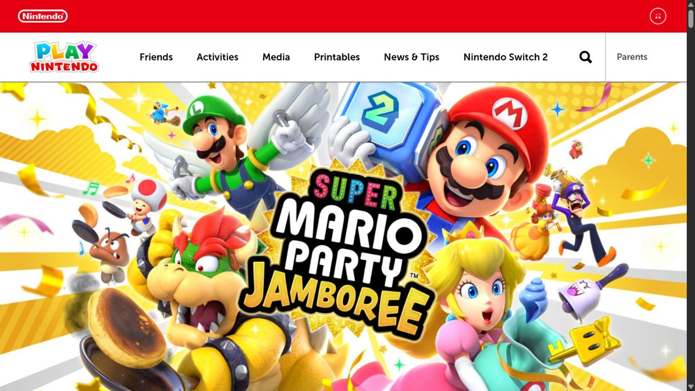
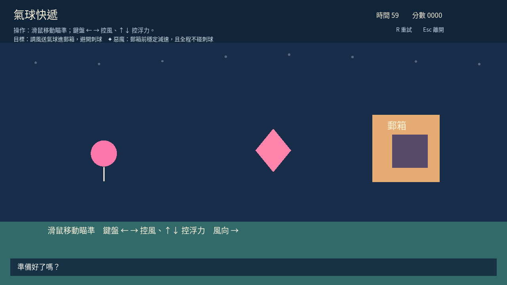
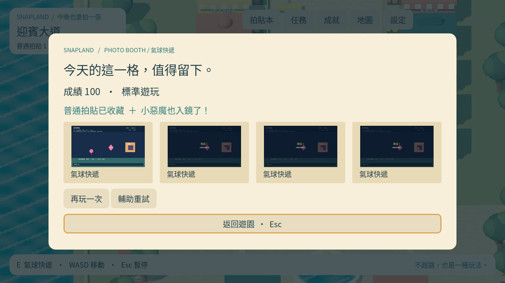

# [SG-2] 實作氣球快遞

> 狀態：進行中

## 內文

### 需求

用左右風向與浮力把氣球送進指定郵箱，注意刺球。

### 來源

使用者於 2026-10-11（Asia/Taipei）要求從上島開始實作主區域、迎賓大道全部小遊戲及共用系統；其他園區先做路口。每項實作前研究業界實例並保存圖例；本票是可執行第一版，品質以實際驗收為準。

研究參考：Nintendo《Super Mario Party》minigames（https://media.nintendo.com/supermarioparty/minigames/）、Nintendo《WarioWare: Get It Together!》遊玩提示（https://play.nintendo.com/news-tips/tips-tricks/warioware-microgames-quick-tips/）。觀察與本款應用記錄於 design/runtime/minigame-research.md。

### 驗收條件

- [x] 有独立操作、目標、失敗回饋、免費重試與離開。
- [x] 正常及輔助可取得普通拍貼；明確小惡魔條件可取得獨立惡魔拍貼。
- [x] 有本款成就與實際原生操作截圖；實作前附已讀玩法研究與圖例。

### 測試流程

1. 啟動遊戲，進入本票內容，依畫面提示實際操作。
2. 核對本票每項驗收條件，測試返回、重試、重開與輔助情境。
3. 保存原生畫面截圖與局部測試摘要；無法確認的項目保持未勾選。

---

# 跟其他票的關係

- Blocks：無
- Blocked by：MAIN-3
- Related：MAIN-1、SG-1、ST-1

---

## 開始基準

c1b7b19；feature/island-first-park。

# Commit-1

## 內文

問題：迎賓設施「氣球快遞」尚無可玩的操作。

改動：現在可依提示遊玩「氣球快遞」，免費重試與離開，正常與輔助都可收藏，另有本款成就及小惡魔目標。

驗收：正常／輔助的成功、惡魔條件與超時不授卡局部測試通過；原生GPU鍵鼠通關取得普通與惡魔拍貼，結算畫面已查看。

分支：`feature/island-first-park`；開始基準：`c1b7b19`；[程式 commit](https://github.com/deadline314/Snapland/commit/f2d6b84919a91d534082660a12aec5a9b44eaa2c)。

### 測試結果

| 項目 | 結果 |
|---|---|
| 受影響局部驗證 | 42個小遊戲案例通過；本款原生通關 |
| 原生畫面 | GPU擷取並查看；程式化操作驗收 |
| 遠端CI | 帳戶限制，工作未啟動；未重試 |

### 研究與圖例

[小遊戲研究](../../design/runtime/minigame-research.md)。圖例為審閱參考，不是本作遊戲素材或試玩證據。

### 截圖

[整組驗收、票況與存檔事故紀錄](../first-playable-delivery.md)。
