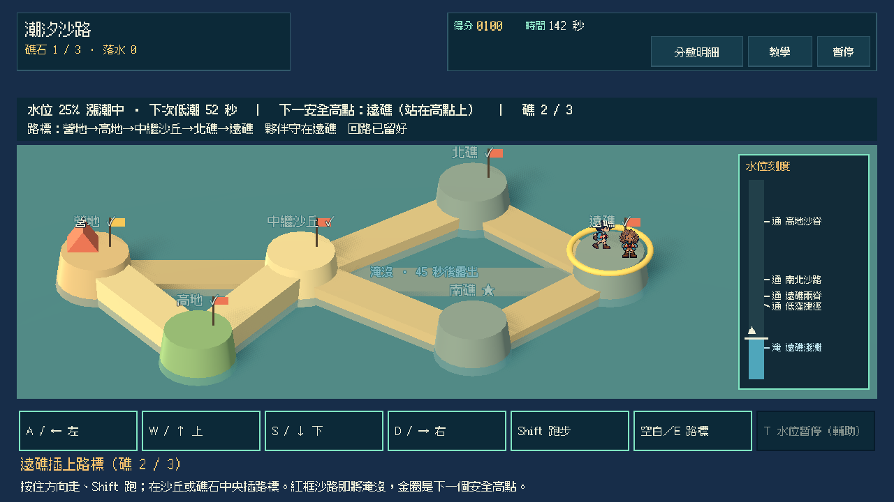
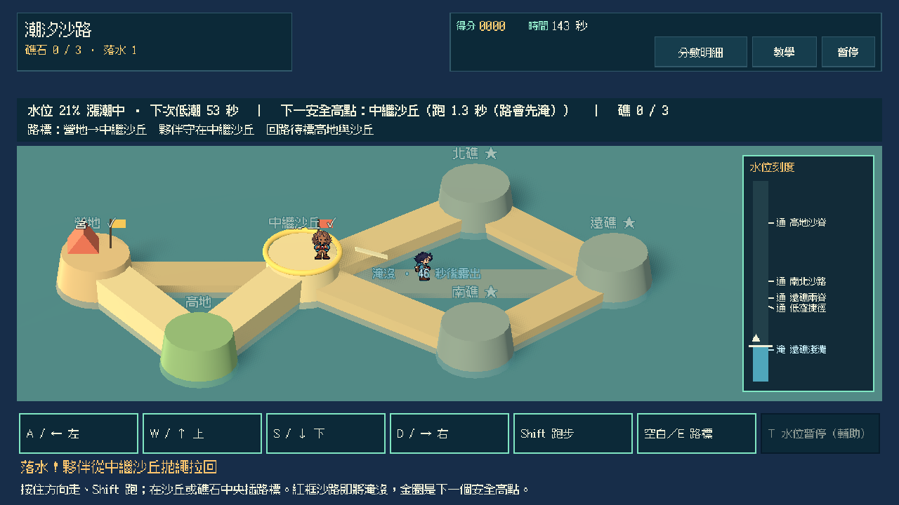
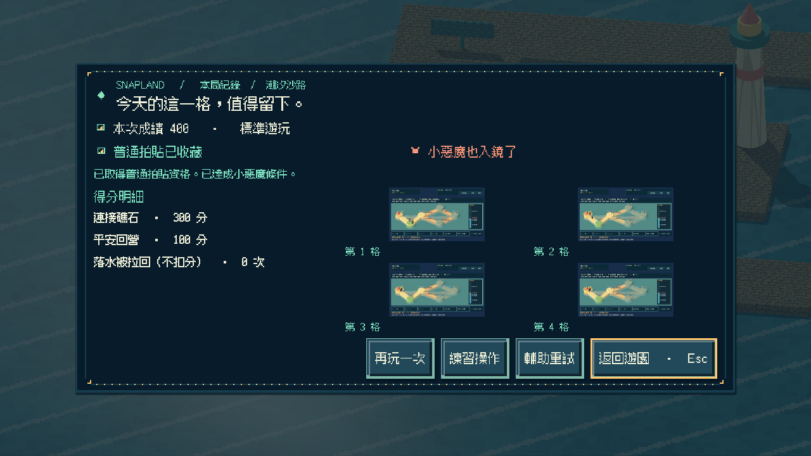
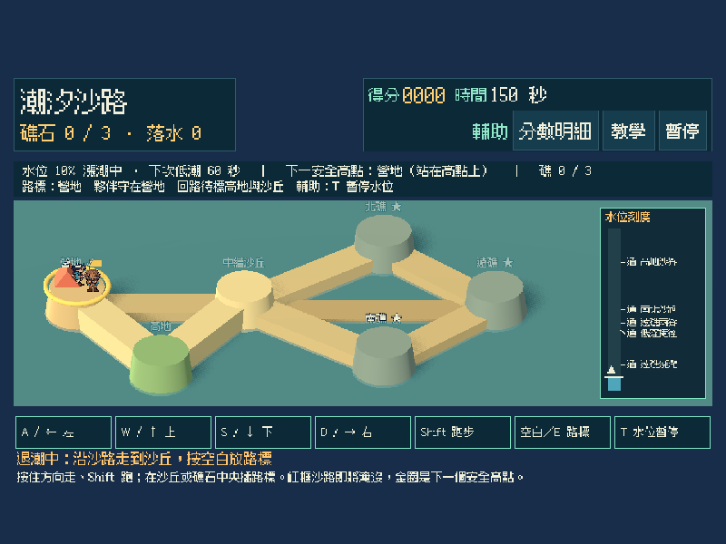
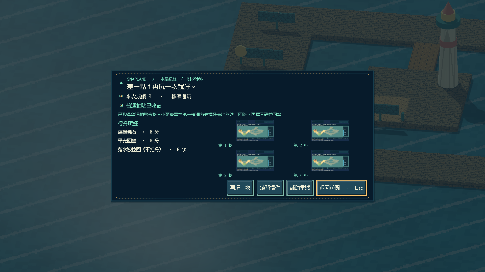
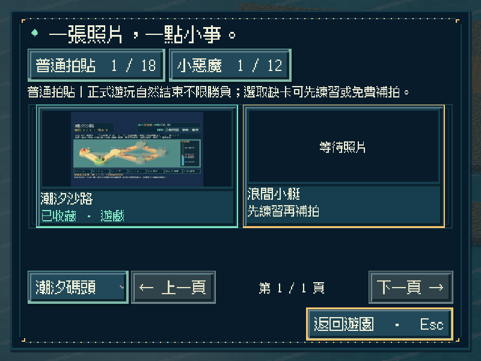
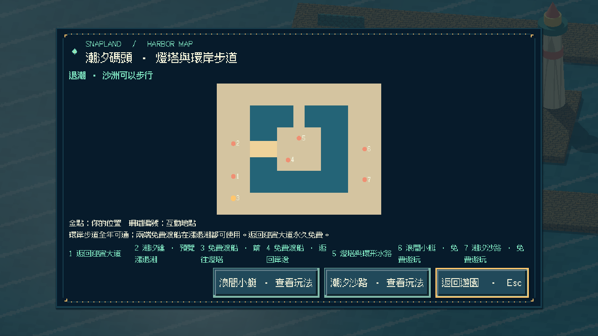
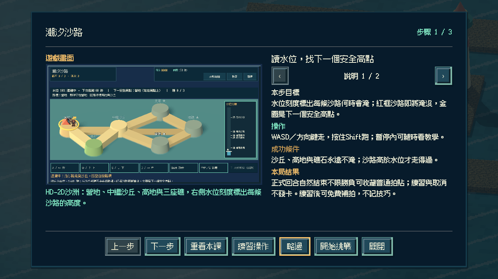

# [SG-30] 實作潮汐沙路與碼頭收藏

> 狀態：完成

## 內文

### 需求
在潮汐碼頭的沙洲實際走跑、預判漲退潮並放下路標，在退潮窗口內連接三座礁並平安回到營地；選擇先探遠礁或先保住高處回程，水位變化必須真正改變哪些沙路能走。

### 來源
2026-11-13 使用者要求持續完成整個遊戲並自主開票交付。既定第十四款「潮汐沙路」目前只有設計；潮汐碼頭與第十三款已可遊玩，參與收藏與免費補拍已通用。

### 驗收條件
- [x] 有獨立的 HD-2D 沙洲玩法；走、跑與放路標實際改變進度，潮位升降真正讓低窪沙路淹沒或露出，不以既有小艇或其他玩法換名代替。
- [x] 畫面持續顯示水位刻度、即將淹沒的沙路輪廓與下一個安全高點；靜音與色弱也能從文字及圖形讀出。
- [x] 先探遠礁可趁低水走捷徑，先保回程則花時間標好高處路線；兩種作法在實際操作下結果不同。
- [x] 落水時簡單 AI 從最近高點拋繩，把玩家拉回安全處；拉回是畫面上看得到的規則，不偷偷傳送或代替玩家完成。
- [x] 單人可操作全部流程；首次教學、練習、輔助（水位暫停、常駐安全回渡）、暫停、失焦、重試與離開正常，持續按鍵不會黏住。
- [x] 正常參與到結算可取得普通拍貼，成功或失敗如實記分；同一輪潮內先標好回路再探三礁並返回可取得小惡魔拍貼，輔助不取消資格；練習與中途取消不發獎，可接續免費補拍。
- [x] 新拍貼記在潮汐碼頭第二格，成就與教學辨認為第十四款；重播不重複加錢，縮圖與原圖重開仍有效，迎賓十二款、第十三款與舊存檔不受損，其他碼頭玩法仍如實顯示準備中。
- [x] 不同視窗、放大文字、降低動態、原生操作與隔離輸出包驗證附票；不能用直接設分、傳送角色或設定完成旗標代替原生操作證據。

### 測試流程
1. 以相同起點分別先探遠礁與先保回程，觀察低窪沙路隨潮淹沒、高處路線保留，以及水位刻度與輪廓提示。
2. 走進水中確認拋繩拉回；正常與輔助完成回合，核對普通、小惡魔資格、真實成績、重試與取消；暫停及失焦後操作不黏住。
3. 取得碼頭第二格拍貼後重播並關閉重開，核對金幣、教學、成就、縮圖與原圖，以及原迎賓與小艇內容。
4. 在原生視窗與輸出包用實際指令操作，保存畫面、結果與局部／完整驗證紀錄。

---

# 跟其他票的關係
- Blocks：無
- Blocked by：無
- Related：SG-1、SG-28、SG-29、MAIN-24

---

# Commit-1

## 內文

潮汐碼頭原本只有第十三款，沙洲只是退潮預覽。現在可從碼頭遊戲亭或地圖進入「潮汐沙路」：在 HD-2D 沙洲上走跑，沿沙路插路標連接北礁、遠礁、南礁並回營。潮位依週期升降，低窪沙路會真的被淹沒或露出；遠礁淺灘只在低潮前段可走，高地沙脊永遠可回。

畫面持續寫出水位、漲退、下次低潮、下一個安全高點與跑到所需秒數；右側水位刻度列出每段沙路的「通／危／淹」，即將淹沒的沙路有紅框，淹沒的沙路標示幾秒後露出。落水時夥伴從最近的已標高點拋繩，先拋出再連續拉回，看得到繩子與移動。重試會輪換潮週期與高地位置。

正常回合結束可收藏碼頭第二格普通拍貼，成功與時間到如實記分；第一輪潮內先標高地與中繼沙丘、再連三礁並回營可取得小惡魔拍貼，輔助（T 暫停水位、落水拉回最近高點）仍有資格。先探遠礁也能成功但不算小惡魔。練習與取消不發卡，可接續免費補拍；重播不重複發錢，成就與教學辨認為第十四款，第十五款以後仍拒絕。

以實際鍵盤輸入完成先保回程、先探遠礁、落水拉回、輔助、逾時、練習與取消；原生 800×600 放大文字＋降低動態、1280×720、1920×1080 均跑完全回合並重開讀檔。排除測試資料的獨立資源包從空工作目錄完成全回合與重開，0 ERROR／0 WARNING；Windows 成品啟動檢查通過。以上是程式化驗收，未當成真人樂趣或試聽。

### 測試結果

| 項目 | 結果 |
|---|---|
| 新增局部 | 沙路模型 53、操作 37、畫面 45、Session 31 項 0 失敗；Main 入口／地圖／教學／逾時／練習／路線／輔助小惡魔／重開與原生前置通過 |
| 受影響回歸 | 補拍、參與收藏、碼頭世界與收藏、地區旅行、小艇全組、教學、相簿、像素介面、迎賓十二款、啟動與主場景整合等 37＋11 項本機通過 |
| Python | 199 項通過；設計五範圍 0 錯誤 |
| 原生尺寸 | 三種視窗＋放大文字／降低動態；正常、輔助、逾時、先探遠礁、落水拉回、重開讀檔 |
| 獨立輸出 | 排除測試的資源包全回合＋重開 0 ERROR／0 WARNING；Windows 成品 `--smoke-test` 通過 |
| 執行記錄 | 新玩法執行 0 ERROR；迎賓場景保留既有材質回退警告 |

### 截圖

