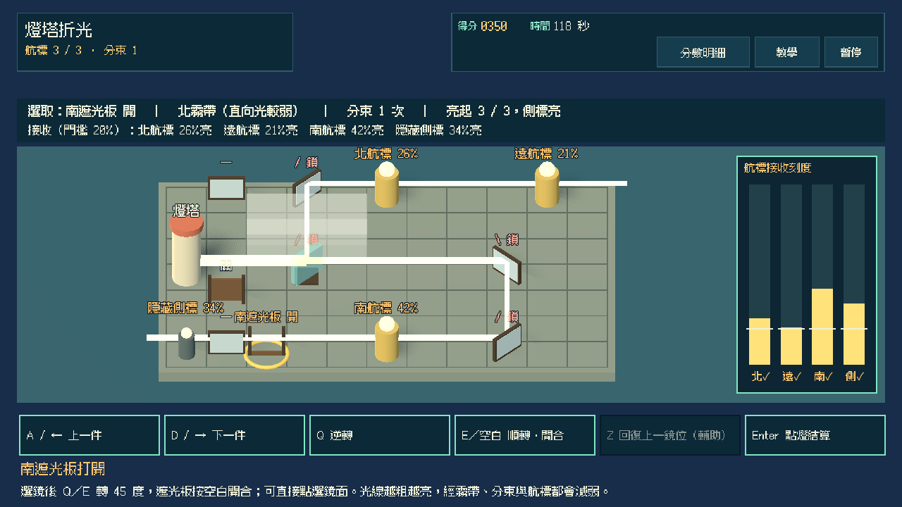
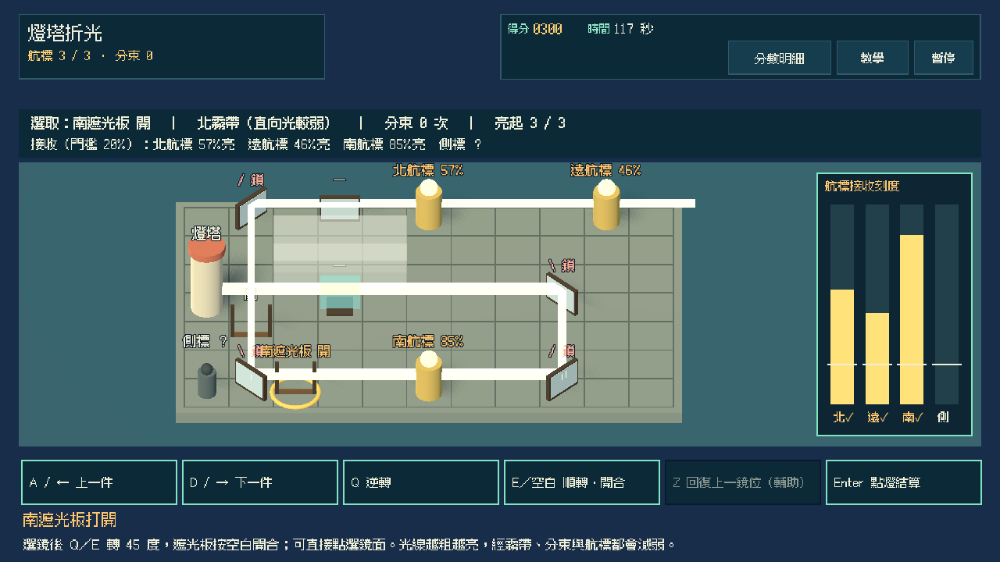
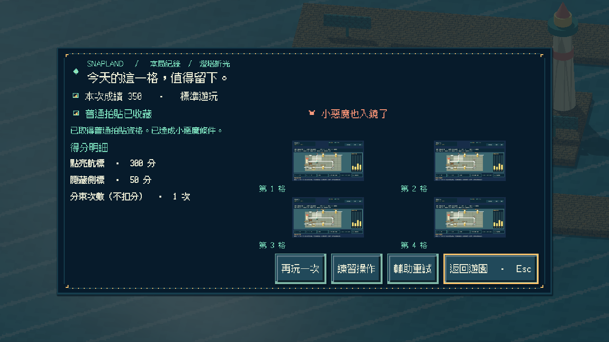
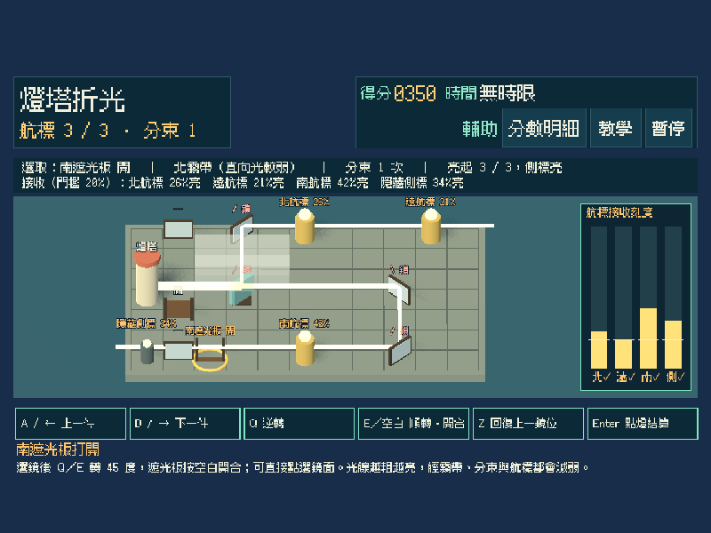
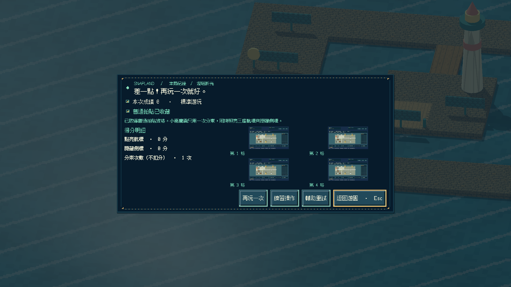
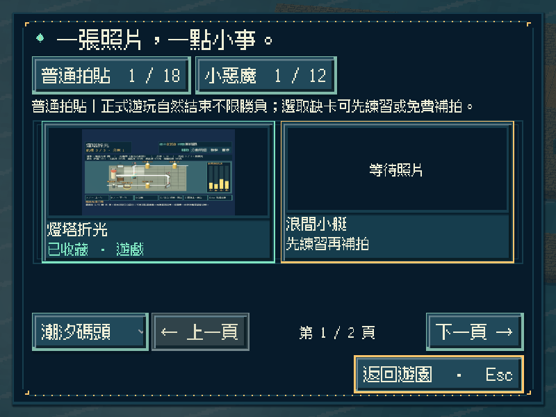
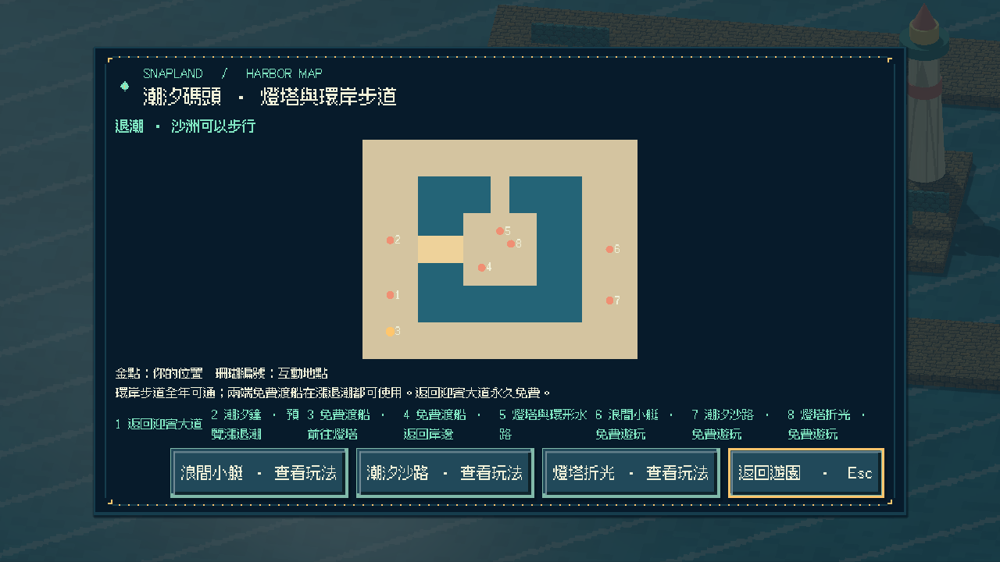
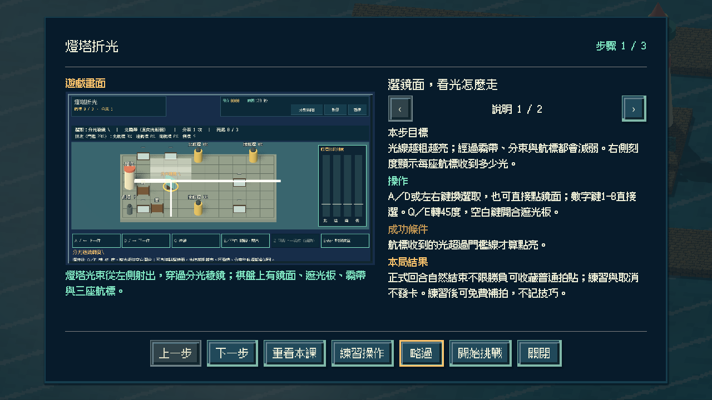

# [SG-31] 實作燈塔折光與碼頭收藏

> 狀態：完成

## 內文

### 需求
在潮汐碼頭的燈塔縮景中實際旋轉稜鏡與反射鏡、開合遮光板，讓燈塔光束同時照亮三座航標；可選擇分束照遠或串反射減損，霧帶會讓某些角度的光變弱，光路與每座航標的接收量都看得到。

### 來源
2026-11-13 使用者要求持續完成整個遊戲並自主開票交付。既定第十五款「燈塔折光」目前只有設計；潮汐碼頭已有第十三、十四款可玩，參與收藏與免費補拍已通用。

### 驗收條件
- [x] 有獨立的三維光路縮景玩法；旋轉鏡面與稜鏡、開合遮光板會即時改變實際光路與航標接收量，不以既有玩法換名代替。
- [x] 同一關至少有兩種不同鏡路能同時照亮三座航標（分束照遠與串反射各有代價），不是固定點擊順序；霧帶依角度削弱光線，重試換不同霧帶。
- [x] 每座航標顯示接收刻度與門檻，光路以線條與文字呈現，靜音與色弱也能讀懂；簡單 AI 會鎖住正在照亮航標的鏡面，避免誤轉但不代替操作。
- [x] 單人可操作全部流程；首次教學、練習、輔助（無時限、可回復上一鏡位）、暫停、失焦、重試與離開正常。
- [x] 正常參與到結算可取得普通拍貼，成功或失敗如實記分；只用一次分束同時照亮三航標與隱藏側標可取得小惡魔拍貼，輔助不取消資格；練習與中途取消不發獎，可接續免費補拍。
- [x] 新拍貼記在潮汐碼頭第三格，成就與教學辨認為第十五款；重播不重複加錢，縮圖與原圖重開仍有效，迎賓十二款、第十三／十四款與舊存檔不受損，其他碼頭玩法仍如實顯示準備中。
- [x] 不同視窗、放大文字、降低動態、原生操作與隔離輸出包驗證附票；不能用直接設分或設定完成旗標代替原生操作證據。

### 測試流程
1. 以分束與串反射兩種鏡路分別照亮三航標，比較接收量；換霧帶重試確認角度削弱改變。
2. 正常、輔助（回復上一鏡位、無時限）與逾時完成回合，核對普通、小惡魔資格與真實成績；暫停及失焦後操作不黏住。
3. 取得碼頭第三格拍貼後重播並關閉重開，核對金幣、教學、成就、縮圖與原圖，以及原有內容。
4. 在原生視窗與輸出包用實際指令操作，保存畫面、結果與局部／完整驗證紀錄。

---

# 跟其他票的關係
- Blocks：無
- Blocked by：無
- Related：SG-1、SG-29、SG-30

---

# Commit-1

## 內文

潮汐碼頭原本有兩款玩法，燈塔只是景點。現在燈塔旁的遊戲亭與地圖可進入「燈塔折光」：在三維光路縮景裡選鏡、轉 45 度、開合遮光板，燈塔光束即時改變走向並穿過航標；每座航標顯示收到多少光與門檻。

同一張棋盤至少有串反射（不分束、整束光依序穿過三座航標）與分束照遠（稜鏡分成兩束）兩條不同光路，接收量各不相同；只分束一次並打開南遮光板，光還能照到隱藏側標，取得小惡魔。霧帶削弱直向穿過的光，重試輪替北／西霧帶，讓不同路線的餘量改變。正照亮航標的鏡面由夥伴鎖住，誤轉時第一次只提醒。

正常回合結束（點燈結算或時間到）可收藏碼頭第三格普通拍貼，成功與失敗如實記分；輔助無時限且可回復上一鏡位，仍保留小惡魔資格。練習與取消不發卡，可接續免費補拍；重播不重複發錢，成就與教學辨認為第十五款，第十六款以後仍拒絕。

設計以全部 16,384 種鏡位組合窮舉核對可解性與路線差異。以實際按鍵完成串反射、分束、小惡魔、逾時、練習與取消；原生三種尺寸含放大文字／降低動態與重開讀檔，排除測試的獨立資源包從空工作目錄完成全回合與重開 0 ERROR／0 WARNING，Windows 成品啟動檢查通過。另把各測試中的已交付數量改為從遊戲目錄推得，只留目錄測試一處精確數量。以上是程式化驗收，不代表真人樂趣。

### 測試結果

| 項目 | 結果 |
|---|---|
| 新增局部 | 光路模型 46（含 16,384 組窮舉）、操作 37、畫面 34、Session 20 項 0 失敗；Main 入口／地圖／教學／逾時／練習／三條路線／輔助小惡魔／重開與原生前置通過 |
| 受影響回歸 | 小艇、沙路、碼頭世界與收藏、補拍、參與收藏、地區旅行、教學、相簿、像素介面、啟動與主場景整合共 43 項本機通過 |
| Python | 執行時契約、分批與設計驗證通過；設計五範圍 0 錯誤 |
| 原生尺寸 | 800×600 放大文字＋降低動態（輔助）、1280×720（小惡魔／串反射）、1920×1080（逾時）及重開讀檔 |
| 獨立輸出 | 資源包全回合＋重開 0 ERROR／0 WARNING；Windows 成品 `--smoke-test` 通過 |

### 截圖

