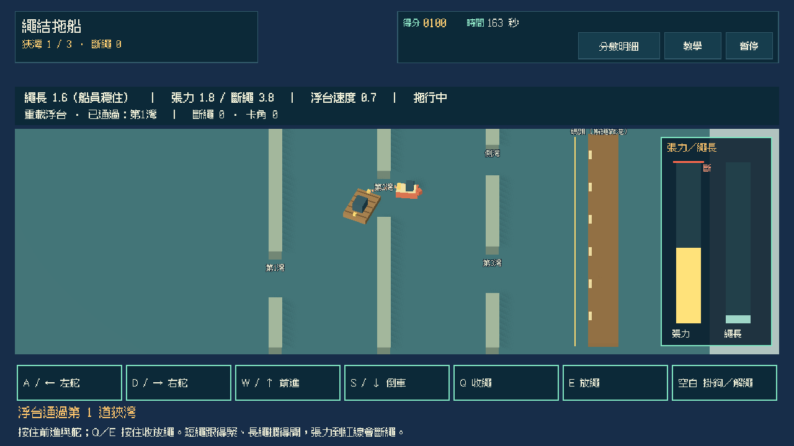
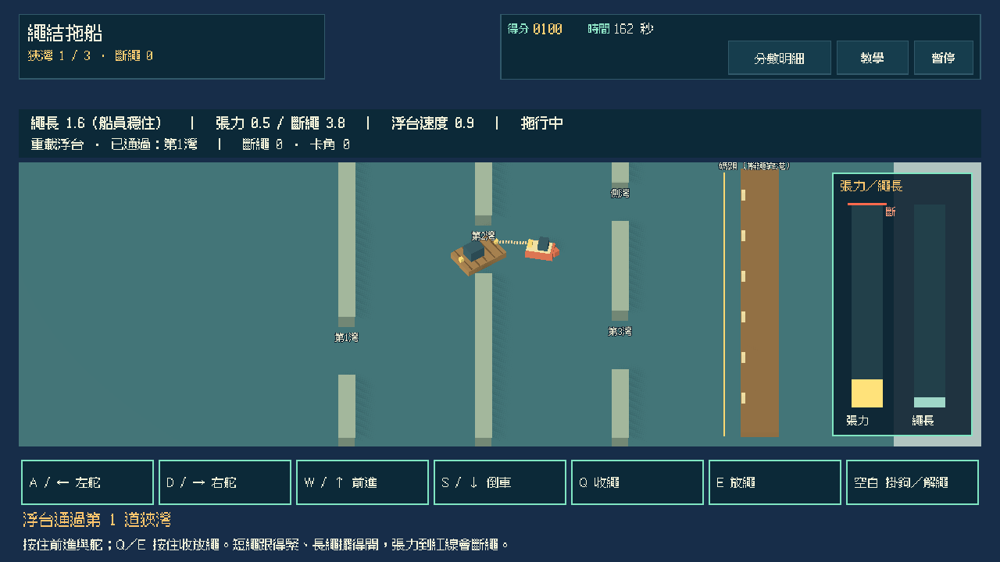
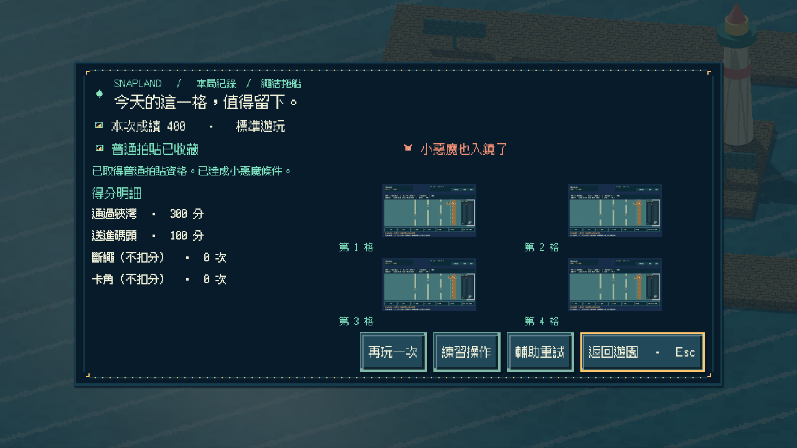
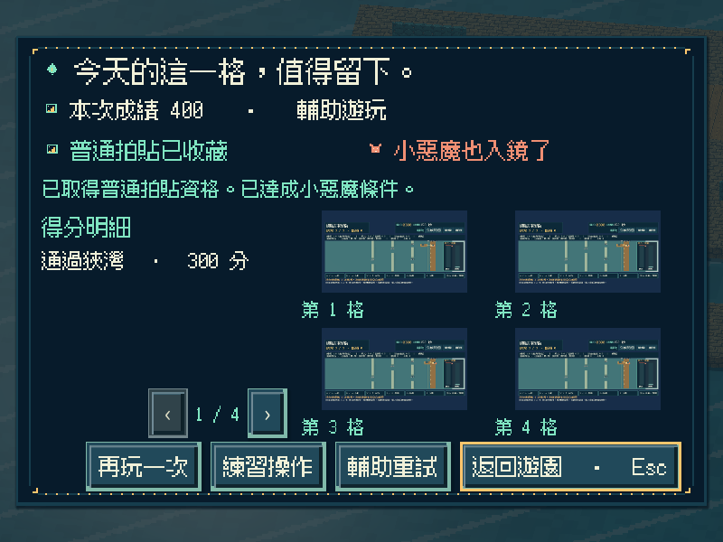
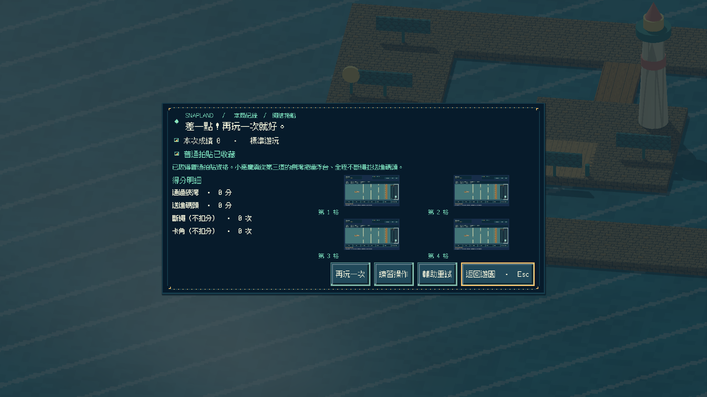
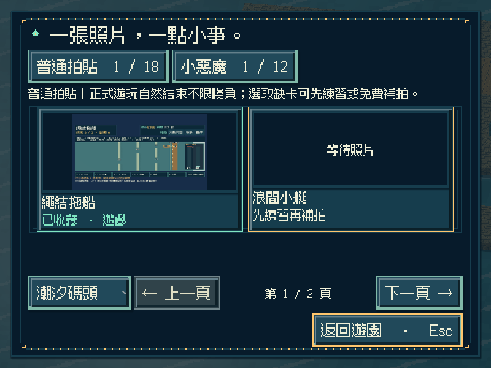
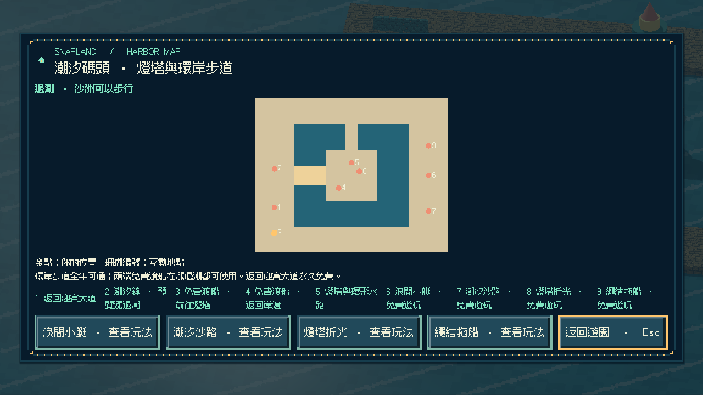
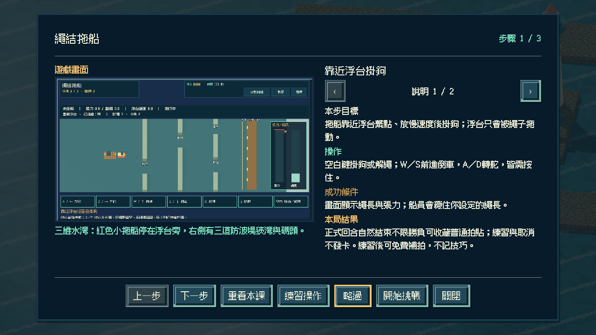

# [SG-32] 實作繩結拖船與碼頭收藏

> 狀態：完成

## 內文

### 需求
在潮汐碼頭的水灣實際駕駛小拖船：掛鉤、收放拖繩並轉向，把浮台拖過三道狹灣送進碼頭。短繩精準、長繩能借浮台慣性繞角；繩子拉太緊會斷，浮台撞角會卡住。

### 來源
2026-11-13 使用者要求持續完成整個遊戲並自主開票交付。既定第十六款「繩結拖船」目前只有設計；潮汐碼頭已有第十三至十五款可玩，參與收藏與免費補拍已通用。

### 驗收條件
- [x] 有獨立的三維拖曳水灣玩法；推進、轉向、收放繩長與掛鉤實際改變拖船與浮台的運動，不以既有小艇或其他玩法換名代替。
- [x] 畫面顯示繩張力、繩長、浮台速度與卡角狀態；短繩與長繩在同樣狹灣有不同的跟隨與擺盪結果，繩張力過大會真的斷繩並需重新掛鉤。
- [x] 浮台重量與繫點位置隨重試變化；簡單 AI 船員維持玩家指定的繩長，不代替駕駛。單人可依序完成所有操作，不需要同時兩組操作。
- [x] 單人可操作全部流程；首次教學、練習、輔助（彈性繩加長、卡住時原地鬆繩）、暫停、失焦、重試與離開正常，持續按鍵不會黏住。
- [x] 正常參與到結算可取得普通拍貼，成功或失敗如實記分；借浮台擺盪從側灣通過且全程不斷繩可取得小惡魔拍貼，輔助不取消資格；練習與中途取消不發獎，可接續免費補拍。
- [x] 新拍貼記在潮汐碼頭第四格，成就與教學辨認為第十六款；重播不重複加錢，縮圖與原圖重開仍有效，既有玩法與舊存檔不受損，其他碼頭玩法仍如實顯示準備中。
- [x] 不同視窗、放大文字、降低動態、原生操作與隔離輸出包驗證附票；不能用直接設分、傳送船隻或設定完成旗標代替原生操作證據。

### 測試流程
1. 以短繩與長繩分別通過同一道狹灣，比較浮台路徑與張力；猛拉確認斷繩與重新掛鉤。
2. 正常與輔助完成回合，核對普通、小惡魔（側灣、不斷繩）資格與真實成績；暫停及失焦後操作不黏住。
3. 取得碼頭第四格拍貼後重播並關閉重開，核對金幣、教學、成就、縮圖與原圖，以及原有內容。
4. 在原生視窗與輸出包用實際指令操作，保存畫面、結果與局部／完整驗證紀錄。

---

# 跟其他票的關係
- Blocks：無
- Blocked by：無
- Related：SG-1、SG-29、SG-31

---

# Commit-1

## 內文

潮汐碼頭的東岸新增「繩結拖船」遊戲亭與地圖入口。玩家駕駛小拖船靠近浮台掛鉤，按住前進、轉舵與收放繩，把浮台依序拖過三道防波堤狹灣，慢速拖過碼頭線後解繩送達。浮台只靠繩子拉動，會因慣性擺盪、撞到灣角時卡住；繩子在高速下突然拉緊會真的斷掉，需要重新掛鉤。

同一條緊湊航線，短繩能穩穩通過，長繩會讓浮台擺開撞上灣角；重試輪替重載與輕載偏繫點的浮台，偏繫點會讓浮台偏擺。第三道另有較窄的側灣，從側灣通過且全程不斷繩可取得小惡魔。船員穩住玩家設定的繩長，不代替駕駛；換端只需依序解繩再掛另一端。

正常回合結束（送達或時間到）可收藏碼頭第四格普通拍貼，成功與失敗如實記分；輔助的拖繩更長更有彈性、卡住時船員原地鬆繩，仍保留小惡魔資格。練習與取消不發卡，可接續免費補拍；重播不重複發錢，成就與教學辨認為第十六款，第十七款以後仍拒絕。

以實際按鍵完成主航線、側灣、逾時、練習與取消，並以短繩／長繩、鬆繩猛拉斷繩、兩種浮台與輔助彈性繩做模型驗證；原生三種尺寸含放大文字／降低動態與重開讀檔，獨立資源包從空工作目錄完成全回合與重開 0 ERROR／0 WARNING，Windows 成品啟動檢查通過。以上是程式化驗收，不代表真人手感評價。

### 測試結果

| 項目 | 結果 |
|---|---|
| 新增局部 | 拖船模型 38、操作 31、畫面 24、Session 20 項 0 失敗；Main 入口／地圖／教學／逾時／練習／兩條航線／輔助小惡魔／重開與原生前置通過 |
| 受影響回歸 | 碼頭四款、補拍、參與收藏、地區旅行、教學、相簿、啟動與主場景整合共 44 項本機通過 |
| Python | 執行時契約、分批與設計驗證通過；設計五範圍 0 錯誤 |
| 原生尺寸 | 800×600 放大文字＋降低動態（輔助）、1280×720（側灣／主航線）、1920×1080（逾時）及重開讀檔 |
| 獨立輸出 | 資源包全回合＋重開 0 ERROR／0 WARNING；Windows 成品 `--smoke-test` 通過 |

### 截圖

