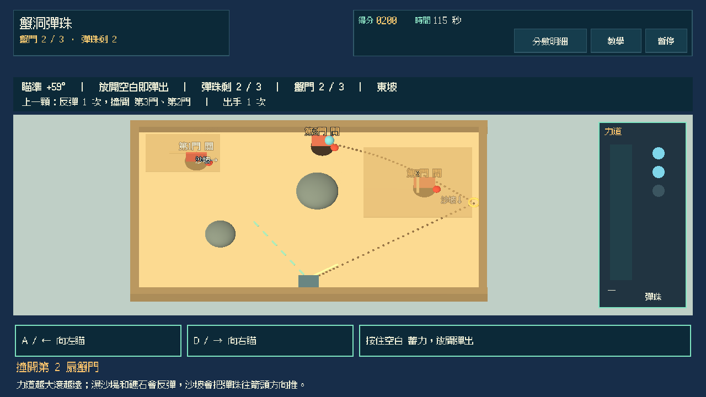
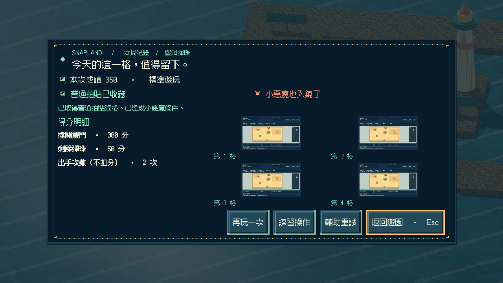
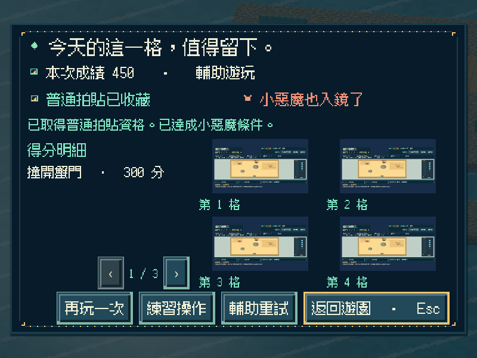
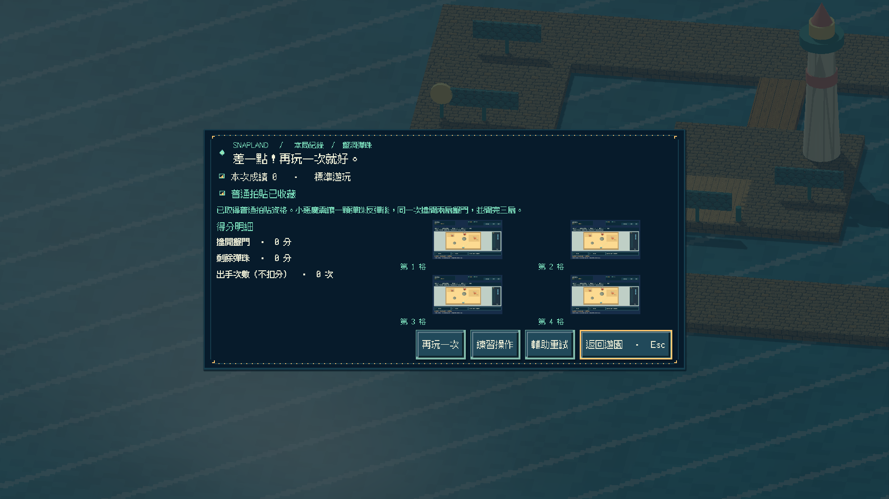
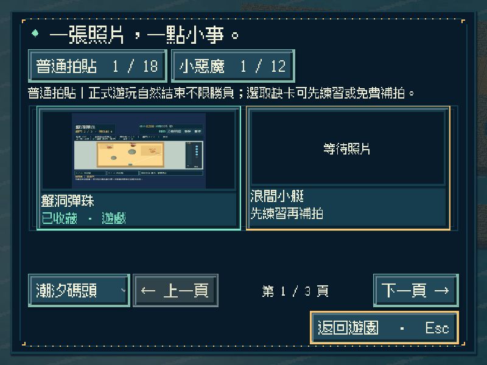
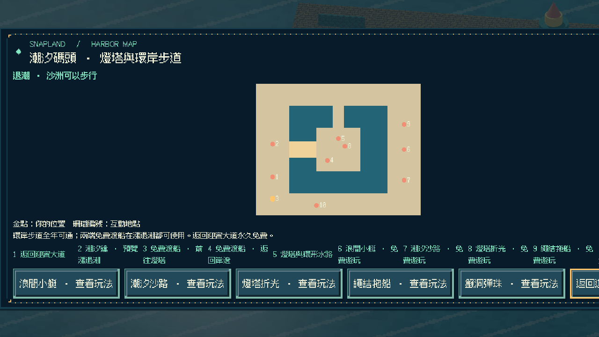
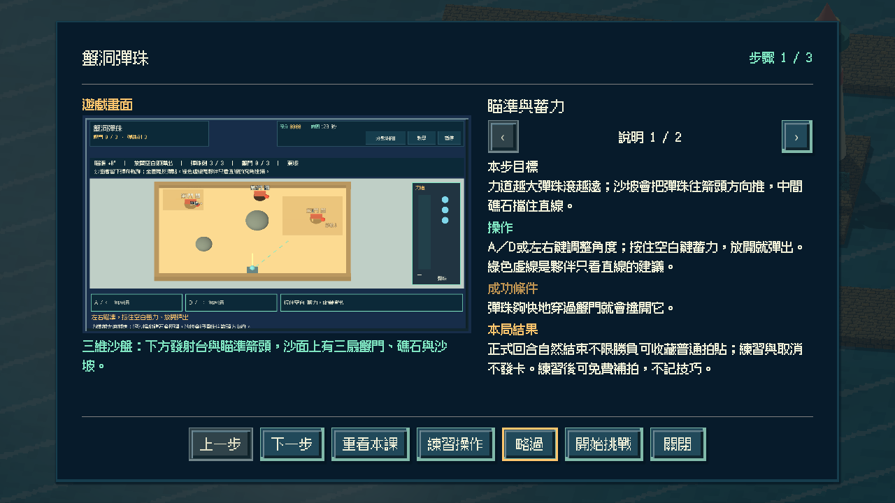

# [SG-33] 實作蟹洞彈珠與碼頭收藏

> 狀態：完成

## 內文

### 需求
在潮汐碼頭的沙盤上實際瞄準角度、蓄力並放出彈珠，用三顆彈珠撞開三扇沙灘蟹門；可以直擊窄小的門，或借濕沙堤反彈繞過礁石，力道會真正改變彈珠滾動的距離。

### 來源
2026-11-13 使用者要求持續完成整個遊戲並自主開票交付。既定第十七款「蟹洞彈珠」目前只有設計；潮汐碼頭已有第十三至十六款可玩，參與收藏與免費補拍已通用。

### 驗收條件
- [x] 有獨立的三維近景沙盤玩法；瞄角、蓄力與放珠實際決定彈珠的方向與距離，沙坡會改變滾動，濕沙堤與礁石會反彈，不以既有玩法換名代替。
- [x] 沙面留下彈珠軌跡並標出反彈點；同角度不同力道會停在不同距離，直擊與反彈兩種打法都能開門。
- [x] 沙坡配置與蟹門位置隨重試變化；簡單 AI 夥伴只用看得到的直線給寬角建議，不讀隱藏落點、不代替出手。
- [x] 單人可操作全部流程；首次教學、練習、輔助（顯示首段路徑、增加球數）、暫停、失焦、重試與離開正常，持續按鍵不會黏住。
- [x] 正常參與到結算可取得普通拍貼，成功或失敗如實記分；一顆彈珠反彈後同時撞開兩扇門可取得小惡魔拍貼，輔助不取消資格；練習與中途取消不發獎，可接續免費補拍。
- [x] 新拍貼記在潮汐碼頭第五格，成就與教學辨認為第十七款；重播不重複加錢，縮圖與原圖重開仍有效，既有玩法與舊存檔不受損，其他碼頭玩法仍如實顯示準備中。
- [x] 不同視窗、放大文字、降低動態、原生操作與隔離輸出包驗證附票；不能用直接設分或設定完成旗標代替原生操作證據。

### 測試流程
1. 同一角度以輕、重兩種力道放珠，比較停止距離；分別直擊與借濕沙反彈開門。
2. 正常與輔助完成回合，核對普通、小惡魔（一次反彈開雙門）資格與真實成績；暫停及失焦後操作不黏住。
3. 取得碼頭第五格拍貼後重播並關閉重開，核對金幣、教學、成就、縮圖與原圖，以及原有內容。
4. 在原生視窗與輸出包用實際指令操作，保存畫面、結果與局部／完整驗證紀錄。

---

# 跟其他票的關係
- Blocks：無
- Blocked by：無
- Related：SG-1、SG-29、SG-32

---

# Commit-1

## 內文

潮汐碼頭南岸新增「蟹洞彈珠」遊戲亭與地圖入口。玩家在三維沙盤上左右瞄準、按住空白蓄力、放開彈出彈珠，彈珠受沙面摩擦與沙坡推動滾動，撞到濕沙堤或礁石會反彈；夠快地穿過蟹門就能撞開。

沙面留下彈珠軌跡並以金圈標出反彈點；同一角度力道越大滾得越遠。中間的門被礁石擋住，只能借反彈打開，兩側的門可以直擊或反彈。一顆彈珠反彈後同時撞開兩扇門可取得小惡魔；重試輪替東坡／西坡兩種沙坡與蟹門配置。夥伴只畫指向最近蟹門的直線建議，不讀隱藏的沙坡落點。

正常回合結束（開完、彈珠用完或時間到）可收藏碼頭第五格普通拍貼，成功與失敗如實記分；輔助多兩顆彈珠並顯示首段路徑，仍保留小惡魔資格。練習與取消不發卡，暫停、失焦與離開只取消蓄力不會彈出；重播不重複發錢，成就與教學辨認為第十七款，第十八款以後仍拒絕。

以實際按鍵完成直擊／反彈、反彈雙門、逾時、練習與取消，並以力道與距離、全角度掃描、即時與預覽一致做模型驗證；原生三種尺寸含放大文字／降低動態與重開讀檔，獨立資源包從空工作目錄完成全回合與重開 0 ERROR／0 WARNING，Windows 成品啟動檢查通過。以上是程式化驗收，不代表真人手感評價。

### 測試結果

| 項目 | 結果 |
|---|---|
| 新增局部 | 彈珠模型 36、操作 30、畫面 28、Session 22 項 0 失敗；Main 入口／地圖／教學／逾時／練習／反彈雙門／輔助小惡魔／重開與原生前置通過 |
| 受影響回歸 | 碼頭五款、補拍、參與收藏、地區旅行、教學、相簿、啟動與主場景整合共 46 項本機通過 |
| Python | 執行時契約、分批與設計驗證通過；設計五範圍 0 錯誤 |
| 原生尺寸 | 800×600 放大文字＋降低動態（輔助）、1280×720（反彈雙門／逐門）、1920×1080（逾時）及重開讀檔 |
| 獨立輸出 | 資源包全回合＋重開 0 ERROR／0 WARNING；Windows 成品 `--smoke-test` 通過 |

### 截圖

