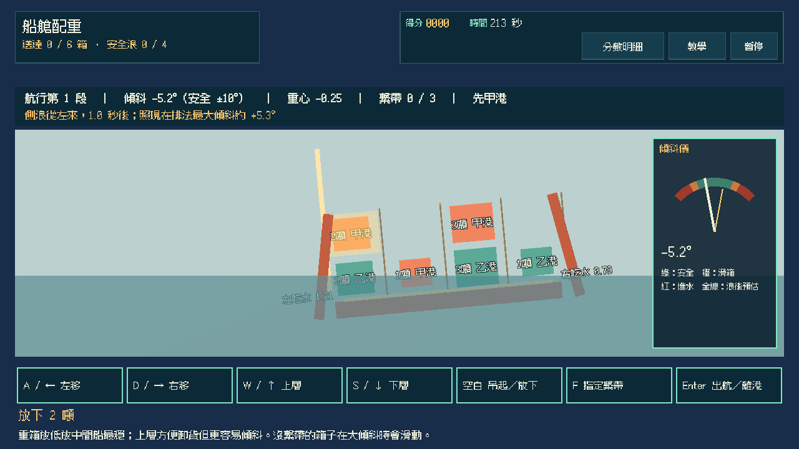
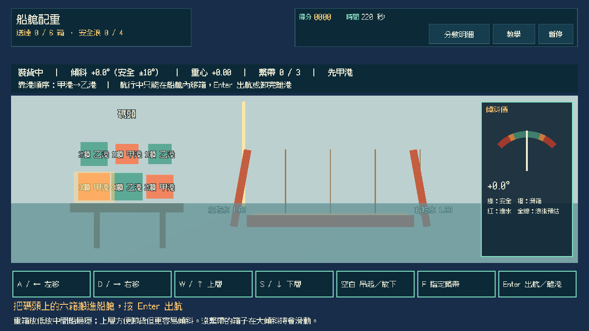
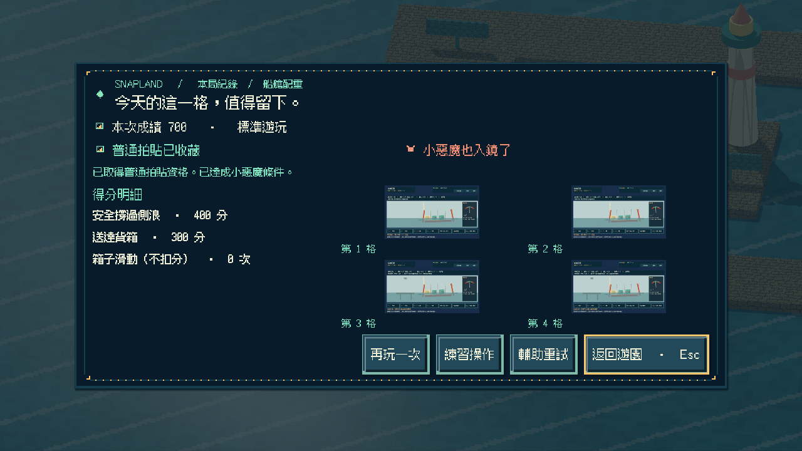
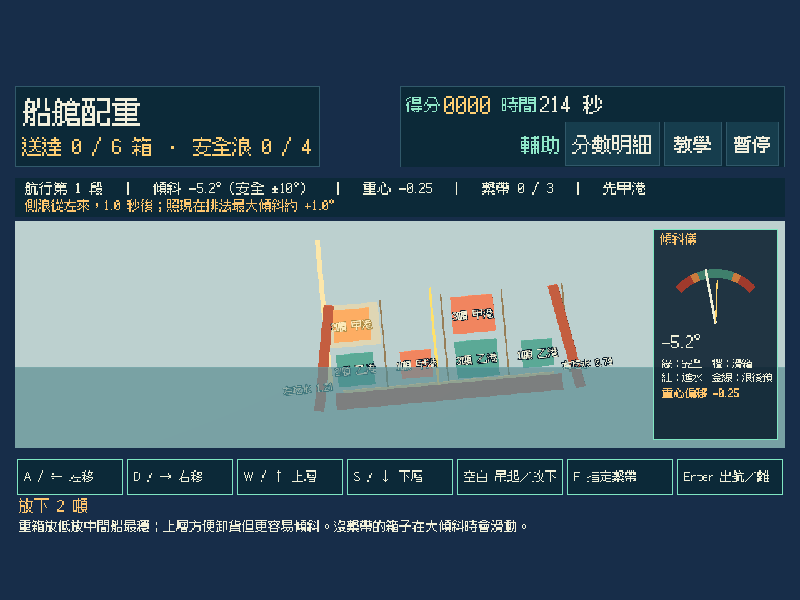
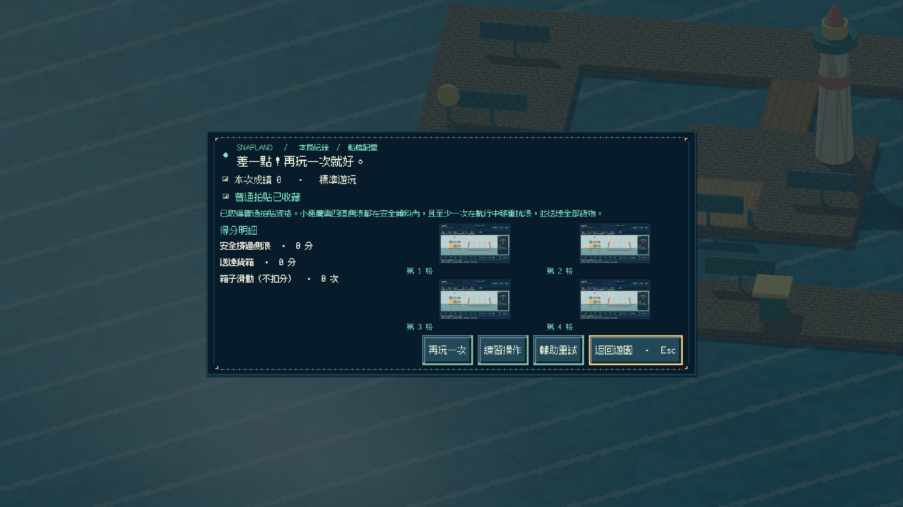
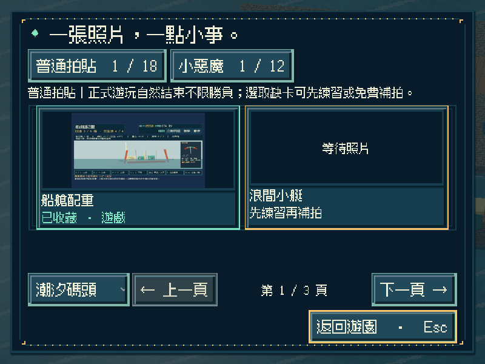
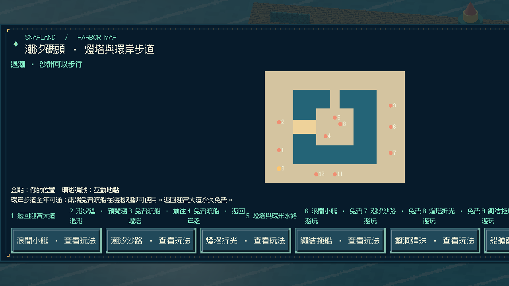
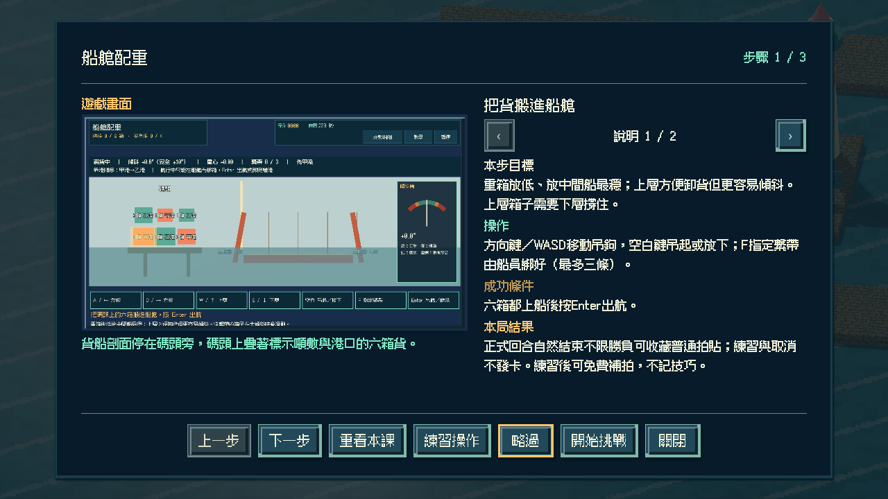

# [SG-34] 實作船艙配重與碼頭收藏

> 狀態：完成

## 內文

### 需求
在潮汐碼頭的貨船剖面裡實際搬箱、指定繫帶，讓船在航行中左右吃水保持平衡；箱子放在方便卸貨的位置或壓低重心各有代價，側浪來時可以移動重量撐過去。

### 來源
2026-11-13 使用者要求持續完成整個遊戲並自主開票交付。既定第十八款「船艙配重」目前只有設計；潮汐碼頭已有第十三至十七款可玩，參與收藏與免費補拍已通用。

### 驗收條件
- [x] 有獨立的三維剖面船艙玩法；搬箱位置、疊放高度與繫帶實際改變船的傾斜，側浪會推動船身，不以既有玩法換名代替。
- [x] 畫面顯示左右吃水線、傾斜角、重心位置與側浪預告；同樣總重的不同排列產生不同傾斜，未繫緊的箱子在大傾斜時會滑動。
- [x] 箱重分布與靠岸順序隨重試變化；靠岸時要先卸下該港的貨，壓在下層的箱子要先移開上層才能卸；簡單 AI 只先綁好玩家指定的箱子。
- [x] 單人可操作全部流程；首次教學、練習、輔助（放慢側浪、顯示重心投影）、暫停、失焦、重試與離開正常，持續按鍵不會黏住。
- [x] 正常參與到結算可取得普通拍貼，成功或失敗如實記分；全程每道側浪都保持在安全傾斜內、且至少一次在航行中移重抗浪可取得小惡魔拍貼，輔助不取消資格；練習與中途取消不發獎，可接續免費補拍。
- [x] 新拍貼記在潮汐碼頭第六格，成就與教學辨認為第十八款；重播不重複加錢，縮圖與原圖重開仍有效，既有玩法與舊存檔不受損，其他碼頭玩法仍如實顯示準備中。
- [x] 不同視窗、放大文字、降低動態、原生操作與隔離輸出包驗證附票；不能用直接設分或設定完成旗標代替原生操作證據。

### 測試流程
1. 以同樣的箱子做兩種排列，比較靜止傾斜；不繫帶讓大浪推動箱子滑動。
2. 正常與輔助完成兩段航行與兩次靠岸卸貨，核對普通、小惡魔資格與真實成績；暫停及失焦後操作不黏住。
3. 取得碼頭第六格拍貼後重播並關閉重開，核對金幣、教學、成就、縮圖與原圖，以及原有內容。
4. 在原生視窗與輸出包用實際指令操作，保存畫面、結果與局部／完整驗證紀錄。

---

# 跟其他票的關係
- Blocks：無
- Blocked by：無
- Related：SG-1、SG-29、SG-33

---

# Commit-1

## 內文

潮汐碼頭南岸新增「船艙配重」遊戲亭與地圖入口。玩家在三維貨船剖面裡用吊鉤把碼頭上的六箱貨搬進船艙，按 F 指定繫帶由船員綁好，按 Enter 出航；船身依貨物力矩與上層重量傾斜，側浪來時疊加推力。

同樣六箱貨，不同排法會有不同的靜止傾斜，疊得越高越容易傾。航行中會預告側浪方向與照現在排法的預估傾斜，把一箱移到迎浪側就能抵住；沒繫帶的箱子在大傾斜時滑向低側，傾斜過大會進水中止航程。抵港時要把該港的箱子搬上碼頭，被壓住的要先移開上層。重試輪替箱重、目的港與靠港順序。

正常回合結束（卸完、進水或時間到）可收藏碼頭第六格普通拍貼，成功與失敗如實記分；四道浪都安全且至少一次移重抗浪可取得小惡魔，輔助放慢側浪、提早預告並投影重心位置，仍保留資格。練習與取消不發卡；重播不重複發錢，成就與教學辨認為第十八款，第十九款以後仍拒絕。

以實際按鍵完成移重與不移重兩種航程、逾時、練習與取消，並以同重不同排列、繫帶與滑箱、進水、卸貨順序做模型驗證；原生三種尺寸含放大文字／降低動態與重開讀檔，獨立資源包從空工作目錄完成全回合與重開 0 ERROR／0 WARNING，Windows 成品啟動檢查通過。以上是程式化驗收，不代表真人手感評價。

### 測試結果

| 項目 | 結果 |
|---|---|
| 新增局部 | 配重模型 38、操作 30、畫面 26、Session 24 項 0 失敗；Main 入口／地圖／教學／逾時／練習／兩種航程／輔助小惡魔／重開與原生前置通過 |
| 受影響回歸 | 碼頭六款、補拍、參與收藏、地區旅行、教學、相簿、啟動與主場景整合共 39 項本機通過 |
| Python | 執行時契約、分批與設計驗證通過；設計五範圍 0 錯誤 |
| 原生尺寸 | 800×600 放大文字＋降低動態（輔助）、1280×720（移重／不移重）、1920×1080（逾時）及重開讀檔 |
| 獨立輸出 | 資源包全回合＋重開 0 ERROR／0 WARNING；Windows 成品 `--smoke-test` 通過 |

### 截圖

