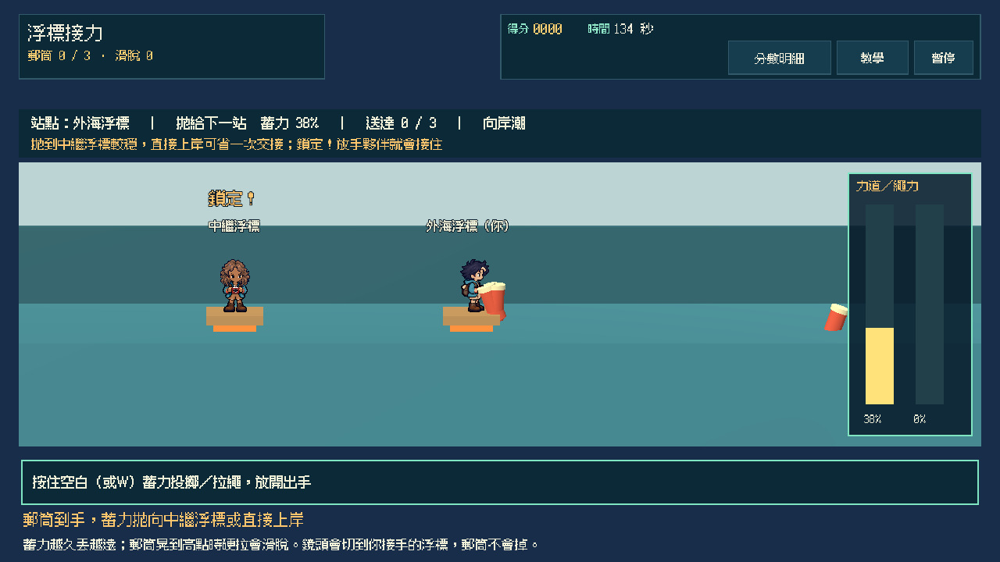
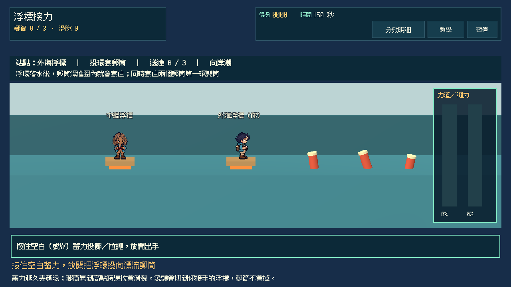
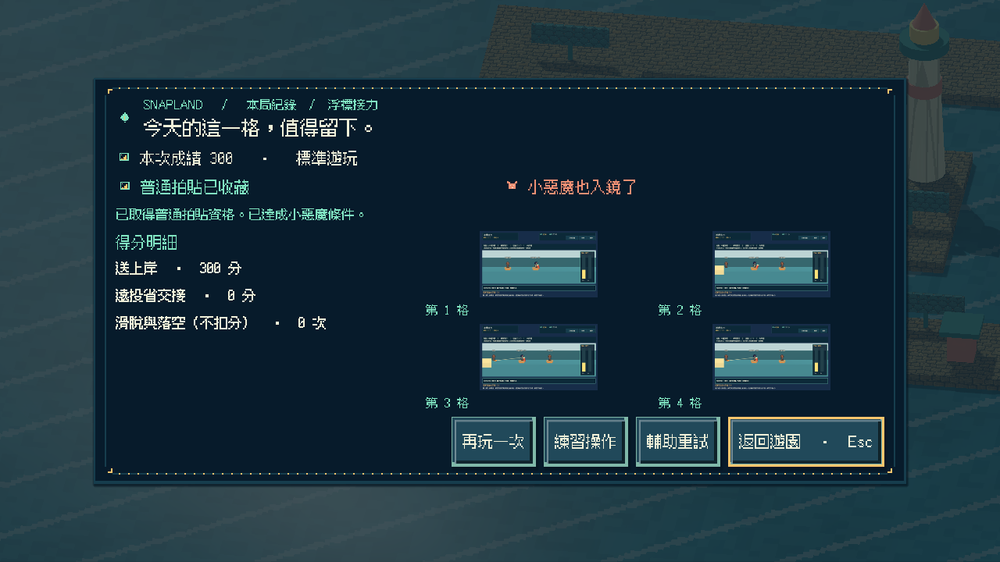
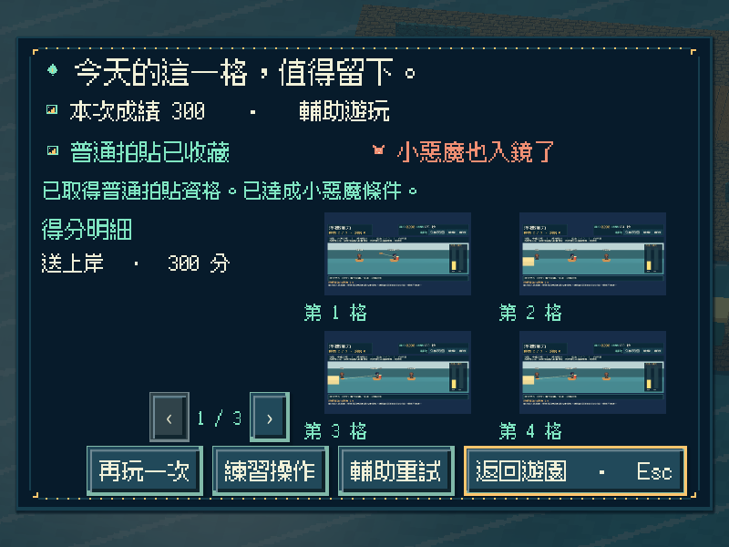
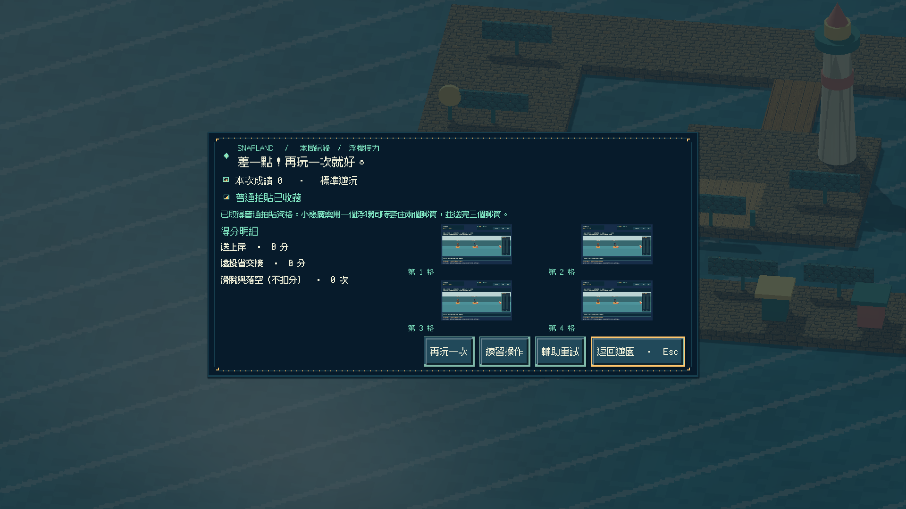
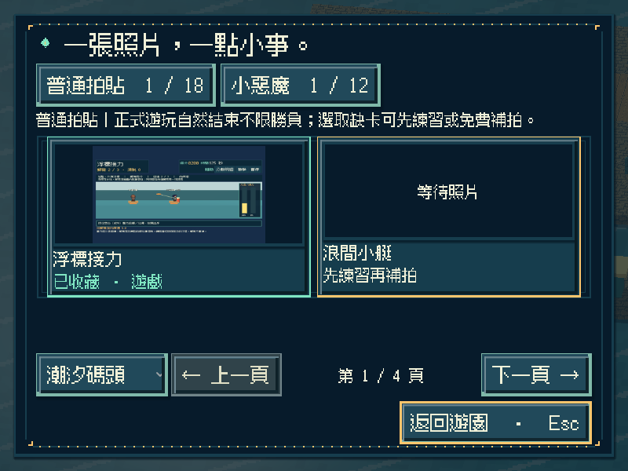
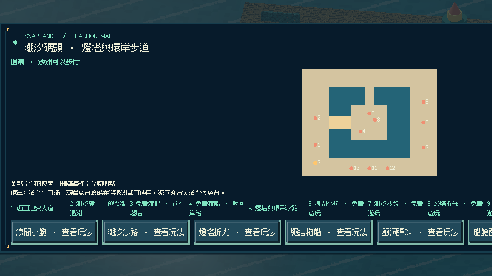
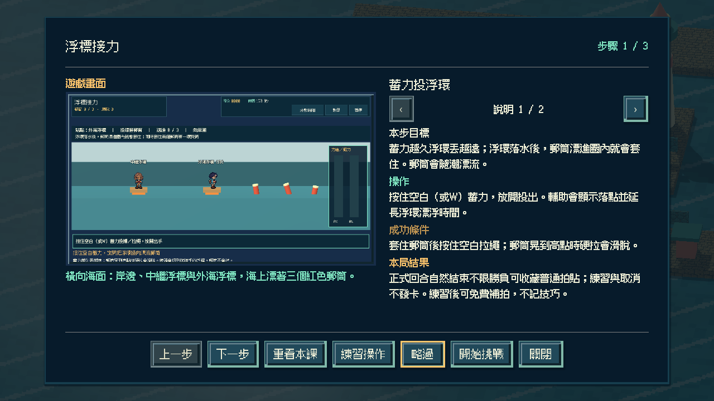

# [SG-35] 實作浮標接力與碼頭收藏

> 狀態：完成

## 內文

### 需求
在潮汐碼頭的海面浮標站之間實際蓄力投出浮環、拉繩把漂流郵筒拖回，再把郵筒拋給下一站或直接拋上岸；近站穩接或遠投減少交接各有代價，鏡頭切換站點時手上的郵筒不會遺失。

### 來源
2026-11-13 使用者要求持續完成整個遊戲並自主開票交付。既定第十九款「浮標接力」目前只有設計；潮汐碼頭已有第十三至十八款可玩，參與收藏與免費補拍已通用。

### 驗收條件
- [x] 有獨立的 2.5D 橫向海面玩法；蓄力決定浮環與郵筒的落點，拉繩速度與時機實際影響郵筒能否拖回，不以既有玩法換名代替。
- [x] 畫面顯示投環落點、繩子鬆緊與郵筒晃動；拉得太急會讓繩子滑脫，郵筒會隨潮漂流。
- [x] 浮標間距與潮推方向隨重試變化；簡單 AI 只在投擲出現「鎖定」提示時接住，不代替投擲。鏡頭切換到下一站時手上的郵筒保持不變。
- [x] 單人可操作全部流程；首次教學、練習、輔助（延長接環時間並顯示落點）、暫停、失焦、重試與離開正常，持續按鍵不會黏住。
- [x] 正常參與到結算可取得普通拍貼，成功或失敗如實記分；用一個浮環同時套住兩個郵筒並送完全部郵筒可取得小惡魔拍貼，輔助不取消資格；練習與中途取消不發獎，可接續免費補拍。
- [x] 新拍貼記在潮汐碼頭第七格，成就與教學辨認為第十九款；重播不重複加錢，縮圖與原圖重開仍有效，既有玩法與舊存檔不受損，其他碼頭玩法仍如實顯示準備中。
- [x] 不同視窗、放大文字、降低動態、原生操作與隔離輸出包驗證附票；不能用直接設分或設定完成旗標代替原生操作證據。

### 測試流程
1. 以不同蓄力投環比較落點；拉繩時在郵筒晃動高點猛拉確認滑脫。
2. 分別近站交接與遠投上岸完成回合，核對普通、小惡魔（一環雙筒）資格與真實成績；暫停及失焦後操作不黏住。
3. 取得碼頭第七格拍貼後重播並關閉重開，核對金幣、教學、成就、縮圖與原圖，以及原有內容。
4. 在原生視窗與輸出包用實際指令操作，保存畫面、結果與局部／完整驗證紀錄。

---

# 跟其他票的關係
- Blocks：無
- Blocked by：無
- Related：SG-1、SG-29、SG-34

---

# Commit-1

## 內文

潮汐碼頭南岸新增「浮標接力」遊戲亭與地圖入口。整局只用一個動作鍵：按住蓄力、放開投出浮環，郵筒隨潮漂進圈內就套住；按住拉繩把郵筒拖回浮標，再蓄力把郵筒拋給中繼浮標或直接上岸。

蓄力越久丟越遠；郵筒晃到高點時硬拉，繩子會吃緊並滑脫。交接時落點對準接手站才會出現「鎖定」，夥伴才會接住；鏡頭隨之切到接手的浮標，郵筒仍在手上。從外海直接拋上岸可省一次交接但落點窗更窄；三個郵筒以不同速度漂流，兩個靠近時用一個浮環同時套住可取得小惡魔。重試輪替向岸潮與離岸潮。

正常回合結束（送完或時間到）可收藏碼頭第七格普通拍貼，成功與失敗如實記分；輔助延長浮環漂浮、放寬接環範圍並標出落點，仍保留小惡魔資格。練習與取消不發卡，暫停、失焦與離開只取消蓄力；重播不重複發錢，成就與教學辨認為第十九款，第二十款以後仍拒絕。

以實際按鍵完成遠投、近站交接、一環雙筒、逾時、練習與取消，並以蓄力與落點、漂流、滑脫、鎖定與換站保留郵筒做模型驗證；原生三種尺寸含放大文字／降低動態與重開讀檔，獨立資源包從空工作目錄完成全回合與重開 0 ERROR／0 WARNING，Windows 成品啟動檢查通過。以上是程式化驗收，不代表真人手感評價。

### 測試結果

| 項目 | 結果 |
|---|---|
| 新增局部 | 接力模型 35、操作 28、畫面 30、Session 22 項 0 失敗；Main 入口／地圖／教學／逾時／練習／交接路線／輔助小惡魔／重開與原生前置通過 |
| 受影響回歸 | 碼頭七款 Session、補拍、參與收藏、地區旅行、教學、相簿、啟動與主場景整合共 32 項本機通過 |
| Python | 執行時契約、分批與設計驗證通過；設計五範圍 0 錯誤 |
| 原生尺寸 | 800×600 放大文字＋降低動態（輔助）、1280×720（一環雙筒／逐筒）、1920×1080（逾時）及重開讀檔 |
| 獨立輸出 | 資源包全回合＋重開 0 ERROR／0 WARNING；Windows 成品 `--smoke-test` 通過 |

### 截圖

