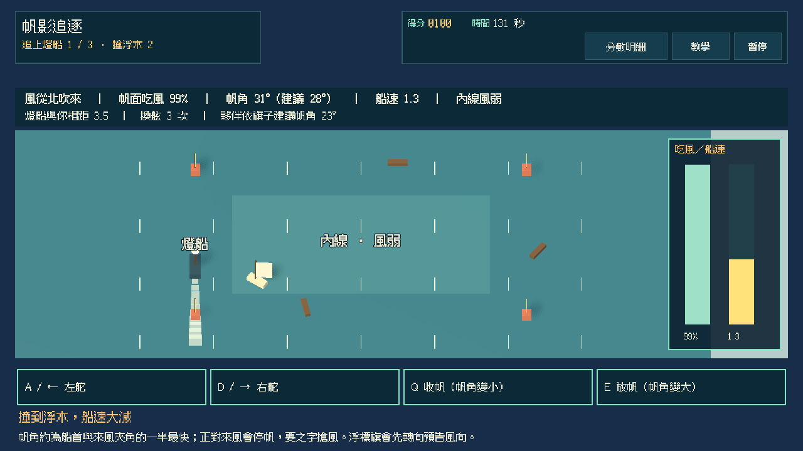
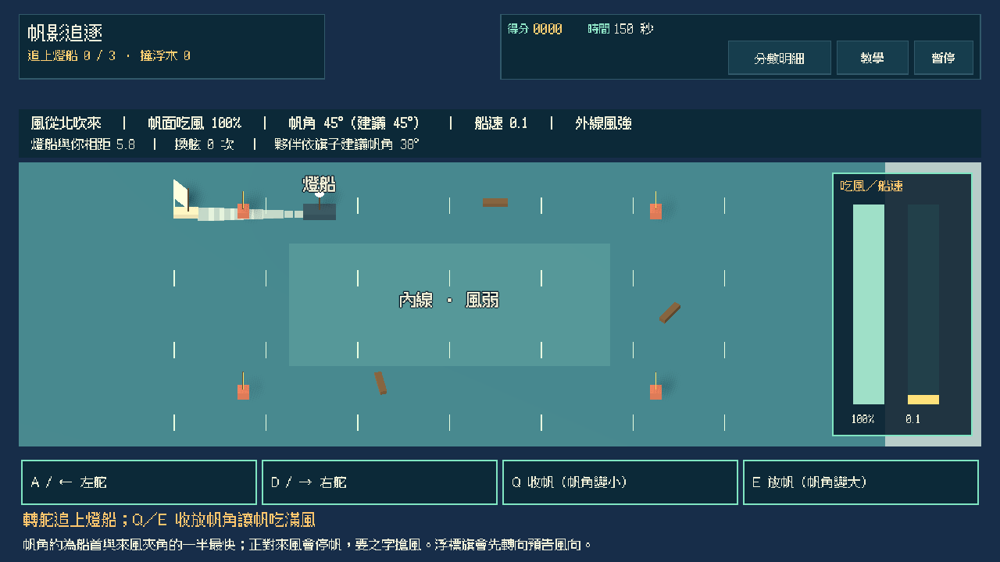
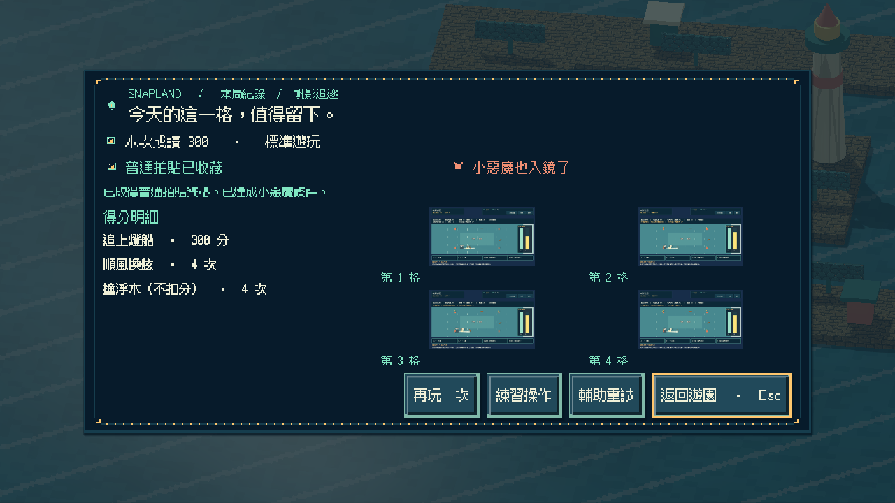
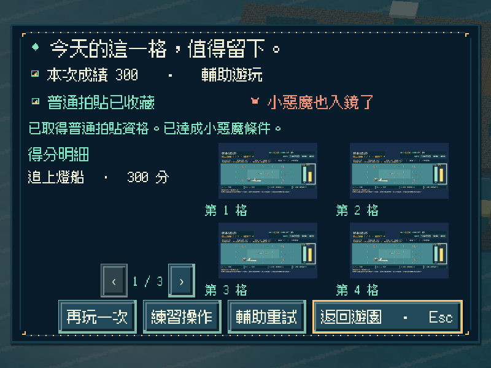
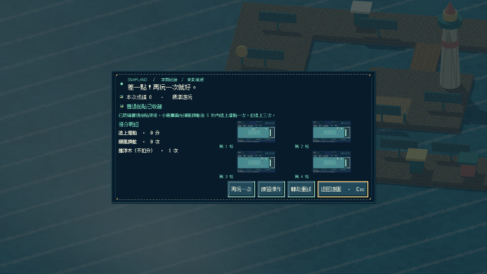
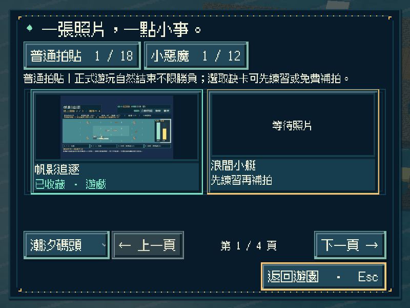
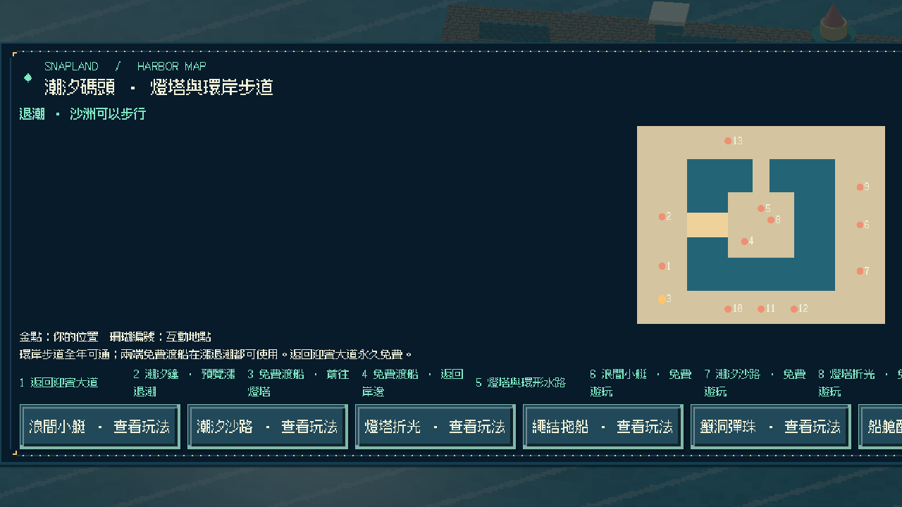
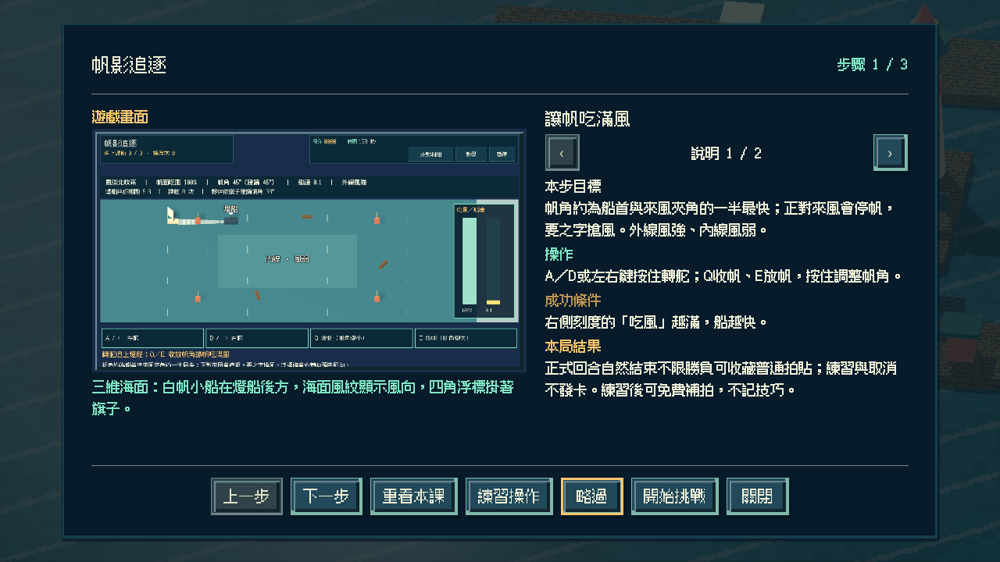

# [SG-36] 實作帆影追逐與碼頭收藏

> 狀態：完成

## 內文

### 需求
在潮汐碼頭外海實際轉舵、收放帆角，追上繞圈的移動燈船三次；帆角與風向的關係決定船速，外線風強但繞遠、內線風弱但路短，浮標上的旗子預告風向轉折。

### 來源
2026-11-13 使用者要求持續完成整個遊戲並自主開票交付。既定第二十款「帆影追逐」目前只有設計；潮汐碼頭已有第十三至十九款可玩，參與收藏與免費補拍已通用。

### 驗收條件
- [x] 有獨立的三維帆船追逐玩法；船首與風向的夾角和帆角決定實際船速，逆風無法直駛須之字搶風，不以既有小艇玩法換名代替。
- [x] 畫面顯示風向、帆面受風效率、船速與燈船尾流；外線與內線的風力不同，浮木會撞慢船速。
- [x] 風向轉折與浮木位置隨重試變化；浮標旗提前預告下一次風向，簡單 AI 只依看得到的旗子建議保守帆角，不代替操舵。
- [x] 單人可操作全部流程；首次教學、練習、輔助（帆角自動回中、風轉更早預告）、暫停、失焦、重試與離開正常，持續按鍵不會黏住。
- [x] 正常參與到結算可取得普通拍貼，成功或失敗如實記分；以一次順風換舷完成超越（換舷後不久追上燈船）並追上三次可取得小惡魔拍貼，輔助不取消資格；練習與中途取消不發獎，可接續免費補拍。
- [x] 新拍貼記在潮汐碼頭第八格，成就與教學辨認為第二十款；重播不重複加錢，縮圖與原圖重開仍有效，既有玩法與舊存檔不受損，其他碼頭玩法仍如實顯示準備中。
- [x] 不同視窗、放大文字、降低動態、原生操作與隔離輸出包驗證附票；不能用直接設分或設定完成旗標代替原生操作證據。

### 測試流程
1. 以不同帆角在同一航向比較船速；逆風直駛確認無法前進、搶風可前進。
2. 依旗子預告調整，完成三次追上，核對普通、小惡魔（換舷超越）資格與真實成績；暫停及失焦後操作不黏住。
3. 取得碼頭第八格拍貼後重播並關閉重開，核對金幣、教學、成就、縮圖與原圖，以及原有內容。
4. 在原生視窗與輸出包用實際指令操作，保存畫面、結果與局部／完整驗證紀錄。

---

# 跟其他票的關係
- Blocks：無
- Blocked by：無
- Related：SG-1、SG-28、SG-29、SG-35

---

# Commit-1

## 內文

潮汐碼頭北岸新增「帆影追逐」遊戲亭與地圖入口。玩家在三維海面上按住轉舵、收放帆角，追趕沿四角浮標繞圈的燈船；船首與來風的夾角和帆角決定船速，正對來風會停帆，要之字搶風。

帆角在夾角一半附近吃風最滿；外線風強、內線路短但風弱。浮標旗會在風向轉折前先轉向預告，夥伴只依旗子建議保守帆角；燈船被追上後會加速拉開，浮木會撞慢船速。在燈船順風行駛時換舷切近、六秒內追上可取得小惡魔。重試輪替兩種風向轉折與浮木位置。

正常回合結束（追上三次或時間到）可收藏碼頭第八格普通拍貼，成功與失敗如實記分；輔助自動把帆角回到最佳並提早預告風向，仍保留小惡魔資格。練習與取消不發卡；重播不重複發錢，成就與教學辨認為第二十款，第二十一款以後仍拒絕。

以實際按鍵完成直接追逐、換舷超越、逾時、練習與取消，並以帆角與船速、停帆、內外線風力、旗子預告、浮木與輔助自動帆角做模型驗證；原生三種尺寸含放大文字／降低動態與重開讀檔，獨立資源包從空工作目錄完成全回合與重開 0 ERROR／0 WARNING，Windows 成品啟動檢查通過。以上是程式化驗收，不代表真人手感評價。

### 測試結果

| 項目 | 結果 |
|---|---|
| 新增局部 | 帆船模型 31、操作 27、畫面 25、Session 20 項 0 失敗；Main 入口／地圖／教學／逾時／練習／換舷超越／輔助小惡魔／重開與原生前置通過 |
| 受影響回歸 | 碼頭八款 Session、補拍、參與收藏、地區旅行、教學、相簿、啟動與主場景整合共 33 項本機通過 |
| Python | 執行時契約、分批與設計驗證通過；設計五範圍 0 錯誤 |
| 原生尺寸 | 800×600 放大文字＋降低動態（輔助）、1280×720（換舷超越／直接追逐）、1920×1080（逾時）及重開讀檔 |
| 獨立輸出 | 資源包全回合＋重開 0 ERROR／0 WARNING；Windows 成品 `--smoke-test` 通過 |

### 截圖

