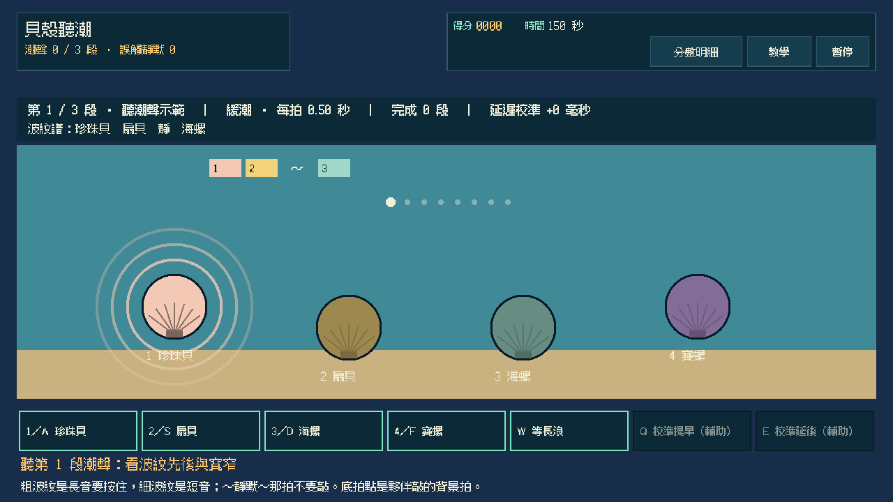
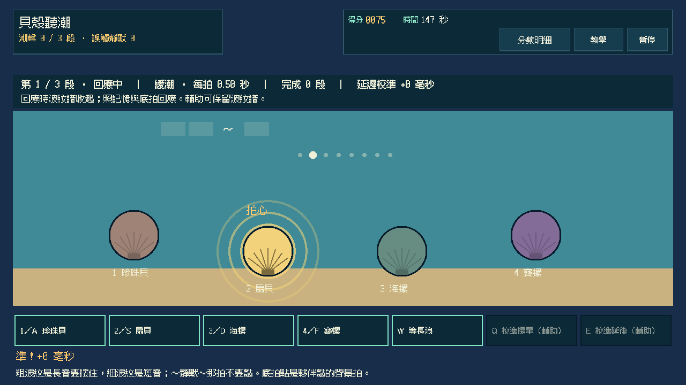
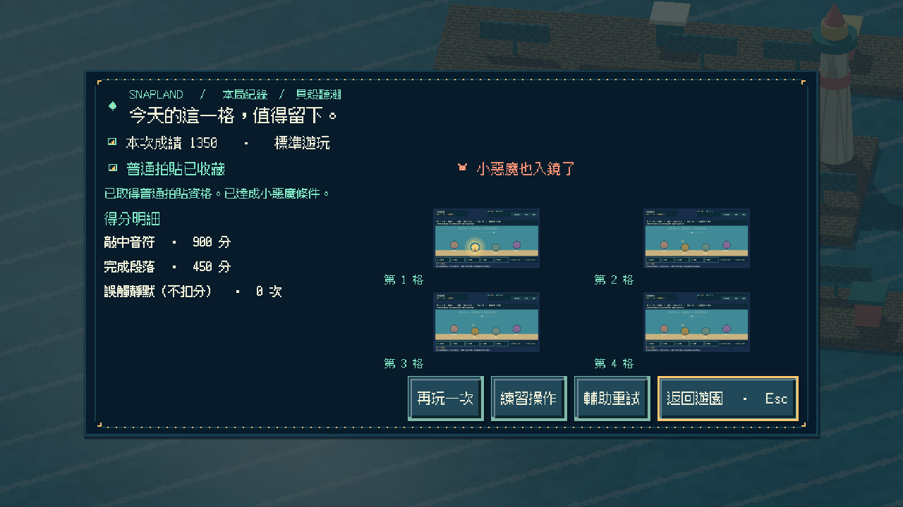
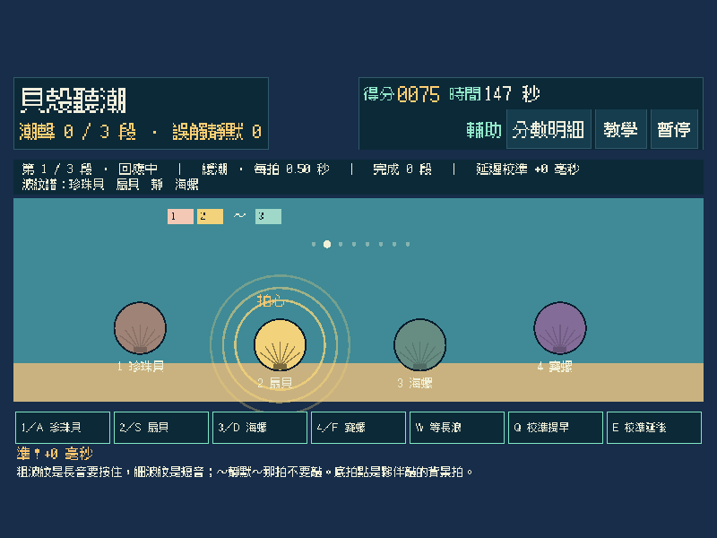
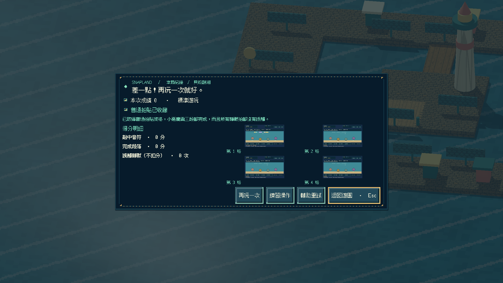
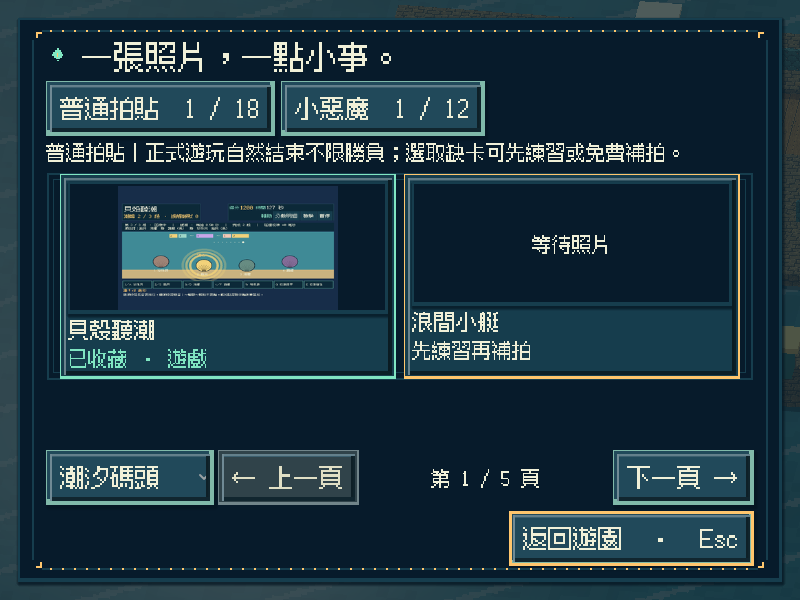
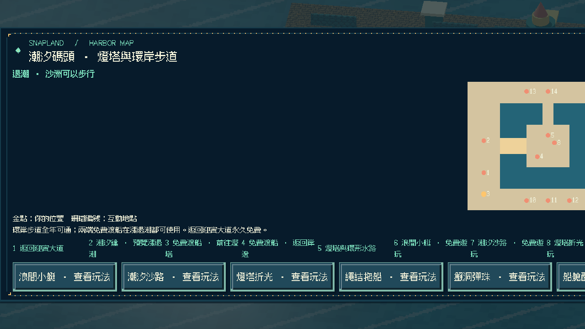
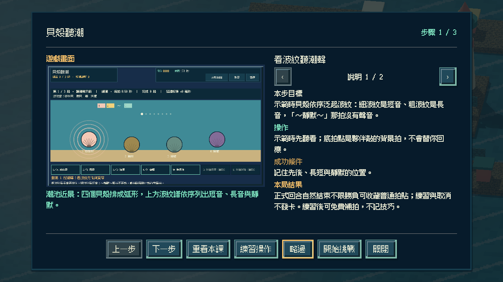

# [SG-37] 實作貝殼聽潮與碼頭收藏

> 狀態：完成

## 內文

### 需求
在潮汐碼頭的潮池邊聽潮聲示範，照波紋先後敲四個貝殼回應三段「潮的呼吸」；波紋寬窄代表長短音，靜默的拍子不能敲。可以趁短浪立刻回應，或等一道長浪用較慢的節奏回應。

### 來源
2026-11-13 使用者要求持續完成整個遊戲並自主開票交付。既定第二十一款「貝殼聽潮」目前只有設計；潮汐碼頭已有第十三至二十款可玩，參與收藏與免費補拍已通用。

### 驗收條件
- [x] 有獨立的 2D 潮池節奏玩法；示範後依序敲對貝殼並按住長音，靜默拍不能敲，判定依實際時間差，不以迎賓的合奏或彩帶玩法換名代替。
- [x] 波紋寬度、波紋譜與底拍點讓靜音時也能分辨長短音與空拍；每次敲擊顯示早晚毫秒。
- [x] 潮拍間隔與靜默位置隨重試變化；選擇等長浪時節奏變慢、判定變寬但加分較少；簡單 AI 只敲背景底拍，不代替回應。
- [x] 單人可操作全部流程；首次教學、練習、輔助（保留波紋譜、可自由校準延遲）、暫停、失焦、重試與離開正常，持續按鍵不會黏住。
- [x] 正常參與到結算可取得普通拍貼，成功或失敗如實記分；三段都完成且所有靜默拍都沒誤觸可取得小惡魔拍貼，輔助不取消資格；練習與中途取消不發獎，可接續免費補拍。
- [x] 新拍貼記在潮汐碼頭第九格，成就與教學辨認為第二十一款；重播不重複加錢，縮圖與原圖重開仍有效，既有玩法與舊存檔不受損，其他碼頭玩法仍如實顯示準備中。
- [x] 不同視窗、放大文字、降低動態、原生操作與隔離輸出包驗證附票；不能用直接設分或設定完成旗標代替原生操作證據。

### 測試流程
1. 看一段示範後照波紋回應，故意在靜默拍敲一下與提早放開長音，核對判定。
2. 分別立刻回應與等長浪回應完成三段，核對普通、小惡魔（靜默不誤觸）資格與真實成績；暫停及失焦後操作不黏住。
3. 取得碼頭第九格拍貼後重播並關閉重開，核對金幣、教學、成就、縮圖與原圖，以及原有內容。
4. 在原生視窗與輸出包用實際指令操作，保存畫面、結果與局部／完整驗證紀錄。

---

# 跟其他票的關係
- Blocks：無
- Blocked by：無
- Related：SG-1、SG-29、SG-36

---

# Commit-1

## 內文

潮汐碼頭北岸新增「貝殼聽潮」遊戲亭與地圖入口。每段先看潮聲示範：四個貝殼依序泛起波紋並發出音符，細波紋是短音、粗波紋是長音，「～靜默～」那拍沒有聲音；接著照記憶敲貝殼回應，長音要按住，靜默拍不能敲，判定依實際時間差並顯示拍心或早晚毫秒。

可以趁短浪立刻回應，或按 W 等一道長浪：節奏變慢、判定變寬，但完成加分較少。每段對到四分之三以上就完成，沒對到可再聽一次。重試輪替兩組節奏與靜默位置；夥伴只在背景敲底拍點，不替你回應。三段都完成且所有靜默拍都沒誤觸可取得小惡魔。

正常回合結束可收藏碼頭第九格普通拍貼，成功與失敗如實記分；輔助保留波紋譜、放寬判定並可校準延遲，仍保留小惡魔資格。練習與取消不發卡；重播不重複發錢，成就與教學辨認為第二十一款，第二十二款以後仍拒絕。另外新增通用接口，讓這類玩法的音符經由既有音訊播放並遵守音量設定。

以實際按鍵完成乾淨回應、誤觸靜默、等長浪、逾時、練習與取消，並以判定窗、長音放太早、示範不判定、校準上限與音符送出做模型與 Session 驗證；原生三種尺寸含放大文字／降低動態與重開讀檔，獨立資源包從空工作目錄完成全回合與重開 0 ERROR／0 WARNING，Windows 成品啟動檢查通過。以上是程式化驗收，不代表真人聽感評價。

### 測試結果

| 項目 | 結果 |
|---|---|
| 新增局部 | 聽潮模型 36、操作 29、畫面 14、Session 24 項 0 失敗；Main 入口／地圖／教學／逾時／練習／誤觸靜默／輔助小惡魔／重開與原生前置通過 |
| 受影響回歸 | 碼頭九款 Session、迎賓小遊戲、音訊、補拍、參與收藏、地區旅行、教學、相簿、啟動與主場景整合共 38 項本機通過 |
| Python | 執行時契約、分批與設計驗證通過；設計五範圍 0 錯誤 |
| 原生尺寸 | 800×600 放大文字＋降低動態（輔助）、1280×720（乾淨回應／誤觸靜默）、1920×1080（逾時）及重開讀檔 |
| 獨立輸出 | 資源包全回合＋重開 0 ERROR／0 WARNING；Windows 成品 `--smoke-test` 通過 |

### 截圖

