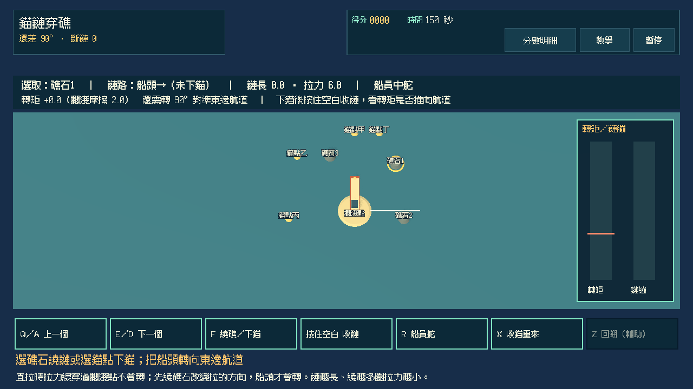
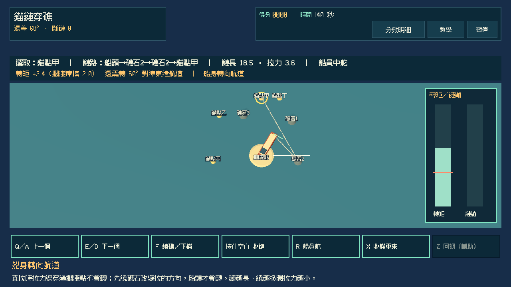
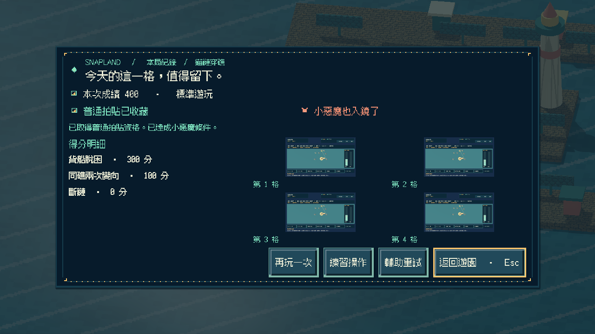
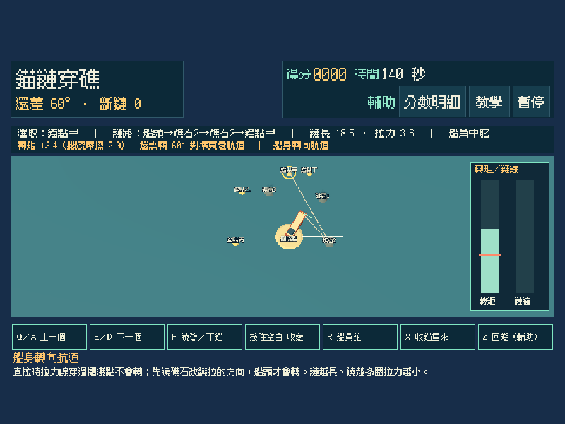
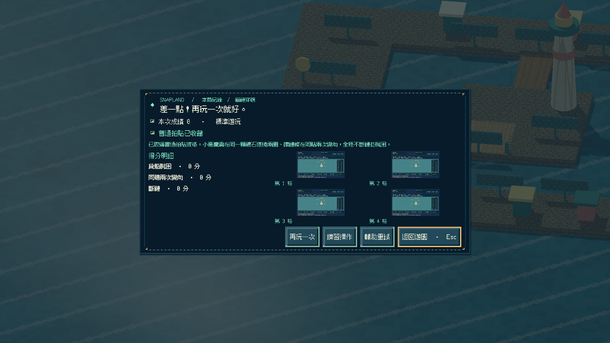
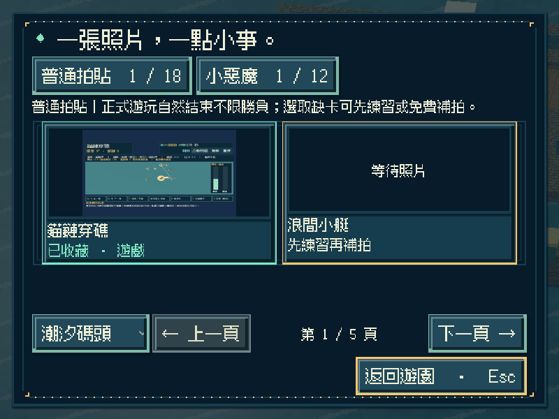
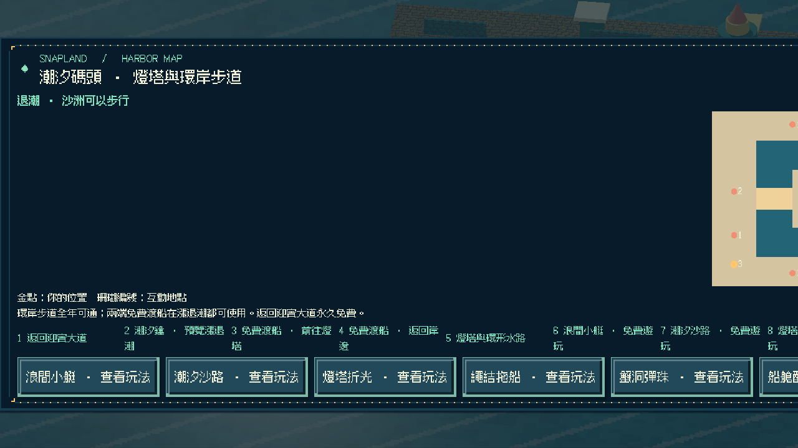
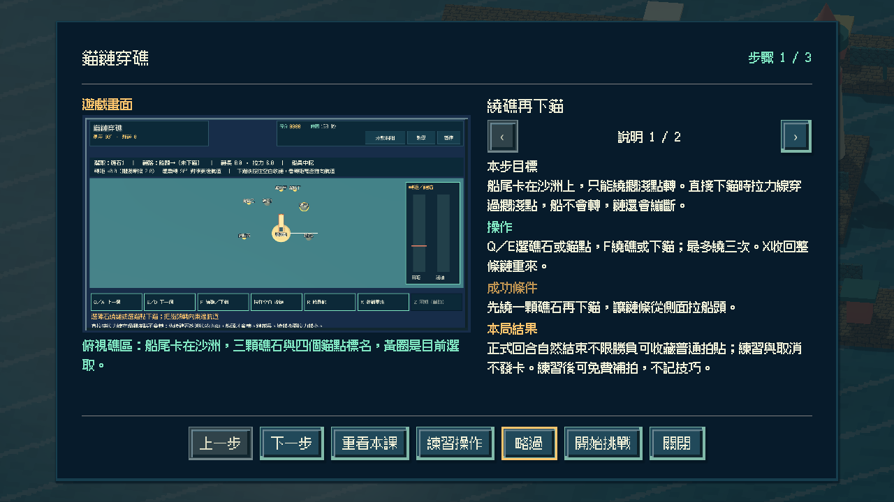

# [SG-38] 實作錨鏈穿礁與碼頭收藏

> 狀態：完成

## 內文

### 需求
在潮汐碼頭外的礁區救援一艘擱淺貨船：選礁石繞鏈或選錨點下錨，按住收鏈讓鏈條拉力轉動船身，把船頭轉進航道。直接拉時拉力線穿過擱淺點不會轉；可以多放鏈繞遠，或借礁石改變拉的方向，但繞得越多、鏈越長拉力越小。

### 來源
2026-11-13 使用者要求持續完成整個遊戲並自主開票交付。既定第二十二款「錨鏈穿礁」目前只有設計；潮汐碼頭已有第十三至二十一款可玩，參與收藏與免費補拍已通用。

### 驗收條件
- [x] 有獨立的 3D 俯視救援玩法；船身繞擱淺點轉動，轉矩依鏈條離開船頭的方向計算，不以拖船、配重或其他玩法換名代替。
- [x] 直拉失敗時顯示可讀原因（拉力線穿過擱淺點、轉矩不足或方向反了），繞礁成功時能看出鏈條接觸點與轉矩變化。
- [x] 初始船向、航道方向與礁形隨重試變化；簡單 AI 船員只保持低速指定舵角，不代替繞礁或收鏈。
- [x] 單人可操作全部流程；首次教學、練習、輔助（不斷鏈、可回溯繞礁步驟）、暫停、失焦、重試與離開正常，按住收鏈不會黏住。
- [x] 正常參與到結算可取得普通拍貼，成功或失敗如實記分；在同一顆礁石連繞兩圈讓鏈條兩次變向、全程不斷鏈並脫困可取得小惡魔拍貼，輔助不取消資格；練習與中途取消不發獎，可接續免費補拍。
- [x] 新拍貼記在潮汐碼頭第十格，成就與教學辨認為第二十二款；重播不重複加錢，縮圖與原圖重開仍有效，既有玩法與舊存檔不受損，其他碼頭玩法仍如實顯示準備中。
- [x] 不同視窗、放大文字、降低動態、原生操作與隔離輸出包驗證附票；不能用直接設分或設定完成旗標代替原生操作證據。

### 測試流程
1. 直接下錨收鏈，核對斷鏈與「拉力線穿過擱淺點」原因；再繞一顆礁石後收鏈，核對船頭轉向航道。
2. 分別用一般繞法與同一礁石連繞兩圈完成脫困，核對普通、小惡魔資格與真實成績；暫停及失焦後收鏈不黏住。
3. 取得碼頭第十格拍貼後重播並關閉重開，核對金幣、教學、成就、縮圖與原圖，以及原有內容。
4. 在原生視窗與輸出包用實際指令操作，保存畫面、結果與局部／完整驗證紀錄。

---

# 跟其他票的關係
- Blocks：無
- Blocked by：無
- Related：SG-1、SG-29、SG-37

---

# Commit-1

## 內文

潮汐碼頭北岸新增「錨鏈穿礁」遊戲亭與地圖入口。貨船船尾卡在沙洲上，只能繞擱淺點轉：選礁石繞鏈或選錨點下錨，按住空白收鏈，鏈條從船頭離開的方向決定轉矩。直接下錨時拉力線穿過擱淺點，船不會轉，鏈條繃緊兩秒就會斷並說明原因；先繞一顆礁石改變拉的方向，轉矩超過擱淺摩擦，船頭就轉向航道。

繞越多圈、鏈越長拉力越小，鏈長與繞礁次數都有上限；方向反了也會明示。重試輪替北向與南向兩組鏡像礁形；船員只保持左／中／右低速舵，不替你繞礁或收鏈。同一顆礁石連繞兩圈、全程不斷鏈並脫困可取得小惡魔。

正常回合結束可收藏碼頭第十格普通拍貼，成功與失敗如實記分；輔助取消斷鏈並可回溯繞礁步驟，仍保留小惡魔資格。練習與取消不發卡；重播不重複發錢，成就與教學辨認為第二十二款，第二十三款以後仍拒絕。

以實際按鍵完成直拉斷鏈、單次繞礁、同礁兩圈、逾時、練習與取消，並以轉矩、斷鏈、方向反了、鏈長與繞礁上限、輔助回溯與船員舵做模型與 Session 驗證；原生三種尺寸含放大文字／降低動態與重開讀檔，獨立資源包從空工作目錄完成全回合與重開，Windows 成品啟動檢查通過。以上是程式化驗收，不代表真人試玩評價。

### 測試結果

| 項目 | 結果 |
|---|---|
| 新增局部 | 錨鏈模型 35、操作 30、畫面 16、Session 23 項 0 失敗；Main 入口／地圖／教學／逾時／練習／單次繞礁／輔助小惡魔／重開與原生前置通過 |
| 受影響回歸 | 碼頭十款 Session、迎賓小遊戲、音訊、補拍、參與收藏、地區旅行、教學、相簿、啟動與主場景整合共 44 項本機通過 |
| Python | 執行時契約、分批與設計驗證 199 項通過；設計五範圍 0 錯誤 |
| 原生尺寸 | 800×600 放大文字＋降低動態（輔助）、1280×720（同礁兩圈／單次繞礁）、1920×1080（逾時）及重開讀檔 |
| 獨立輸出 | 資源包全回合＋重開 0 ERROR／0 WARNING；Windows 成品 `--smoke-test` 通過 |

### 截圖

