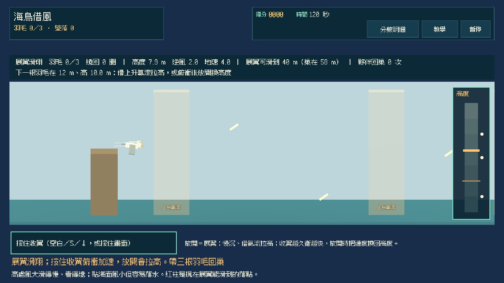
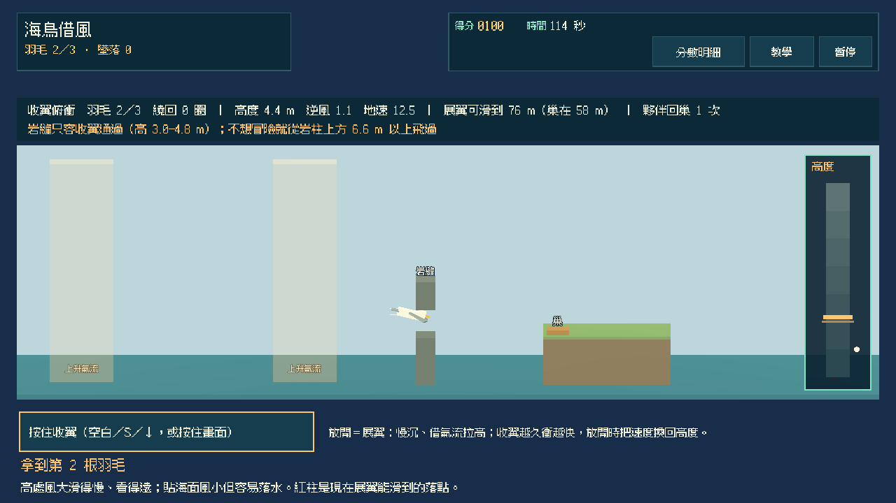
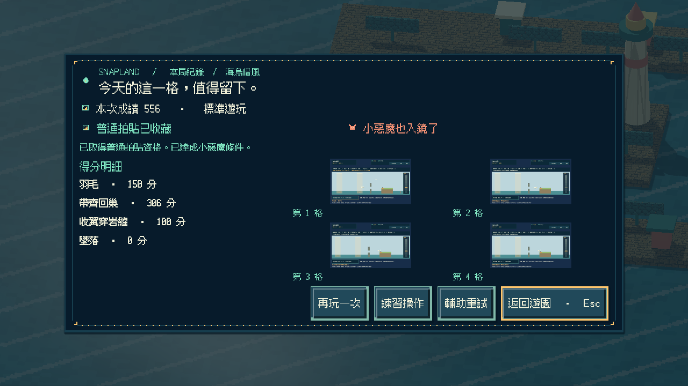
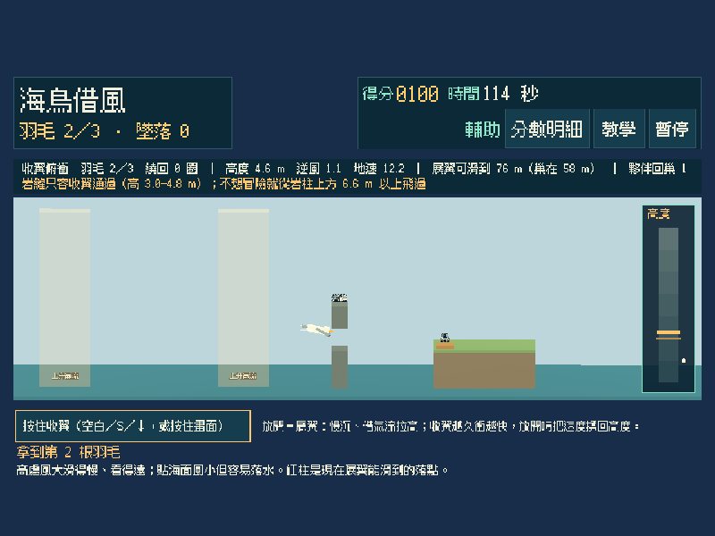
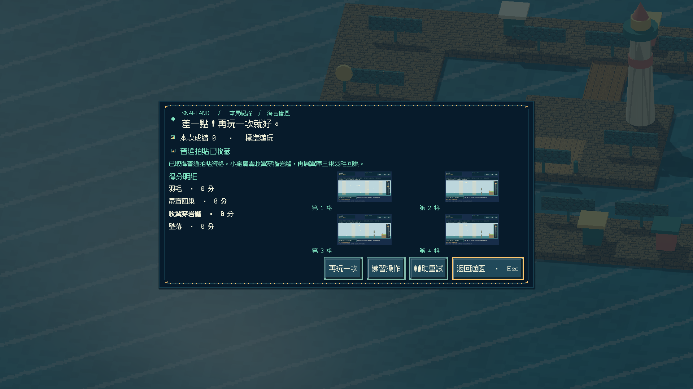
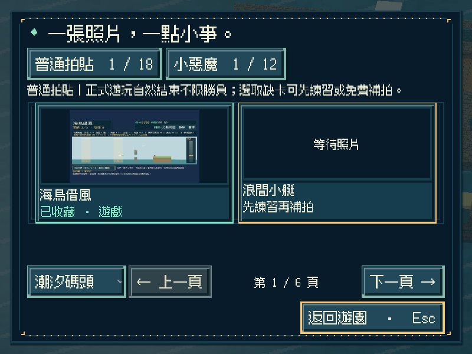
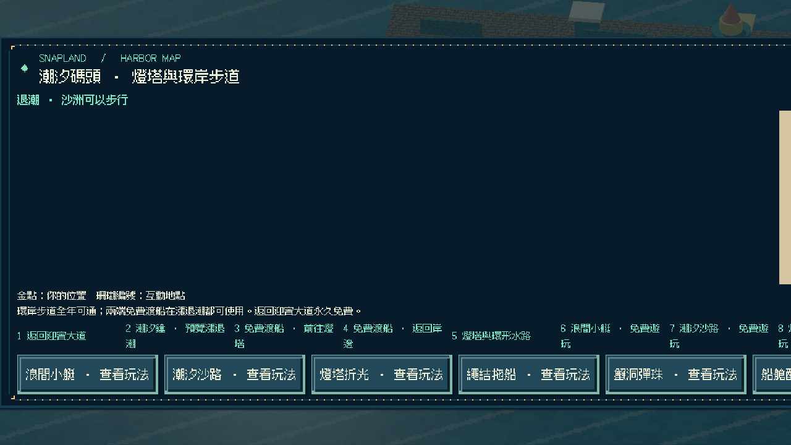
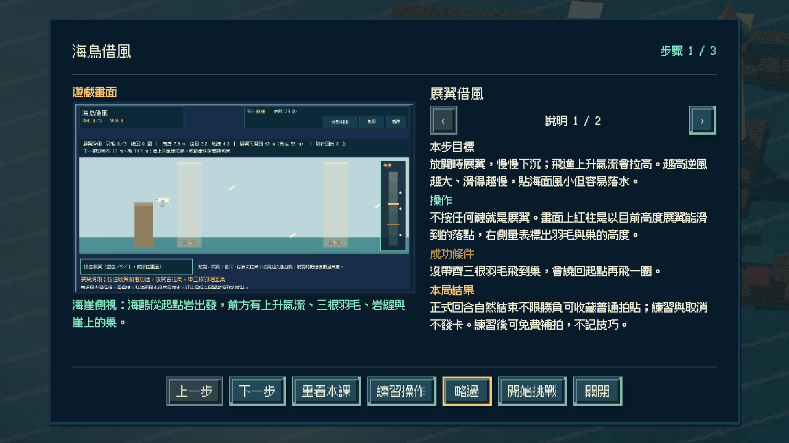

# [SG-39] 實作海鳥借風與碼頭收藏

> 狀態：完成

## 內文

### 需求
在潮汐碼頭的海崖邊扮演一隻海鷗側向滑翔：預設展翼慢慢下沉，按住收翼俯衝加速，放開時把速度換成高度。飛得高看得遠但逆風大，貼海面風小卻容易落水；借上升氣流拉高，帶三根羽毛回到崖上的巢。

### 來源
2026-11-13 使用者要求持續完成整個遊戲並自主開票交付。既定第二十三款「海鳥借風」目前只有設計；潮汐碼頭已有第十三至二十二款可玩，參與收藏與免費補拍已通用。

### 驗收條件
- [x] 有獨立的 2.5D 側向滑翔玩法；展翼與短促收翼對同一路線產生可重複的距離與高度差，不以划船、追帆或其他玩法換名代替。
- [x] 翼尖風線顯示當前逆風，畫面標出以目前高度展翼滑翔可到的落點；上升氣流、羽毛、岩縫與巢都看得見。
- [x] 上升氣流、羽毛位置、岩縫高度與巢位隨重試變化；簡單 AI 夥伴只走低風保底路線回巢，不撿羽毛也不代替玩家飛。
- [x] 單人可操作全部流程；首次教學、練習、輔助（墜落回最近上升氣流且保留羽毛）、暫停、失焦、重試與離開正常，按住收翼不會黏住。
- [x] 正常參與到結算可取得普通拍貼，成功或失敗如實記分；收翼穿過岩縫後再展翼帶三根羽毛回巢可取得小惡魔拍貼，輔助不取消資格；練習與中途取消不發獎，可接續免費補拍。
- [x] 新拍貼記在潮汐碼頭第十一格，成就與教學辨認為第二十三款；重播不重複加錢，縮圖與原圖重開仍有效，既有玩法與舊存檔不受損，其他碼頭玩法仍如實顯示準備中。
- [x] 不同視窗、放大文字、降低動態、原生操作與隔離輸出包驗證附票；不能用直接設分或設定完成旗標代替原生操作證據。

### 測試流程
1. 只展翼不收翼飛一圈，核對拿不到羽毛會繞回起點；再用收翼俯衝與放開拉高拿到低處與高處羽毛。
2. 分別從岩柱上方與收翼穿岩縫回巢，核對普通、小惡魔資格與真實成績；展翼擦岩縫、收翼衝巢與落水的原因要明示；暫停及失焦後收翼不黏住。
3. 取得碼頭第十一格拍貼後重播並關閉重開，核對金幣、教學、成就、縮圖與原圖，以及原有內容。
4. 在原生視窗與輸出包用實際指令操作，保存畫面、結果與局部／完整驗證紀錄。

---

# 跟其他票的關係
- Blocks：無
- Blocked by：無
- Related：SG-1、SG-29、SG-38

---

# Commit-1

## 內文

潮汐碼頭東北角新增「海鳥借風」遊戲亭與地圖入口。海鷗預設展翼滑翔、慢慢下沉，按住收翼俯衝加速，放開時把速度換回高度；越高逆風越大、滑得越慢，貼海面風小卻容易落水，上升氣流能把展開的翅膀抬高。同樣的展收翼操作得到同樣的距離差。

帶三根羽毛回到崖上的巢就成功；沒帶齊會繞回起點再飛一圈。岩縫只容收翼穿過，展著翼會擦到，也可以從岩柱上方飛過；收著翼衝巢、落水或撞岩都算墜落並說明原因。畫面有翼尖風線、展翼落點紅柱與高度量表；重試輪替兩組氣流、羽毛、岩縫與巢位；半透明夥伴只走低風保底路線回巢，不撿羽毛。收翼穿過岩縫後再展翼回巢可取得小惡魔。

正常回合結束可收藏碼頭第十一格普通拍貼，成功與失敗如實記分；輔助讓墜落回到最近的上升氣流並保留羽毛，仍保留小惡魔資格。練習與取消不發卡；重播不重複發錢，成就與教學辨認為第二十三款，第二十四款以後仍拒絕。

以實際按鍵完成只展翼繞圈、俯衝拿羽毛、越過岩柱、穿岩縫、逾時、練習與取消，並以展收翼距離差、上升氣流、擦岩縫、收翼衝巢、輔助保留羽毛與夥伴回巢做模型與 Session 驗證；原生三種尺寸含放大文字／降低動態與重開讀檔，獨立資源包從空工作目錄完成全回合與重開，Windows 成品啟動檢查通過。以上是程式化驗收，不代表真人試玩評價。

### 測試結果

| 項目 | 結果 |
|---|---|
| 新增局部 | 借風模型 31、操作 27、畫面 16、Session 23 項 0 失敗；Main 入口／地圖／教學／逾時／練習／越岩柱／輔助小惡魔／重開與原生前置通過 |
| 受影響回歸 | 碼頭十一款 Session、迎賓小遊戲、音訊、補拍、參與收藏、地區旅行、教學、相簿、啟動與主場景整合共 45 項本機通過 |
| Python | 執行時契約、分批與設計驗證 199 項通過；設計五範圍 0 錯誤 |
| 原生尺寸 | 800×600 放大文字＋降低動態（輔助）、1280×720（穿岩縫／越岩柱）、1920×1080（逾時）及重開讀檔 |
| 獨立輸出 | 資源包全回合＋重開 0 ERROR／0 WARNING；Windows 成品 `--smoke-test` 通過 |

### 截圖

