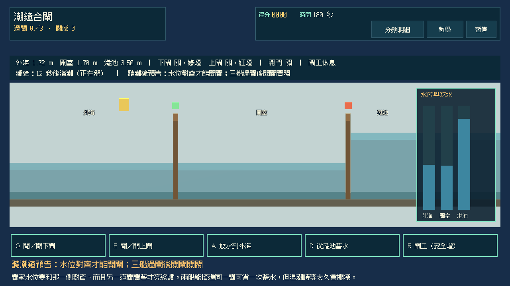
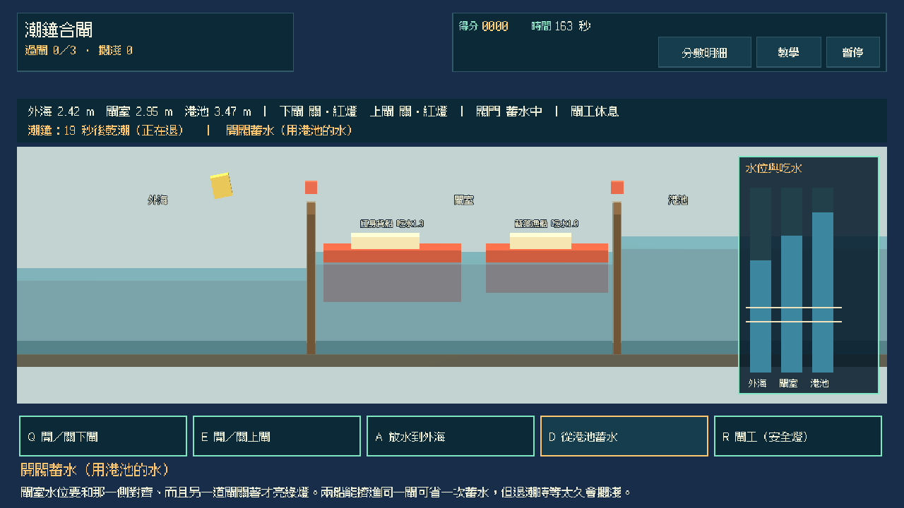
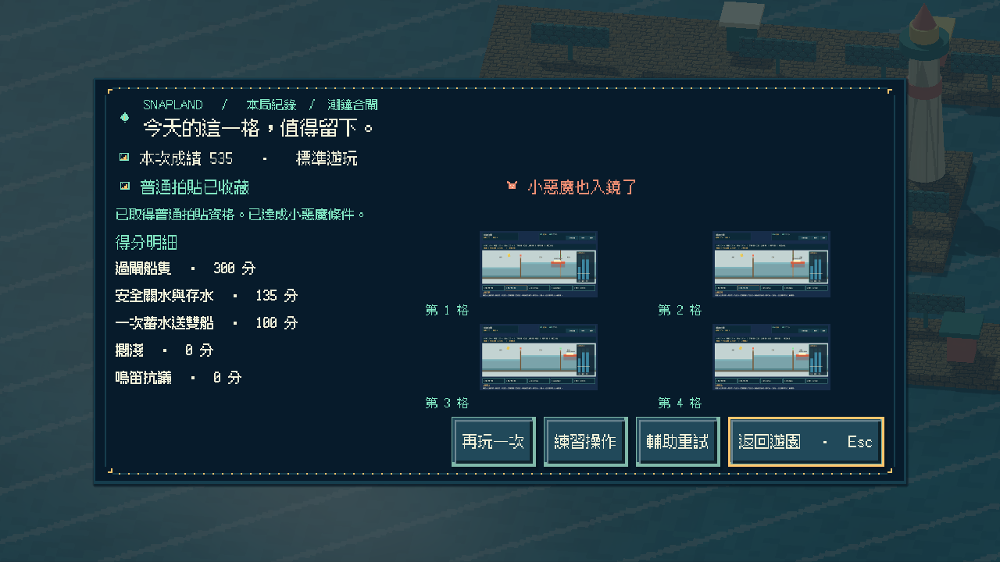
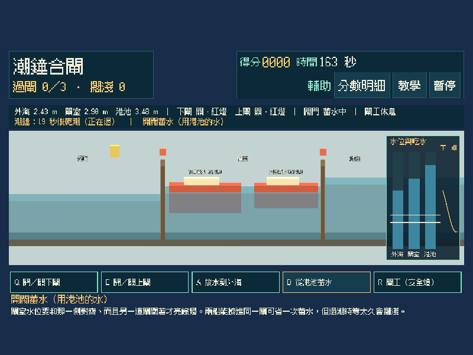
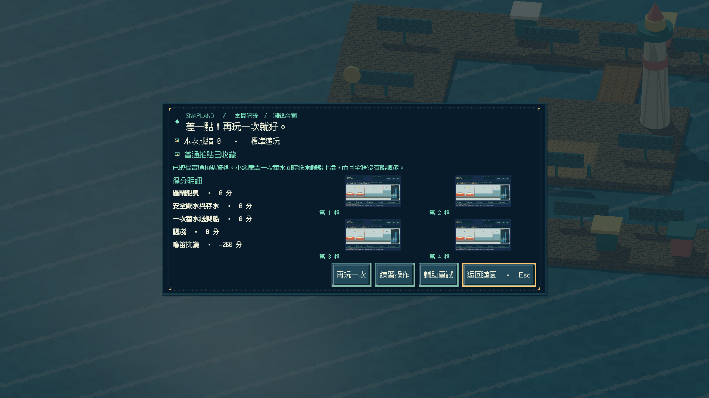
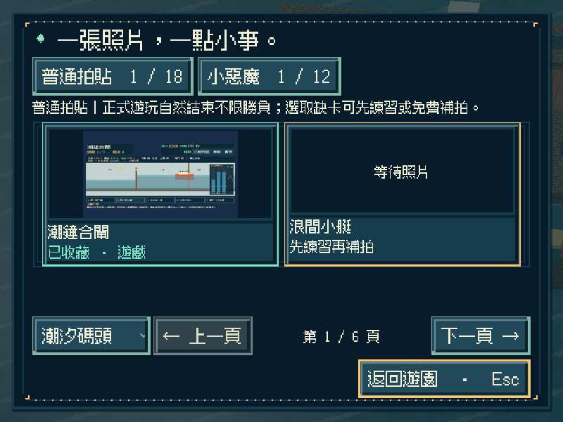
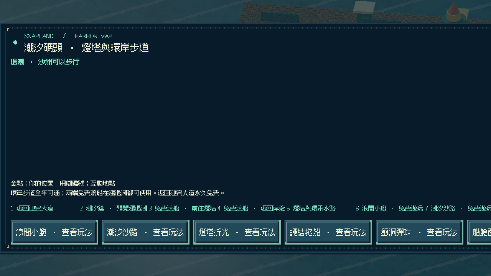
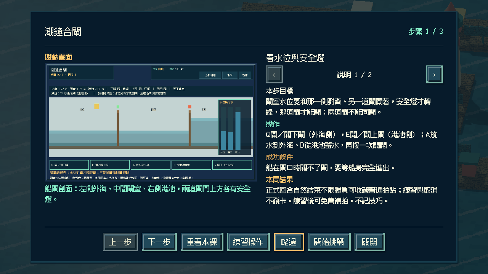

# [SG-40] 實作潮鐘合閘與碼頭收藏

> 狀態：完成

## 內文

### 需求
在潮汐碼頭的船閘當閘工：外海潮位會漲退，港池水位較高。聽潮鐘預告、用閥門把閘室水位對齊外海或港池，輪流開下閘與上閘，讓三艘船過閘上港，最後關好閘門與閥門。兩道閘不能同開；把兩艘船擠進同一閘可以省水，但退潮時等太久會擱淺。

### 來源
2026-11-13 使用者要求持續完成整個遊戲並自主開票交付。既定第二十四款「潮鐘合閘」目前只有設計；潮汐碼頭已有第十三至二十三款可玩，參與收藏與免費補拍已通用。完成後碼頭十二款全數可玩，燈塔資訊仍寫著「其他十一款遊戲準備中」，需同步改成如實內容。

### 驗收條件
- [x] 有獨立的 3D 船閘剖面玩法；兩側水位、閘室水位、門鎖安全燈與潮鐘預告都看得見，不以拖船、配重或其他玩法換名代替。
- [x] 兩道閘任何時候都不能同開；水位不齊、船在閘口或閥門方向不對時拒絕並說明原因；單人可依序完成全部操作。
- [x] 船長、吃水、到達間距與外潮隨重試變化；簡單 AI 閘工只在下閘安全燈亮且有船等候時開下閘，不關閘、不開閥、不開上閘。
- [x] 單人可操作全部流程；首次教學、練習、輔助（取消船隻等候倒數、可預覽下一潮）、暫停、失焦、重試與離開正常，按鍵不會重複觸發。
- [x] 正常參與到結算可取得普通拍貼，成功或失敗如實記分；一次蓄水同時送兩艘船上港且全程沒有擱淺可取得小惡魔拍貼，輔助不取消資格；練習與中途取消不發獎，可接續免費補拍。
- [x] 新拍貼記在潮汐碼頭第十二格，成就與教學辨認為第二十四款；碼頭十二款全數開放後燈塔資訊與「準備中」標示如實更新；重播不重複加錢，縮圖與原圖重開仍有效，既有玩法與舊存檔不受損。
- [x] 不同視窗、放大文字、降低動態、原生操作與隔離輸出包驗證附票；不能用直接設分或設定完成旗標代替原生操作證據。

### 測試流程
1. 水位不齊時開閘、兩閘同開、船在閘口關閘，核對都被拒絕並說明原因；依序放一艘船上港。
2. 分別一船一閘與兩船一閘完成，核對普通、小惡魔（不擱淺）資格與真實成績；退潮時讓船在閘室久等，核對擱淺；暫停及失焦後按鍵不重複。
3. 取得碼頭第十二格拍貼後重播並關閉重開，核對金幣、教學、成就、縮圖與原圖、燈塔資訊，以及原有內容。
4. 在原生視窗與輸出包用實際指令操作，保存畫面、結果與局部／完整驗證紀錄。

---

# 跟其他票的關係
- Blocks：無
- Blocked by：無
- Related：SG-1、SG-29、SG-39

---

# Commit-1

## 內文

潮汐碼頭東南角新增「潮鐘合閘」遊戲亭與地圖入口，碼頭十二款至此全數可玩。外海潮位會漲退，港池水位較高：用閥門把閘室水位對齊外海或港池，安全燈轉綠才能開那道閘，兩道閘任何時候都不能同開；水位不齊、船在閘口或閥門方向不對時都會拒絕並說明原因。潮鐘在滿潮或乾潮前響起。

船依序從外海駛來，水太淺會停在閘外；閘室水位低於吃水會擱淺，等水位回升才浮起。兩艘船擠進同一閘可以省一次蓄水、多留港池存水，但退潮時等太久就會擱淺。重試輪替兩組船長、吃水、到達時間與外潮；閘工只在下閘安全燈亮且有船等候時開下閘。一次蓄水送雙船且全程不擱淺可取得小惡魔。

正常回合結束可收藏碼頭第十二格普通拍貼，成功與失敗如實記分；輔助取消船隻等候倒數並預覽下一潮，仍保留小惡魔資格。練習與取消不發卡；重播不重複發錢，成就與教學辨認為第二十四款。燈塔資訊原本仍寫著「其他十一款遊戲準備中」，改為依目錄實際開放的款數說明。

以實際按鍵完成逐船過閘、兩船一閘、逾時、練習與取消，並以門鎖拒絕、閘口卡船、擱淺與浮起、閘工權限、鳴笛與輔助預覽做模型與 Session 驗證；原生三種尺寸含放大文字／降低動態與重開讀檔，獨立資源包從空工作目錄完成全回合與重開，Windows 成品啟動檢查通過。以上是程式化驗收，不代表真人試玩評價。

### 測試結果

| 項目 | 結果 |
|---|---|
| 新增局部 | 合閘模型 34、操作 28、畫面 15、Session 24 項 0 失敗；Main 入口／地圖／教學／逾時／練習／逐船過閘／輔助小惡魔／燈塔資訊／重開與原生前置通過 |
| 受影響回歸 | 碼頭十二款 Session、迎賓小遊戲、音訊、補拍、參與收藏、地區旅行、教學、相簿、啟動與主場景整合共 46 項本機通過（音訊逾時與教學分頁溢出各修正或單獨重跑後通過） |
| Python | 執行時契約、分批與設計驗證 199 項通過；設計五範圍 0 錯誤 |
| 原生尺寸 | 800×600 放大文字＋降低動態（輔助）、1280×720（兩船一閘／逐船過閘）、1920×1080（逾時）及重開讀檔 |
| 獨立輸出 | 資源包全回合＋重開 0 ERROR／0 WARNING；Windows 成品 `--smoke-test` 通過 |

### 截圖

