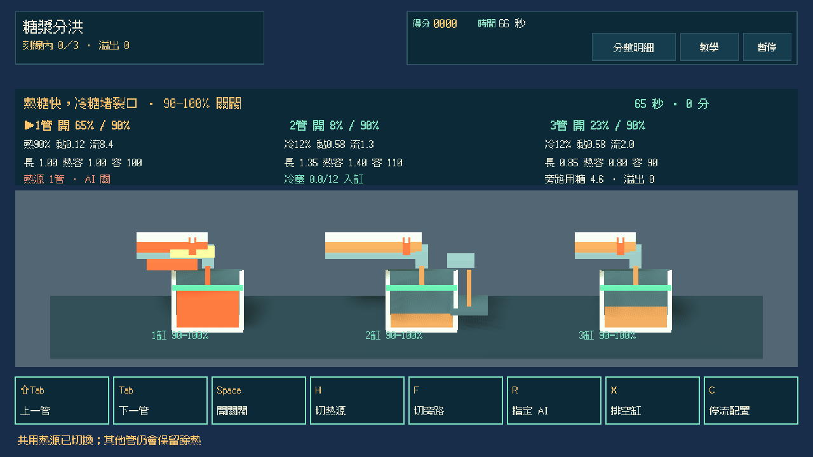
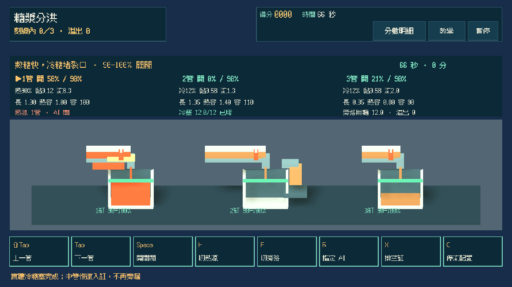
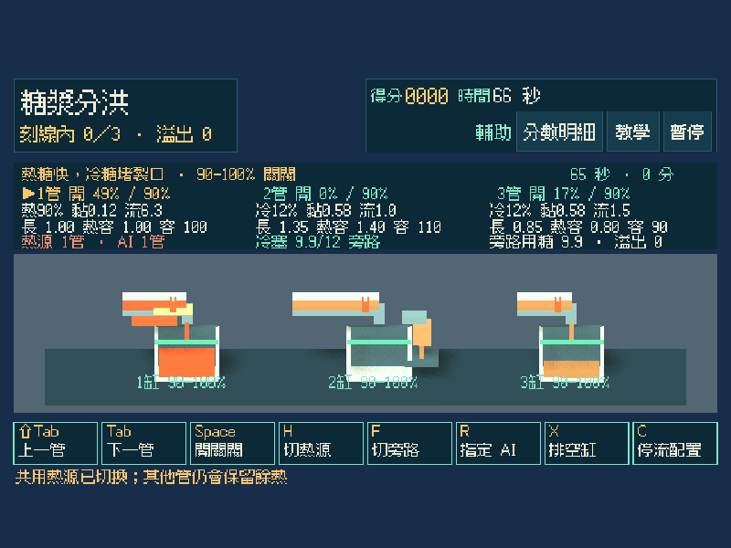
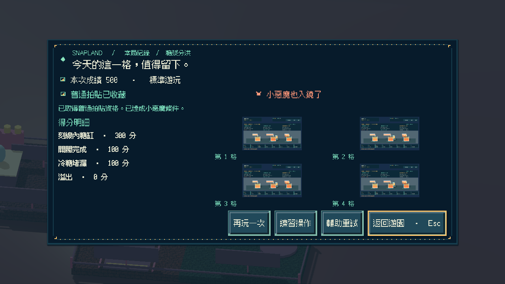
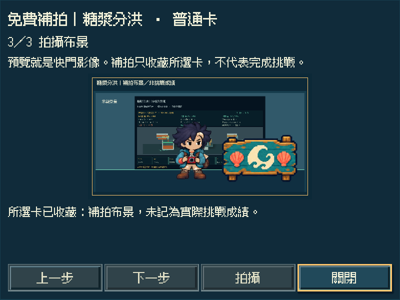
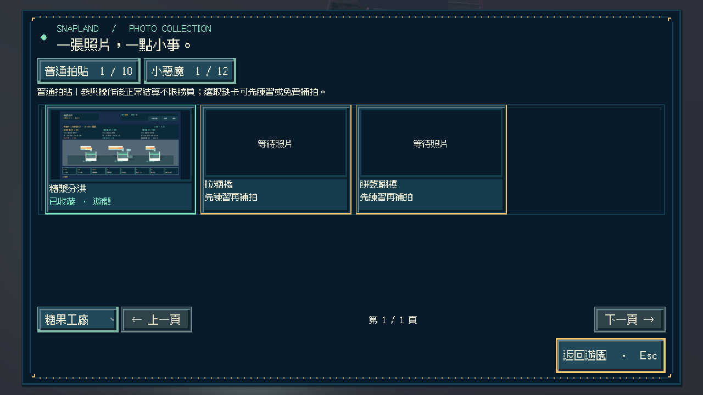

# [SG-43] 實作糖漿分洪與冷糖堵漏

> 狀態：完成

## 內文

### 需求
新增糖果工廠第三款基本遊戲「糖漿分洪」。玩家控制三條支管的閥門與共用熱源，以溫度、黏度與流量的取捨裝滿三缸；保留冷糖可真實堵住旁漏，再完成整局取得小惡魔條件。管長與熱容量變化影響操作，不以換題材或直接指定成功取代玩法。

### 來源
2026-11-18 使用者要求持續處理所有票，並增加不同玩法避免重複；既有 128 款目錄的 game-027 設計，接續已交付的拉糖橋與餅乾翻模。

### 驗收條件
- [x] 真實操作閥門與共用加熱支管，三缸液面、流速及溫度可見；相同開閥時間有實際冷熱流量差。
- [x] 三缸達刻線且關閥才成功；溢出、逾時及重做如實處理，不操作不自動通關。
- [x] 冷糖實際流入旁漏並堵住一次，且完成三缸才有小惡魔資格；單靠切換或等待不能領取。
- [x] 管長及熱容量有不同重玩配置；單人可獨立完成，簡單 AI 僅協助關指定閥，輔助保留完整核心操作與收藏資格。
- [x] 鍵盤、指標與觸控可用，有精簡操作引導及必要 hover，三種尺寸與放大文字可讀，暫停、失焦、重試及離場安全。
- [x] 工廠入口、地圖、教學、結算及收藏可實際走通；第三格固定身分、練習／取消不發卡、去重、補拍與保存重開正確。
- [x] 局部規則、輸入、視圖及整合檢查通過，保存原生截圖與獨立存檔紀錄，逐票提交並同步 main。

### 測試流程
1. 由工廠或區域地圖進入教學及正式遊戲，操作熱源與閥門，對照冷熱流速、液面及管道配置。
2. 分別完成普通裝缸及冷糖堵漏後裝缸，核對真實成功、溢出重做、逾時、輔助及 AI 邊界。
3. 檢查不同輸入及三種視窗、暫停重試、練習取消、收藏補拍與新程序保存重開；腳本驗證不描述為真人試玩或試聽。

---

# 跟其他票的關係

- Blocks：無
- Blocked by：MAIN-34
- Related：SG-41、SG-42、MAIN-26、MAIN-27

---

# Commit-1

## 內文

工廠新增第三款基本遊戲「糖漿分洪」。玩家切換共用熱源與三條支管閥門，讀取溫度、流量及液面；保留冷糖實際堵住旁漏，再把三缸裝至刻線並關閥，才能取得小惡魔。管長與熱容量交替，單人可停流配置，簡單 AI 僅協助關指定閥；溢出可排空補救，時間不回復。

實際可玩基本遊戲由 26 增至 27，工廠由 2 增至 3；入口、地圖、三頁圖解、練習、正式／輔助結算、第三格收藏及免費補拍均已接通。三張教學圖取自真實原生操作。練習與取消不發卡，重玩不重複領取首局獎勵；補拍原圖與來源在後續挑戰、新程序重開保持一致。

### 測試結果

| 項目 | 結果 |
|---|---|
| 規則、輸入、畫面與回合 | 分別 308、96、104、46 項通過；不同配置、輔助與真實冷塞路徑成立 |
| 玩法與局部流程 | 23 組選定流程通過，含既有兩款工廠遊戲及收藏接縫 |
| 三尺寸與兩種補拍 | 七組原生寫入／新程序讀取通過，含 800 大字／降低動態與五頁規則 |
| 獨立 Windows 包 | 實際執行檔寫入及新程序讀取通過，來源、原圖與執行檔雜湊一致 |
| 完整原生證據 | 16 個程序、194 張原圖、24 次自然結算，0 ERROR／洩漏訊息 |
| 最新共用規則接縫 | 27 款 × 三尺寸 × 五種持有狀態 × 五頁，共 2025 頁通過；既有餅乾流程通過 |
| 設計與連結 | 局部驗證通過 |

原生紀錄使用獨立存檔，僅入園所需六張迎賓卡與已看開場是明示的合成前置；工廠入口採受控站位後實際互動，不當作步行證據。新玩法狀態、成績、冷塞、照片與獎勵由真實輸入及自然結算產生。一般遊戲拍貼沿用最近一次完成的畫面更新；補拍原檔另外驗證不被後續挑戰覆寫。這些是腳本、數值、原生畫面與保存驗證，不當作真人試玩或試聽；完整套件交 CI。

### 截圖

[原圖、檢查、來源雜湊與審查紀錄](images/SG-43-evidence.zip)
