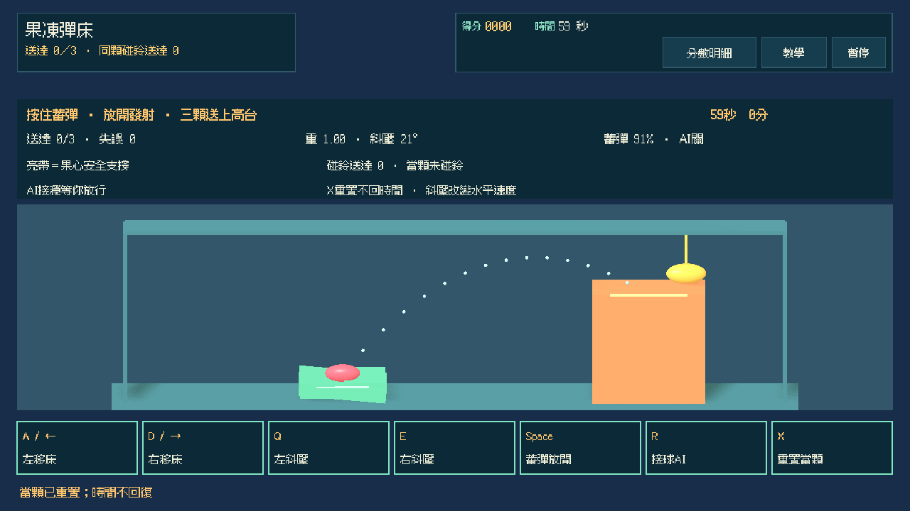
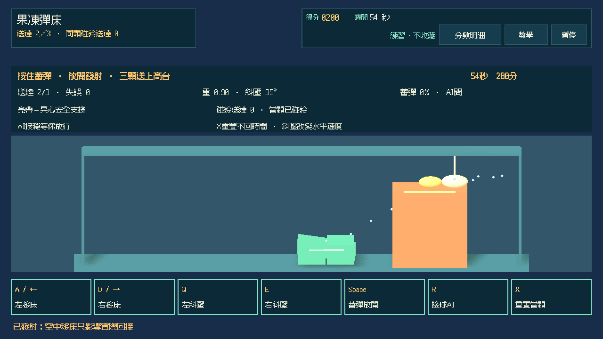
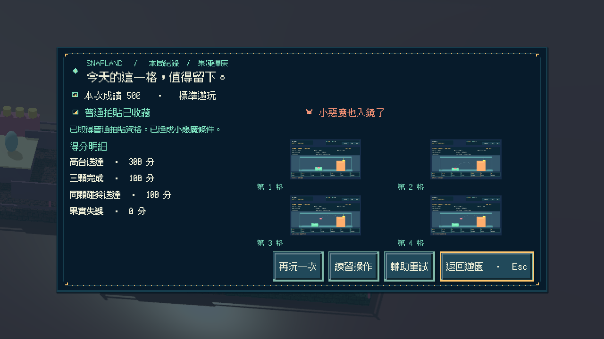
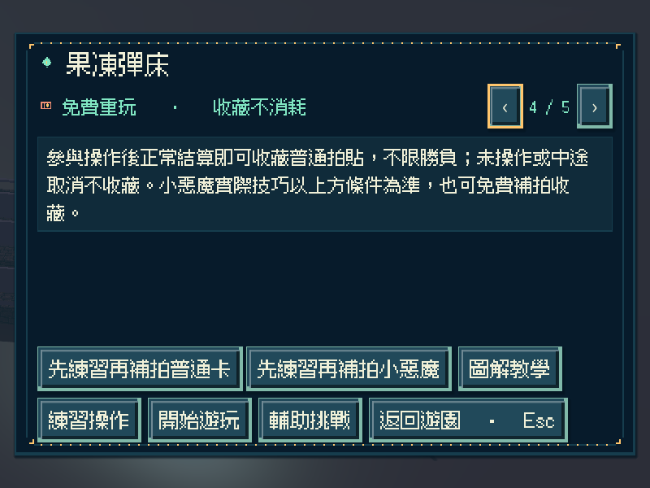
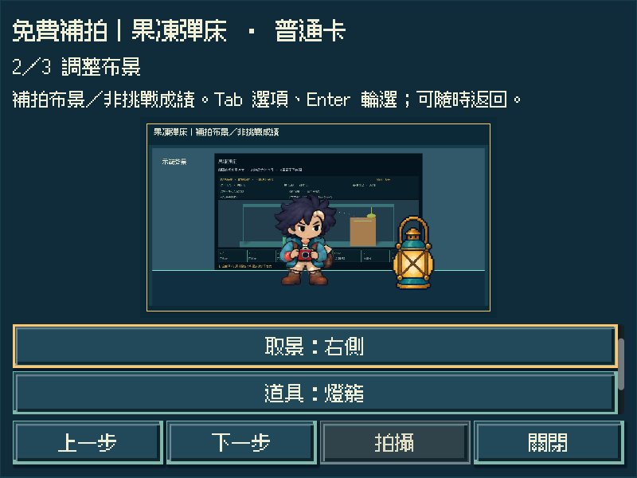
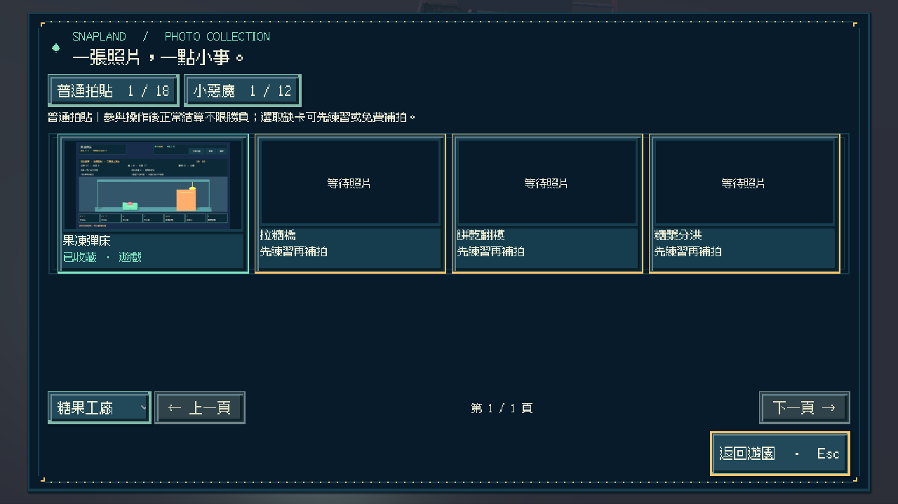
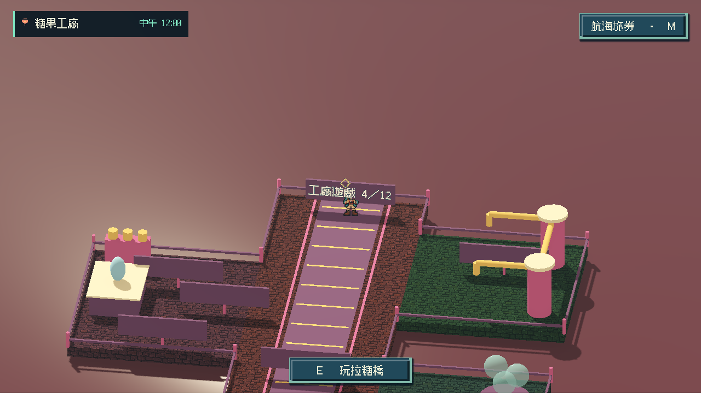

# [SG-44] 實作果凍彈床與斜壓側鈴

> 狀態：完成

## 內文

### 需求
新增糖果工廠第四款基本遊戲「果凍彈床」。玩家移動彈床並按住蓄彈，以深壓高跳或淺壓穩落把三顆果實送上高台；斜壓要真正改變水平飛向，碰響側鈴後仍須完成運送，才能取得小惡魔條件。果重與台高改變操作，提供與既有工廠遊戲不同的空間、彈性及落點玩法。

### 來源
2026-11-18 使用者要求持續處理票並增加多樣化內容，避免反覆做同一件事；既有 128 款目錄的 game-028，接續已交付的糖漿分洪。

### 驗收條件
- [x] 移動彈床、按住蓄彈與放開發射可真實操作；凹陷、果實飛行及落點弧線與操作一致。
- [x] 深淺蓄彈、果重與平台高度影響實際飛行；斜壓改變水平飛向，不只是改高度。
- [x] 三顆果實實際落上高台才成功；側鈴需真實接觸，且碰鈴的果實仍完成運送，才可累積小惡魔資格。
- [x] 失落、逾時、重做與分數如實處理；單人可獨立完成，簡單 AI 只接穩並等待玩家放行，輔助保留蓄彈及斜壓核心操作。
- [x] 鍵盤、指標與觸控可用，具精簡引導及必要 hover；三尺寸、大字、降低動態、暫停、失焦、重試與離場安全。
- [x] 工廠入口、地圖、教學、結算、第四格固定收藏、練習取消、去重、免費補拍及新程序保存重開正確。
- [x] 局部檢查、原生三尺寸與獨立輸出包驗證通過；附原圖及保存紀錄，逐票提交並同步 main。

### 測試流程
1. 由實際工廠入口及地圖開啟教學，移動彈床、調斜壓、蓄彈後放開，對照深淺與左右飛行。
2. 分別完成普通運送、真實側鈴後運送、不同果重與台高、失落、逾時、輔助及 AI 邊界。
3. 檢查三尺寸及輸入方式，重試、練習取消、兩種補拍與新程序重開；腳本和原生畫面不描述為真人試玩或試聽。

---

# 跟其他票的關係

- Blocks：無
- Blocked by：無
- Related：SG-43、MAIN-26、MAIN-27、MAIN-34

---

# Commit-1

## 內文

糖果工廠新增第四款「果凍彈床」，實際可玩基本遊戲由 27 款增加為 28 款。移床、斜壓、按住蓄彈與放開發射共同決定果實飛行；三顆真實落台才成功，碰鈴的同顆果實也送達才取得小惡魔條件。

一般失落會重置運送進度，輔助保留已完成檢查點；重做只重置當顆果實，不回復時間。接球 AI 只接穩並等待玩家手動蓄彈放行。普通、碰鈴、輔助、逾時、練習及取消結果均依實際操作處理。

入口、地圖、三張圖解與逐頁說明、第四組固定收藏及一次性獎勵均已接通。兩種免費補拍使用實際布景與快門影像；之後完成對應挑戰及新程序重開，補拍原圖、取得方式與一次性獎勵保持正確。一般遊玩照片依既有規則更新為最近一次完成的影像。

交付程式：`159ec69`。原圖、執行紀錄、保存來源、審查與各項驗證邊界附於 [完整證據包](images/SG-44-evidence.zip)。

### 測試結果

| 項目 | 結果 |
|---|---|
| 物理與邊界檢查 | 215 項，0 失敗 |
| 輸入與畫面檢查 | 78／83 項，0 失敗 |
| 挑戰流程檢查 | 52 項，0 失敗；15 組局部執行通過，含既有三款工廠遊戲 |
| 局部 Python 與資料檢查 | 98 項及遊戲／連結／執行覆蓋檢查通過 |
| 整合程式 CI | 六項全部通過，保留原始結果 |
| 原生三尺寸 | 1280×720、1152×648、800×600 大字及降低動態通過 |
| 原生與新程序重開 | 16 個程序、438 張原圖；0 ERROR、0 真正洩漏診斷；四組指定補拍通過 |
| 獨立 Windows 執行檔 | 實際執行、保存與另啟程序重開通過 |

以上為腳本、數值及 GPU 畫面驗證；近距離招牌與入口使用已揭露的驗證用定位，不代表真人試玩、試聽或步行抵達。舊有四組故障子程序測試仍保留 CI 覆蓋，未列入本次局部通過數；歷史隔離執行與排除原因一併保存。

### 截圖

證據包：842 個項目、30433613 bytes，SHA256 `7a18683c2faf7c54cc144b082f6659f5b513974ac4c5815e5adfd5f07470ad68`。
