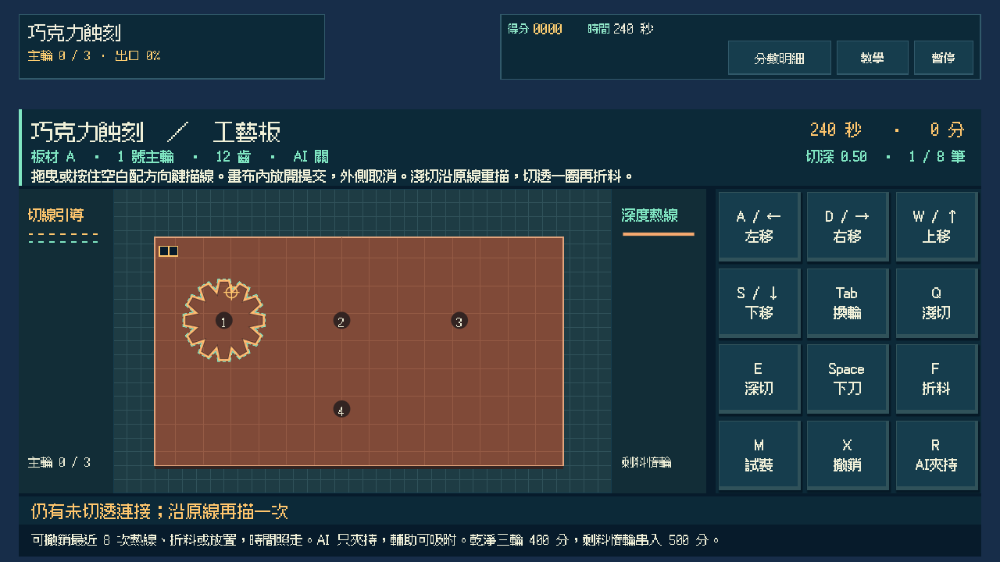
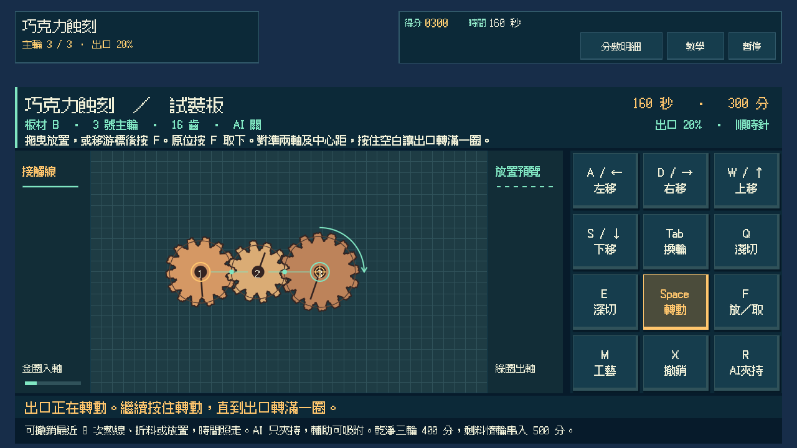
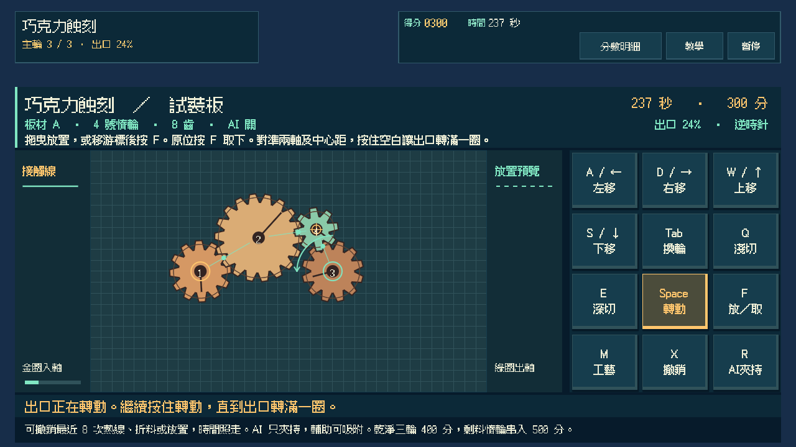
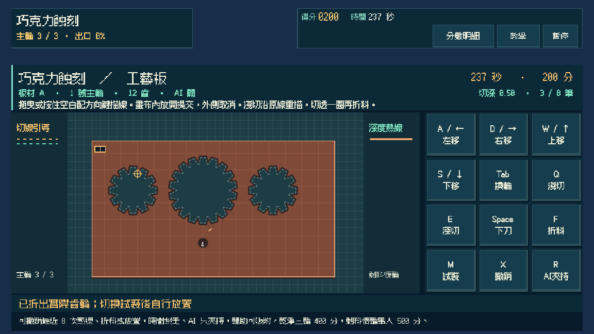
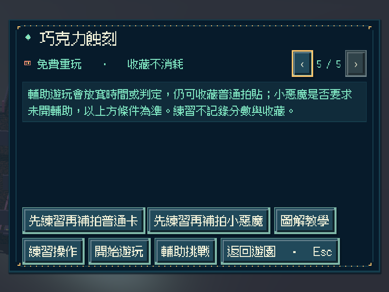
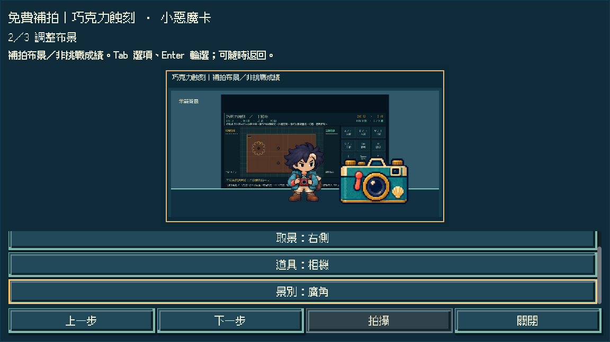
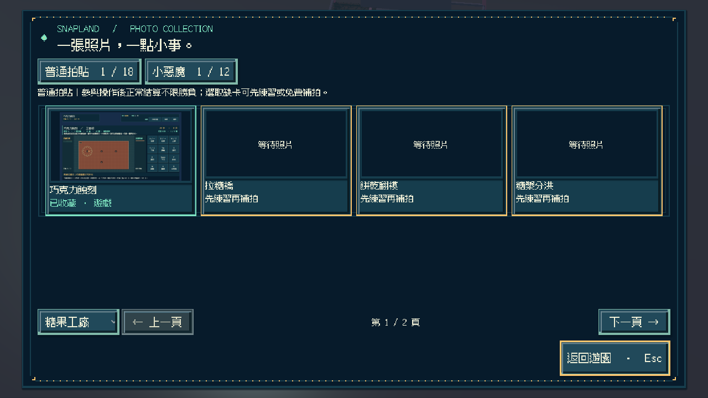
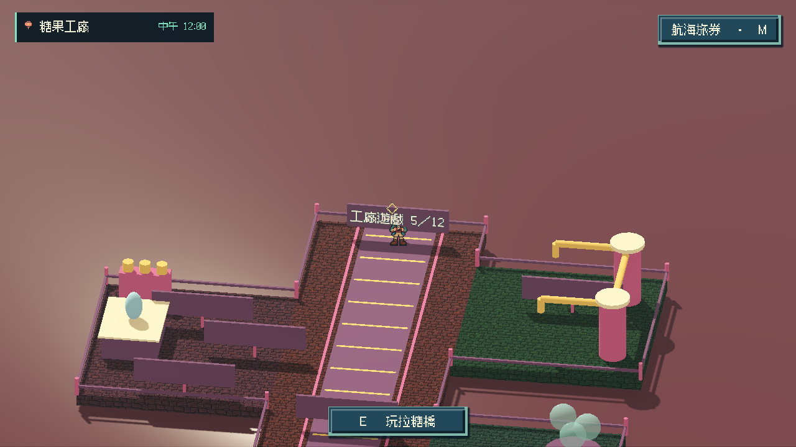

# [SG-45] 實作巧克力蝕刻與剩料惰輪

> 狀態：完成

## 內文

### 需求
新增糖果工廠第五款基本遊戲「巧克力蝕刻」。玩家親自描畫熱線、控制切深並折開板材，做出能相扣傳動的三片齒輪。少切料與保留厚齒形成取捨；輪廓、切深與組裝位置實際影響可拆出與可咬合的結果，提供不同於既有運輸、分流及彈射的工藝與組裝玩法。

### 來源
2026-11-18 使用者要求持續增加多樣遊戲內容、避免反覆做相同操作；既有 128 款目錄的 game-029，接續 SG-44 果凍彈床。

### 驗收條件
- [x] 可實際描畫熱線、控制深淺並折料；未切開的連接不能直接取出，齒形或厚齒保留影響成品。
- [x] 三片齒輪需實際相扣並帶動出口才成功；未拆出、錯位、過薄或不相容的部件不能直接判定成功。
- [x] 至少兩種齒數及尺寸配置可完成；輪廓、切深與試咬合有清楚可讀的回饋，操作不只反覆按確認。
- [x] 剩料可做成第四顆惰輪並真實接入傳動，才取得小惡魔條件。
- [x] 單人可取得普通與小惡魔內容；簡單 AI 只夾持未切側、不代畫線，輔助保留描線、折料及咬合核心並提供吸附與撤銷。
- [x] 鍵盤、指標與觸控可操作，具精簡教學與必要 hover；三尺寸、大字、降低動態、暫停、失焦、重試、失誤及離場正確。
- [x] 工廠入口、地圖、教學、結算、第五組固定收藏、練習取消、獎勵去重、兩種免費補拍及新程序重開正確，保留既有內容與存檔。
- [x] 局部檢查、原生三尺寸及獨立輸出包驗證通過；附原圖、保存紀錄及逐票提交，完成後同步 main。

### 測試流程
1. 從實際工廠入口及地圖開啟教學，描畫不同熱線與切深，觀察完整切開、仍連接與厚齒保留的差異。
2. 以兩種齒數配置拆出、組裝並試轉三片齒輪；比較錯位或不相容情況，再讓剩料惰輪實際參與傳動。
3. 檢查三種輸入、三尺寸與暫停重試、練習取消；分別補拍兩種收藏、完成真實挑戰並另啟程序重開。腳本與畫面檢查不描述為真人試玩或試聽。

---

# 跟其他票的關係

- Blocks：無
- Blocked by：無
- Related：SG-44、MAIN-26、MAIN-27、MAIN-34

---

# Commit-1

## 內文

糖果工廠原有四款遊戲之外，新增可親手描線、控制熱切深度、折料並組裝齒輪的巧克力工藝。基本遊戲增加至 29 款，工廠可玩站點增加至 5／12；128 款候選與固定收藏規則保留。

兩種板材各可完成三輪出口傳動，或從真正剩料取得第四顆惰輪並接入出口路徑。單次淺切保留連接，沿原線重切才能折出；過薄、舊切痕、錯位或不相容部件有對應回饋。微調齒輪不會誤卸下，原位放開保留進度；仍影響剩料的舊切痕在換輪、折料後可見，撤銷會清除。AI 只夾持另一個未切角落，輔助與三種輸入仍須自行切割與組裝。

有效熱切達參與條件後自然結算可收藏普通拍貼；無失誤時，三輪帶動出口轉滿一圈為 400 分，剩料惰輪真正參與傳動為 500 分。練習與取消不發獎勵。工廠入口、地圖、教學、第五組拍貼與成就、40 枚遊園幣去重及免費補拍均完成驗證。

補拍原圖與實際快門 GPU 畫面逐像素相符，完成對應挑戰後與另啟程序讀檔，原圖、縮圖路徑及補拍來源均保留。一般遊玩後仍依原有規則刷新最近遊戲照片，與補拍原圖分別驗證。

### 測試結果

| 項目 | 結果 |
|---|---|
| 玩法、幾何、輸入與畫面局部檢查 | 217／92／33 項全通過 |
| 回合生命週期與自然完成 | 55 項全通過，兩種板材、標準／輔助、普通／惰輪共 8 條路線 |
| 三種輸入完成路線 | 鍵盤、滑鼠、觸控共 24 條通過 |
| 集中邊界回歸 | 舊版 29 項中 9 項失敗；同案例修正後 29 項全通過 |
| 設計與結果契約 | 47＋23 項 Python 測試通過，遊戲與連結驗證通過 |
| 園區、獎勵、收藏及既有內容 | 第五站實際入口、固定獎勵及補拍通過；先前 17 項局部回歸保留原始來源紀錄 |
| 原生三尺寸 | 1280×720、1152×648、800×600；小視窗 1.25 大字與降低動態，五頁規則及全部教學正文通過 |
| GPU 補拍與重新啟動 | 普通與惡魔四組指定尺寸通過，逐像素與來源保存通過 |
| 獨立 Windows 驗證輸出 | 實際執行檔寫入與讀取通過，未指定外部專案或場景 |
| 最終原生程序 | 八組寫入／新程序讀取，共 16 個程序全通過；成功標記各一次，零錯誤與資源洩漏診斷 |
| 最終整體審查 | 五項原始問題均修正，複審可合併 |

以上為腳本操作、資料檢查與單機 GPU 畫面驗證，不描述為真人試玩、試聽、實體觸控或步行入場。

[原始證據與來源對照](images/SG-45-evidence.zip)：1,948 個項目，66,718,046 bytes，SHA-256 `b8b9f3cecbe15b2b0219c0e17058d1c1922782b51b4e8404d7b30e4ca6705acd`。較早來源與最終修正後的紀錄分別標示，封存逐檔雜湊與完整性檢查通過。

### 截圖

