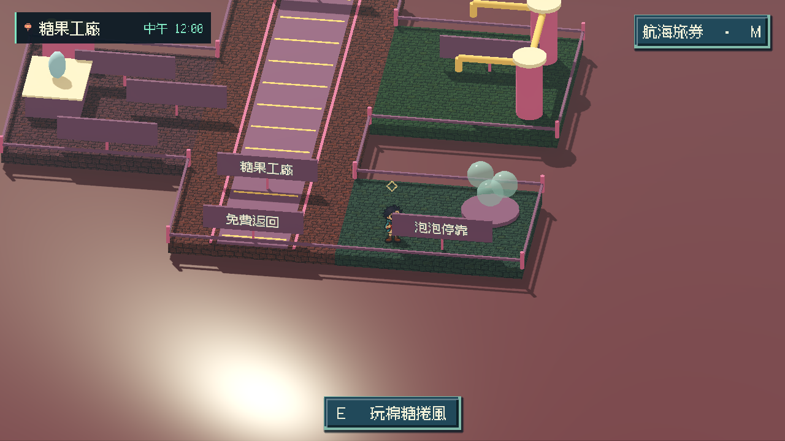
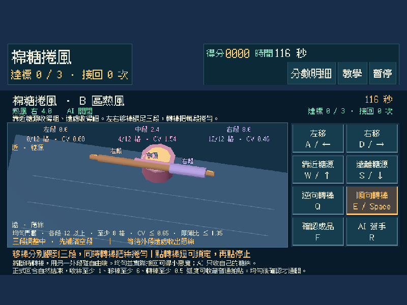
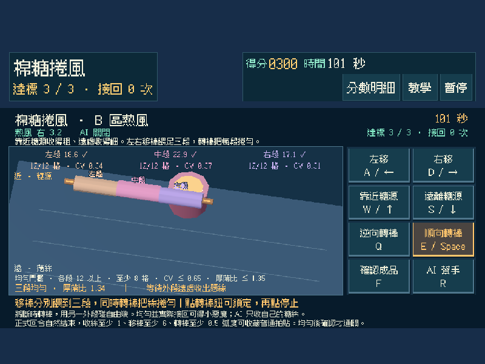
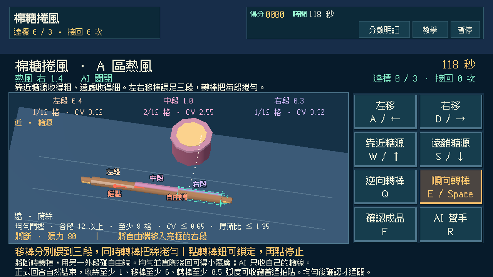
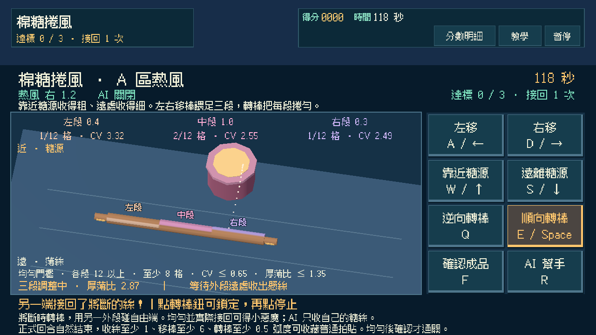
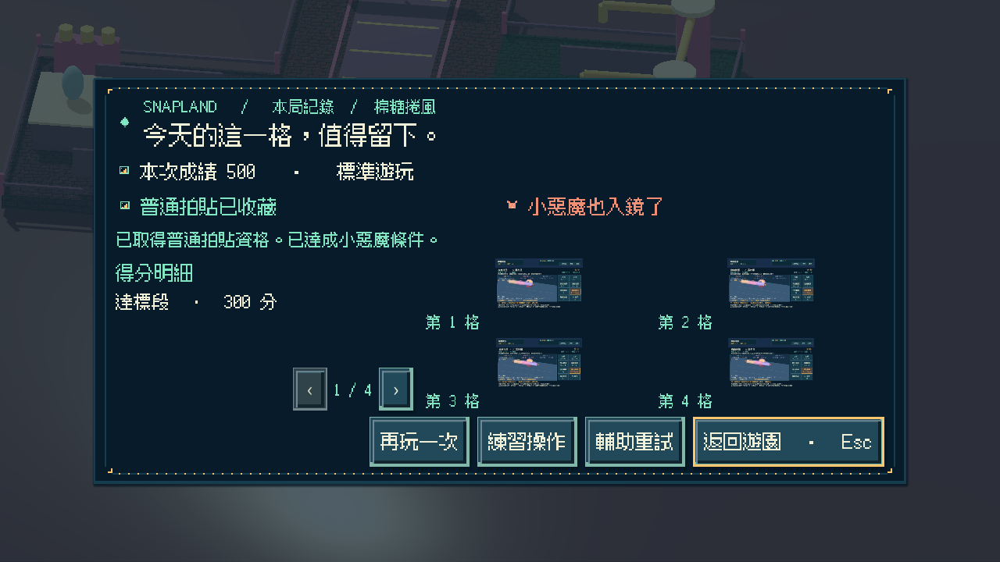
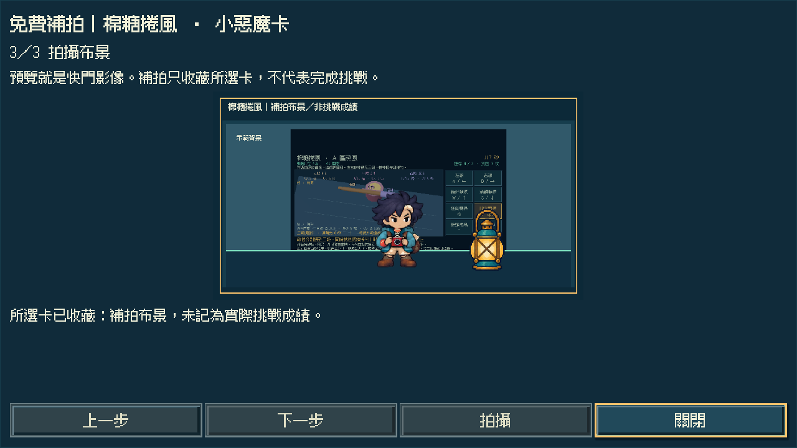
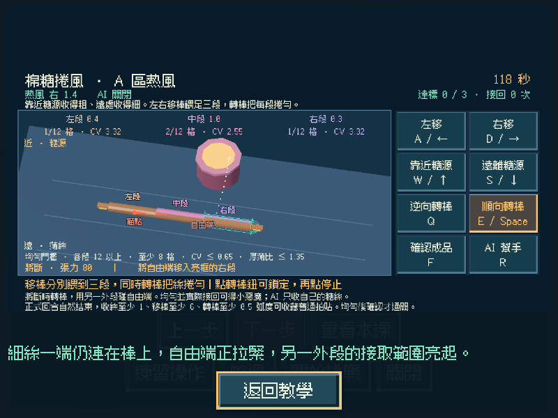

# [SG-47] 實作棉糖捲風與斷絲接回

> 狀態：完成

## 內文

### 需求
將糖果工廠第六款候選「棉糖捲風」做成可實際操作的 3D 小遊戲。玩家觀察熱風與絲流，轉棒並左右、近遠移動，讓棒上三段棉糖均勻成形；貼近快收、離遠拉細形成取捨。小惡魔要求把真正將斷的細絲接回棒的另一端，延伸同一套收絲操作。

### 來源
2026-11-18，使用者要求持續完成票並增加不同玩法，減少重複操作；既有候選目錄 game-030 的轉棒、移近遠、三段均勻、低密度 AI 與斷絲接回規格。

### 驗收條件
- [x] 工廠可進入第六款，原有入口、收藏與存檔持續可用。
- [x] 實際 3D 絲流、轉棒與左右／近遠移動共同決定三段厚薄，無法靠靜置或單按完成跳過收絲。
- [x] 貼近快收與離遠拉細可觀察；兩種熱風／絲束變化、輔助與低密度區 AI 均可實際操作。
- [x] 小惡魔須把實際將斷細絲接到另一端；輔助不省略轉棒、移動與接回。
- [x] 鍵盤、滑鼠與單指觸控可完成普通與小惡魔操作；暫停、失焦、取消及離場停止持續操作。
- [x] 三段狀態、時間、規則、精簡提示與原始操作教學在三種驗證視窗均完整可讀。
- [x] 正式參與、成功、小惡魔、練習、取消與補拍沿用既有收藏規則，重啟後保存正確且不重複發獎。
- [x] 完成局部自動驗證、原生圖形與獨立封裝驗證，保存原始畫面與可核對紀錄。

### 測試流程
1. 使用獨立存檔進入工廠並實際互動，觀察絲流，轉棒與平移收出三段棉糖；比較近遠收絲及不轉棒／不平移的結果。
2. 在兩種熱風與一般／輔助設定下操作普通與斷絲接回，切換 AI；以鍵盤、滑鼠、觸控事件驗證持續操作與中斷。
3. 檢查三種視窗的操作畫面、規則與教學；完成正式回合、練習、取消與補拍，再以新程序確認收藏及獎勵。

---

# 跟其他票的關係

- Blocks：無
- Blocked by：無
- Related：無

---

# Commit-1

## 內文

糖果工廠開放第六站「棉糖捲風」，全園共有 30 款可玩小遊戲。轉棒、左右與近遠移動會改變三段糖絲的實際重量與厚薄。近處收得快且厚，遠處可取細絲，玩家可從熱風、三段讀數與將斷張力判斷下一步。

正式回合必須親自轉棒、移動並收絲，正常結算才有普通拍貼資格。小惡魔須真的用另一外段接回將斷的絲，再讓三段均勻並確認成品。練習與取消不發卡。補拍保留所選卡的原圖與來源，之後真實挑戰也不覆寫補拍，一款仍只發一次 40 點。

### 測試結果

| 項目 | 結果 |
|---|---|
| 五組 Godot 聚焦檢查 | 模型 99、操作 62、無視窗呈現 7、回合 98、主遊戲 70，合計 336 項通過 |
| 操作與玩法 | 模型 8 路徑，Driver 與 Session 各 24 路徑通過。普通 400、小惡魔 500。測得收絲位置、將斷張力、另一端接回與材料守恆 |
| 原生寫入及新程序讀檔 | 三種尺寸、四組真實補拍與一組封裝共 8 組配對通過。三種尺寸皆檢查 1.25 倍文字與降低動態 |
| 補拍與收藏 | 四組快門原圖逐像素相等，320×180 縮圖可解碼。重玩與讀檔後原圖、路徑、來源、成就及單筆 40 點正確。正常挑戰仍會更新最新遊戲自拍畫面 |
| 原有內容 | 既有五個工廠入口、收藏、教學、參與規則與巧克力蝕刻代表性回歸通過。設計與 Python 契約檢查通過 |
| 最終修正 | 9a15daf 複審通過。原生工作台 71 項、800×600 寫入 1,279 項與讀回 38 項全過，三張完整放大圖說均可閱讀及還原焦點。九組啟動前與兩組場景拒絕保護通過 |
| 封裝與日誌 | Godot 4.7.2，新建內嵌 Windows EXE 實際寫入 1,116 項、獨立讀回 38 項通過。兩程序退出碼 0，引擎原始日誌及未抑制的 UTF-8 標準輸出／錯誤紀錄均無 ERROR 或資源洩漏診斷 |

原生操作使用實際 GUI 事件與受控時間步進。只設定獨立測試存檔的入園前置及角色站位，再以 E 進入。驗證範圍涵蓋腳本操作、GPU 畫面與封裝重啟讀檔。真人試玩、實體觸控及聽感另行驗收。

### 截圖

[原始畫面、執行紀錄與來源指紋](images/SG-47-evidence.zip)。671 項，25,426,929 bytes，SHA-256 `35dfc1327f71bf638b3d6d7f9f8690bd9e4ef79fe8c3be94eee4136ae5f317a9`。逐項檔案雜湊與解壓完整性通過。正本原始執行與最終修正的補充證據分開保存。
