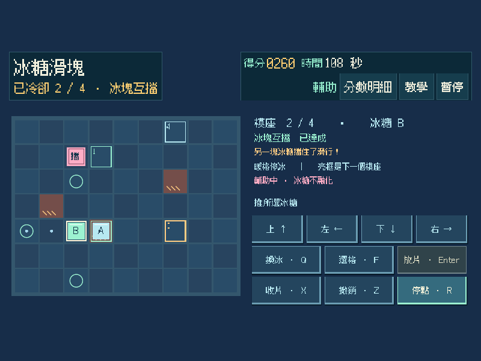

# [SG-49] 實作冰糖滑塊與冰塊互擋

> 狀態：完成

## 內文

### 需求

開放糖果工廠第八站「冰糖滑塊」。玩家可推動兩塊冰糖，借冰面長滑、暖格減速及可回收擋片，依亮起順序冷卻四個模座。小惡魔需讓一塊冰糖實際擋停另一塊。

### 來源

2026-11-25 使用者要求持續完成票並增加玩法多樣性。候選目錄 game-032 已定義冰面預判、可回收擋片、溫區變化、四模座和冰塊互擋。

### 驗收條件

- [x] 從工廠設施與地圖可進入，既有七站與收藏正常。
- [x] 冰糖依冰面、暖格、邊界及擋片停下。四模座要依序實際接觸才通關。
- [x] 至少兩種溫區與模座路線，可回收擋片，冰糖互擋的判定可見。
- [x] 輔助取消融化、提供一步撤銷。AI 可預覽擋停位置，普通與小惡魔皆可用輔助取得。
- [x] 鍵盤、滑鼠與單指可操作，暫停、重試、取消沿用既有行為。畫面提供精簡 Hover 與實際遊戲截圖教學。
- [x] 第八格兩張拍貼與成就沿用正常參與、成功、補拍和練習規則，舊存檔與重開正常。
- [x] 通過局部測試與原生驗證，票內只存代表截圖及摘要。

### 測試流程

1. 進入工廠第八站，推動兩塊冰糖，觀察冰面、暖格與擋片改變停點。
2. 冷卻四個亮起模座，再重玩另一種溫區。以冰塊實際擋停另一塊取得小惡魔。
3. 驗證輔助撤銷、三種輸入、教學、暫停、取消、收藏與重開。

---

# 跟其他票的關係

- Blocks：無
- Blocked by：無
- Related：無

# Commit-1

## 內文

糖果工廠開放第八站「冰糖滑塊」。推動 A、B 兩塊冰糖時，冰面會長滑，暖格會停冰，擋片可回收換位。四座模座依序亮起，滑過亮框即可冷卻。兩個布局採不同暖格及末座方向，可用擋片精準停住，也可只靠兩塊冰糖與長滑解開。

小惡魔要求一塊冰糖先實際移動，再被另一塊擋停。一般模式個別顯示兩塊冰糖的熱度。輔助取消融化、延長回合並能撤銷上一步，AI 可預覽停點。一般與輔助皆驗證可達成兩種拍貼條件。

### 測試結果

| 項目 | 結果 |
|---|---|
| 玩法及回歸 | 七組聚焦 Godot 檢查通過，含兩個布局的普通與小惡魔路線、兩條無擋片解法、暖格融化、撤銷、逾時、其他工廠遊戲及補拍。215 項 Python 和五組設計驗證通過。 |
| 原生流程 | 800×600、1280×720、1920×1080 分別通過 153、144、144 項，重開讀回分別通過 23、23、23 項。涵蓋實際入口、地圖、圖解、1.25 倍文字、鍵盤、滑鼠、單指事件與暫停取消。 |
| 舊檔及補拍 | 舊檔相容 15 項。保留第七站原圖與點數。第八站補拍 79 項，實際快門與存下的原圖逐像素一致，正式挑戰和重開後仍保留原始來源。 |
| Windows 封裝 | 獨立內嵌 EXE 實際寫入 144 項、另一程序讀回 23 項皆通過。 |

驗收採隔離存檔與實際原生圖形，使用腳本輸入。首區收藏只用於配置入園前置。票內保留一張代表截圖（15,722 bytes），完整紀錄保留於本機隔離驗證目錄。

### 截圖

