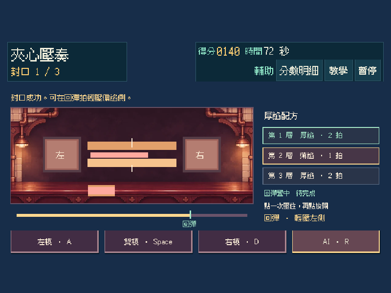

# [SG-50] 實作夾心壓奏與回彈置中

> 狀態：完成

## 內文

### 需求

開放糖果工廠第九站「夾心壓奏」。玩家依畫面節拍按壓與放開左右模具，完成三層夾心餅乾。短壓薄餡和長壓厚餡使用不同釋放時機，空拍須讓模具回彈。小惡魔要利用回彈從正確一側把偏移的餡推回中央。

### 來源

2026-11-25，使用者要求接續糖果工廠下一款並增加不同玩法。候選目錄 game-033 定義雙側按壓與空拍、短長壓、偏餡、回彈置中及單人輔助。

### 驗收條件

- [x] 從工廠與地圖進入第九站，原有八站與收藏正常。
- [x] 真實按住與放開決定薄厚餡及成敗，空拍、雙側同步與溢餡有可見回饋。兩個配方以不同壓拍順序和回彈方向改變做法。
- [x] 小惡魔要求正確側、回彈拍及夾心實際置中。
- [x] 靜音時可看提示完成。輔助放寬時機並可切換代替長按，AI 只跟隨玩家壓另一側。
- [x] 鍵盤、滑鼠、單指與取消／失焦／暫停可操作，圖解和 Hover 說明短而清楚。
- [x] 第九格拍貼、成就、實際參與、補拍、舊存檔及重新開啟沿用既有規則。
- [x] 局部、原生及封裝驗證通過，PM 只保留代表截圖與摘要。

### 測試流程

1. 從工廠開始標準及輔助回合，依視覺完成長短拍和空拍。
2. 重玩另一配方，比較左右回彈與不同放開時機。以正確與錯誤的側壓分別驗證小惡魔。
3. 驗證三種輸入、暫停與取消、兩種拍貼及補拍重開。

---

# 跟其他票的關係

- Blocks：無
- Blocked by：無
- Related：無

# Commit-1

## 內文

開放工廠第九站「夾心壓奏」。兩種配方交替使用不同拍速與薄厚順序。模具按壓、放開與留空會改變實際餡層。小惡魔要求三層封口，並至少把一層偏餡在回彈拍推回中心。輔助可點按切換並放寬判定，AI 只在合模時補壓右側。

### 驗證摘要

- 10 組 Godot 局部回歸、215 項 Python 檢查及五組設計驗證通過。
- 800×600、1280×720、1920×1080 的原生流程通過 135、126、126 項，另開程序讀回通過 23、23、23 項。涵蓋入口、地圖、三張圖解、靜音、1.25 倍文字、三種輸入、輔助及暫停取消。
- 既有第八站存檔通過 15 項。第九站補拍與讀回各通過 72、19 項，存下的原圖與快門結果逐像素相同，正式挑戰保留補拍來源。
- Windows 內嵌 EXE 在隔離存檔完成 126 項，另開程序讀回 23 項。

原生流程使用腳本輸入。PM 保留一張代表截圖（54,766 bytes），烘焙台背景使用 gpt-image 製作。

