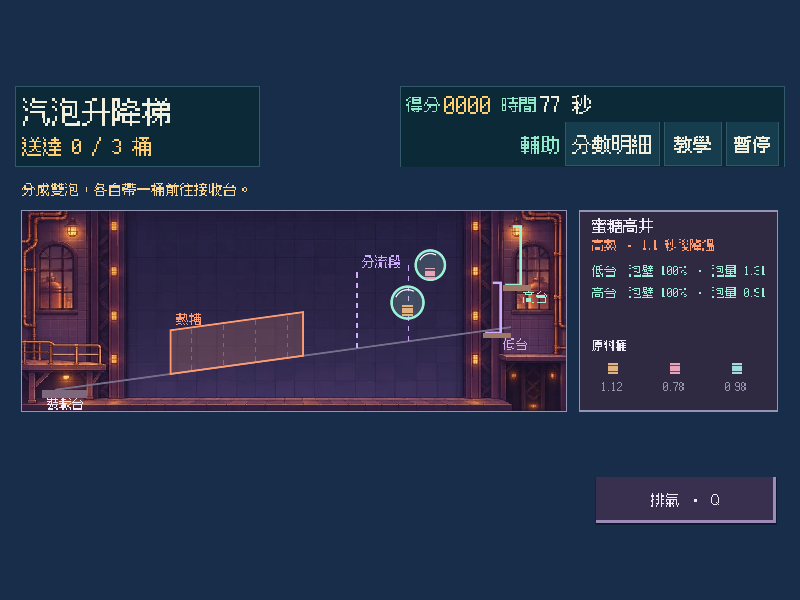

# [SG-52] 實作汽泡升降梯與分泡運送

> 狀態：完成

## 內文

### 需求

開放糖果工廠第十一站「汽泡升降梯」。玩家裝載原料桶，踩泵調整泡量，判斷熱槽週期後放出乘籃。每桶重量會改變升速。小惡魔挑戰要求在分流段把載兩桶的大泡分成雙泡，讓兩桶分別抵達接收台。

### 來源

2026-11-26，使用者要求接續糖果工廠小遊戲。設計目錄 game-035 規劃踩泵、載重、熱槽、分裂雙泡與單人輔助。

### 驗收條件

- [x] 工廠與地圖可進入第十一站，原有十站與收藏維持可用。
- [x] 桶重、泵量、排氣與熱槽確實影響升速及破泡。兩種配置需要不同的泵量和放籃時機。
- [x] 運到三桶才通關。同一趟分出的兩泡各送一桶到不同接收台才算小惡魔條件。
- [x] 鍵盤、滑鼠及單指可完成。輔助在泡失效時緩降收回，AI 只在確認裝載並操作踩泵後補泵。
- [x] 有圖解、精簡 Hover 與可辨識的熱槽預告。暫停、失焦及練習取消可安全操作。
- [x] 第十一格拍貼、成就、補拍及舊存檔沿用既有規則，重開可讀回。
- [x] 局部與原生流程通過，PM 只保留必要截圖與摘要。

### 測試流程

1. 從工廠進入，對不同桶重踩泵、放籃和排氣，查看熱槽預告與送達。
2. 重試另一配置，在分流段分泡，確認兩桶各自抵達。
3. 驗證練習退出、補拍、舊檔及重開。

---

# 跟其他票的關係

- Blocks：無
- Blocked by：無
- Related：無

# Commit-1

## 內文

開放工廠第十一站「汽泡升降梯」。玩家依桶重踩泵，判斷泡籃入槽時的熱度，再放籃運送。高熱會耗損泡壁，排氣會降低升速。雙桶在分流段可拆成兩個載桶泡，分別送到高、低接收台。兩台同趟各收到一桶，再送完第三桶可取得小惡魔。輔助會緩降回收失效的泡，AI 隨玩家踩泵補力。

### 驗證摘要

- 12 組 Godot 局部回歸、215 項 Python 檢查與五組設計驗證通過。
- 800×600、1280×720、1920×1080 原生流程通過 170、161、161 項，另開程序讀回通過 23、23、23 項。涵蓋入口、地圖、圖解、1.25 倍文字、靜音、鍵鼠、單指、雙泡及暫停取消。
- 第十站舊檔通過 15 項。第十一站補拍與重開各通過 89、19 項。正式挑戰保留原始補拍來源。
- Windows 內嵌 EXE 用隔離存檔完成 161 項，另一程序讀回 23 項。

原生驗證使用腳本輸入。PM 保留一張代表截圖（113,663 bytes）。廠井背景使用 gpt-image 製作。

