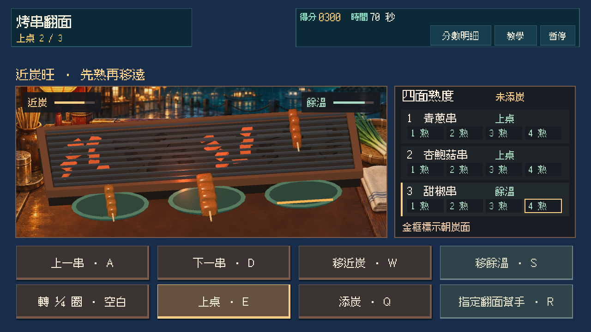

# [SG-55] 實作烤串翻面與餘溫收火

> 狀態：完成

## 內文

### 需求

開放霓虹夜市第二款小遊戲「烤串翻面」。玩家移動三串食材到近炭或餘溫區，逐面翻烤並判斷盛盤時機。熱區可加速，遠炭能安全收火，食材大小與炭火配置影響熟成時間。

### 來源

[小遊戲目錄 game-038](../../design/02-minigames/catalog.md#game-038-烤串翻面) 與 2026-11-26 使用者要求延續夜市玩法、打磨動作和視覺。

### 驗收條件

- [x] 三串各面獨立熟成，旋轉與移動有實際效果，兩種配置提供不同的火力取捨。
- [x] 烤串可從顏色與文字讀取熟度，四面、火區、翻面和盛盤都有簡短操作引導。鍵盤、滑鼠、觸控與手把可完成回合。
- [x] 最後一面確實利用餘溫熟成且未添炭可得小惡魔拍貼；一般和輔助操作可取得兩種拍貼，簡單 AI 只協助指定串。
- [x] 夜市入口、教學、結算、免費補拍與舊檔可用。局部回歸、原生實際操作與封裝驗證通過，PM 僅附摘要與一張畫面。

### 測試流程

1. 各選擇一種炭況，觀察翻面、近炭、移遠與盛盤的影響。
2. 使用一般及輔助流程，分別以添炭和只用餘溫完成最後一面。
3. 從夜市場景進入，取得拍貼、免費補拍並從隔離存檔重新開啟。

---

# 跟其他票的關係

- Blocks：無
- Blocked by：無
- Related：無

---

# Commit-1

## 內文

夜市東側炭火攤開放「烤串翻面」。兩套炭況和食材大小影響火候，轉面會改變煎烤位置，三串各面熟成才可上桌。炭爐、食材汁光和火力在操作時更新，文字熟度可直接讀取。

### 測試結果

| 檢查 | 結果 |
|---|---|
| 規則與操作 | 兩套炭況、四面獨立熟成、焦串替換、輔助、按鍵／滑鼠／觸控／手把，以及未添炭餘溫挑戰通過。 |
| 局部回歸 | 最終整合 8 組，另通過 215 項 Python 與五項設計檢查。 |
| 800×600 原生視窗 | 正式回合 72 項、獨立重開 25 項。 |
| 1280×720 Windows 內嵌成品 | 正式回合 68 項、獨立重開 25 項。 |
| 1920×1080 Windows 內嵌成品 | 正式回合 68 項、獨立重開 25 項。 |
| Windows 免費補拍 | 實際操作 133 項、獨立重開 24 項。 |

### 截圖

