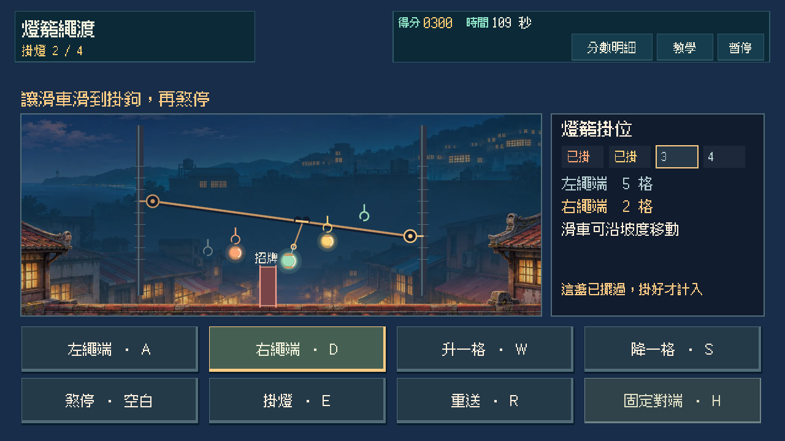

# [SG-56] 實作燈籠繩渡與擺盪越牌

> 狀態：完成

## 內文

### 需求

開放霓虹夜市第三款小遊戲「燈籠繩渡」。玩家切換繩端的控制權，升降兩端、煞停滑車、把四盞燈籠掛到不同高度。緩速升繩可安全繞過招牌，熟練者可讓燈籠擺盪繞過凸角。

### 來源

[小遊戲目錄 game-039](../../design/02-minigames/catalog.md#game-039-燈籠繩渡) 與 2026-11-26 使用者要求接續夜市、提高玩法多樣性與改善操作動態。

### 驗收條件

- [x] 兩端繩高、坡度、煞車及燈擺確實影響滑車和燈籠位置。單人可停車調繩，完成兩套四盞布局。
- [x] 按鍵、滑鼠、觸控與手把可完成回合。畫面能看出所選繩端、掛鉤、碰撞輪廓及燈擺。簡短 Hover 說明升降與煞車，降低動態保留必要操作回饋。
- [x] 用真實擺幅躲過會撞到的招牌，再把同一盞燈掛好並完成四盞可取得小惡魔。安全繞過與重送無法取得此條件。輔助和指定端點 AI 保留此路線。
- [x] 屋頂實際入口、圖解、拍貼、成就和免費補拍可用。局部回歸、原生多尺寸、存檔獨立重啟與 Windows 封裝驗證通過。PM 保留摘要與一張畫面。

### 測試流程

1. 沿夜市斜坡走到屋頂站位，選一套布局，以煞車、升降和緩滑方式掛完四盞。
2. 把最後一盞擺過招牌，核對掛鉤、成功條件及補拍。再試安全繞過、撞擊重送及輔助。
3. 以隔離存檔從獨立執行檔重啟，確認兩種拍貼、原圖與獎勵狀態。

---

# 跟其他票的關係

- Blocks：無
- Blocked by：無
- Related：無

---

# Commit-1

## 內文

夜市屋頂可玩「燈籠繩渡」。玩家升降兩端、用煞車減速，將四盞燈掛到不同高度。安全路線可慢慢抬繩，挑戰需同一盞藉真實擺幅避開招牌，再完成掛燈。燈籠、繩索、碰撞框及掛鉤與實際操作同步。

### 測試結果

| 檢查 | 結果 |
|---|---|
| 規則與操作 | 82 項模型檢查，兩套布局的一般與輔助安全路線及實際越牌均完成四盞。鍵鼠、觸控與手把控制通過。 |
| 局部回歸 | 11 組 Godot、215 項 Python 與五項設計檢查通過。 |
| 800×600 原生視窗 | 正式回合 121 項、獨立重開 27 項。 |
| 1280×720 Windows 內嵌成品 | 正式回合 118 項、獨立重開 27 項。 |
| 1920×1080 Windows 內嵌成品 | 正式回合 118 項、獨立重開 27 項。 |
| Windows 免費補拍 | 實際操作 237 項、獨立重開 24 項。 |

### 截圖

