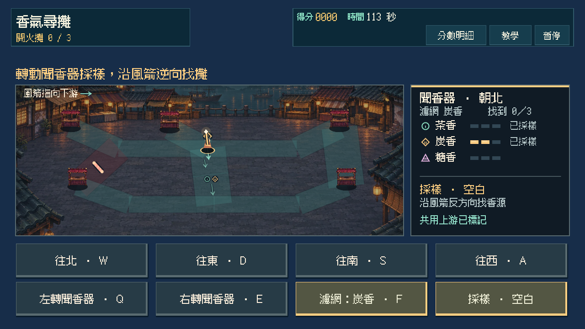

# [SG-58] 實作香氣尋攤與逆風取樣

> 狀態：完成

## 內文

### 需求

開放霓虹夜市第五款小遊戲「香氣尋攤」。玩家自由走巷，轉動聞香筒對準來風，以形狀和紋路分辨三股香氣，找到三個真正開火的攤位。兩套巷道的開閉會改變可走路線與混香位置。

### 來源

[小遊戲目錄 game-041](../../design/02-minigames/catalog.md#game-041-香氣尋攤) 與 2026-11-26 使用者要求延續不同玩法並改善場景、動態和操作。

### 驗收條件

- [x] 玩家可自由前後左右走動、轉筒和切換香型。風向、距離、分流與合流影響讀取，三個開火攤要實際確認，冷攤及封巷有可見提示。
- [x] 鍵盤、滑鼠、觸控與手把可完成。風箭、香型和強度能在無色無聲時讀取，Hover 說明有用操作。
- [x] 在混香段分別記下同一段的兩股香，往共同上游抵達真實合流點並完成三攤，可取得小惡魔。輔助和指定香的幫手可用，兩股獨立讀值不判成功。
- [x] 夜市入口、圖解、拍貼、結算與免費補拍接通。局部回歸、原生多尺寸及 Windows 封裝重開通過，PM 保留摘要和一張畫面。

### 測試流程

1. 在兩套支巷圖走到實際香流，沿相反方向取樣及確認開火源。
2. 比較分開取樣、同段混香取樣、冷攤誤判和封巷回頭。完成一次實際混香挑戰。
3. 以隔離存檔實際遊玩、補拍及獨立重啟，核對拍貼資料。

---

# 跟其他票的關係

- Blocks：無
- Blocked by：無
- Related：無

---

# Commit-1

## 內文

夜市北街開放「香氣尋攤」。風從三個開火攤出發，支巷會改變香流和混香匯口。玩家用形狀、紋路及強度找來源，分別取得同一段兩股香後可走回匯口作標記。墨色石板透出通路，暖光攤位、步伐和聞香方向各有線索，降低動態仍保有風箭和香紋。原生驗證採程式化輸入。

### 測試結果

| 檢查 | 結果 |
|---|---|
| 規則與操作 | 101 項模型檢查。兩套支巷各完成一般／輔助及有無混香的八條路線，另驗分段、正反風向、實際封巷及冷攤。 |
| 局部回歸 | 14 組 Godot、215 項 Python 和五項設計檢查通過。 |
| 800×600 Windows 內嵌成品 | 正式回合 180 項、獨立重開 27 項。 |
| 1280×720 Windows 內嵌成品 | 正式回合 176 項、獨立重開 27 項。 |
| 1920×1080 Windows 內嵌成品 | 正式回合 176 項、獨立重開 27 項。 |
| Windows 免費補拍 | 實際操作 186 項、獨立重開 24 項。 |

### 截圖

